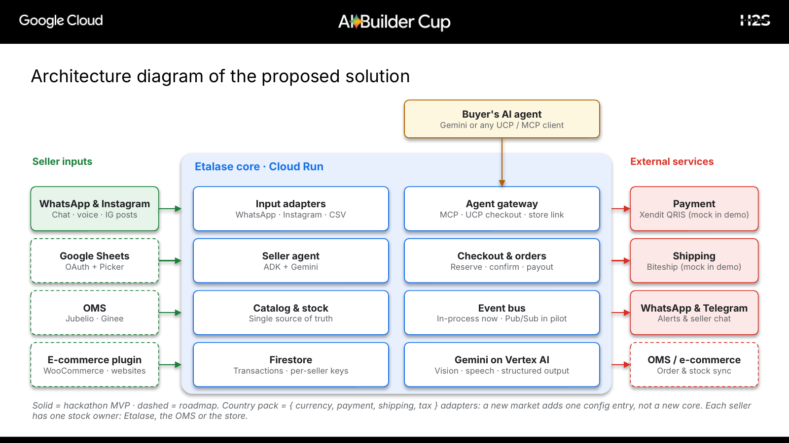
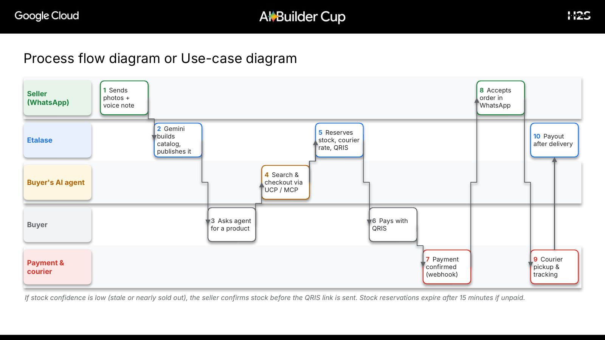
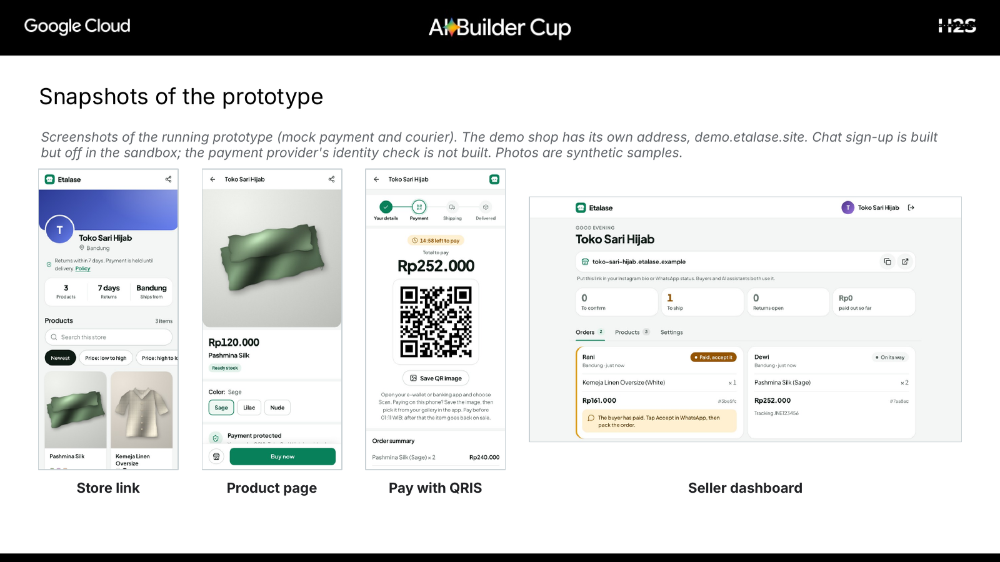

# Etalase

**Make every WhatsApp seller shoppable by AI agents.**

Etalase turns a small seller's product photos and chats into a storefront that AI shopping agents
(Gemini or any MCP client; Etalase also answers Google's Universal Commerce Protocol checkout) can find, check stock on and buy from, with every order landing
back in the seller's chat (WhatsApp, or Telegram if the seller prefers).

It is for sellers who run on chat: they take orders in WhatsApp (or Telegram) and have no store page or checkout of their own to give a buyer or an agent.
Some also list on a marketplace, so Etalase does not assume they have no shop anywhere; it gives them one they own.

Built for the **AI Builder Cup 2026** (Google Cloud, JAPAC), theme **Retail & Commerce: Intelligent
Customer and Business Experiences**.

**Reviewers:** you can try the whole flow without an account in a sandbox where the WhatsApp chat, the payment and the courier are simulated. See [JUDGES.md](JUDGES.md) for the steps and for what is real and what is not.



## Why

- AI shopping is arriving in 2026 (Google's Universal Commerce Protocol, AP2, MCP), but real checkout inside an assistant is still narrow:
  live in the US, started in Australia, and in Indonesia only discovery so far. Agents only see **structured catalogs**, so a seller who
  has none is invisible to them.
- Southeast Asia's e-commerce reached about **US$185B in 2025**, and buying through chat apps is
  normal here. In Indonesia, **95% of e-commerce businesses use messaging apps to sell and 18% use marketplaces**
  (BPS, 2023; businesses can use several channels, so this shows chat is the default order inbox, not that 95% lack a store system).
- Only **11% of small and mid-size merchants** are agent-ready (a global vendor survey), and small sellers keep their catalogs
  in photos, captions and chats, which agents cannot read.
- Marketplaces bring sellers to AI agents only inside their own ecosystem and fees, and WhatsApp's own business AI is moving into
  the conversation. We did not find a tool that builds the catalog from photos and voice notes or holds the payout through a return window.
  Whether sellers will pay for that is not yet tested.

Every number has a source and a quote in [Evidence and sources](docs/15-evidence.md).

More in [Problem and market](docs/01-problem-and-market.md).

## How it works

1. **Seller sends photos and a voice note on WhatsApp** (or optionally connects Instagram or a
   spreadsheet). Gemini builds products, variants, prices and weights, and scores how agent-ready they
   are. The seller taps **Publish**.
2. **A buyer asks their AI agent.** The agent calls Etalase's **MCP server**: search, shipping
   options, checkout. Stock is reserved while the buyer pays with **QRIS**. QRIS is the only payment method
   (no cash on delivery, so a seller never ships an order that is not paid; [ADR 0009](docs/adr/0009-qris-only-no-cod.md)).
   A buyer without an agent opens the seller's **store link** (put it in an Instagram bio or a WhatsApp
   status): the same catalog, a cart (several products of one shop in one order, which agents can also send over MCP, REST and UCP), a short buy form, the QRIS code and an order page, as plain HTML that works on a weak phone connection.
   Each order records the door it came through (store link, MCP, UCP or REST) and a coarse referrer label such as `chatgpt` or
   `instagram`, never a URL or an IP address, so we can see which doors buyers really use.
   With a domain of your own, each shop can also have a short address such as `kopi-tuku.example.com`.
3. **The seller gets the order in WhatsApp** with **Accept** / **Out of stock** buttons and replies
   with a tracking number. A seller can move this to **Telegram** instead (a second channel behind the same
   interface, with no 24-hour window and no per-message fee); WhatsApp stays the default.
4. **Money and returns behave.** The payout is held until delivery plus a return window (72 hours; 168 for a new seller),
   so a buyer can ask for a return (agent tool, or a form on the order page), the seller answers with buttons, and a refund never
   depends on the seller sending money back. The seller's return policy and track record are shown to agents before they buy.
   A parcel the courier brings back or loses is refunded to the buyer in full, and the payout never starts for it.
   After the window the seller is paid, minus a small commission. The rules are published, generated from the same
   settings the money code reads: [`/policy/payouts`](docs/05-checkout-payment-payout.md) (people) and `/policy/payouts.json` (agents).
5. Uncertain stock? **Confirm-first mode** asks the seller before the buyer pays.
6. OMSs, e-commerce plugins and website builders connect through an **OpenAPI Connector API**.



The running prototype (mock payment and courier, synthetic product photos): the store link, a product page, the QRIS payment page and the seller dashboard.



## Run the prototype (no credentials needed)

```bash
cd prototype
pip install -r requirements-dev.txt
python scripts/demo.py          # full end-to-end story in the terminal
pytest -q                       # 627 tests: oversell race, payments, webhook security, OTP abuse
uvicorn etalase.api.main:app --port 8080   # API, MCP at /mcp/, dashboard at /, docs at /docs
```

Without keys, Etalase uses offline parsers, a console WhatsApp outbox and mock payment and
shipping. Add a Gemini key (or Vertex AI), WhatsApp Cloud API, Xendit and Biteship credentials (and, optionally,
a Telegram bot) to switch each part to the real service. See [prototype/README.md](prototype/README.md).

**Only the keys are left to you:** [SETUP.md](SETUP.md) lists every value and where to get it. `make setup` prepares
everything, `make doctor` tests each key against the real service, `make eval` measures extraction accuracy,
`make deploy` ships to Cloud Run from your `.env`, and `make ucp-conformance` runs Google's official UCP conformance
suite against Etalase, and `make e2e` / `make browser` play the whole story over real HTTP and in a real browser (run them from `prototype/`).

## Google Cloud AI usage

| Technology | Used for | Status |
|---|---|---|
| **Gemini on Vertex AI** | Multimodal catalog extraction (photos + voice + text) with structured output; seller and buyer agents | Built; switches on with Vertex AI or an API key (offline parser otherwise) |
| **Agent Development Kit (ADK)** | WhatsApp seller agent with tenant-scoped tools; demo buyer agent using `McpToolset` | Built |
| **Cloud Run** | API, MCP server, webhooks, seller dashboard | Built (deploy script) |
| **Secret Manager** | Session secret, dev and webhook tokens, provider keys | Built (deploy script) |
| **Firestore** | Transactional catalog, stock reservations and orders | Built; demo runs on the in-memory store |
| **Pub/Sub, Cloud Tasks, Cloud Storage, Cloud KMS** | Events, per-order expiry, media, token encryption | Pilot (in-process equivalents today) |
| **MCP / UCP / AP2** | MCP server; UCP business server (profile at `/.well-known/ucp`, Checkout over REST); AP2 payments | MCP and UCP built (official conformance suite: see [docs/16](docs/16-ucp.md)); AP2 roadmap |

## Judging criteria at a glance

| Criterion | Where to look |
|---|---|
| Technical Merit & Gen AI (40%) | [Architecture](docs/03-architecture.md), [Catalog & stock](docs/04-catalog-and-stock.md), [Seller agent](docs/07-whatsapp-seller-agent.md), `prototype/` |
| Problem Alignment & Impact (25%) | [Problem & market](docs/01-problem-and-market.md), [Business model](docs/10-business-model.md) |
| Innovation & Creativity (25%) | [Product](docs/02-product.md), [Integrations](docs/08-integrations.md) |
| User Experience & Solution Design (10%) | [Product](docs/02-product.md), [Wireframes](docs/assets/wireframes.png) |

Full mapping: [Hackathon alignment](docs/14-hackathon-alignment.md).

## Learn the project: Etalase Academy

A VitePress site in [`learn/`](learn/) teaches the whole project from zero to master: agentic
commerce basics, a code tour, security, deployment, every number with its source
([evidence page](learn/business/evidence.md)), a judge Q&A playbook, exercises and a quiz.

```bash
cd learn && npm install && npm run dev     # http://localhost:5173
```

It is published to GitHub Pages by `.github/workflows/learn.yml` (Settings → Pages → Source: GitHub Actions).

## Repository map

```
.
├── README.md
├── SETUP.md                      every key and where to get it, step by step
├── LICENSE
├── docs/                         plan, design and decisions (index: docs/README.md)
│   ├── 01-problem-and-market.md
│   ├── 02-product.md
│   ├── 03-architecture.md        diagrams: components, sequence, data model
│   ├── 04-catalog-and-stock.md
│   ├── 05-checkout-payment-payout.md
│   ├── 06-shipping.md
│   ├── 07-whatsapp-seller-agent.md
│   ├── 08-integrations.md        Sheets, OMS, e-commerce, Connector API, marketplaces
│   ├── 09-security-privacy-compliance.md   PDP Law, payments, tax, known gaps
│   ├── 10-business-model.md
│   ├── 11-roadmap.md            includes the gates to clear before real money moves
│   ├── 12-benchmark-plan.md
│   ├── 13-demo-script.md
│   ├── 14-hackathon-alignment.md
│   ├── 15-evidence.md            every number with its source and quote
│   ├── 16-ucp.md                 what we implement of the Universal Commerce Protocol
│   ├── 17-market-fit-and-direction.md   is the idea still right: verified, partly, unverified
│   ├── adr/                      ten decision records (0001 to 0010)
│   └── assets/
├── learn/                        Etalase Academy (VitePress learning site)
├── prototype/                    Python · FastAPI · ADK · MCP · Cloud Run
│   ├── etalase/                  the application (code map in prototype/README.md)
│   ├── scripts/                  demo.py, e2e_http.py, browser_check.py, deploy_cloud_run.sh
│   ├── tests/                    627 tests
│   ├── evals/                    labelled messages and the extraction scorer
│   ├── ucp_conformance/          runner for Google's official UCP conformance suite
│   └── Dockerfile
└── submission/                   deck (.pptx and .pdf)
```

## Status

Hackathon prototype. It works end to end locally with mocks, and every live integration (Gemini, WhatsApp Cloud API,
Telegram, Xendit QRIS, Biteship, Firestore) is wired and switches on with credentials. **None of them has been exercised
with real traffic yet:** they are covered by contract tests written from the providers' documentation, not by live calls.

Not yet known, and said plainly in the docs: whether a payout hold can be enforced at Xendit, how Bank Indonesia would classify
holding a payout, how accurate Gemini extraction is on real seller messages (49% for the offline baseline, no model measured),
and whether sellers will pay a 4% commission and wait 72 to 168 hours (no seller has been interviewed). Details and the
checks to run first are in [Market fit and direction](docs/17-market-fit-and-direction.md) and in
[Security, privacy and compliance](docs/09-security-privacy-compliance.md#known-gaps-before-a-pilot).

Instagram DM selling is roadmap, not built. Sign-up in chat is built but off by default and never run on live WhatsApp: a stranger picks a unique shop address first,
and the shop stays invisible to buyers and agents until it is verified. The identity and bank check at the payment provider is **not built**: with the mock provider a finished
sign-up is verified at once, with a real one an operator verifies by hand ([ADR 0010](docs/adr/0010-chat-signup-address-first.md)). Each shop address also serves its own UCP
profile, and agents on it see only that shop ([ADR 0008](docs/adr/0008-seller-channels-and-shop-addresses.md)). Importing a seller's existing WhatsApp catalog is not built and not promised
([doc 17](docs/17-market-fit-and-direction.md#what-about-the-catalog-a-seller-already-has)).

## Team

- [Team member 1]: [role]
- [Team member 2]: [role]

## License

[MIT](LICENSE)
