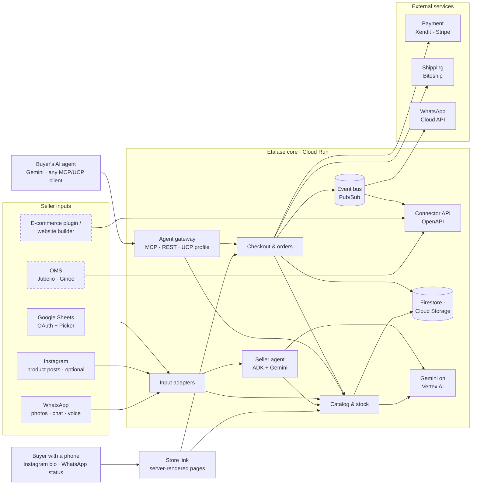
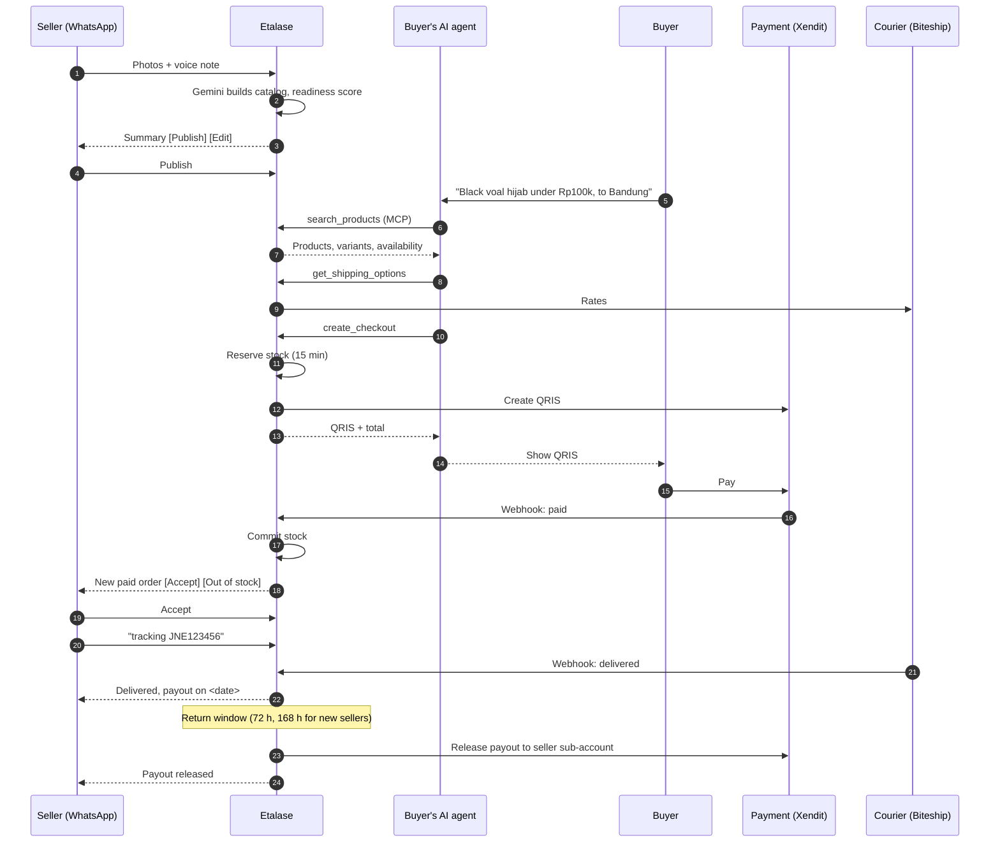

# 3. Architecture

One core, many adapters. The core owns the catalog, stock and orders; adapters connect it to
seller inputs, AI agents and external services. Everything runs on Google Cloud.


## Component view



Dashed boxes are on the roadmap; everything else runs in the prototype.

| Component | Code | Responsibility |
|---|---|---|
| Input adapters / seller inbox | `etalase/seller/inbox.py`, `adapters/messaging.py`, `adapters/telegram.py` | Normalise WhatsApp and Telegram messages (the address says which); buttons are handled deterministically; media is saved and grouped with the next description |
| Seller agent | `etalase/agents/seller_agent.py` | ADK agent with tools scoped to the verified seller (stock, price, catalog, tracking, sales) |
| Catalog & stock | `etalase/catalog/` | Extraction (Gemini or offline rules), normalisation, readiness score, sell mode, search |
| Checkout & orders | `etalase/checkout/service.py` | Reservation, confirm-first, payment, acceptance, shipping, payout hold and release, expiry |
| Returns | `etalase/checkout/returns.py` | Return requests, seller answers, timers (auto-approve, lapse), disputes, refunds, return policy |
| Agent gateway | `etalase/gateway/` | MCP server, REST mirror, UCP profile and Checkout (`ucp.py`), schema.org data |
| Public store link | `etalase/gateway/storefront.py`, `gateway/pages.py` | Server-rendered store page, buy form, pay and order status page, return form, return policy page; calls the same checkout and returns services as an agent. `pages.py` is the one shared look (CSS, layout, QR, progress bar) |
| Instagram import | `etalase/adapters/instagram.py`, `CatalogService.import_instagram` | Optional catalog source: product posts (photo + caption) become drafts via the same extraction |
| Connector API | `etalase/connector/service.py` | Push catalog and stock from OMSs, plugins and builders; signed order webhooks |
| Events | `etalase/events.py` | Decouples checkout from notifications and connectors (Pub/Sub in production) |
| Store | `etalase/store/` | `MemoryStore` (demo, tests) and `FirestoreStore` (transactions) behind one interface |
| Payment / shipping / messaging adapters | `etalase/adapters/` | Xendit, Biteship, WhatsApp Cloud API, Telegram Bot API (a `ChannelRouter` picks the channel from the address), plus mocks for credential-free runs |
| Seller channels and shop addresses | `etalase/seller/channels.py`, `seller/slugs.py`, `gateway/hosts.py` | Link a Telegram chat to a shop, choose the channel, claim a `<slug>.<domain>` address and map the Host header to the shop ([ADR 0008](adr/0008-seller-channels-and-shop-addresses.md)) |
| Country packs | `etalase/config.py` | Currency, payment, shipping and tax profile per market |

## End-to-end sequence



## Data model

```mermaid
erDiagram
  SELLER ||--o{ PRODUCT : sells
  SELLER ||--o{ ORDER : receives
  SELLER ||--o{ CONNECTION : connects
  PRODUCT ||--|{ VARIANT : has
  ORDER ||--|{ ORDER_ITEM : contains
  ORDER ||--o{ RESERVATION : holds
  VARIANT ||--o{ STOCK_CHANGE : logs
  SELLER {
    string id PK
    string whatsapp
    string stock_owner "internal | oms | store"
    string kyc_status "verified at payment provider"
    string payout_account_id "provider sub-account"
  }
  PRODUCT {
    string id PK
    string seller_id FK
    string status "draft | needs_review | published"
    int readiness_score
  }
  VARIANT {
    string id PK
    string sku
    int price
    int weight_gram
    int on_hand "null = not tracked"
    int reserved
  }
  ORDER {
    string id PK
    string status
    string sell_mode "instant | confirm_first"
    int subtotal
    int shipping_fee
    datetime expires_at
  }
  RESERVATION {
    string id PK
    string order_id FK
    int qty
    string status "held | committed | released | restocked"
  }
```



## Adapter contracts

Every external dependency sits behind a small interface, so a new market or provider is a new
adapter, not a change to the core:

```python
class PaymentProvider(Protocol):
    def create_payment(self, order, seller_account_id=None) -> PaymentInfo: ...
    def parse_webhook(self, headers, body) -> tuple[str, str] | None: ...
    def refund(self, order, amount=None) -> None: ...  # raises ManualActionRequired when it cannot refund by API
    def release_to_seller(self, order, seller_account_id, amount, commission) -> str: ...

class ShippingProvider(Protocol):
    def get_rates(self, origin_postal, dest_postal, weight_gram, value) -> list[ShippingRate]: ...
    def book(self, order, origin_name, origin_phone, origin_address) -> Shipment: ...
    def parse_webhook(self, body) -> tuple[str, str] | None: ...

class Messenger(Protocol):
    def send_text(self, to, text) -> None: ...
    def send_buttons(self, to, text, buttons) -> None: ...
    def send_notification(self, to, text, buttons=None, template=None) -> None: ...  # a message Etalase starts
    def download_media(self, media_id, dest_dir) -> str: ...
# `to` is a channel address: a WhatsApp number, or "tg:<chat id>" for Telegram. ChannelRouter picks the adapter.
```

```python
COUNTRY_PACKS = {
    "ID": CountryPack("ID", "IDR", "id-ID", payment_provider="xendit", shipping_provider="biteship", tax_profile="id-ppn"),
}
```

## Design decisions

See [`adr/`](adr/) for the reasoning behind the main choices:

1. [Domestic delivery first](adr/0001-domestic-first.md)
2. [One stock owner per seller](adr/0002-single-stock-owner.md)
3. [Etalase never holds seller funds](adr/0003-never-hold-funds.md)
4. [One agent plus deterministic handlers](adr/0004-one-agent-deterministic-handlers.md)
5. [Adapters and country packs](adr/0005-adapters-and-country-packs.md)
6. [A Connector API with an OpenAPI spec](adr/0006-connector-api.md)
7. [Hold the payout through a return window, and make returns a first-class flow](adr/0007-payout-hold-and-returns.md)
8. [Seller channels (WhatsApp, Telegram) behind one interface, and an address for each shop](adr/0008-seller-channels-and-shop-addresses.md)

## Deployment

| Stage | Setup |
|---|---|
| Hackathon demo | One Cloud Run service (`asia-southeast2`), `STORE_BACKEND=memory`, one instance, Gemini on Vertex AI, mock or test-mode payment and shipping |
| Pilot | `STORE_BACKEND=firestore`, multiple instances, Pub/Sub for events, Cloud Tasks for reservation expiry, Secret Manager for keys, Cloud Storage for media |
| Scale | Separate services for gateway, seller inbox and workers; per-country deployments where data residency requires it |

The MCP endpoint is served at `/mcp/` over streamable HTTP (stateless, JSON responses) so it scales
horizontally on Cloud Run.
