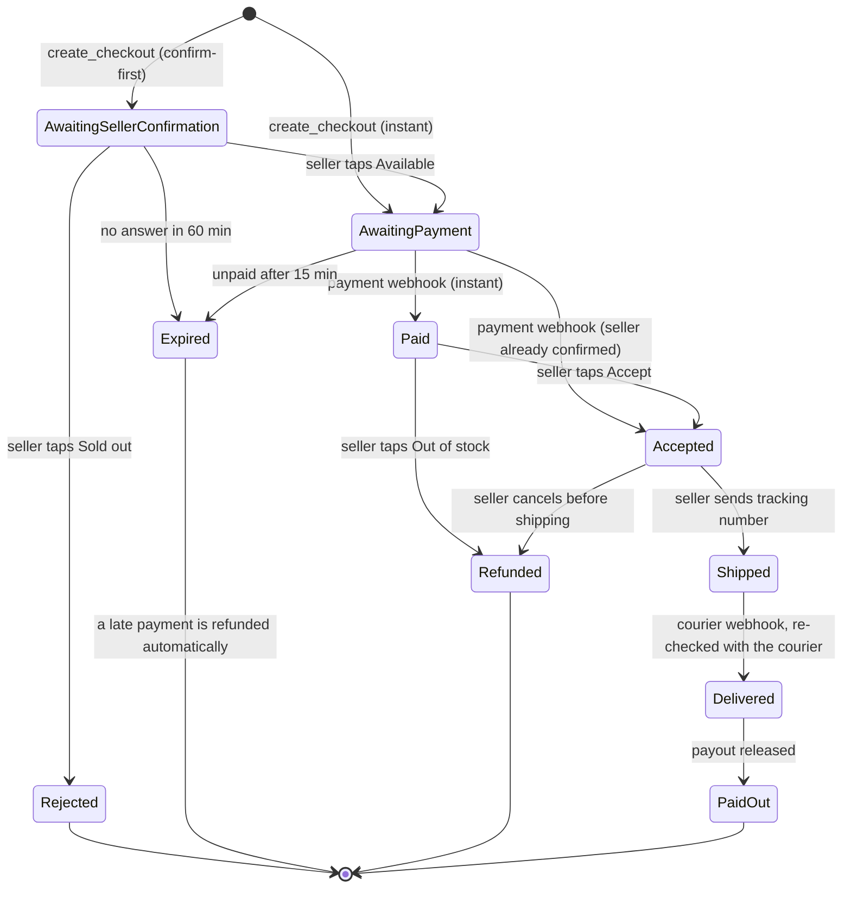

# 5. Checkout, payment and payout

Code: `prototype/etalase/checkout/service.py`, `prototype/etalase/adapters/payment.py`.

## Order states



## Rules

- **Buyers do not register.** They act through their AI agent and pay with QRIS.
- **Sellers must be verified** (KYC at the payment provider) before they can take orders; they can
  build their catalog before that.
- **Domestic only:** the delivery country must equal the seller's country ([ADR 0001](adr/0001-domestic-first.md)).
- **Courier rates** are fetched at checkout; the cheapest rate is used unless the buyer picks a courier.
- **Webhooks are idempotent:** a payment event delivered twice changes nothing the second time.
- **Tenant isolation:** a seller can only confirm, accept, reject or ship their own orders.

## Money flow

Etalase never holds seller funds ([ADR 0003](adr/0003-never-hold-funds.md)).

```
Buyer ──QRIS──► Payment provider (seller's sub-account)
                        │  held until delivery
                        ▼
              split on release: seller amount ──► seller's bank account
                                commission    ──► Etalase
```

- In Indonesia, holding and forwarding other people's money is a regulated payment activity, so
  this is done by a licensed provider (for example Xendit's platform sub-accounts and split rules).
  This needs confirmation with the provider and a legal adviser before the pilot.
- **Payout = subtotal − commission.** The shipping fee goes to the courier.
- **Refunds** happen before release, so Etalase never has to claw money back from a seller.
- Payout bank details are managed at the payment provider and can never be changed by chat.

## Payment providers

| Market | Provider | Methods | Status in prototype |
|---|---|---|---|
| Indonesia | Xendit | QRIS (dynamic), later e-wallets and virtual accounts | QRIS creation and webhook parsing written; refunds and settlement raise `ManualActionRequired` until the account setup is confirmed; the order is then marked `refund_pending` / `pending_manual` and an `ops.manual_action` alert is logged for an operator. Demo uses `MockPayment` |
| Singapore, Australia and other Stripe markets | Stripe | Cards, local methods | Planned adapter |

Why not Stripe in Indonesia: Stripe Indonesia is invite-only, supports only bank transfer (virtual
account) and IDR, and does not offer QRIS or local e-wallets.

## Commission and pricing

- 4% of the order subtotal in the prototype (`COMMISSION_RATE`), charged only when an order is
  delivered. No monthly fee, no listing fee.
- Commission is a service and is subject to VAT once Etalase is VAT-registered; see
  [business model](10-business-model.md#tax).
