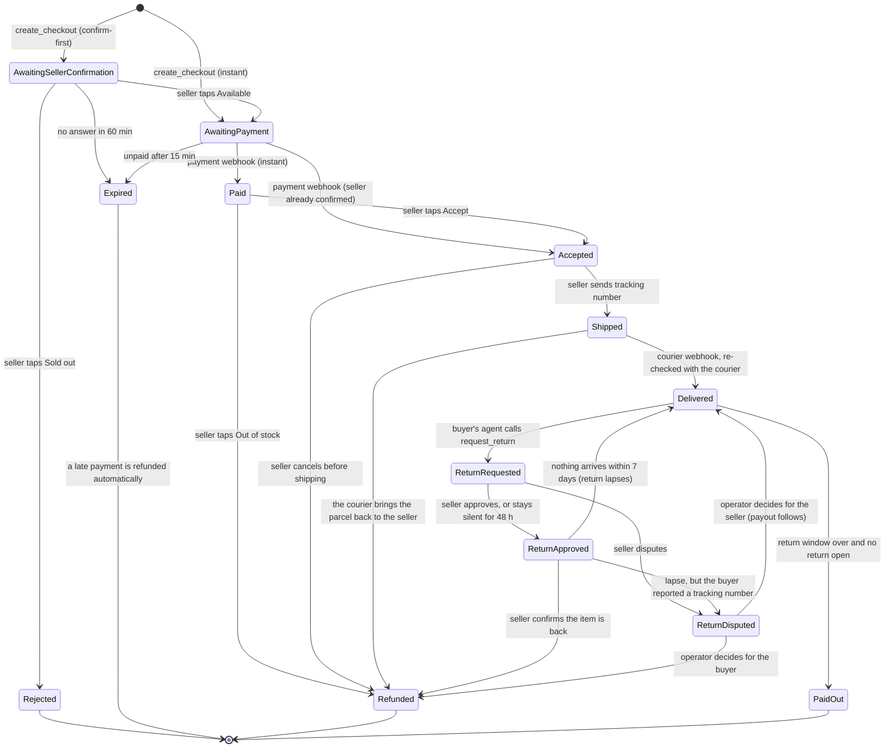

# 5. Checkout, payment and payout

Code: `prototype/etalase/checkout/service.py` (orders, payout hold), `prototype/etalase/checkout/returns.py` (returns), `prototype/etalase/adapters/payment.py`.

## Order states



## Rules

- **Buyers do not register.** They act through their AI agent and pay with QRIS.
- **Sellers must be verified** (KYC at the payment provider) before they can take orders; they can
  build their catalog before that.
- **Domestic only:** the delivery country must equal the seller's country ([ADR 0001](adr/0001-domestic-first.md)).
- **Courier rates** are fetched at checkout; the cheapest rate is used unless the buyer picks a courier.
- **Webhooks are idempotent:** a payment event delivered twice changes nothing the second time.
- **Tenant isolation:** a seller can only confirm, accept, reject, ship, or answer a return on their own orders.
- **The money waits for the return window.** Delivery starts a clock; the seller is paid when it ends and no return is open (below).

## Money flow

Etalase never holds seller funds ([ADR 0003](adr/0003-never-hold-funds.md)).

```
Buyer ──QRIS──► Payment provider (seller's sub-account)
                        │  held until delivery + the return window
                        ▼
              split on release: seller amount ──► seller's bank account
                                commission    ──► Etalase
```

- In Indonesia, holding and forwarding other people's money is a regulated payment activity, so
  this is done by a licensed provider (for example Xendit's platform sub-accounts and split rules).
  This needs confirmation with the provider and a legal adviser before the pilot.
- **Payout = subtotal − commission.** The shipping fee goes to the courier.
- **Refunds** happen before release, so Etalase never has to claw money back from a seller. That is the reason for the
  hold below: a refund after the payout would need money taken back from a seller's bank account, which works only if the seller cooperates.
- Payout bank details are managed at the payment provider and can never be changed by chat.

## Payout hold and returns

[ADR 0007](adr/0007-payout-hold-and-returns.md) has the reasoning and the facts behind it. In short:

**The hold.** When the courier confirms delivery (re-checked with the courier), the order becomes `delivered` and
`payout_due_at = delivered_at + hold`. The hold is `PAYOUT_HOLD_HOURS` (default 72) for a seller with at least
`NEW_SELLER_ORDERS` (5) completed orders and `NEW_SELLER_HOLD_HOURS` (168) for a newer seller. `0` pays at delivery and
switches returns off (the doctor warns about it). The background job (`AppContext.process_due`, called every minute and by
`POST /tasks/expire`) runs three steps in this order: expire unpaid checkouts, run the return timers, release due payouts.

**What the buyer's agent can do.** Inside the window, `request_return` (MCP tool, or `POST /agent/v1/checkouts/{id}/return`) with the
checkout id, the phone used at checkout (the id alone is not enough), a reason, an optional note and up to five https photo links:

| Reason | Always allowed | Refund | Return shipping |
|---|---|---|---|
| `damaged`, `wrong_item`, `not_as_described` | Yes, inside the window | The full amount paid, shipping included | Buyer pays; **Etalase does not reimburse it in this version** |
| `changed_mind` | Only if the seller opted in (`Seller.return_policy`) | Product price only | Buyer pays |

**Open decision: return shipping.** In this version the buyer always pays to send the item back, even for a defective item, and nothing reimburses it
(the policy shown to agents says so: `return_shipping`). That is the simplest rule to build and to state, but it is harsh for a damaged item. Options for
the next version: the seller reimburses a defect return from the held payout, a prepaid return label (Biteship), or a fixed allowance. It needs seller
and buyer interviews before it is decided ([doc 17](17-market-fit-and-direction.md)).

**What happens next.**

1. The seller gets **Approve return / Dispute** buttons on WhatsApp (a template when the 24-hour window is closed).
   Silence for `RETURN_SELLER_RESPONSE_HOURS` (48) counts as approval.
2. Approved: the buyer sends the item back and the agent may report the courier tracking number (`submit_return_tracking`).
   The seller taps **Item received** and the buyer is refunded. A damaged item is not put back in stock automatically (the seller
   inspects it); a change-of-mind item is.
3. Nothing arrives within `RETURN_LAPSE_DAYS` (7): the return lapses and the seller is paid. If the buyer had reported a tracking number,
   an operator looks at it instead.
4. Dispute: the order is frozen and an `ops.manual_action` alert is raised. The operator lists them with `GET /tasks/disputes` and decides with
   `POST /tasks/resolve-dispute` (`refund` or `release`), both behind `WEBHOOK_TOKEN`.
5. If the courier brings the parcel back to the seller (Biteship `returned`), the buyer is refunded automatically and the stock restored;
   a parcel the courier marks `failed` raises an operator alert once.

While any return is open (`return_requested`, `return_approved`, `return_disputed`) the payout cannot be claimed. A refund and a payout can never
both happen to the same order: each transition is one atomic claim (`Store.update_order`).

**What the agent sees.** `get_checkout_status` says until when a return can be requested (`return.can_request_until`) and what to do next.
Every product result carries `seller.return_policy` (window, accepted reasons, refund rules, the seller's note) and
`seller.track_record` (`orders_completed`, `returns_refunded`). The same policy is published as a UCP `refund_policy` link, as schema.org
`MerchantReturnPolicy` in `/stores/{id}/products.jsonld`, and as a page at `/stores/{id}/returns` (`.json` for machines).

**Seller settings.** Sellers choose only whether to accept a change of mind, plus a short note: by WhatsApp ("accept returns for change of
mind" / "terima retur berubah pikiran"), through the seller agent, or `PUT /api/me/return-policy`.

| Setting | Default | Meaning |
|---|---|---|
| `PAYOUT_HOLD_HOURS` | 72 | Payout delay after delivery = return window; 0 = off |
| `NEW_SELLER_HOLD_HOURS` / `NEW_SELLER_ORDERS` | 168 / 5 | Longer hold until a seller has this many completed orders |
| `RETURN_SELLER_RESPONSE_HOURS` | 48 | Seller silence after this counts as approval |
| `RETURN_LAPSE_DAYS` | 7 | An approved return that has not arrived by then lapses |

**Not solved yet, said plainly.**

- The Xendit adapter still raises `ManualActionRequired` for refunds and settlement, so a refund is recorded as `payment.status = refund_pending`
  and an operator sends it. Xendit's own pages disagree on how long a QRIS payment can be refunded (7 or 30 days) and on partial refunds, and the
  payment fee and VAT come back only on a full refund within 24 hours, so a return refund usually comes after that. Confirm with Xendit.
- Whether xenPlatform can keep a seller's balance unreleased for the hold is not verified with Xendit.
- Who bears the courier cost of a parcel that comes back is a policy choice not yet made; today the buyer is refunded in full.
- Buyers get no push notification: the buyer's agent polls `get_checkout_status`.

## Payment providers

| Market | Provider | Methods | Status in prototype |
|---|---|---|---|
| Indonesia | Xendit | QRIS (dynamic), later e-wallets and virtual accounts | QRIS creation and webhook parsing written; refunds and settlement raise `ManualActionRequired` until the account setup is confirmed; the order is then marked `refund_pending` / `pending_manual` and an `ops.manual_action` alert is logged for an operator. Demo uses `MockPayment` |
| Singapore, Australia and other Stripe markets | Stripe | Cards, local methods | Planned adapter |

Why not Stripe in Indonesia: Stripe Indonesia is invite-only, supports only bank transfer (virtual
account) and IDR, and does not offer QRIS or local e-wallets.

## Commission and pricing

- 4% of the order subtotal in the prototype (`COMMISSION_RATE`), charged only when the payout is released (after
  delivery and the return window), never on a refunded order. No monthly fee, no listing fee.
- Commission is a service and is subject to VAT once Etalase is VAT-registered; see
  [business model](10-business-model.md#tax).
