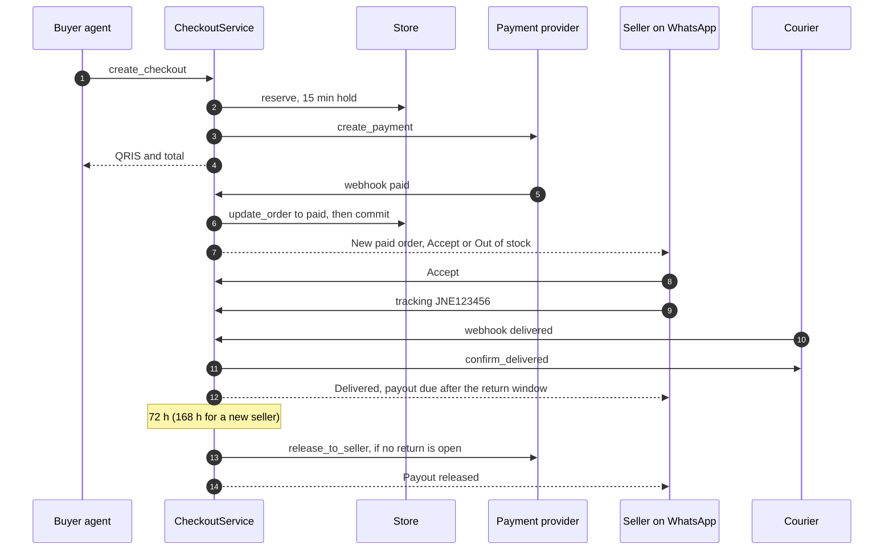
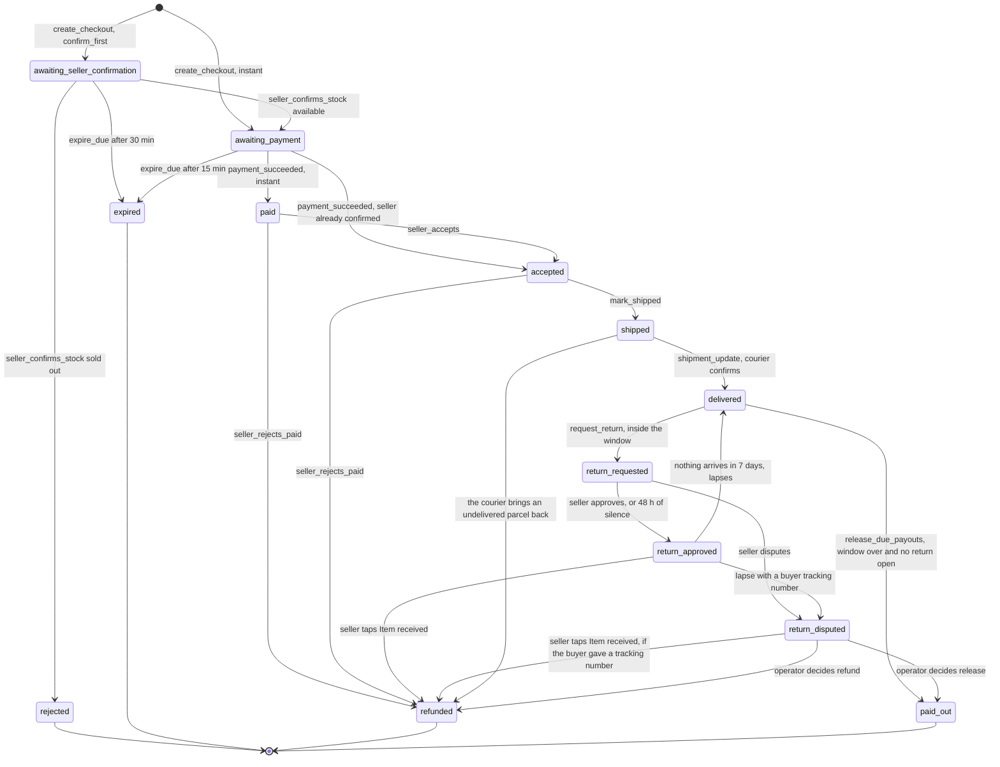
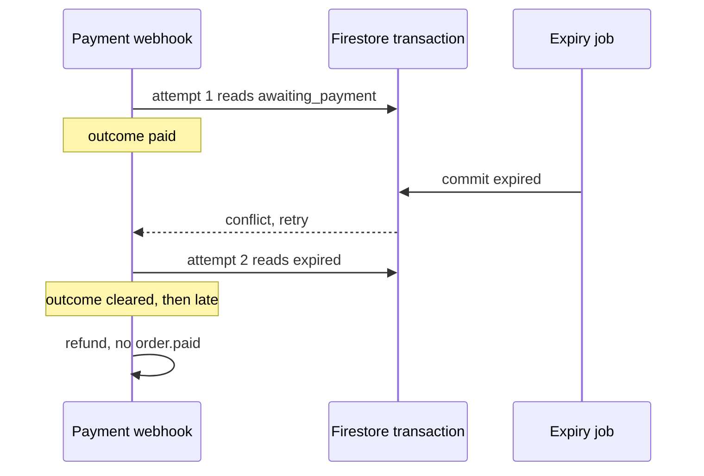

# Checkout and orders

`CheckoutService` takes an order from an agent's `create_checkout` call to the seller's payout, and every step is written so that duplicate webhooks, races with the expiry job and provider failures cannot move stock or money twice.

::: tip What you will learn
- What `create_checkout` validates, and how it reserves stock and requests a QRIS payment
- How confirm-first orders work, and how payment webhooks stay idempotent, including late payments
- How sellers accept, reject, ship, and how delivery is verified before the return window starts
- How the payout hold doubles as the buyer's return window, and the return state machine
- The payout and commission math, with the demo's real numbers
- The exact order state machine, and what happens when a provider step needs a human
:::

## Concepts first

- **Reservation.** When an agent starts a checkout, the units are held (`reserved`) for a limited time, so nobody else can buy them while the buyer pays.
- **QRIS.** Indonesia's national QR payment standard. The buyer scans one code with any banking or e-wallet app. Etalase asks the payment provider to create a *dynamic* QRIS for the exact total.
- **Webhook.** The provider calls our URL when something happens ("paid", "delivered"). Providers retry, so the same event may arrive twice. Handlers must be **idempotent**: the second delivery changes nothing.
- **Retry-safe callback.** Firestore runs a transaction function again when another write conflicts with it. Any code inside the callback may therefore run more than once, and only the last run counts. Callbacks must not leave traces of earlier runs behind.
- **Confirm-first.** When stock is uncertain, the seller confirms before the buyer gets a payment code. No money is taken for an item that may not exist.
- **No buyer payments in Etalase's own account** (ADR 0003, `docs/adr/0003-never-hold-funds.md`). Money goes to the seller's sub-account at the provider. Etalase tells the provider when to release it and how much commission to split off. This is a design statement, not a legal conclusion: whether the provider can enforce the hold and how the activity is classified are unconfirmed.

| Part | Status |
|---|---|
| `CheckoutService` (all paths below) | <Badge type="tip" text="Built" /> |
| `MockPayment`, `MockShipping` (demo and tests) | <Badge type="warning" text="Mocked in demo" /> |
| `XenditPayment.create_payment` and webhook parsing; `BiteshipShipping` rates, booking, tracking | <Badge type="tip" text="Built" />, field names to verify against live APIs |
| Xendit refunds and xenPlatform payouts | Raise `ManualActionRequired`; an operator finishes them (manual by design for now) |
| One Cloud Task per order for expiry | <Badge type="info" text="Roadmap" /> |

## The happy path



## Order states

This diagram matches `checkout/service.py` transition by transition. State names are the `OrderStatus` values.



Details the diagram cannot show:

- A payment that arrives for an `expired` order keeps the status `expired`; only `payment.status` changes (`paid_late`, then `refunded` or `refund_pending`).
- If the payout needs manual action, the order stays `delivered` with `payout.status == "pending_manual"`.
- `delivered` is no longer the moment the seller is paid: it sets `delivered_at` and `payout_due_at = delivered_at + hold`. The payout runs from a sweep (`release_due_payouts`) once that time has passed and no return is open.
- The shipment has its own `shipment.status` (`picked_up`, `booked`, `in_transit`, `delivered`, `returned`, ...). Once it is `delivered` or `returned` it never moves backwards.
- If `create_checkout` fails (validation, no stock, payment creation error), no order is saved at all.

## Code tour

All excerpts are from **`prototype/etalase/checkout/service.py`** unless noted.

### 1. Validation and limits

Agents pass user-typed data straight through, so `create_checkout` checks everything before touching stock:

| Check | Rule | Error text starts with |
|---|---|---|
| Quantity | 1 to `max_qty_per_order` (10) | `quantity must be at least 1`, `at most 10 units` |
| Product | Exists and `published` | `product not found` |
| Seller | `kyc_status == "verified"` | `this seller is not accepting orders yet` |
| Destination | In `product.ships_to` and in `COUNTRY_PACKS` | `shipping to SG is not available (domestic delivery only)` |
| Buyer (`validate_buyer`) | Name required; name ≤ 80, address ≤ 200, city ≤ 60 chars; phone 8 to 15 digits; address ≥ 5 chars; 5-digit postal code for ID | various |
| Rate limit | `max_checkouts_per_buyer_per_hour` (5) per phone number | `too many checkouts for this phone number` |

The rate limit applies to every path (MCP, REST, tests), because it lives in the service.

### 2. Rates and the order

```python
rates = self.shipping.get_rates(seller.origin.postal_code if seller.origin else "", buyer.postal_code,
                                max(1, v.weight_gram) * qty, v.price * qty)
if courier:
    chosen = [r for r in rates if r.courier == courier.lower()]
    if not chosen:
        raise CheckoutError(f"courier {courier} is not available; options: {', '.join(sorted({r.courier for r in rates}))}")
    rates = chosen
if not rates:
    raise CheckoutError("no courier serves this route")
rate = min(rates, key=lambda r: r.price)
```

The cheapest rate wins. If the buyer names a courier that is not offered, checkout fails with an error that lists the couriers that are, for example `courier pigeon is not available; options: jne, jnt, sicepat`. An agent can read that and retry; silently switching couriers would charge the buyer for a service they did not choose (`test_unknown_courier_is_an_error_not_a_silent_fallback`). The order stores `subtotal = price × qty`, `shipping_fee`, and `total = subtotal + shipping_fee`. The hold lasts `reservation_ttl_minutes` (15) for instant orders and `seller_confirm_timeout_minutes` (30) for confirm-first orders.

### 3. Reservation and payment creation

```python
try:
    self.store.reserve(order.id, product.id, v.id, qty, order.expires_at)
except OutOfStock as e:
    raise CheckoutError(f"not enough stock: {e}") from e
order.log(f"created in {mode.value} mode, stock reserved")

if mode == SellMode.INSTANT:
    try:
        order.payment = self.payment.create_payment(order, seller.payout_account_id)
    except Exception as e:  # never leave units held for a checkout that cannot be paid
        self.store.release(order.id)
        log.exception("create_payment failed for %s", order.id)
        raise CheckoutError("payment is temporarily unavailable, please try again") from e
    order.log("payment requested")
    self.store.put_order(order)
    self.events.publish("order.awaiting_payment", {"order_id": order.id})
else:
    self.store.put_order(order)
    self.events.publish("order.awaiting_confirmation", {"order_id": order.id})
```

Order matters: reserve first (so the stock exists), then payment, and on payment failure release the hold. `test_failed_payment_creation_releases_stock` proves no units stay stuck. `XenditPayment` passes `for-user-id` so the money lands in the seller's sub-account, and sets the QR's `expires_at` to the order's, so the code dies with the reservation.

### 4. Confirm-first

The seller receives "Quick stock check" with [Available] and [Sold out] buttons (button ids `confirm:<order>` and `oos:<order>`). `seller_confirms_stock` handles both:

- **Sold out:** an `update_order` moves the order to `rejected` only if it is still awaiting confirmation; then the hold is released and, if Etalase owns the seller's stock (`stock_owner == internal`), the variant's stock is set to 0 (source `seller_confirmation`), because the seller just said it is gone. Confirm-first only happens for internal stock, so in practice this always applies here; the check keeps the rule identical to `seller_rejects_paid`.
- **Available:** a new deadline (now + 15 min) is chosen, the payment is created *first*, and only then an `update_order` claims the transition to `awaiting_payment` with `seller_confirmed = True`. If it wins, `extend` moves the reservation deadline so the hold lives as long as the QR code.

```python
won = {}

def confirm(o: Order) -> bool:

    won.clear()  # Firestore may run a transaction callback more than once
    if o.status != OrderStatus.AWAITING_SELLER_CONFIRMATION:
        return False  # expired or answered meanwhile
    o.seller_confirmed, o.status, o.expires_at, o.payment = True, OrderStatus.AWAITING_PAYMENT, expires_at, payment
    o.log("seller confirmed stock, payment requested")
    won["yes"] = True
    return True

updated = self.store.update_order(order.id, confirm)
if won:
    self.store.extend(order.id, expires_at)  # the hold must outlive the QR code
    self.events.publish("order.awaiting_payment", {"order_id": order.id})
return updated
```

`test_confirm_first_hold_follows_the_new_deadline` checks that the hold now ends after 15 minutes, not 60. The inbox looks at the **returned** order before replying: only `awaiting_payment` with `seller_confirmed` gets "Great, the buyer has been sent the QRIS payment code." Anything else (the order expired, or the seller already tapped Sold out) gets `order_closed`: "This order is already expired, so nothing was sent to the buyer." (`test_late_available_tap_does_not_claim_payment_was_sent`).

### 5. Payment webhook

```python
outcome = {}

def pay(o: Order) -> bool:
    outcome.clear()  # Firestore may run a transaction callback more than once
    if o.status == OrderStatus.AWAITING_PAYMENT:
        o.payment.status = "paid"
        # In confirm-first mode the seller already confirmed, so the order is accepted.
        o.status = OrderStatus.ACCEPTED if o.seller_confirmed else OrderStatus.PAID
        o.log("payment received")
        outcome["paid"] = True
        return True
    if o.status == OrderStatus.EXPIRED and o.payment and o.payment.status == "pending":
        o.payment.status = "paid_late"  # paid after the hold ended: stock is gone, give the money back
        o.log("payment arrived after expiry, refunding")
        outcome["late"] = True
        return True
    return False  # duplicate webhook

order = self.store.update_order(found.id, pay)
if outcome.get("paid"):
    self.store.commit(order.id)
    self.events.publish("order.paid", {"order_id": order.id})
elif outcome.get("late"):
    order = self._refund(order, "late payment")
```

Idempotency comes from the status check inside the atomic `update_order`: the second "paid" webhook finds `paid`, returns `False`, and nothing happens. A payment for an expired order is refunded automatically (`test_late_payment_after_expiry_is_refunded`), because its units may already be sold to someone else.

**Why `outcome.clear()` matters.** The side effects (commit stock, publish `order.paid`, refund) happen *after* `update_order`, based on what the callback wrote into `outcome`. On Firestore, the callback can run twice: picture a payment and the expiry job racing. The first attempt reads the order while it is still `awaiting_payment` and sets `outcome["paid"]`; the transaction conflicts with the expiry write and is retried; the retry reads `expired` and sets `outcome["late"]`. Without the `clear()`, both flags survive, `"paid"` is checked first, and Etalase would tell the seller to ship an expired order and never refund the buyer. With it, only the attempt that actually commits leaves a flag. Every callback that writes to an outer dict (`confirm`, `pay`, `accept`, the `reject` in `seller_rejects_paid`, `update` in `shipment_update`, `expire`) starts with the same line. `MemoryStore` runs each callback once, so `tests/test_regressions.py` simulates the retry with a `RetryingStore` wrapper (`test_late_payment_is_refunded_even_with_retries`).



The HTTP side is in `api/main.py`: `/webhooks/payment` asks the provider adapter to parse and authenticate the call (Xendit's `x-callback-token`, or our `WEBHOOK_TOKEN` for the mock), then calls `payment_succeeded`.

### 6. Seller accepts or rejects

- `seller_accepts`: `paid` → `accepted`, emits `order.accepted`. Confirm-first orders skip this; they are already `accepted` on payment.
- `seller_rejects_paid` (the [Out of stock] button, or `rejected` from the Connector API): `paid` or `accepted` → `refunded`, then `restock` (put the committed units back), then, only if Etalase owns the stock, set the variant to 0 (source `seller_rejection`), then `_refund`. Refunds happen before any payout, so money never has to be clawed back from a seller.

```python
self.store.restock(order.id)
seller = self.store.get_seller(seller_id)
if seller and seller.stock_owner == StockOwner.INTERNAL:  # an OMS or store owns its own stock
    for item in order.items:
        self.store.set_stock(seller_id, item.product_id, item.variant_id, 0, "seller_rejection")
order = self._refund(order, "seller out of stock")
```

The ownership check follows ADR 0002 (one stock owner per seller). When an OMS or a store owns the stock, it will send the true number through the Connector API; Etalase must not overwrite it with 0 (`test_rejection_does_not_touch_stock_owned_by_an_oms`).

Both start with `_seller_order(seller_id, order_id)`, which says "order not found" for another seller's order.

### 7. Shipping

`mark_shipped(seller_id, order_id, waybill)` has two modes:

| Mode | Trigger | Shipment |
|---|---|---|
| Seller's own waybill | Seller types `tracking JNE123456` (no order id: the oldest `accepted` order is used) | Waybill must match `[A-Z0-9-]{6,40}`; status `picked_up` |
| Booked by Etalase | No waybill, for example Connector API `shipped` without one | `shipping.book(...)` (Biteship `POST /v1/orders`); status `booked` |

The transition itself is again a guarded `update_order` from `accepted` to `shipped`.

### 8. Delivery verification

```python
if status == "delivered":
    # Money moves because of delivery, so the webhook is only a hint: ask the courier first.
    if found.status != OrderStatus.SHIPPED or not self.shipping.confirm_delivered(found):
        log.warning("delivery for %s not confirmed by the courier; ignoring", found.id)
        return found
```

`BiteshipShipping.confirm_delivered` looks up public tracking by waybill and courier; a forged webhook or a made-up waybill cannot release money (`test_unconfirmed_delivery_does_not_release_money`). `MockShipping.confirm_delivered` always returns `True`, which is one reason `prod` refuses mock adapters.

Courier events can also arrive late or out of order. The update callback refuses to move a finished shipment backwards:

```python
def update(o: Order) -> bool:

    delivered.clear()  # Firestore may retry callbacks
    if o.shipment.status in ("delivered", "returned"):
        return False  # late or out-of-order courier events never move status backwards
    o.shipment.status = status
    if status == "delivered" and o.status == OrderStatus.SHIPPED:
        o.status = OrderStatus.DELIVERED
        o.log("delivered (confirmed with courier)")
        delivered["yes"] = True
    return True
```

`test_shipment_status_never_goes_backwards` sends `delivered` and then `in_transit` for the same waybill; the shipment stays `delivered`, and the order stays `delivered` until the window is over and then becomes `paid_out`. The webhook key can be an order id or a waybill; `_order_by_waybill` finds a waybill by scanning the orders of every seller that has products (a prototype shortcut; production would query an index on `shipment.waybill`).

### 9. The payout hold, payout and commission

```python
def hold_hours(self, seller) -> int:
    s = self.settings
    if s.payout_hold_hours <= 0:
        return 0
    done = sum(1 for o in self.store.list_orders(seller.id) if self.completed(o))
    return max(s.payout_hold_hours, s.new_seller_hold_hours) if done < s.new_seller_orders else s.payout_hold_hours
```

When the courier confirms delivery, the order gets `delivered_at` and `payout_due_at = delivered_at + hold_hours(seller)`. The hold is 72 hours (`PAYOUT_HOLD_HOURS`), or 168 hours for a seller with fewer than 5 completed orders (`NEW_SELLER_ORDERS`). `0` pays at once and switches returns off. **The hold is also the buyer's return window**, so a refund never needs money clawed back from a seller's bank account. The terms are copied onto the order at checkout (`Order.return_terms`), so changing the policy later never changes an order already placed.

Then the background job (`AppContext.process_due`, every 60 seconds and on `POST /tasks/expire`) runs three guarded steps in this order: expire unpaid checkouts, run the return timers (`ReturnService.sweep`), release due payouts (`release_due_payouts`). One broken order is logged and skipped; it never stops the others.

```python
rate = seller.commission_rate if seller.commission_rate is not None else self.settings.commission_rate
commission = round(order.subtotal * rate)
seller_amount = order.subtotal - commission  # the shipping fee goes to the courier
```

Commission is 4% of the **subtotal** by default (per-seller override possible), charged **only when the payout is released**, so a refunded order earns nothing. A first `update_order` *claims* the payout by writing `Payout(status="releasing")`; only the caller that wins the claim calls `release_to_seller`. That prevents a double release (`test_manual_payout_when_provider_is_not_automated` calls `release_payout` twice). A return that is open (`return_requested`, `return_approved`, `return_disputed`) is a different status from `delivered`, so the sweep cannot pay it.

### 10. Expiry

`expire_due(when)` loads held reservations whose `expires_at <= when`, and for each order runs a guarded update: only `awaiting_payment` or `awaiting_seller_confirmation`, and only if `order.expires_at` has not been extended past `when`. Expired (or rejected) orders get their hold released. In the prototype, the app's lifespan task calls it every 60 seconds; `POST /tasks/expire` (with `WEBHOOK_TOKEN`) lets Cloud Scheduler call it. A paid order is never expired (`test_expiry_never_cancels_a_paid_order`).

### 11. Returns (`checkout/returns.py`)

`ReturnService` is the other half of the hold. Every transition is one guarded `update_order`, with the same "callback may run again, so it must be idempotent" rule as the rest of the file.

| Step | Who | What the code checks | Result |
|---|---|---|---|
| `request(order_id, phone, reason, note, evidence)` | The buyer's agent, or the buyer on the order page | Checkout id **and** the buyer's phone (a wrong phone gets the same "checkout not found" as an unknown id), status `delivered`, inside the window, reason allowed under the order's `return_terms`, note up to 500 characters, up to 5 `https` links (stored, never fetched) | `return_requested`; the seller gets **Approve return / Dispute** |
| `seller_responds(approve)` | The seller, scoped to their own orders (`_seller_order`) | Only on `return_requested` | `return_approved` or `return_disputed` |
| `add_return_tracking` | The buyer's agent | Phone again; waybill format | Tracking stored; changes what a lapse does |
| `seller_received` | The seller | Only on `return_approved` (or on `return_disputed` when the buyer gave a tracking number) | Refund first, then restock only a change-of-mind item (a damaged one is inspected first); `refunded` |
| `sweep(when)` | The clock | 48 h without an answer counts as approval; 7 days without the parcel lapses to `delivered` (payout continues), or to `return_disputed` plus an operator alert if the buyer gave a tracking number | Timers, never a person |
| `resolve_dispute` | An operator (`POST /tasks/resolve-dispute`, behind the `X-Etalase-Operator-Token` header) | `refund` or `release` | `refunded` or `paid_out` |

Refund amount: the full total (shipping included) for `damaged`, `wrong_item` and `not_as_described`; the subtotal only for `changed_mind`, which exists only if the seller opted in. The buyer pays the return shipping and Etalase does not reimburse it in this version (an open decision, [ADR 0007](https://github.com/galihsatriawan/etalase/blob/main/docs/adr/0007-payout-hold-and-returns.md)). `XenditPayment.refund` still raises `ManualActionRequired`, so a refund becomes `payment.status = "refund_pending"` and an operator sends it. This is separate from what the courier reports about the parcel itself. `shipment_update` maps Biteship's statuses onto ours and money moves only after the courier's own tracking record agrees with the webhook:

| Biteship | Ours | Money |
|---|---|---|
| `delivered` | `delivered` | The return window starts; the payout follows when it ends (`confirm_delivered`) |
| `return_in_transit` | `returning` | None. The order page and `next_step` say the parcel is coming back |
| `returned` | `returned` | Refund in full, restock, tell the seller (`confirm_returned`, only from `shipped`) |
| `disposed` | `lost` | Refund in full, no restock, tell the seller to claim insurance (`confirm_lost`); the payout never happens |
| `cancelled`, `rejected`, `courier_not_found` | `failed` | None; one operator alert |

Late or repeated events change nothing: `delivered`, `returned` and `lost` are final, and a stale "in transit" cannot undo `returning`. A webhook can also be lost, or arrive before the courier's own tracking agrees and be ignored, so `reconcile_shipments` (a step of the background job) asks the courier again about every parcel still `shipped`, once per `SHIPMENT_RECHECK_HOURS`, and feeds what it learns through the same checks. Who bears a lost parcel is still a policy choice: today the buyer is refunded and the seller carries the loss.

Two properties to keep when you change this code: **refund and payout can never both happen** (each is an atomic claim on the same order), and a refund is recorded **before** the stock is restored, so a crash cannot restock an item whose refund was never recorded.

## When a human must finish the job

`ManualActionRequired` (in `adapters/payment.py`) means "the provider step is not automated for this account yet". `XenditPayment.refund` and `XenditPayment.release_to_seller` always raise it today. A provider can also fail in ways nobody planned for (a timeout, a 500, a changed field name). Etalase treats **any** exception from these two calls the same way: money must never be lost track of.

```python
def _refund(self, order: Order, reason: str) -> Order:
    try:
        self.payment.refund(order)
        status, note = "refunded", f"refunded ({reason})"
    except Exception as e:  # ManualActionRequired or a provider error: never lose track of the money
        if not isinstance(e, ManualActionRequired):
            log.exception("refund failed for %s", order.id)
        status, note = "refund_pending", f"manual refund required ({reason}): {e}"
        self.events.publish("ops.manual_action", {"order_id": order.id, "action": "refund"})
    # ...
```

| Step | What the code does | Visible result |
|---|---|---|
| Refund (seller rejection or late payment) | Catches any exception, publishes `ops.manual_action` with `action: "refund"` | `payment.status = "refund_pending"`, order status unchanged |
| Payout | Catches any exception, publishes `ops.manual_action` with `action: "payout"` | Order stays `delivered`, `payout.status = "pending_manual"` |

`ops.manual_action` is one of the topics in `events.TOPICS`, and **`prototype/etalase/container.py`** subscribes a handler to it:

```python
# Pilot: page the on-call operator (Pub/Sub -> alert). Prototype: an ERROR log line, visible in Cloud Logging.
events.subscribe("ops.manual_action", lambda e: log.error("MANUAL ACTION REQUIRED: %s for order %s",
                                                          e.get("action"), e.get("order_id")))
```

So today a human finds out through an ERROR line in Cloud Logging. For the pilot, that line should page an operator (a log-based alert, or Pub/Sub to an alerting service). There is still no code path to mark a manual refund or payout as done later; operations would finish it in the Xendit dashboard.

## Worked example: the demo numbers

From `python scripts/demo.py` (steps 3 to 6): the agent buys 2 Black voal hijabs at Rp85.000, shipped from Jakarta 12950 to Bandung 40135.

| Step | Calculation | Amount |
|---|---|---|
| Subtotal | 2 × 85,000 | Rp170.000 |
| Parcel weight | 2 × 150 g = 300 g, `MockShipping` rounds up to 1 kg | 1 kg |
| Rates offered | JNE 12,000; SiCepat 12,500; J&T 13,000 per kg | |
| Shipping fee | Cheapest: JNE REG | Rp12.000 |
| Total on the QRIS | 170,000 + 12,000 | Rp182.000 |
| Commission | round(170,000 × 0.04) | Rp6.800 |
| Seller payout | 170,000 − 6,800 | Rp163.200 |

Black stock goes from 5 to 3 at payment (`commit`). When the courier confirms delivery the seller sees "Parcel delivered ✅ Rp163.200 will be paid out on `<date>` if the buyer does not open a return." The order ends as `paid_out` once the window is over (the demo moves its clock forward), and the seller then sees "Parcel delivered ✅ Rp163.200 is on its way to your account (commission Rp6.800)." The 12,000 shipping fee is not part of the payout; how it reaches the courier depends on the provider setup and is not modelled in the prototype.

## Pitfalls

::: warning Side effects before a lost race
`seller_confirms_stock` creates the payment before claiming the transition, and `mark_shipped` books the courier before claiming it. If the order expired in between, a QR code or a booking exists at the provider with no order using it.
:::

- **Outer flags in a callback.** If you add a new `update_order` callback that reports back through an outer dict, clear it on the first line, like every existing callback does. Otherwise the code passes every `MemoryStore` test and breaks only on Firestore under contention.
- A crash between the payout claim (`releasing`) and the provider call leaves `payout.status = "releasing"`, and the guard (`order.payout is not None`) prevents a retry. A reconciliation job is needed before the pilot.
- If a seller types a waybill for a different courier than the one chosen at checkout, the Biteship delivery check uses the checkout courier and will fail.
- The hold is Etalase choosing **when to call** `release_to_seller`. Whether Xendit xenPlatform lets the money sit in the seller's sub-account until then, or needs a delayed split rule, is not verified (see [Known gaps](/master/known-gaps)).
- Tapping [Out of stock] on a confirmed but unpaid order does nothing: `seller_rejects_paid` only acts on `paid` or `accepted`.

## Check yourself

1. The payment webhook arrives twice. Walk through what the second call does.

::: details Answer
`find_order_by_payment_ref` finds the order; `update_order` runs `pay`, which sees `paid` (or `accepted`) instead of `awaiting_payment` and returns `False`. No save, no `commit`, no event. The order is returned unchanged.
:::

2. Why does a confirm-first order go straight to `accepted` on payment?

::: details Answer
The seller already confirmed stock (`seller_confirmed = True`) before the QR code was created, so `pay` sets `ACCEPTED` instead of `PAID` and the seller is told to ship.
:::

3. A buyer pays 20 minutes after an instant checkout was created. What happens to the money and the stock?

::: details Answer
The order expired at 15 minutes and its hold was released. `pay` sees `expired` with a pending payment, marks it `paid_late` and `_refund` refunds it (or marks `refund_pending` and publishes `ops.manual_action` with Xendit or on any provider error). No stock is committed.
:::

4. Why is a courier "delivered" webhook not enough to release money?

::: details Answer
Webhooks can be forged and waybills typed by sellers can be fake. `shipment_update` calls `confirm_delivered`, which asks the courier directly, and only then moves the order to `delivered`. That starts the return window; the payout follows when it ends.
:::

5. Why does every `update_order` callback start with something like `outcome.clear()`?

::: details Answer
Firestore may run a transaction callback more than once when it conflicts. The side effects after `update_order` are decided by the flags the callback wrote. Clearing them first means only the attempt that commits leaves a flag, so a retried payment can't be both "paid" and "late".
:::

6. Using the demo numbers, what does Etalase earn and what does the seller receive?

::: details Answer
Commission is round(170,000 × 0.04) = Rp6.800; the seller receives 170,000 − 6,800 = Rp163.200. The Rp12.000 shipping fee is outside both.
:::

7. A buyer opens a return 71 hours after delivery, and the payout sweep runs at hour 72. Does the seller get paid?

::: details Answer
No. `request` moves the order to `return_requested` inside one guarded update, and `release_due_payouts` only looks at `delivered` orders, so the sweep never sees it. If the sweep had claimed the payout first (`order.payout is not None`), the buyer's `open_return` update would return `False` and the buyer would be told the window is over. Either way the order is claimed exactly once, so refund and payout cannot both happen.
:::

8. The seller never answers a return request and the buyer never ships the parcel. How does the order end?

::: details Answer
`sweep` approves the return after 48 hours of silence (`return_approved`). After 7 more days with no parcel it lapses back to `delivered` with `payout_due_at` set to now, and the same minute's payout sweep pays the seller. If the buyer had reported a tracking number, the lapse goes to `return_disputed` and an operator decides instead.
:::

## Next

[Agent gateway](/architecture/agent-gateway)
