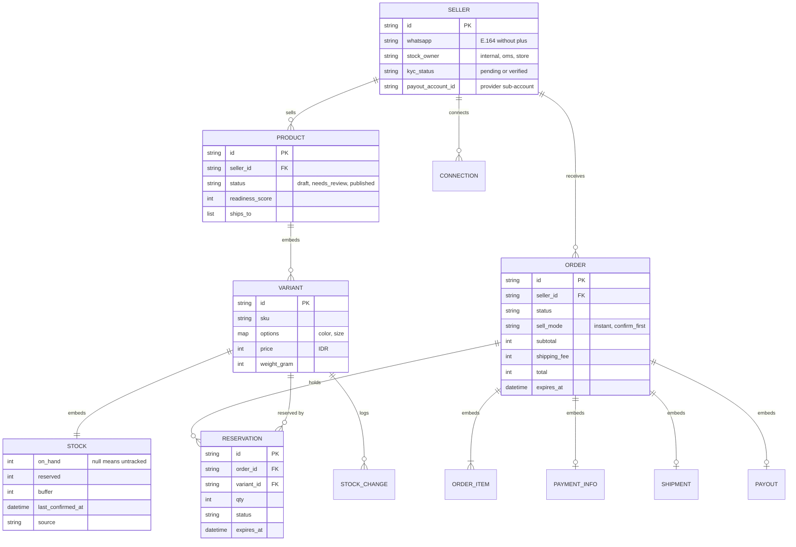

# Data model and store

Every part of Etalase reads and writes the same handful of Pydantic models through one small `Store` interface, and two rules in that store (stock never moves by accident, order status never changes twice) carry most of the system's safety.

::: tip What you will learn
- Every model in `prototype/etalase/models.py` and how they relate
- The `Store` protocol, and how `MemoryStore` (locks) and `FirestoreStore` (transactions) each keep its promises
- Why `put_product` never changes stock, and why every order transition goes through `update_order`
- Which Firestore collections and indexes the production store needs
- Why queries are scoped by seller, and the few places where they are not
:::

## Concepts first

Three ideas shape the data model.

1. **Many sellers, one database (multi-tenancy).** Every product, order, connection and stock log entry carries a `seller_id`. A seller must never see or change another seller's data, so ownership is checked in code, not assumed.
2. **Stock is a counter that only a few functions may touch.** Buyers' agents, the seller's chat and connected systems all race for the same units. If any code could write `on_hand` freely, a stale copy of a product could undo a sale. So stock changes only through `reserve`, `commit`, `release`, `restock` and `set_stock`.
3. **An order is a state machine, and money is not in our database.** The order records *what happened* (status, history, payment reference). The money itself sits with the payment provider (ADR 0003, `docs/adr/0003-never-hold-funds.md`; see [Checkout and orders](/architecture/checkout-and-orders)). Our job is to make each status change happen exactly once.

| Part | Status |
|---|---|
| Models (`models.py`) | <Badge type="tip" text="Built" /> |
| `MemoryStore` (used by the demo and all 82 tests) | <Badge type="tip" text="Built" /> |
| `FirestoreStore` (transactions; exercised manually against the emulator, not in CI) | <Badge type="tip" text="Built" /> <Badge type="warning" text="Mocked in demo" /> |
| Cloud Storage for media, Firestore emulator in CI | <Badge type="info" text="Roadmap" /> |

## The models at a glance



"Embeds" means the child lives *inside* the parent document: a product's variants and their stock are one record, and an order carries its items, payment, shipment and payout. Reservations, stock changes and connections are separate records.

## Model by model

All models are in **`prototype/etalase/models.py`**. IDs come from `new_id(prefix)`, so you can tell them apart in logs: `sel_`, `prd_`, `var_`, `ord_`, `rsv_`, `stk_`, `con_`.

| Model | What it is | Notes |
|---|---|---|
| `Seller` | A shop, identified by its WhatsApp number | `kyc_status` must be `"verified"` before checkout works. `origin` (an `Address`) gives the courier pickup postal code |
| `Product` | One item for sale | `status` starts as `draft` or `needs_review`; only `published` is visible to agents. `ships_to` defaults to `["ID"]` |
| `Variant` | A sellable option (colour, size) | `price` is in minor units of the currency; IDR has none, so 85000 means Rp85.000 |
| `Stock` | Counters inside each variant | `on_hand = None` means the seller does not count stock |
| `Order` | One checkout | Contains `OrderItem`s, the buyer `Address`, the chosen `ShippingRate`, and later `PaymentInfo`, `Shipment`, `Payout`. `history` is a human-readable log |
| `Reservation` | Units held for an order | One per order item; drives stock commits, releases and expiry |
| `PaymentInfo` | The provider's payment record | `reference` is how payment webhooks find the order |
| `Shipment` | Courier and waybill | Created when the order ships |
| `Payout` | Seller amount and commission | Created once, on delivery |
| `Connection` | A connected OMS, store plugin or Instagram account | Only the SHA-256 of the API key is stored |
| `StockChange` | Audit log of `set_stock` | Who (`seller_id`), what (`before`, `after`), how (`source`), when (`at`) |

The most important piece of logic in the models is the availability formula:

```python
# prototype/etalase/models.py
class Stock(BaseModel):
    on_hand: int | None = None    # None = seller does not track stock
    reserved: int = 0
    buffer: int = 0
    last_confirmed_at: datetime | None = None
    source: str = "chat"

    @property
    def available(self) -> int | None:
        if self.on_hand is None:
            return None
        return max(0, self.on_hand - self.reserved - self.buffer)
```

`available` is computed, never stored. That is why two writers can never disagree about it: they only ever change `on_hand` and `reserved`.

### Status values the code actually uses

Several models keep status as a free string. The inline comments in `models.py` list only some values; this table lists every value the code writes.

| Field | Values written by the code |
|---|---|
| `Reservation.status` | `held`, `committed`, `released`, `restocked` |
| `PaymentInfo.status` | `pending`, `paid`, `paid_late`, `refunded`, `refund_pending` |
| `Shipment.status` | `booked`, `picked_up`, `in_transit`, `delivered`, `returned` |
| `Payout.status` | `releasing`, `released`, `pending_manual` (the default `scheduled` is never used) |
| `Order.status` | the 10 `OrderStatus` values, see [Checkout and orders](/architecture/checkout-and-orders) |

## The Store protocol

`Store` is a Python `Protocol`: any class with these methods is a store. Services only ever talk to this interface.

```python
# prototype/etalase/store/base.py
class Store(Protocol):
    # products. put_product never changes stock of variants that already exist: stock moves only
    # through reserve/commit/release/restock/set_stock, so a stale product copy cannot undo a sale.
    def put_product(self, product: Product) -> None: ...
    def list_products(self, seller_id: str | None = None, status: str | None = None) -> list[Product]: ...
    # ...
    def update_order(self, order_id: str, change: Callable[[Order], bool]) -> Order | None:
        """Atomic read-modify-write. `change` mutates the order and returns True to save it.
        Used for every status transition, so a webhook and the expiry job cannot both win."""

    # stock: these four must be atomic
    def reserve(self, order_id: str, product_id: str, variant_id: str, qty: int, expires_at: datetime) -> Reservation: ...
    def commit(self, order_id: str) -> None: ...
    def release(self, order_id: str) -> None: ...
    def set_stock(self, seller_id: str, product_id: str, variant_id: str, on_hand: int | None, source: str) -> StockChange: ...
    def restock(self, order_id: str) -> None: ...
    def extend(self, order_id: str, expires_at: datetime) -> None: ...
    # ...
```

`build_store(backend)` in `store/__init__.py` picks the implementation from `STORE_BACKEND` (`memory` by default, or `firestore`).

## MemoryStore vs FirestoreStore

| | `MemoryStore` | `FirestoreStore` |
|---|---|---|
| File | `store/memory.py` | `store/firestore.py` |
| Data lives in | Python dicts | Firestore collections |
| Atomicity | One `threading.RLock` around every method | `@firestore.transactional` functions |
| Reads return | Deep copies, so callers cannot mutate stored data by accident | Fresh documents parsed with `model_validate` |
| Survives restart | No | Yes |
| Multiple Cloud Run instances | No (each instance has its own memory) | Yes |
| Used by | Demo, tests, hackathon deployment | Pilot and later |

The lock gives the same guarantee a transaction does: nobody else can read or write between "check available" and "add to reserved". The 100-thread race test proves it for `MemoryStore` ([Catalog and stock](/architecture/catalog-and-stock#the-oversell-race-test)).

### Firestore collections

| Collection | Document | Written by |
|---|---|---|
| `sellers` | `Seller` | `put_seller` |
| `products` | `Product` with variants and stock embedded | `put_product`, and the stock functions |
| `orders` | `Order` with items, payment, shipment, payout | `put_order` (creation only), `update_order` |
| `reservations` | `Reservation` plus an extra `expires_ts` timestamp field | `reserve`, `_apply`, `extend` |
| `stock_log` | `StockChange` | `set_stock` |
| `connections` | `Connection` | `put_connection` |

`expires_ts` exists because `model_dump(mode="json")` turns `expires_at` into a string, and string comparison is not a safe time comparison. The expiry query filters on the native timestamp instead.

### Rule 1: put_product keeps stock that already exists

```python
# prototype/etalase/store/memory.py
def put_product(self, product: Product) -> None:
    with self._lock:
        product.updated_at = now()
        stored = product.model_copy(deep=True)
        old = self._products.get(product.id)
        if old:
            old_stock = {v.id: v.stock for v in old.variants}
            for v in stored.variants:
                if v.id in old_stock:
                    v.stock = old_stock[v.id].model_copy()
        self._products[product.id] = stored
```

Picture the seller editing a title while an agent reserves two units. The edit started from a copy where `reserved == 0`. Without this rule, saving the edit would wipe the reservation. `test_stale_product_copy_cannot_overwrite_stock` in `tests/test_security.py` checks exactly this. `FirestoreStore.put_product` does the same inside a transaction. New variants (ids not seen before) keep the stock you give them, which is how `ingest` sets the first counts.

### Rule 2: update_order is the only way to change status

```python
# prototype/etalase/store/memory.py
def update_order(self, order_id: str, change: Callable[[Order], bool]) -> Order | None:
    with self._lock:
        current = self._orders.get(order_id)
        if current is None:
            return None
        working = current.model_copy(deep=True)
        if change(working):
            self._orders[order_id] = working.model_copy(deep=True)
        return working
```

The caller passes a small function that checks the *current* status and returns `True` only if it made a change. Because the check and the write happen under one lock (or one transaction), a payment webhook and the expiry job cannot both win. `put_order` is called only once per order, in `create_checkout`.

### Stock functions in Firestore

`commit`, `release` and `restock` share one helper, `_apply(order_id, from_status, to_status, mutate)`. In one transaction it loads the order's reservations in `from_status`, applies `mutate` to each variant (for `commit`: `reserved -= qty`, `on_hand -= qty`) and flips the reservations to `to_status`. Because each call only touches reservations in the expected starting status, calling it twice does nothing the second time. That is what makes webhooks safe to retry.

### extend

`extend(order_id, expires_at)` moves the deadline of `held` reservations, used when a seller confirms stock and the hold must last as long as the new QR code. In `FirestoreStore` it is a plain query and update, not a transaction. That is acceptable because `expire_due` re-checks `order.expires_at` inside `update_order` before expiring anything.

## Indexes Firestore needs

Firestore indexes every single field automatically. A query that combines an equality filter with a range filter needs a composite index.

| Query (method) | Filters | Index |
|---|---|---|
| `held_reservations_expiring_before` | `status == "held"`, `expires_ts <= when` | Composite `(status, expires_ts)`, noted in the code |
| `_apply`, `extend` | `order_id ==`, `status ==` | Automatic single-field; add a composite if Firestore asks |
| `list_products` | `seller_id ==`, optional `status ==` | Same |
| `find_seller_by_whatsapp` | `whatsapp ==` | Automatic |
| `find_order_by_payment_ref` | `payment.reference ==` | Automatic (nested field) |
| `list_orders`, `stock_log`, `list_connections` | `seller_id ==` | Automatic |
| `find_connection_by_key_hash` | `api_key_hash ==` | Automatic |

When a query is missing an index, the Firestore client raises an error with a link that creates it. Run the store against the emulator first (see the docstring at the top of `store/firestore.py`).

## Why every query is scoped by seller

Tenant isolation is enforced at three levels:

- **Store methods take a `seller_id`**: `list_orders`, `list_connections`, `stock_log`, and `list_products(seller_id=...)` for seller actions.
- **Writes check ownership**: `set_stock` raises `PermissionError("product belongs to another seller")`, and `CheckoutService._seller_order` returns "order not found" when the order belongs to someone else (`test_tenant_isolation_on_orders`).
- **The seller id never comes from untrusted input**: it comes from the verified WhatsApp number, the dashboard session token or the Connector API key.

A few lookups are deliberately not seller-scoped. Know them, because judges may ask:

| Lookup | Why it is global |
|---|---|
| `CatalogService.search` uses `list_products(status=PUBLISHED)` | The public catalogue is meant to be searched across shops |
| `get_order(checkout_id)` for `get_checkout_status` | The random checkout id acts as the buyer's handle; the view contains no buyer address |
| `find_order_by_payment_ref`, `find_seller_by_whatsapp`, `find_connection_by_key_hash` | They establish *who* is calling, so they cannot be scoped yet |
| `CheckoutService._order_by_waybill` | Courier webhooks only know the waybill. It collects the unique sellers from all products and scans each seller's orders; still a full scan, which should become a query on `shipment.waybill` (a single-field index) |

## Pitfalls

::: warning Firestore may run a transaction function more than once
When transactions collide, the client retries the whole function. The `change` callbacks in `checkout/service.py` record their outcome in outer dicts (`won`, `outcome`, `delivered`), so each one now resets its dict on its first line (`won.clear()` and so on); otherwise a flag set by an attempt that was thrown away would survive into the retry. `MemoryStore` never retries, so `tests/test_regressions.py` wraps it in a `RetryingStore` that runs each callback twice to prove the reset works. Any new callback you write must follow the same rule. See [Checkout and orders](/architecture/checkout-and-orders).
:::

::: warning Never save a whole order with put_order after creation
It overwrites the document without checking status. Use `update_order` with a status check, as every method in `CheckoutService` does.
:::

- `MemoryStore.reserve` rejects `qty <= 0`; `FirestoreStore.reserve` does not. `create_checkout` checks quantity first, so today this is only a gap in the store contract.
- `MemoryStore` state disappears on restart, and each Cloud Run instance would have its own copy. That is why the hackathon deployment runs one instance.

## Check yourself

1. A seller renames a product at the same moment an agent reserves its last unit. Which store rule keeps the reservation, and where is it tested?

::: details Answer
`put_product` copies the stored stock of existing variants over the incoming product before saving, so a stale copy cannot reset `reserved`. It is tested by `test_stale_product_copy_cannot_overwrite_stock` in `tests/test_security.py`.
:::

2. Why is `available` a property and not a stored field?

::: details Answer
It is derived from `on_hand - reserved - buffer`. Storing it would create a second number that could drift out of sync when two writers update stock. Writers only change `on_hand` and `reserved`, and everyone computes `available` the same way.
:::

3. Why does the `reservations` collection store `expires_ts` next to `expires_at`?

::: details Answer
`model_dump(mode="json")` serialises `expires_at` as a string. The expiry query needs a real timestamp for `expires_ts <= when`, which also needs the composite index `(status, expires_ts)`.
:::

4. Name two lookups that are intentionally not scoped by seller, and why.

::: details Answer
For example, the public product search (the catalogue is meant to be found across shops) and `find_order_by_payment_ref` (the payment webhook only knows the provider reference). Others: `find_seller_by_whatsapp`, `find_connection_by_key_hash`, `get_order` by checkout id, and the waybill scan.
:::

5. What happens if `commit(order_id)` is called twice?

::: details Answer
Nothing the second time. It only processes reservations in status `held` and flips them to `committed`, so the second call finds nothing to do.
:::

## Next

[Catalog and stock](/architecture/catalog-and-stock)
