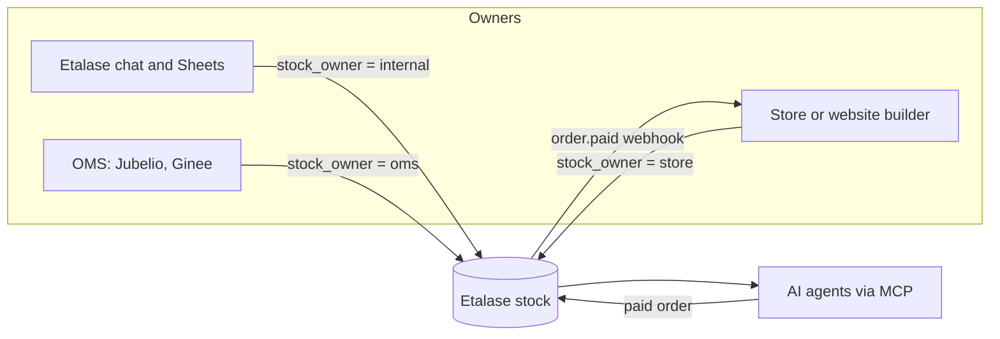
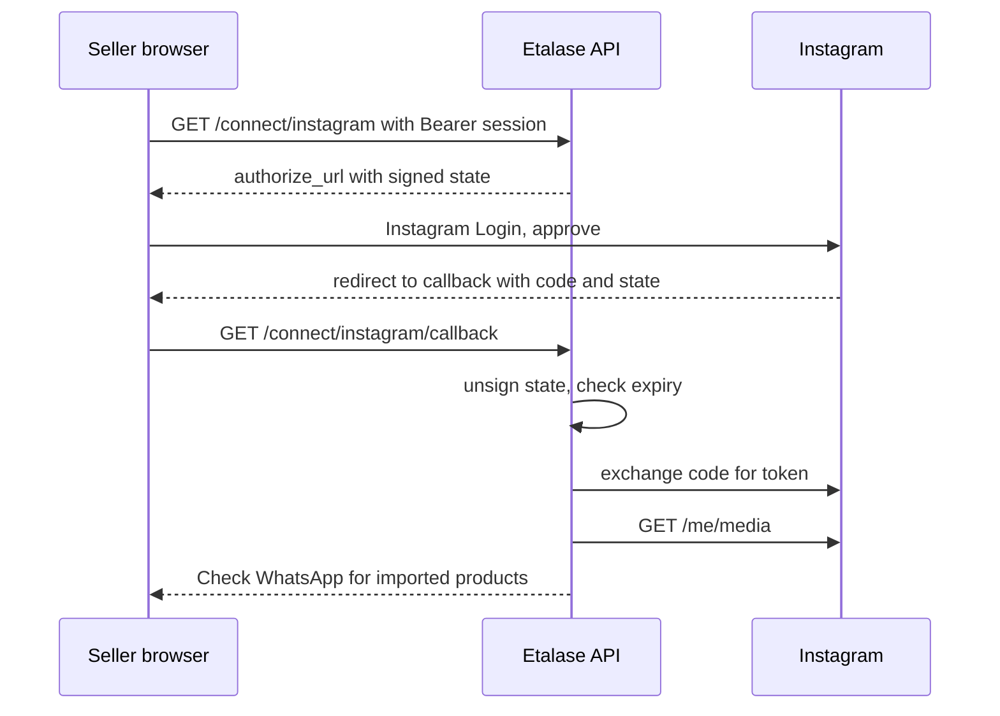

# Integrations

How catalogs and stock get into Etalase from places other than WhatsApp chat (Instagram, spreadsheets, OMSs, online stores, website builders) without ever selling the same unit twice.

::: tip What you will learn
- The two integration styles (pull adapters and the push Connector API) and the one-stock-owner rule that governs both
- How Instagram Login, a signed OAuth `state` and `ig:<post id>` references make Instagram import safe and repeatable
- What is built today and what is roadmap: Google Sheets, Jubelio and Ginee, WooCommerce, marketplaces
- How the Connector API authenticates partners with a hashed `X-Etalase-Key`, and how a partner verifies a signed `order.paid` webhook
:::

## Two styles, one rule

| Style | Who moves the data | Used for | Status |
|---|---|---|---|
| **Pull adapter** | Etalase calls the partner's API | Instagram, Google Sheets, WooCommerce, Jubelio, Ginee, marketplace stock sync | Instagram <Badge type="tip" text="Built" />, the rest <Badge type="info" text="Roadmap" /> |
| **Push: Connector API** | The partner calls Etalase | Local website builders, small platforms, any OMS that prefers webhooks | <Badge type="tip" text="Built" /> |

Two terms first:

- An **e-commerce platform** (WooCommerce, Shopify, a website builder) is where a seller *sells*: storefront, catalog, checkout.
- An **OMS** (order management system, e.g. Jubelio or Ginee) is where a seller *operates*: it syncs stock and orders across Shopee, TikTok Shop, Tokopedia and websites.

The rule that holds everything together is ADR 0002 (`docs/adr/0002-single-stock-owner.md`): **each seller has exactly one stock owner**. If two systems could both write stock without rules, the same unit could be sold on Shopee and through an AI agent at once.

## Stock ownership

**`prototype/etalase/models.py`** defines three owners in `StockOwner`: `internal` (Etalase), `oms` and `store`.



Three code paths enforce it:

1. **Creating a connection switches the owner.** In **`prototype/etalase/connector/service.py`**:

   ```python
   seller.stock_owner = StockOwner.OMS if kind in ("jubelio", "ginee") else StockOwner.STORE
   ```

2. **Chat stock updates are refused for external owners.** In **`prototype/etalase/catalog/service.py`**:

   ```python
   if seller and seller.stock_owner != StockOwner.INTERNAL:
       raise PermissionError(f"Stock for this seller is owned by the connected {seller.stock_owner.value}; update it there.")
   ```

   The seller agent turns this into a polite error (`test_chat_stock_updates_blocked_for_oms_sellers`).

3. **External owners sell instantly.** `CatalogService.sell_mode` returns `INSTANT` when the owner is not internal, because synced stock is trusted more than a number typed in chat days ago.

Consequences from the ADR: a seller with both an OMS and a website connects through the OMS, and Google Sheets is an *input* to Etalase's stock, not an owner.

## Instagram <Badge type="tip" text="Built" />

Many sellers' products already live on Instagram as photo plus caption. Instagram is an **optional catalog source**: the seller still works in WhatsApp, and Instagram is never used for buyer DMs.

### Concepts: OAuth and `state`

**OAuth** lets a seller grant Etalase limited access to their Instagram account without sharing a password. Etalase redirects them to Instagram, they approve, and Instagram redirects back with a one-time `code` that Etalase exchanges for an access token.

The `state` parameter travels through that round trip unchanged. It serves two purposes here: it tells the callback **which seller** started the flow, and it must be **unforgeable**, or an attacker could attach their Instagram account (or a victim's callback) to the wrong seller. Etalase signs it with HMAC.



**`prototype/etalase/api/main.py`**

```python
@app.get("/connect/instagram", tags=["seller"])
def instagram_connect(seller_id: str = Depends(current_seller)):
    # ...
    # Short-lived signed state (not a session token), so the callback knows which seller connected.
    state = ctx.auth.sign(f"ig.{seller_id}.{int(time.time()) + 600}")
    return {"authorize_url": instagram.authorize_url(s.instagram_app_id, f"{s.public_base_url}/connect/instagram/callback", state)}


@app.get("/connect/instagram/callback", tags=["seller"], response_class=HTMLResponse)
def instagram_callback(code: str, state: str):
    payload = ctx.auth.unsign(state) or ""
    parts = payload.split(".")
    if len(parts) != 3 or parts[0] != "ig" or not parts[2].isdigit() or int(parts[2]) < time.time():
        raise HTTPException(401, "invalid or expired state")
    seller_id = parts[1]
    # ... exchange_code, store Connection(kind="instagram"), import
```

The state is `ig.<seller_id>.<expiry>` plus an HMAC-SHA256 signature (keyed with `SESSION_SECRET` and the purpose `state`), valid for 10 minutes. `test_signed_state_round_trip` checks that a one-character change is rejected, and `test_session_tokens_and_oauth_state_are_not_interchangeable` checks that a signed state is never accepted as a dashboard session token (session tokens are signed with the purpose `session`).

### Scope and endpoints

**`prototype/etalase/adapters/instagram.py`** asks for one scope, `instagram_business_basic`, the minimum needed to read the account's own media (`test_authorize_url_requests_basic_scope_only`). It uses the **Instagram API with Instagram Login**, which requires a professional (Business or Creator) account. Public launch needs Meta App Review; development mode with test users is enough for the hackathon.

`InstagramGraphSource.recent_posts` calls `GET https://graph.instagram.com/me/media` for `id, caption, media_type, media_url, permalink, timestamp`. Albums (`CAROUSEL_ALBUM`) are expanded through `/children`, up to 4 images; videos and reels are skipped.

### Import and dedupe

```python
    def import_instagram(self, seller_id: str, source, media_dir: str, limit: int = 25) -> tuple[list[Product], int]:
        known = {p.external_ref for p in self.store.list_products(seller_id=seller_id) if p.external_ref}
        drafts, skipped = [], 0
        for post in source.recent_posts(limit):
            ref = f"ig:{post.id}"
            if ref in known:
                continue
            images = [source.download(u, media_dir) for u in post.media_urls]
            made, _ = self.ingest(seller_id, [post.caption], images)
            if not made:
                skipped += 1
                continue
            for p in made:
                p.external_ref = ref
                p.attributes["instagram_post"] = post.permalink
                self.store.put_product(p)
            drafts.extend(made)
        return drafts, skipped
```

(From **`prototype/etalase/catalog/service.py`**.) Each post goes through the same `ingest` pipeline as a WhatsApp photo, so Gemini (or the offline parser) decides whether it is a product at all; promo and thank-you posts produce nothing and are counted as skipped. Products remember `external_ref = "ig:<post id>"`, so a second import adds only new posts (`test_import_is_idempotent`). The summary then goes to WhatsApp with **Publish** / **Edit**, like any other catalog input. Instagram has no stock counts, so imported variants stay in confirm-first mode until the seller sets stock by chat.

For offline demos, `POST /dev/instagram/import?seller_id=...` uses `SampleInstagramSource` and `samples/instagram_posts.json`.

::: warning Gaps to know before a pilot
- `exchange_code` returns a **short-lived** token, and the callback stores it as is. Its docstring says to exchange it for a long-lived token first; that step is not implemented.
- Tokens are stored unencrypted on the `Connection`; Cloud KMS encryption is a known gap in `docs/09`.
- `docs/08` describes a "Connect Instagram" button in the dashboard, but `dashboard.html` has none yet; the endpoint is only reachable through the API.
- Non-product posts are not remembered, so every re-import downloads and re-analyses them again.
:::

## Google Sheets <Badge type="info" text="Roadmap" />

Designed in `docs/08-integrations.md`, not in the code:

- **OAuth plus Google Picker with the `drive.file` scope.** The seller picks one sheet, and Etalase can read only files the seller chose, not their whole Drive. This is a narrower scope than full Drive read access.
- Gemini proposes a column mapping ("column B = product name, D = colour, F = stock — correct?") and the seller confirms in WhatsApp.
- Changes are detected by polling the file's `modifiedTime` (or Drive change notifications) and diffing rows.
- Refresh tokens encrypted per seller with Secret Manager or Cloud KMS; a revoked token triggers a "reconnect" message.

Sheets feed Etalase's own stock; Etalase stays the owner.

## OMS adapters: Jubelio, Ginee <Badge type="info" text="Roadmap" />

Pull adapters that read catalog and stock, and push agent orders into the OMS so it updates every channel. Each needs the OMS's partner programme; terms are still to be confirmed. `create_connection` already accepts `kind="jubelio"` and `"ginee"` and sets `stock_owner = oms`, so the ownership logic is ready.

## E-commerce plugins: WooCommerce first <Badge type="info" text="Roadmap" />

`docs/08` gives the reasons for starting with WooCommerce:

- It is the seller's own store: they can install a plugin without platform approval, and the REST API is open.
- Many Indonesian WooCommerce stores use local payments (Xendit, Midtrans) that Stripe's agentic commerce suite does not reach.
- Shopify already ships agentic storefronts and agent-readiness apps, so Etalase adds less there.

This is an assumption to validate in seller interviews. If most website sellers use a local builder instead, that builder comes first through the Connector API.

## Marketplaces: stock sync only

Shopee Open Platform and TikTok Shop Partner Center (which also serves Tokopedia) offer APIs for managing a seller's shop *on that marketplace*. Etalase plans to use them only to **keep stock in sync**: when something sells through an AI agent, stock drops on Shopee too, and the other way round.

Etalase will **not** republish marketplace listings to AI agents. That would compete with the marketplaces' own agent partnerships and likely breach their partner terms. Partner app stores are, however, a distribution channel for Etalase itself.

## The Connector API <Badge type="tip" text="Built" />

There are too many OMSs and website builders to write a pull adapter for each. ADR 0006 (`docs/adr/0006-connector-api.md`) flips the direction: partners call Etalase. One integration by a website builder enables every merchant on that builder. FastAPI publishes the spec at `/openapi.json` and interactive docs at `/docs` (`test_openapi_documents_connector_api`).

| Endpoint | Purpose |
|---|---|
| `PUT /connector/v1/products/{external_id}` | Create or update a product with variants, price, weight, stock |
| `PATCH /connector/v1/stock` | Bulk stock updates by SKU; returns `updated` and `unknown_skus` |
| `POST /connector/v1/orders/{order_id}/status` | `accepted`, `rejected` or `shipped` (+ `waybill`). `rejected` refunds the buyer and puts the units back, but does **not** set stock to 0: the partner owns the stock and sends the true count |
| Outgoing `order.paid` webhook | Paid orders pushed to the partner, signed with `X-Etalase-Signature` |

### Keys: shown once, stored hashed

```python
def hash_key(key: str) -> str:
    return hashlib.sha256(key.encode()).hexdigest()

# in ConnectorService.create_connection
        key = "etk_" + secrets.token_urlsafe(24)
        conn = Connection(seller_id=seller_id, kind=kind, api_key_hash=hash_key(key),
                          order_webhook_url=order_webhook_url, webhook_secret=secrets.token_hex(16))

    def authenticate(self, key: str | None) -> Connection | None:
        return self.ctx.store.find_connection_by_key_hash(hash_key(key)) if key else None
```

Only the SHA-256 of the key is stored, so a database leak does not leak usable keys. A plain fast hash is fine here because the key is 24 random bytes, far too many to brute-force (passwords, by contrast, need slow hashes). Every route depends on `connection(...)`, which returns 401 without a valid `X-Etalase-Key` (`test_connector_requires_key_and_otp_rejects_wrong_code`). A key belongs to one connection, so to one seller: every service call uses `conn.seller_id`.

In the prototype a connection is created only through `POST /dev/connections`, which returns the key and webhook secret once.

### Payloads are validated

Pydantic models cap everything: title up to 150 characters, up to 100 variants, up to 10 image URLs that must be `https`, price up to 1,000,000,000, stock up to 1,000,000. On a re-sync, an **existing** variant's stock goes through `store.set_stock`, never through `put_product`, so units already reserved by an agent checkout stay reserved (`test_connector_resync_keeps_reservations`).

### Signed `order.paid` webhooks

When an order is paid, `deliver_order` posts it to every connection of that seller that has an `order_webhook_url`:

```python
            body = {"event": "order.paid", "order": order_view(order),
                    "buyer": order.buyer.model_dump()}
            raw = json.dumps(body, separators=(",", ":")).encode()
            # ...
                check_webhook_url(conn.order_webhook_url, allow_test=False)  # DNS may have changed since
                httpx.post(conn.order_webhook_url, content=raw, timeout=10, follow_redirects=False, headers={
                    "content-type": "application/json", "X-Etalase-Signature": sign(conn.webhook_secret, raw)})
```

with `sign(secret, body) = hmac.new(secret.encode(), body, hashlib.sha256).hexdigest()`.

The payload carries the buyer's name, phone and address, so `check_webhook_url` only allows public `https` hosts: it resolves the hostname and rejects private, loopback, link-local (including the `169.254.169.254` metadata server), reserved and multicast addresses. It runs when the connection is created and again before each send, and redirects are not followed. This blocks **SSRF** (server-side request forgery: tricking a server into calling its own internal network). Covered by `test_connector_webhooks_only_to_public_https`.

### Verifying the signature on the receiver

A partner should check that a webhook really came from Etalase before trusting it. Derived from `sign` above:

```python
import hashlib
import hmac


def verify_etalase_webhook(raw_body: bytes, signature_header: str | None, webhook_secret: str) -> bool:
    """raw_body must be the exact bytes received, before any JSON parsing."""
    if not signature_header:
        return False
    expected = hmac.new(webhook_secret.encode(), raw_body, hashlib.sha256).hexdigest()
    return hmac.compare_digest(expected, signature_header)
```

Use the raw bytes (in Flask `request.get_data()`, in FastAPI `await request.body()`), because parsing and re-dumping JSON changes spacing and breaks the signature. Use `hmac.compare_digest`, a constant-time comparison, so an attacker cannot learn the signature byte by byte from response timing. Return 401 on failure rather than relying on `assert`, which Python skips under `-O`.

::: warning Delivery limitations today
- One attempt, no retries: a failed POST is logged, and ADR 0006 plans retries and a dead-letter queue on Pub/Sub.
- The signature covers only the body, with no timestamp or event id, so a captured webhook could be replayed. Receivers should dedupe on `order.checkout_id`.
:::

## Check yourself

1. A seller connects Jubelio and then types "navy 5" in WhatsApp. What happens?

::: details Answer
`create_connection` set `stock_owner = oms`, so `CatalogService.update_stock` raises `PermissionError` and the seller is told to update stock in the OMS. Agent orders for that seller are also instant.
:::

2. Why is the Instagram `state` signed and given an expiry?

::: details Answer
The callback is not authenticated by a session; the state is the only thing that says which seller connected. Signing stops anyone from forging a state for another seller, and the 10-minute expiry limits replay of an old link.
:::

3. Why can Etalase store only a SHA-256 of Connector API keys and still authenticate requests?

::: details Answer
On each request it hashes the supplied `X-Etalase-Key` and looks up that hash. The key is long and random, so a fast hash is safe, and a leaked database contains no usable keys.
:::

4. A website builder registers `https://10.0.0.5/hook` as its order webhook. What happens, and why?

::: details Answer
`check_webhook_url` resolves the host, sees a private address and raises "webhook URL must point to a public address". Order webhooks carry buyer addresses and must never reach internal services.
:::

5. Why does Etalase use marketplace APIs only for stock sync?

::: details Answer
Those APIs exist to manage the seller's shop on the marketplace. Reselling listings to AI agents would compete with the marketplaces' own agent deals and likely breach partner terms. Syncing stock prevents overselling across channels.
:::

## Next

[Security model](/architecture/security)
