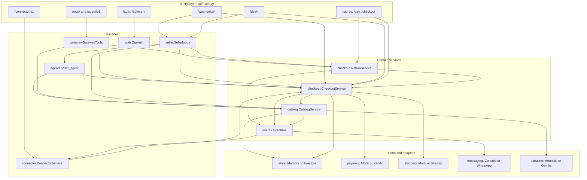
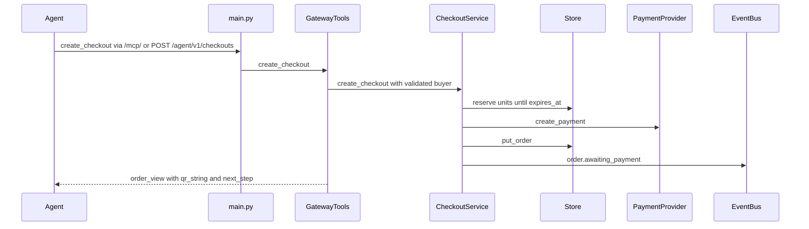
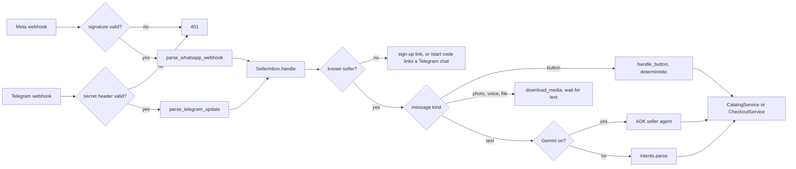
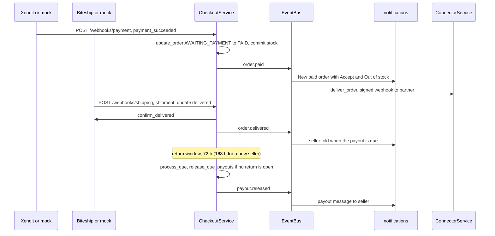
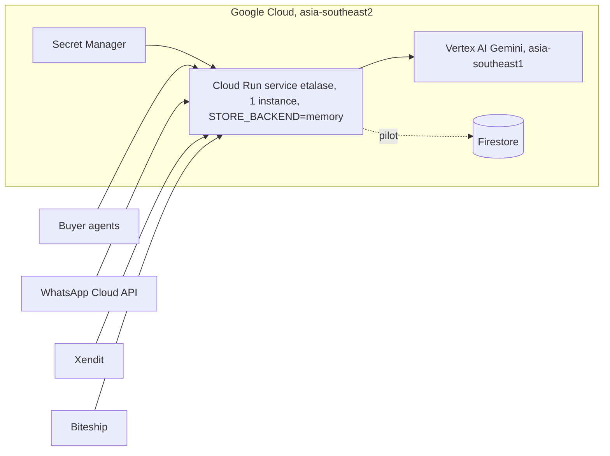

# Architecture overview

Etalase is one FastAPI process with a small domain core, five ways in (agents, buyers with a link, sellers, providers, the dashboard) and an adapter behind every external service, all wired together in one file.

::: tip What you will learn
- The layers of the codebase and what each package is responsible for
- The five request paths: agent, store link, seller WhatsApp, provider webhooks and dashboard
- How `container.py` builds the `AppContext` and why some fields are filled in late
- How adapters and country packs keep the core free of provider code, and where that is still incomplete
- What runs on Cloud Run today and what is still roadmap
:::

## The idea: one core, many adapters

The core owns three things: the **catalog** (what is sold), **stock** (what is available) and **orders** (what was bought). Everything else is a way in or a way out:

- **Ways in:** a buyer's AI agent (MCP or REST), a person on the public store link, a seller's WhatsApp messages, provider webhooks (payment, courier), the seller dashboard and the Connector API.
- **Ways out:** WhatsApp messages to the seller, QRIS payments, courier rates and bookings, signed webhooks to partner stores.

Each way out sits behind a small interface with a real and a mock implementation. That is why the [demo runs with zero credentials](/run/run-locally), and why a new market should be "a new adapter, not a change to the core" (`docs/03-architecture.md`).

## Layers



The arrows show who calls whom. Routes stay thin: they authenticate, validate the body and call one facade or service. Business rules live in `catalog/` and `checkout/`. The event bus is the only way checkout reaches WhatsApp and partner webhooks, so checkout never imports a messenger.

## Code map

| Path | Responsibility | Status |
|---|---|---|
| `etalase/api/main.py` | FastAPI app: routes, webhooks, dev endpoints, request size limit, security headers, the background loop (`process_due`) | <Badge type="tip" text="Built" /> |
| `etalase/api/dashboard.html` | Single-page seller dashboard served at `/`, in the same visual language as the store pages | <Badge type="tip" text="Built" /> |
| `etalase/gateway/` | `mcp_server.py` (seven MCP tools), `tools.py` (`GatewayTools`, `order_view`, `next_step` hints), `discovery.py` (schema.org JSON-LD), `ucp.py` (UCP profile and Checkout over REST, hosted payment page, return policy page), `storefront.py` (the public store link: catalog, buy form, order page, return form), `pages.py` (the one look and the one small script shared by every buyer page), `static/` (the self-hosted display font) | <Badge type="tip" text="Built" /> |
| `etalase/catalog/` | Extraction (`GeminiExtractor`, `HeuristicExtractor`), normalisation, readiness score, sell mode, search, offline intents | <Badge type="tip" text="Built" /> (Gemini needs a key) |
| `etalase/checkout/` | `service.py`: reservation, confirm-first, payment, acceptance, shipping, delivery, payout hold, expiry. `returns.py`: the return state machine (request, approve or dispute, refund, timers) | <Badge type="tip" text="Built" /> |
| `etalase/seller/` | `inbox.py` (every inbound seller message, from WhatsApp or Telegram), `notifications.py` (events to messages), `channels.py` (link a Telegram chat, choose the channel), `slugs.py` (shop addresses), `i18n.py` (en / id) | <Badge type="tip" text="Built" /> |
| `etalase/agents/` | ADK seller agent (tenant-scoped tools), ADK buyer agent (`McpToolset`) | <Badge type="tip" text="Built" /> (needs Gemini) |
| `etalase/connector/service.py` | Connector API: API keys, product upsert, stock, order status, signed `order.paid` webhooks | <Badge type="tip" text="Built" /> |
| `etalase/adapters/` | Payment, shipping, messaging (WhatsApp, Telegram, the router), Instagram | <Badge type="warning" text="Mocked in demo" /> |
| `etalase/store/` | `Store` protocol, `MemoryStore`, `FirestoreStore` | <Badge type="warning" text="Mocked in demo" /> (Firestore not in automated tests) |
| `etalase/auth.py` | One-time-code sign-in (sent to the seller's channel), signed session tokens, Telegram link codes | <Badge type="tip" text="Built" /> |
| `etalase/security.py` | Startup checks, dev and webhook guards, rate limiter, headers | <Badge type="tip" text="Built" /> |
| `etalase/events.py` | In-process `EventBus` and topic names | <Badge type="tip" text="Built" /> (Pub/Sub is roadmap) |
| `etalase/models.py` | Pydantic models: `Seller`, `Product`, `Variant`, `Stock`, `Order`, `Reservation`, `Connection` | <Badge type="tip" text="Built" /> |
| `etalase/config.py` | `Settings` from the environment, `CountryPack`, `COUNTRY_PACKS` | <Badge type="tip" text="Built" /> |
| `etalase/container.py` | Wiring: builds the `AppContext` | <Badge type="tip" text="Built" /> |

## The four request paths

### 1. A buyer's agent (MCP or REST)

The MCP server is mounted inside the same FastAPI app, so MCP and REST call the very same `GatewayTools` methods:

```python
# prototype/etalase/api/main.py
ctx: AppContext = build_context()   # refuses to start on an insecure configuration (see security.py)
mcp = build_mcp(ctx)
# ...
app.mount("/mcp", mcp.streamable_http_app())
```



Errors come back as `{"error": "..."}` with HTTP 200, not exceptions, because LLM agents cope better with readable results. Details in [Agent gateway](/architecture/agent-gateway).

### 2. A person on the store link

An Instagram bio, a WhatsApp status or a QR code on a parcel can carry the shop link: `/stores/{seller_id}`, or `https://<slug>.<domain>` when `STORE_BASE_DOMAIN` is set (`gateway/hosts.py` maps the Host header to the shop; `seller/slugs.py` validates and assigns the slug). The pages are server-rendered by `gateway/storefront.py`: the store (`/stores/{id}`), one product (`/stores/{id}/p/{product}`, photos, option chips, a sticky Buy bar), the checkout (`/stores/{id}/buy/{variant}`), the order and pay page (`/pay/{order_id}`) and the return form (`/pay/{order_id}/return`). They call the same `CheckoutService` and `ReturnService` as an agent does, so stock, the per-phone limit, courier quotes, the seller's confirm-first rule and the return terms are identical. The seller is alerted on their channel exactly as for an agent's order. The order id in the URL is the only secret (a capability), so the page shows no phone number or address.

The pages share one look (design system v3, `gateway/pages.py`): Plus Jakarta Sans, white "bands" separated by grey gaps on a phone and rounded cards on a wider screen, one green used for the main action, one icon set, a gradient cover and avatar derived from the shop name, and the same buttons, fields and tokens on the seller dashboard. They also share **one small script, pinned by hash in the Content-Security-Policy** (`pages.SCRIPT`), that makes the site feel smooth: (1) links and forms inside the store, product, checkout and pay pages are fetched and swapped in place with a cross-fade, so there is no white flash, the back button restores the last page and what was typed, store links are fetched when the pointer or a finger reaches them, and a thin progress line shows on a slow server; (2) a second tap on a submit button does nothing and the button says what is happening; (3) a waiting order page asks the server for itself every few seconds and swaps its status in place, with a payment countdown counted from the server's number, not the phone's clock; (4) photos fade in once loaded; (5) the quantity field gets + and - buttons and a live subtotal; (6) the store's search box and sort control filter and reorder the real cards (with a short move animation); (7) the option chips on a product page update the price, the availability, the Buy link and the URL without a reload; (8) share, copy and "save the QR code as an image" buttons. Nothing else can run. Without JavaScript every link and form still works as a normal page and a `<noscript>` meta refresh keeps the order page current. `scripts/browser_check.py` drives all of this in a real browser. More in [Security model](/architecture/security) and [Checkout and orders](/architecture/checkout-and-orders).

### 3. A seller on WhatsApp (or Telegram)



The signature check applies when the real Cloud API is on (or `WHATSAPP_APP_SECRET` is set); in console mode the webhook needs `WEBHOOK_TOKEN` instead, which is open on localhost. The Telegram webhook (`POST /webhooks/telegram`) is checked with the secret set at `setWebhook` (header `X-Telegram-Bot-Api-Secret-Token`); the sender is then `tg:<chat id>` and everything after `SellerInbox.handle` is the same code. Buttons (Publish, Available, Sold out, Accept, Out of stock, Approve return, Dispute, Item received) never reach the model: accepting an order must be exact. Duplicate deliveries are dropped by message ID, and the webhook always answers `{"ok": true}` even if handling failed, because Meta would otherwise retry the same message for days. Replies go back through the channel the seller wrote on; messages Etalase starts go to the channel the seller chose (`Seller.address`). Locally, `POST /dev/whatsapp` builds the same `Inbound` object and calls `ctx.inbox.handle` directly. More in [WhatsApp seller agent](/architecture/seller-agent).

### 4. Provider webhooks

Payment and courier webhooks enter `CheckoutService` directly; side effects fan out through events:



Every status change goes through `Store.update_order(order_id, change)`, an atomic read-modify-write, so a late payment webhook and the expiry job can never both win. See [Checkout and orders](/architecture/checkout-and-orders).

A fifth trigger has no caller at all: the `lifespan` function starts a loop that runs `ctx.process_due()` every 60 seconds. It expires unpaid checkouts, runs the return timers (a silent seller approves after 48 hours, a return that never arrives lapses after 7 days) and releases the payouts whose return window has ended. `POST /tasks/expire` (with `WEBHOOK_TOKEN`) does the same, ready for Cloud Scheduler, and `POST /tasks/resolve-dispute` lets an operator decide a disputed return.

### 5. The seller dashboard

`GET /` returns `dashboard.html`, a single inline page that calls `/auth/otp`, `/auth/verify`, then `/api/me`, `/api/me/products` and `/api/me/orders` (plus `PUT /api/me/return-policy`, `PUT /api/me/slug`, `POST /api/me/telegram/link` and `PUT /api/me/channel` from its Settings tab) with `Authorization: Bearer <token>`. `OtpAuth` sends the code through the same `Messenger` the rest of the app uses, to the seller's chosen channel, so locally it lands in the outbox. The `current_seller` dependency turns the token into a `seller_id`, and every `/api/me*` query is scoped to it. See [Security model](/architecture/security).

## Wiring: `container.py`

Every object is created in `build_context()` in **`prototype/etalase/container.py`**. Adapters are chosen by which credentials exist:

```python
s = settings or get_settings()
events = EventBus()
store = build_store(s.store_backend, s.google_cloud_project)

if s.whatsapp_token and s.whatsapp_phone_number_id:
    messenger: Messenger = WhatsAppCloudMessenger(s.whatsapp_token, s.whatsapp_phone_number_id, s.whatsapp_api_version)
else:
    # ...
    messenger = ConsoleMessenger(echo=echo_messages, media_roots=[samples])
telegram = TelegramMessenger(s.telegram_bot_token, s.telegram_bot_username) if s.telegram_bot_token else None
if telegram:   # one Messenger for the services; the address ("tg:<chat>" or a number) picks the channel
    messenger = ChannelRouter(messenger, telegram)
payment: PaymentProvider = XenditPayment(s.xendit_secret_key, s.xendit_callback_token) if s.xendit_secret_key else MockPayment()
shipping: ShippingProvider = BiteshipShipping(s.biteship_api_key) if s.biteship_api_key else MockShipping()
```

Then the services, in dependency order:

```python
catalog = CatalogService(store, s, extractor, events)
checkout = CheckoutService(store, s, catalog, payment, shipping, events)
# ...
ctx.t = Translator(s.seller_locale)
ctx.gateway = GatewayTools(ctx)
ctx.inbox = SellerInbox(ctx)
ctx.connector = ConnectorService(ctx)
ctx.auth = OtpAuth(ctx, s.session_secret)
if s.gemini_enabled:
    from .agents.seller_agent import SellerAgentRunner
    ctx.seller_agent = SellerAgentRunner(ctx)

notifications.register(ctx)
events.subscribe("order.paid", ctx.connector.deliver_order)
# Pilot: page the on-call operator (Pub/Sub -> alert). Prototype: an ERROR log line, visible in Cloud Logging.
events.subscribe("ops.manual_action", lambda e: log.error("MANUAL ACTION REQUIRED: %s for order %s",
                                                          e.get("action"), e.get("order_id")))
```

Three things to notice:

1. **Two kinds of fields.** `CatalogService` and `CheckoutService` receive exactly what they need, which keeps them easy to test. The facades (`gateway`, `inbox`, `connector`, `auth`, `seller_agent`) need almost everything, so they receive the whole `ctx` and are attached after it exists. That is why they are typed `object = None` in the `AppContext` dataclass.
2. **Subscriptions are wiring too.** `notifications.register` subscribes eleven handlers (the order events, `order.delivered`, `order.returned_to_sender`, `payout.released` and the `return.*` events); the connector subscribes to `order.paid`; and a one-line handler logs every `ops.manual_action` (a refund or payout an operator must finish) at ERROR level, so it shows up in Cloud Logging. Other topics, such as `stock.changed` and `order.expired`, are published with no subscriber yet.
3. **It ends with a security check.** `ctx.modes` records what was picked (that is what `/healthz` shows), then `validate_settings(s, ctx.modes)` raises `InsecureConfig` on a bad configuration. Because `main.py` calls `build_context()` at import time, a bad configuration stops the process before it serves a single request.

## Adapters and country packs

Each adapter implements a `Protocol` (structural typing: any class with the right methods fits):

| Interface | File | Real | Mock |
|---|---|---|---|
| `PaymentProvider` | `adapters/payment.py` | `XenditPayment` (dynamic QRIS, callback token, xenPlatform `for-user-id`) | `MockPayment` |
| `ShippingProvider` | `adapters/shipping.py` | `BiteshipShipping` (rates, booking, tracking lookup) | `MockShipping` |
| `Messenger` | `adapters/messaging.py`, `adapters/telegram.py` | `WhatsAppCloudMessenger`, `TelegramMessenger` (a `ChannelRouter` sends each call to the one the address belongs to: `tg:<chat id>` or a WhatsApp number) | `ConsoleMessenger` |
| `CatalogExtractor` | `catalog/extractor.py` | `GeminiExtractor` | `HeuristicExtractor` |
| `Store` | `store/base.py` | `FirestoreStore` | `MemoryStore` |

A **country pack** describes a market:

```python
# prototype/etalase/config.py
COUNTRY_PACKS: dict[str, CountryPack] = {
    "ID": CountryPack("ID", "IDR", "id-ID", payment_provider="xendit", shipping_provider="biteship", tax_profile="id-ppn"),
    # Planned (roadmap phase 4), listed so the shape is visible:
    # "MY": CountryPack("MY", "MYR", "ms-MY", payment_provider="xendit", shipping_provider="tbd", tax_profile="my-sst"),
    # ...
}
```

Be precise about what it does today: `CheckoutService.create_checkout` uses it to refuse delivery countries without a pack and to set the order currency. Adapter selection does **not** read `payment_provider` or `shipping_provider`; `build_context()` picks one payment and one shipping adapter per process from the credentials, and nothing reads `tax_profile` yet. Making the pack drive adapter choice per seller is part of the regional roadmap.

## Deployment shape on Cloud Run



`prototype/Dockerfile` builds a `python:3.12-slim` image that runs `uvicorn etalase.api.main:app --host 0.0.0.0 --port ${PORT} --proxy-headers`. `prototype/scripts/deploy_cloud_run.sh` deploys it from source as a dedicated least-privilege service account (`etalase-run`), with `--min-instances 1 --max-instances 1` and `--no-cpu-throttling` (so the in-process expiry loop keeps running), Gemini on Vertex AI, `SESSION_SECRET`, `DEV_TOKEN` and `WEBHOOK_TOKEN` from Secret Manager plus any optional provider secrets that exist, and `PUBLIC_BASE_URL` set to the service URL from the first revision.

Exactly one instance is not a detail. Much of the state lives in process memory: `MemoryStore`, the rate limiters, OTP codes, the inbox's seen-message IDs and pending media, and the ADK `InMemorySessionService`. Two instances would each have their own copy. The walkthrough is in [Deploy to Cloud Run](/ship/deploy).

## What is roadmap

| Today, in-process | Production plan | Status |
|---|---|---|
| `EventBus` calls handlers synchronously | Same topics on Pub/Sub, with retries for partner webhooks | <Badge type="info" text="Roadmap" /> |
| `expiry_loop` every 60 s, or `/tasks/expire` | One Cloud Task per order at `expires_at`, or Cloud Scheduler | <Badge type="info" text="Roadmap" /> |
| Media in `./media` (`ETALASE_MEDIA_DIR`) | Cloud Storage with signed URLs and malware scanning | <Badge type="info" text="Roadmap" /> |
| Instagram token stored in plain `Connection.access_token` | Encrypted with Cloud KMS or Secret Manager | <Badge type="info" text="Roadmap" /> |
| Rate limits and OTP counters per instance | Memorystore or Firestore | <Badge type="info" text="Roadmap" /> |
| `MemoryStore` by default | `STORE_BACKEND=firestore` (code exists; composite index on reservations needed) | <Badge type="warning" text="Mocked in demo" /> |
| One service | Separate services for gateway, seller inbox and workers | <Badge type="info" text="Roadmap" /> |
| No AP2, no OMS or WooCommerce adapters, no Sheets sync | See [Integrations](/architecture/integrations) | <Badge type="info" text="Roadmap" /> |

## Pitfalls

- **Import-time wiring.** `ctx` and `mcp` are module globals in `main.py`. Anything that imports the app builds a full context from the environment and `.env`. That is why tests build their own context with `Settings(_env_file=None)`, and why `tests/conftest.py` clears provider and token variables and changes into `tests/` before `test_api.py` imports the app.
- **Two front doors, one implementation.** `/agent/v1` mirrors all seven MCP tools (search, product, shipping options, checkout, status, request return, return tracking). When you add a tool, add the REST route too, or REST clients fall behind.
- **Events are synchronous.** A slow partner webhook in `deliver_order` runs inside the payment webhook request (it has a 10-second timeout and failures are only logged).
- **Firestore is the less-tested path.** Automated tests use `MemoryStore`; `FirestoreStore` is meant to be exercised against the emulator.

## Check yourself

1. A seller taps Accept. Which layers does that request cross, and does Gemini see it?
2. Why are `gateway`, `inbox` and `connector` attached to `AppContext` after it is created?
3. You set `XENDIT_SECRET_KEY` but forget `XENDIT_CALLBACK_TOKEN`. What happens, and where?
4. Why does the deploy script pin Cloud Run to one instance?
5. Does adding a `"MY"` country pack make Etalase use a different payment adapter for Malaysian sellers?

::: details Answer 1
`POST /webhooks/whatsapp` (entry), `SellerInbox.handle` then `handle_button` (facade), `CheckoutService.seller_accepts` (domain), `Store.update_order` (port), then `order.accepted` on the event bus, which sends a WhatsApp message through the `Messenger`. Buttons are deterministic, so Gemini never sees it.
:::

::: details Answer 2
They take the whole context (store, services, messenger, settings, translator), so the context must exist first. The core services get only their explicit dependencies.
:::

::: details Answer 3
The server never starts. `build_context()` constructs `XenditPayment(s.xendit_secret_key, s.xendit_callback_token)`, and its constructor raises `ValueError: XENDIT_CALLBACK_TOKEN is required` before `validate_settings` even runs (that function has the same check as a second line of defence). Because `main.py` builds the context at import time, the error stops the process.
:::

::: details Answer 4
`STORE_BACKEND=memory`, rate limits, OTP codes, seen WhatsApp message IDs and ADK sessions all live in process memory. A second instance would see different data, for example a checkout created on one instance would not exist on the other.
:::

::: details Answer 5
No. Today the pack only gates delivery countries and sets the currency; `build_context()` picks adapters from credentials, one per process. Per-market adapter selection is roadmap.
:::

## Next

Look at the data the core stores and how the two stores keep stock safe: [Data model and store](/architecture/data-model).
