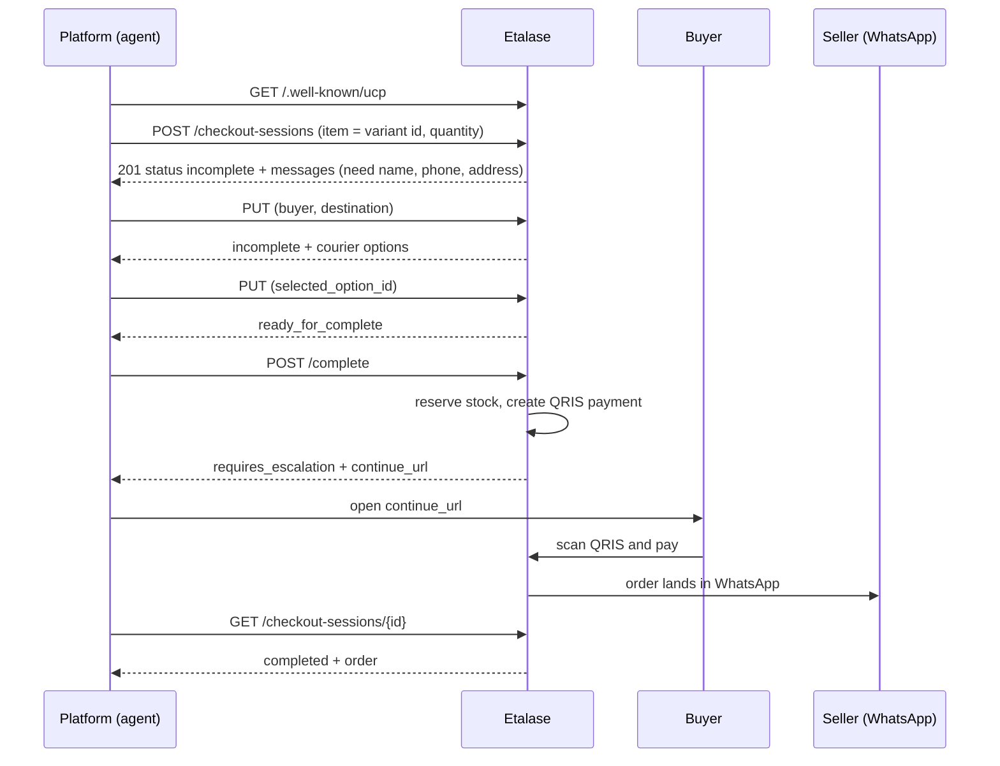

# UCP: the Universal Commerce Protocol

Etalase is a UCP *business*: it publishes the standard discovery profile and answers the standard Checkout calls, so an AI shopping platform that speaks UCP can start a checkout with a WhatsApp seller. This page explains the protocol, how Etalase maps onto it, and exactly how far it has been tested.

::: tip What you will learn
- What UCP is and who plays which role
- What Etalase implements, what it does not, and why QRIS ends in `requires_escalation` instead of `completed`
- The five checkout calls and the status lifecycle, as Etalase uses them
- How it was tested: SDK models, the official conformance suite, and the official sample server as a control
- What you can honestly say to a judge, and what you cannot
:::

## Concepts first

**UCP** is an open standard for agent-led shopping, launched by Google in January 2026 with Shopify, Etsy, Wayfair, Target and Walmart. Three roles matter:

- the **platform** is the shopping surface or agent (AI Mode, the Gemini app, any agent);
- the **business** is the merchant. Etalase plays this role for all its sellers;
- **payment handlers** describe how a payment instrument is processed (cards, wallets). Etalase has none, because QRIS is paid by the buyer outside the API.

A business advertises itself at `/.well-known/ucp`. The platform finds the REST endpoint there and calls the **Checkout** capability. Capabilities have reverse-domain names (`dev.ucp.shopping.checkout`), extensions build on them (`dev.ucp.shopping.fulfillment` extends checkout), and every version is a date (`2026-04-08`). Sources are on the [Evidence](/business/evidence) page; the specification is at [ucp.dev](https://ucp.dev/2026-04-08/specification/overview/).

## What Etalase serves

| Endpoint | Purpose |
|---|---|
| `GET /.well-known/ucp` | Discovery profile: version, the `dev.ucp.shopping` REST service at `/ucp/v1`, the checkout, fulfillment and order capabilities, the buyer-consent extension, the `signing_keys` that verify our webhooks, no payment handlers |
| `POST /ucp/v1/checkout-sessions` | Create a session for one variant and a quantity |
| `GET /ucp/v1/checkout-sessions/{id}` | Read it (the platform polls this after `complete`) |
| `PUT /ucp/v1/checkout-sessions/{id}` | Send buyer, address and the chosen courier option |
| `POST /ucp/v1/checkout-sessions/{id}/complete` | Reserve the stock and create the QRIS payment |
| `POST /ucp/v1/checkout-sessions/{id}/cancel` | Give the stock back for an unpaid checkout |
| `GET /ucp/v1/orders/{id}` | The order as the UCP `Order` entity, after payment and only for the platform that created the checkout. Changes are pushed to that platform as signed webhooks |
| `GET /checkout/{id}` | The hosted payment page that `continue_url` points to. It shows the QRIS code and a live countdown, and swaps to "Paid" by itself when the payment arrives |
| `GET /stores/{seller_id}/returns` | The seller's return policy as a plain page: the target of the `refund_policy` link that every checkout session carries |

All of it is in **`prototype/etalase/gateway/ucp.py`**; the app mounts it in `etalase/api/main.py`. It is a thin layer: it keeps a draft session in the store and calls the same `CheckoutService` as the MCP tools and the WhatsApp flow, so stock reservation, the per-phone limit, courier quotes, payment and the seller's confirm-first rule behave identically on every channel.

Also implemented: the `dev.ucp.shopping.buyer_consent` extension (`buyer.consent` with analytics, preferences, marketing and sale_of_data is recorded on the session as the platform sends it and returned on every response; a request that sends consent replaces it, so it can be withdrawn, one that leaves it out keeps it; Etalase sends no marketing and sells no data, so nothing acts on it yet).

Also implemented: the **Order capability** ([ADR 0011](https://github.com/galihsatriawan/etalase/blob/main/docs/adr/0011-ucp-order-capability.md), `gateway/ucp_order.py` and `gateway/ucp_signing.py`). After payment the platform can read the order and receives a webhook each time it changes: paid, accepted, shipped with the waybill, delivered, returned, refunded. Each webhook is the **full order**, signed with RFC 9421 (ES256 or Ed25519) under a key listed in the profile's `signing_keys`, and sent only to a platform on the allow-list (`UCP_PLATFORMS`), through a connection pinned to a public address. Deliveries are stored, retried with a back-off and reported to the operator when given up. The official suite's Order tests need a sandbox-only test mode ([doc 16](https://github.com/galihsatriawan/etalase/blob/main/docs/16-ucp.md)).

Not implemented, so not advertised: payment handlers and AP2, cart, catalog and discount capabilities, UCP's MCP and A2A bindings, verifying the signature of incoming requests, carts that mix shops, pickup.

## The journey



Status values as Etalase uses them:

| Status | When |
|---|---|
| `incomplete` | Something recoverable is missing; `messages[].path` says what (for example `$.buyer.phone_number`) |
| `ready_for_complete` | Everything is there and the item is in stock |
| `requires_escalation` | The stock is held and the QRIS code exists. The buyer must pay on `continue_url`; the spec obliges the platform to hand the buyer over there |
| `complete_in_progress` | The seller is confirming stock first (confirm-first sellers); the payment code appears when they accept |
| `completed` | Paid. Includes `order` |
| `canceled` | Cancelled, expired unpaid, or rejected by the seller |

Closed checkouts (`completed`, `canceled`) answer `409` to update and complete, and a paid order answers `409` to cancel.

## Decisions worth knowing

- **Why not `completed` straight after `complete`?** UCP's default payment model is a card or wallet instrument that the platform submits. QRIS is different: the buyer scans a code in their banking app, and Etalase learns of the payment from a webhook. Reporting `completed` before money arrived would be wrong, so the checkout stays open until then.
- **Why `requires_escalation` and not `complete_in_progress`?** With `complete_in_progress` a platform may just show "processing" and never open the QR page. `requires_escalation` plus `continue_url` is the spec's way to make the platform hand the buyer over.
- **Amounts.** UCP amounts are minor units under ISO 4217. IDR has exponent 2, so Rp 85.000 is sent as `8500000`. Etalase stores whole rupiah and converts in `to_minor`.
- **One shop per session, up to 10 lines.** A session holds several line items, and the courier quote, the stock reservation (all lines or none) and the order cover all of them. A cart that mixes shops gets an error envelope `unsupported`, because an order, its payout and its parcel belong to one seller: a platform that wants items from two shops opens two sessions.
- **No fetch of the platform profile.** The `UCP-Agent` header carries a profile URL; fetching a URL taken from a request header is an SSRF risk, so Etalase checks only that the header and version are acceptable.
- **Phone number required.** The courier and the seller reach the buyer by phone. A buyer with only an email stays `incomplete` with a recoverable message.

## Testing, in three layers

1. **Unit tests with the official models** (`tests/test_ucp.py`, 18 tests). The `ucp-sdk` package is generated from the UCP JSON schemas; the tests parse the profile with `BusinessSchema` and every checkout response with `Checkout`. They also run the whole flow to a paid order, plus idempotency, cancel, closed sessions, confirm-first sellers, escaping and bad input.
2. **The official conformance suite against Etalase.** `python -m ucp_conformance.run` clones the official repos, starts Etalase with fixed demo items and runs all 17 test files.
3. **The same suite against the official sample server** (`--target reference`) as a control.

Result on 18 Oct 2026 (spec 2026-04-08, ucp-sdk 0.4.6):

| Target | Passed | Failed | Skipped |
|---|---|---|---|
| Official sample server | 76 | 0 | 1 |
| Etalase, production mode (QRIS only) | 31 | 26 | 20 |
| Etalase, sandbox test mode (mock card, Order tests) | 54 | 3 | 20 |

All failures are accounted for in `prototype/ucp_conformance/expected_failures.json` (production) and `expected_failures_test_mode.json`, and the runner exits non-zero if an unlisted failure appears. The 26 production failures are: tests that pay with a card or AP2 and expect `completed` in the same call (8), tests that need an order created by the suite's mock card or its simulation hooks (13), discount tests that the suite does not skip when the capability is absent (2), and the sample server's own simulation hooks (3). 23 of the 26 pass in test mode; the 3 test-mode failures are two discount tests and one that sends a raw card number. Read [UCP in docs/16](https://github.com/galihsatriawan/etalase/blob/main/docs/16-ucp.md) for the table.

::: warning What this does not prove
In production mode the official suite never reaches Etalase's *completion* path, because it completes with a card; that path is covered by our own tests, and in test mode by the mock card. Test mode is a sandbox setting that production refuses to start with. Nobody has tried it with Google's surfaces, and UCP checkout is not live for Indonesian businesses that we know of. Say "we implement the UCP checkout over REST and pass the applicable conformance tests", not "we are UCP certified" (there is no certification) and not "we work with AI Mode".
:::

## Try it by hand

```bash
cd prototype
python -m ucp_conformance.server --port 8190          # Etalase with demo items item_1 and item_out_of_stock
curl -s localhost:8190/.well-known/ucp | python -m json.tool
curl -s -X POST localhost:8190/ucp/v1/checkout-sessions \
  -H 'UCP-Agent: profile="https://platform.example/profile"' \
  -H 'Content-Type: application/json' \
  -d '{"line_items":[{"item":{"id":"item_1"},"quantity":2}]}' | python -m json.tool
```

## Quick check

1. Why does `complete` not return `completed`?
2. Which header does the platform send on every call, and what does Etalase do with it?
3. A platform sends a buyer with only an email. What status comes back, and what tells the platform what to add?
4. Name two kinds of conformance test Etalase fails and why that is not a bug.

::: details Answers
1. QRIS is paid by the buyer outside the API and confirmed by a webhook; `completed` before payment would be false. The session is `requires_escalation` with a `continue_url`.
2. `UCP-Agent` with the platform's profile URL (and optionally a version). Etalase requires it and rejects unsupported versions with 422, but does not fetch the profile.
3. `incomplete`, with `messages` entries of code `missing` and `path` values such as `$.buyer.phone_number`.
4. Tests that complete with a card instrument (Etalase takes QRIS) and order-capability tests (not implemented, not advertised).
:::
