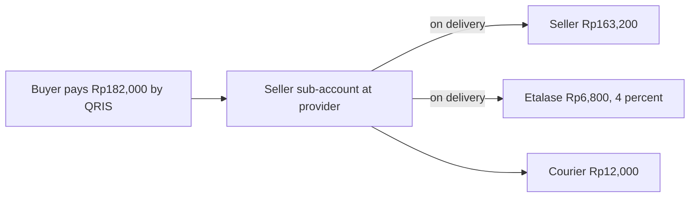

# Business model and costs

Etalase earns a small commission on each delivered order, and this page shows where that money goes, what one order and one pilot month cost, and which numbers are still assumptions.

::: tip What you will learn
- How Etalase charges (commission per delivered order, 4% in the prototype) and where that rule lives in code
- The unit economics of one IDR 170,000 order, from buyer payment to seller payout
- The pilot's monthly cost table and the AI cost per product and per order, with the arithmetic
- WhatsApp and QRIS fees, who pays for the buyer's AI agent, and the tax picture
- Go-to-market and the risks that could break the model
:::

::: warning Source rules for this page
Every figure here comes from `docs/10-business-model.md`, `docs/09-security-privacy-compliance.md` or the submission deck, and each external number is backed on [Evidence and sources](/business/evidence) with the quote, date and link. Lines marked "our arithmetic" are calculations on those figures, not new data. Nothing here is legal or tax advice.
:::

## Concepts: what is being sold

Etalase sells **a sales channel**, not software seats. A seller turns photos and chats into an agent-ready catalog for free; Etalase earns only when an AI agent's buyer completes an order and the courier confirms delivery. Three ideas carry the model:

- **Pay per sale.** No monthly fee, no listing fee. A seller who never sells pays nothing (`docs/10`).
- **Cheaper than a marketplace for fee-heavy categories, on a channel the seller owns.** The prototype charges 4%; Shopee Indonesia's admin fee for fashion is 10% plus Rp1,250 per order for non-Mall sellers after the 2026 revision, but its range starts at 2.5% for low-fee categories ([Evidence](/business/evidence#competitors)). Mayar charges about the same as we do (3% + 0.7% QRIS, no monthly fee), so 4% is not a discount against it. The pitch line in `docs/10` is "pay-per-sale, on a channel the seller owns, with a catalog from photos and a buyer-protection hold".
- **Money stays in the seller's sub-account at a licensed payment provider** and is split on release (`docs/adr/0003-never-hold-funds.md`). Etalase does not receive buyer payments in its own account. Whether the provider can enforce the hold, and the legal classification, are open.

### Who pays (B2B2C)

| Segment | Pays | How |
|---|---|---|
| WhatsApp and Instagram sellers | Seller | Commission per delivered order, 3–5% (4% in the prototype), excluding VAT |
| OMS and website-builder partners | Partner or their merchants | Revenue share or per-store fee through the Connector API |
| Later: banks, e-wallets, payment providers | Partner | Merchant acquisition into digital payments |

Later revenue in `docs/10`: an optional monthly plan for multi-channel sync and analytics. <Badge type="info" text="Roadmap" />

## How the commission works in code

<Badge type="tip" text="Built" /> The commission is computed once, when a delivered order is released. From **`prototype/etalase/checkout/service.py`** (`release_payout`):

```python
        seller = self.store.get_seller(order.seller_id)
        rate = seller.commission_rate if seller.commission_rate is not None else self.settings.commission_rate
        commission = round(order.subtotal * rate)
        seller_amount = order.subtotal - commission  # the shipping fee goes to the courier
```

- The default rate is `COMMISSION_RATE=0.04` (`prototype/.env.example`, `config.py`); a seller can have their own `commission_rate`, which is how a pilot could test 3% vs 5%.
- Commission applies to the **subtotal only**. Shipping is paid by the buyer and goes to the courier.
- It runs only after `shipment_update` confirms delivery with the courier, so a cancelled or refunded order never pays commission.
- With the mock adapter the split is recorded; with Xendit, `release_to_seller` raises `ManualActionRequired` and the payout becomes `pending_manual` (with an ERROR log line for an operator) until xenPlatform settlement is set up ([Turn on real services](/ship/real-services#xendit-qris-test-mode)). <Badge type="warning" text="Mocked in demo" />

## One order, end to end

The deck's wireframe uses this order: 2 × Voal Hijab Black at Rp85,000, shipped JNE REG to Bandung for Rp12,000.



| Line | Amount | Source |
|---|---|---|
| Subtotal (2 × Rp85,000) | Rp170,000 | Deck wireframe |
| Shipping (JNE REG) | Rp12,000 | Deck wireframe |
| Buyer pays | Rp182,000 | Deck wireframe |
| Etalase commission, 4% of subtotal | Rp6,800 | Deck, `docs/10` |
| Seller payout | Rp163,200 | Deck wireframe ("Payout Rp163,200 after delivery (4% fee)") |
| Gateway processing fee | Shown to the buyer as a payment fee in the pilot, if it applies | `docs/10` (Xendit's global price list shows IDR 4,000; its Indonesian page shows no fixed fee; unconfirmed) |

**Platform cost per order (revised 16 Oct 2026):** WhatsApp IDR 2,535–4,140 (7–9 charged messages at IDR 357–460, because Meta's newer documentation says service messages and in-window utility replies are charged from 1 Oct 2026), AI IDR 90–380, cloud IDR 160–480, Biteship's subscription IDR 149. Earlier versions of this page said IDR 2,000–3,500; that range assumed in-window replies were free and is now out of date (`docs/10`).

**Per-seller fixed costs:** Xendit's Indonesian page lists xenPlatform at Rp25,000 per active account per month (unconfirmed; its global page shows a far higher schedule), and Biteship's Grow plan costs Rp149,000 per month from 2 Nov 2026. These do not scale with orders, so they depend on **orders per seller per month**:

| Orders per seller per month | Margin per order against the IDR 6,800 commission |
|---|---|
| 4 | −IDR 2,384 to −4,599 |
| 10 (the pilot assumption) | +IDR 1,366 to −849 |
| 20 | +IDR 2,616 to +401 |

(our arithmetic; excludes the IDR 4,000 gateway fee, refunds, disputes, support and VAT). A pure 4% commission is only comfortable above roughly 20 orders per seller, and we have no data on how many orders a chat-first seller gets.

**Sensitivity (our arithmetic on the same order):**

| Change | Effect |
|---|---|
| Commission 3% instead of 4% | Rp5,100 per order |
| Commission 5% | Rp8,500 per order |
| Etalase absorbs the IDR 4,000 gateway fee instead of passing it on | About IDR −700 to +800 left per order. This is why `docs/10` says "the margin would disappear at list price" and puts gateway pricing on the pilot validation list |

## Pilot monthly cost

Assumptions from `docs/10` and the deck: **100 sellers, 3,000 products, 1,000 orders a month**, US$1 ≈ IDR 16,000, "rough estimates to validate with the Google Cloud Pricing Calculator".

| Component | Basis | Est. / month |
|---|---|---|
| Cloud Run, Firestore, Storage, Pub/Sub | Low pilot traffic, mostly within free tiers | US$10–30 |
| Gemini on Vertex AI | ~3,000 catalog extractions + ~2,000 seller-agent turns (buyers' agents run on their own models) | US$15–60 |
| WhatsApp Cloud API | ~4 utility templates + ~3–5 charged replies per order × 1,000 orders at ~IDR 357–460 (in-window replies charged from 1 Oct 2026 per Meta's newer page; re-check) | ~US$160–260 |
| Biteship | Grow plan from 2 Nov 2026, Rp149,000 per month, plus prepaid shipping float | ~US$9 |
| Xendit xenPlatform account fee | Rp25,000 per active seller per month on Xendit's Indonesian page (unconfirmed) | ~US$155 |
| QRIS payments | MDR 0% only if the seller is classified as micro; gateway fixed fee, if any, shown to the buyer | Pass-through or 0.7% |
| **Total platform cost (excluding gateway fees and refunds)** | | **≈ US$350–520** |

Check of the WhatsApp line (our arithmetic): 7–9 × 1,000 × IDR 357–460 ≈ IDR 2.5–4.1 million ≈ US$158–259.

Illustrative revenue (our arithmetic, only if every order were IDR 170,000): 1,000 × IDR 6,800 = IDR 6.8 million ≈ US$425 a month. This is not a forecast; the pilot's real order values are unknown.

::: warning Cloud line caveat
The deploy script keeps `--min-instances 1` and `--no-cpu-throttling`: an always-on instance whose CPU is billed all the time, not only during requests. `docs/10` does not say whether its US$10–30 includes that, so re-check it in the pricing calculator before quoting it ([Deploy to Cloud Run](/ship/deploy#costs)).
:::

## AI cost per product and per order

Most expensive AI work happens **outside Etalase**: the buyer's conversation runs on the buyer's agent, and Etalase's MCP tools are plain database queries. Etalase pays for Gemini in two places (`docs/10`):

| Workload | Tokens (estimate) | Gemini 2.5 Flash | Gemini 3.8 Flash from 2027 |
|---|---|---|---|
| Catalog extraction, once per product (3 photos + 20 s voice note + text → JSON) | ~4,500 in / ~800 out | ≈ US$0.004 (≈ IDR 65) | ≈ US$0.013 (≈ IDR 210) |
| Seller agent per order (≈ 2 free-text turns, 2 model calls each) | ~12,000 in / ~800 out | ≈ US$0.006 (≈ IDR 90) | ≈ US$0.024 (≈ IDR 380) |

Prices per 1M tokens on Vertex AI: Gemini 2.5 Flash US$0.30 input, US$1.00 audio input, US$2.50 output; Gemini 3.8 Flash US$0.75 / 3.75 introductory until 31 December 2026, then US$1.50 / 7.50 ([Evidence](/business/evidence#costs-and-prices)).

How the seller-agent figure is built (our arithmetic): 12,000 × 0.30 / 1M = US$0.0036 input, plus 800 × 2.50 / 1M = US$0.0020 output, ≈ US$0.006. At 2027 list prices: 12,000 × 1.50 / 1M + 800 × 7.50 / 1M = US$0.024 ≈ IDR 380, which is about **5.6% of the IDR 6,800 commission**. Even in the expensive case, AI is a small slice; WhatsApp is the big one.

Two nuances from the link check: the 3.8 Flash introductory price is delivered as "50% credits back on net spend", and the pricing page lists those 3.8 Flash prices for the global endpoint, with higher prices on regional endpoints. The prototype defaults to `gemini-3.8-flash`, because Google now limits the 2.5 models to existing users, so a new project cannot count on them. At the introductory 3.8 Flash prices the same arithmetic gives about US$0.006 per extracted product and US$0.012 per seller-agent order (our arithmetic, text rates), still far below the commission.

**Keeping AI cost low** (from `docs/10`): buttons and the offline parser handle common commands without a model call; Flash-Lite for routing and short replies; batch or flex pricing (50% off) for bulk imports; context caching (about 10% of the input price) for the agent's instructions; a free allowance per seller (for example the first 50 products), then a paid plan for very large catalogs.

### Who pays for the buyer agent's AI?

The buyer's AI assistant (for example Gemini in AI Mode, or any MCP client) pays for its own model calls; that is the platform's or the buyer's cost, not Etalase's. Etalase pays only for the tool calls the agent makes: Cloud Run time and, when Biteship is on, about IDR 5 per shipping-rate check (`docs/06` suggests caching rates for a few minutes).

One exception: the **demo buyer agent** (`prototype/etalase/agents/buyer_agent.py`) runs on Etalase's own Gemini credentials, so during the demo Etalase pays for the buyer side too. That is a demo cost, not part of the model.

## WhatsApp and QRIS fees

**WhatsApp.** Meta charges per message. Utility templates cost about IDR 357–460 (Qontak's IDR price includes its fee; US$0.0287 on USD rate cards). Meta's older pricing page said replies inside an open window are free, but Meta's newer documentation page says that from 1 October 2026 service messages are charged at the utility rate and utility messages sent as in-window replies are charged too; resellers list a service price of about IDR 357 and some report a 1,000-message free quota that we could not find in Meta's text. We read these pages through a summarising tool, so re-open Meta's page before quoting ([Evidence](/business/evidence#costs-and-prices)). WhatsApp is the largest cost per order (37–61% of the commission in our estimate), which is why the design keeps seller messages short and combined, and why a per-seller message meter is a recommended priority (not built).

**Click-to-WhatsApp (CTWA) ads.** Resellers describe a free window for a chat that starts from such an ad (72 hours to 7 days, depending on who you read), and Meta's own page was not confirmed. It does not make Etalase's alerts free: they go to a seller on events (a paid order) that no ad opens. It can make a seller's first chat with Etalase free if Etalase runs the ad, and it makes the buyer chats of sellers who run CTWA ads free to those sellers.

**A second channel with no per-message fee: Telegram (built).** A seller can link a Telegram chat in the dashboard and receive orders, stock checks and payouts there. A Telegram bot can message a user at any time once the user has started it: no 24-hour window, no templates, and the Bot API pages describe no price. It shows that cost can be moved by changing a channel; it is not a claim that Indonesian sellers use Telegram. WhatsApp stays the default and the sign-in identity.

**Instagram and Facebook.** Meta's pages describe a 24-hour window for both and no price; "Instagram DMs are free" came from a vendor table we could not confirm. So Instagram is used as an input (importing posts as drafts) and as a door (the store link in the bio), not as the channel for order alerts. A buyer-side Instagram DM bot would have to run per seller, on each seller's own account, and is roadmap only ([Pitch and Q&A](/business/pitch-and-qa), Q49).

**QRIS.** Since 1 October 2026 Bank Indonesia sets the merchant discount rate at 0% for micro merchants on transactions up to Rp500,000 and for all merchants up to Rp100,000; above that 0.3% (micro) or 0.7% (others) (Bank Indonesia press release 28/159/DKom). The release does not say who classifies a sub-merchant behind a gateway, so on a typical Rp170,000 order the MDR is 0% only if the seller is classified as micro; otherwise it is 0.7% (Rp1,190). Mayar's and Midtrans' pages still show 0.7%. Xendit's global price list shows a fixed IDR 4,000 processing fee, which is large against a Rp6,800 commission; its Indonesian page shows none, and whether it applies to an Indonesian contract is unknown. Xendit's pages give two QRIS settlement times (T+1 and T+2) and three versions of the refund rules.

## Tax

::: danger Not legal or tax advice
This summarises `docs/09` and its sources as of October 2026. Indonesian e-commerce tax rules changed several times in 2025–2026. Confirm with a tax adviser before the pilot.
:::

| Tax | Who | What we know | Caveat |
|---|---|---|---|
| Seller income tax (PPh final UMKM, PP 55/2022) | The seller | 0.5% final tax on turnover up to Rp4.8 billion a year; for individuals the first Rp500 million a year is untaxed; individuals can use the rate for at most 7 tax years; PP 20/2026 extends it to tax year 2026 for individuals whose period had ended in 2024 or 2025 | Etalase only provides monthly sales reports to help sellers file |
| PPh 22 collection by marketplaces (PMK 37/2025) | Marketplaces appointed by DJP | 0.5% of gross turnover; four marketplaces appointed in July 2026; individuals with turnover up to Rp500 million exempt with a statement letter. DJP then postponed collection to 31 October 2026 (PENG-46/PJ.09/2026) and revoked the appointments; the finance minister floated a 2027 start | Status can change again. Etalase is unlikely to be appointed early; whether it could ever meet the criteria is a question for an adviser |
| VAT on Etalase's commission | Etalase | Commission is a service; VAT applies once Etalase is VAT-registered (mandatory above Rp4.8 billion annual turnover, voluntary earlier). Pricing states commission excluding VAT | The Rp4.8 billion source is a 2014 DJP release; `docs/09` keeps a **verify** tag |
| VAT on goods | The seller | Most small sellers are not VAT-registered | |

In code, each country pack has a `tax_profile` (`"id-ppn"` for Indonesia in `config.py`). It is declared but not yet used by any calculation. <Badge type="info" text="Roadmap" /> If withholding ever applies, it would be applied at payout through that profile (`docs/09`).

## Go-to-market

From `docs/10` and `docs/11`:

1. **Pilot in one category and city:** fashion and hijab sellers in Jakarta and Bandung, reached through seller communities and WhatsApp groups. Target 50–100 real sellers (roadmap phase 2).
2. **Partners:** payment providers and local website builders through the Connector API.
3. **Distribution through partner app stores:** OMS and marketplace partner programmes, for stock sync.

**Assumptions to validate first:** sellers' willingness to pay 3–5% per order; the share of sellers who track stock at all; when UCP checkout reaches Indonesia; payment provider support for sub-accounts and delayed release.

## Risks

| Risk | Why it matters | Mitigation in the docs |
|---|---|---|
| **Timing** | UCP checkout is not live in Indonesia ([Evidence](/business/evidence#agentic-commerce-adoption)) | The catalog and QRIS checkout link are useful without agents; MCP works with any agent now |
| **Volume** | Agent-driven volume is still small | Pay-per-order pricing, so sellers carry no risk while it grows |
| **Gateway fixed fee** | IDR 4,000 list price exceeds the platform cost per order | Pass it to the buyer in the pilot, negotiate volume pricing, compare Midtrans |
| **WhatsApp pricing** | About half of the cost per order; service-message pricing changed on 1 Oct 2026 | Buttons, combined messages, stay inside the 24-hour window |
| **Payments licensing** | Holding others' money is regulated | Funds stay in provider sub-accounts; confirm with the provider and a legal adviser |
| **Willingness to pay** | 3–5% is an assumption, not a measured result | First thing to test in the pilot |
| **Fixed costs** | Onboarding and support, not inference, are the larger margin risk (`docs/10`) | WhatsApp-first onboarding, no new app |
| **Fast followers** | Local WhatsApp-tool vendors could add similar features | Seller network, local catalog data, Connector API partnerships |

## Check yourself

1. Why is the commission computed in `release_payout` and not at checkout?
::: details Answer
Commission is charged only on delivered orders. `release_payout` runs after the courier confirms delivery, so refunded, rejected or expired orders never generate commission, and the split happens at release from the seller's sub-account.
:::

2. A judge says "AI must be your biggest cost". What do you answer?
::: details Answer
No. On Gemini 2.5 Flash the seller agent costs about IDR 90 per order and extraction about IDR 65 per product; even at 2027 Gemini 3.8 Flash list prices it is about IDR 380 per order, about 5.6% of the IDR 6,800 commission. WhatsApp messages (IDR 2,535–4,140 per order since 1 October 2026), per-seller account and subscription fees, and the gateway's fixed fee are bigger.
:::

3. Who pays for the buyer's AI agent, and what is the one exception?
::: details Answer
The buyer's AI platform runs and pays for its own model; Etalase serves database-backed MCP tools. The exception is the demo buyer agent, which runs on Etalase's Gemini credentials.
:::

4. When is QRIS MDR 0% for an Etalase seller, and why is payment cost still a risk?
::: details Answer
Since 1 October 2026 the MDR is 0% for every merchant up to Rp100,000 and for micro merchants up to Rp500,000. A typical Rp170,000 order is above the first threshold, so 0% applies only if the gateway classifies the seller as micro (not defined in the BI release); otherwise it is 0.7%. Gateways can also add a fixed processing fee (Xendit's global list shows IDR 4,000; unconfirmed for Indonesia), which would wipe out the margin if Etalase absorbed it.
:::

5. What is the status of marketplace PPh 22 collection under PMK 37/2025?
::: details Answer
DJP postponed it to 31 October 2026 (PENG-46/PJ.09/2026) and revoked the earlier appointments; the finance minister has floated a 2027 start. It applies to appointed marketplaces, not to Etalase today. Not tax advice; re-check before the pitch.
:::

## Next

[Evidence and sources](/business/evidence)
