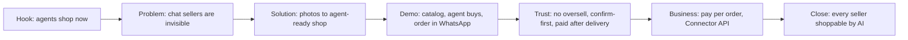

# Pitch and Q&A playbook

How to pitch Etalase in 30 seconds and in 3 minutes, how to prove each judging criterion, and how to answer 51 hard judge questions honestly.

::: tip What you will learn
- A 30-second pitch and a 3-minute pitch that follow the deck's slide order and the demo script in `docs/13-demo-script.md`
- Which file, test or page proves each judging criterion and each special award
- Model answers to 51 hard questions, each tagged as Built, Mocked in demo or Roadmap
- The overclaims that lose a judge's trust, and what to say instead
:::

## Why honesty is your strongest pitch move

Judges at AI Builder Cup 2026 score four things: **Technical Merit & Gen AI (40%)**, **Problem Alignment & Impact (25%)**, **Innovation & Creativity (25%)** and **UX & Solution Design (10%)**. Most of them have seen many prototypes. They don't mind that payments are mocked. They do mind if you say something is live and the demo shows it is not.

So in every answer, say clearly how far each part has got. Use the same three words as the rest of this site:

| Status | Meaning | Examples |
|---|---|---|
| <Badge type="tip" text="Built" /> | The code exists and runs; tests cover it | MCP server, stock reservations, confirm-first, WhatsApp inbox, ADK seller agent, Connector API, OTP sign-in, startup checks |
| <Badge type="warning" text="Mocked in demo" /> | The code to switch it on exists, but the demo runs a stand-in | Gemini (runs only with an API key or Vertex AI; offline parsers otherwise), Xendit QRIS (`MockPayment`), Biteship (`MockShipping`), payouts, Firestore (demo uses `MemoryStore`), KYC |
| <Badge type="info" text="Roadmap" /> | Designed or planned, not written | Pub/Sub, Cloud Tasks, Cloud Storage, KMS, Google Sheets sync, OMS adapters, WooCommerce plugin, AP2, Merchant Center feed |

If you are not sure which status something has, the safe answer is: "That part is wired but mocked in the demo; here is the adapter." Then show the file.

## The shape of the pitch

Each box is one idea. If you run out of time, cut from the business box, never from the trust box. Trust is the part that makes this a real system and not a chatbot demo.

## The 30-second pitch

Learn this word for word. It fits in about 75 words.

> A WhatsApp seller sends photos and a voice note. Etalase turns them into a catalog and a store link where anyone can pay with QRIS, and an AI agent that its owner connects can search and reserve over MCP. Stock is held while the buyer pays, the order lands in the seller's chat, and the payout waits for the return window. In Indonesia 95% of e-commerce businesses use chat apps like WhatsApp to sell, but their catalogs live in photos and voice notes. The seller side and the store link are the product today; the agent door is an option for when agents start buying.

If a judge asks "where is the AI?", add one sentence: "Gemini builds the catalog from photos, voice and text with structured output, and an ADK agent runs the seller's WhatsApp chat."

## The 3-minute pitch

This version follows the deck slide order (slides 2 to 12 in `submission/Etalase_AI_Builder_Cup_Submission.pdf`) and reuses the scenes and voice-over of `docs/13-demo-script.md`. The recorded video follows `docs/13` exactly. Use this version when you present live and switch between slides and the running app.

| Time | Deck slide | What you show | What you say (key lines) |
|---|---|---|---|
| 0:00–0:20 | 2 · Brief about the idea | "Why now" and the four numbers | "AI shopping is arriving. Checkout through Google's UCP is live in the US and has started in Australia; in Indonesia only discovery is live so far. Agents only read structured catalogs. Platforms make their own merchants agent-ready; independent chat sellers have no path in." |
| 0:20–0:40 | 2 · The problem | 95% / 18% (BPS) and 11% (PYMNTS × Visa) | "95% of Indonesian e-commerce businesses use chat apps to sell; only 18% use marketplaces. Only 11% of small merchants are ready for agents, in a global survey." |
| 0:40–1:05 | 4 · Features, 6 · Wireframe 1 | Seller sends photos and a voice note; summary with readiness score; **Publish** | "Rina just sends what she already has. Gemini turns photos and a voice note into products, variants, prices and weights, and tells her what is missing." |
| 1:05–1:45 | 5 · Process flow, 6 · Wireframe 2 | Buyer agent: search, shipping quote, checkout, QRIS | "Any agent can now find her products over MCP and check out. Stock is held for 15 minutes while the buyer pays with QRIS." |
| 1:45–2:05 | 6 · Wireframe 3 | "New paid order" with **Accept**; seller replies "tracking JNE123456" | "Rina never leaves WhatsApp. Buttons never go through the model." |
| 2:05–2:25 | 4 · Safe agent checkout, 11 · Benchmark | Confirm-first message; the 50-agent race (demo step 8) | "Low or stale stock? She confirms before the buyer pays. 50 agents race for the last unit; exactly one wins. 675 automated tests cover races, payments and webhook abuse." |
| 2:25–2:45 | 7 · Architecture, 9 · Cost | Architecture slide; unit economics | "She's paid after the courier confirms delivery, minus 4%. The money sits in the seller's sub-account at the payment provider, not in ours. Platform cost per order is about IDR 5,000–7,600 at ten orders per seller, against IDR 6,800 commission, so we are testing a minimum fee. Any OMS or website builder can plug in with one API." |
| 2:45–3:00 | 12 · Roadmap | Four phases | "Next: a pilot with 50–100 sellers on Firestore and real payment sub-accounts. Etalase: every seller, shoppable by AI." |

::: warning Say the status out loud once
Somewhere around 2:05, say: "Payments and couriers run on mocks in this demo; the Xendit and Biteship adapters are wired and switch on with credentials." One sentence like this protects every other claim you make.
:::

## How each judging criterion is evidenced

For each criterion, have one claim, one thing to show and one place to point to. Links go to Academy pages; file paths are in the repo.

| Criterion | Your claim | Show this | Where it lives |
|---|---|---|---|
| **Technical Merit & Gen AI (40%)** | Gemini multimodal extraction with structured output; ADK seller agent with tenant-scoped tools; ADK buyer agent over MCP; transactional stock tested under concurrency | `GeminiExtractor` with `response_schema=ExtractedCatalog`; `build_seller_agent` tools; `pytest -q` (675 passed); demo step 8 | [Catalog and stock](/architecture/catalog-and-stock), [Seller agent](/architecture/seller-agent), [Agent gateway](/architecture/agent-gateway), [Testing](/ship/testing); `prototype/etalase/catalog/extractor.py`, `prototype/etalase/agents/seller_agent.py`, `prototype/tests/test_stock.py` |
| **Problem Alignment & Impact (25%)** | Brings chat-first sellers into online shopping with a catalog from photos, a QRIS store link and an agent door; pay-per-order below marketplace fees for fee-heavy categories; payout after delivery and the return window | BPS 95% / 18% with its nuance; Shopee 10% fashion fee; cost table with the 20-orders break-even | [The problem](/foundations/problem), [Evidence](/business/evidence), [Business model](/business/business-model); `docs/15-evidence.md` |
| **Innovation & Creativity (25%)** | Catalog from photos and voice notes plus an agent-readable store for sellers who run on chat (we found no competitor page claiming the first part); WhatsApp as the seller interface; confirm-first for uncertain stock; Connector API so one partner enables many stores | Confirm-first flow; Connector API in `/docs` | [The product](/foundations/product), [Integrations](/architecture/integrations); `prototype/etalase/catalog/service.py` (`sell_mode`), `prototype/etalase/connector/service.py` |
| **UX & Solution Design (10%)** | No new app; buttons for decisions, chat for data; bilingual; honest availability for agents | WhatsApp summary with Publish / Edit; `SELLER_LOCALE=id`; dashboard sign-in | [Seller agent](/architecture/seller-agent), [Hands-on](/run/hands-on); `prototype/etalase/seller/i18n.py`, `prototype/etalase/api/dashboard.html` |

### Special awards

| Award | Why Etalase can compete | What to emphasise |
|---|---|---|
| Best use of Google Cloud AI tools | Gemini on Vertex AI (multimodal plus structured output), two ADK agents, Cloud Run, Secret Manager, a Firestore store | Be exact: Pub/Sub, Cloud Tasks, Storage and KMS are roadmap, not used |
| Most Impactful | Targets Indonesian businesses that sell in chats (95% of e-commerce businesses use messaging apps to sell, BPS 2023), at a fee below marketplaces for fee-heavy categories | Use BPS numbers with the multi-channel and definition nuance |
| Social Choice | The ~3-minute public video | Public link (not unlisted), English captions, the split-screen story from `docs/13` |
| Best UI/UX | The seller UI is WhatsApp itself; buttons for money and stock decisions | Show the bilingual messages and the confirm-first question |

## How to answer a hard question

Use the same three steps every time:

1. **Answer directly** in one sentence ("No, not yet." / "Yes, here is how.").
2. **Give the evidence**: a number with its source, a file or a test.
3. **State the status** (Built, Mocked in demo, Roadmap) and the next step.

Practice: read the question, answer out loud, then open the model answer. Each answer is 2–5 sentences, which is about 20–30 seconds of speaking.

## Q&A bank

### Problem and market

**Q1. Is agent commerce actually live in Indonesia?**

::: details Answer
No, and we say so. AI discovery is live in Indonesia, but we found no agent checkout and no report of an agent-initiated purchase. Agent checkout through Google's UCP is live in the US (February 2026) and started with select retailers in Australia (June 2026); Google is testing Flipkart checkout in India; one trade report (not Google) says Indonesia is next, with no date, and Google's UCP takes cards, not QRIS ([Evidence](/business/evidence)). Etalase does not need UCP to work: the seller side and the store link run today, and an MCP or REST agent whose owner connects it to our server can search and reserve. The ADK buyer agent in `prototype/etalase/agents/buyer_agent.py` proves the flow. We treat the agent door as an option, not the revenue plan.
:::

**Q2. How big is your segment, really?**

::: details Answer
BPS reports that 95.33% of Indonesian e-commerce businesses use instant messaging apps to sell, 17.80% use marketplaces and 1.77% a website ([Evidence](/business/evidence)). Businesses can use several channels, and the survey counts any business that took orders online, so it means "chat is the default order inbox", not "95% have no store system". For the region, e-Conomy SEA projects US$185B of e-commerce GMV in 2025. We do not quote a GMV for chat commerce, nor the share of product sellers who are chat-first, because no source measures them; the seller interviews are meant to size it.
:::

**Q3. Isn't your 2019 regional data old?**

::: details Answer
Yes, and we no longer lead with it. The Facebook-funded Facebook × BCG study is the only cross-country Southeast Asia comparison we found, and its Indonesia figure was 29%, lower than Thailand or Vietnam. For Indonesia we use BPS 2023 data, published in January 2025, which is newer and official ([Evidence](/business/evidence)).
:::

**Q4. Chat sellers like talking to buyers and haggling. Do they even want AI agents as buyers?**

::: details Answer
That is an assumption we still have to test, and it is on our validation list in `docs/10-business-model.md`. Etalase doesn't replace the chat: the seller keeps selling to people in WhatsApp, and agent orders are an extra channel that arrives in the same chat. Because pricing is per delivered order with no monthly fee, a seller who gets no agent orders pays nothing.
:::

**Q5. Agent-driven volume is tiny today. Why build this now?**

::: details Answer
Only 11% of small and mid-size merchants are agent-ready versus 19% of large ones, and only 15% of merchants have structured product data (PYMNTS × Visa, [Evidence](/business/evidence)). Getting a catalog into shape takes time, and Morgan Stanley expects agents to handle about 10% (up to 20%) of US online retail by 2030. Pay-per-order pricing means sellers carry no cost while volume grows; that is the mitigation for the timing risk listed in `docs/01-problem-and-market.md`.
:::

### Competitors

**Q6. Why won't Shopify do this? Its Agentic plan is open to non-Shopify brands.**

::: details Answer
Correct: since March 2026 Shopify's Agentic plan accepts brands that are not on Shopify ([Evidence](/business/evidence)). It is built for brands that already have structured catalogs and card or wallet checkout. Our sellers have no store system, keep their catalog in photos and voice notes, and are paid by QRIS; there is no WhatsApp order loop in Shopify's offer, and availability for Indonesian sellers is unconfirmed.
:::

**Q7. Why won't Stripe do this with its Agentic Commerce Suite?**

::: details Answer
Stripe's suite targets website platforms such as WooCommerce, Wix, Squarespace and BigCommerce. Stripe in Indonesia is invite-only and supports only virtual-account bank transfers, with no QRIS ([Evidence](/business/evidence)). Our payment layer is an adapter (`PaymentProvider` in `prototype/etalase/adapters/payment.py`), so Stripe can be the provider in markets where it fits; that is roadmap phase 4.
:::

**Q8. Shopee is already in ChatGPT and building an agent prototype with Google. Why won't Shopee win?**

::: details Answer
Shopee brings its own listings to AI agents, and checkout continues on Shopee with its fees, for example 10% for fashion for non-Mall sellers after the 2026 revision ([Evidence](/business/evidence)). That's the right move for Shopee, but only 17.80% of Indonesian e-commerce businesses use marketplaces at all. We plan to use marketplace partner APIs only for stock sync (roadmap) and never to resell marketplace listings to agents.
:::

**Q9. Why won't Meta add this to WhatsApp?**

::: details Answer
It is already moving there. Meta Business Agent answers buyers inside WhatsApp Business for free and recommends products from the seller's catalog; the press reports an Indonesian launch on 11 Aug 2026, though rollout, pricing and payment support in Indonesia are unconfirmed. In Indonesia WhatsApp's own payment feature only copies bank details. On the pages we read, Meta's agent does not build a catalog from photos, run QRIS checkout, reserve stock or open the catalog to third-party agents. If Meta adds payment or catalog intake, what remains for us is catalog quality, reserved stock and the payout hold, and we say so. We are a WhatsApp Cloud API customer, and if Meta opens agent features we plug in through the `Messenger` adapter.
:::

**Q9a. WhatsApp Business already has a catalog and a cart. What do you add?**

::: details Answer
Correct, and it is free. The app lets a seller type up to 500 items one at a time; each colour or size is its own item, there is no stock field, and a buyer's cart
arrives as a chat message. WhatsApp does not process the payment, so the seller sends bank details and confirms by hand. We add what happens before and after that:
the catalog is built from photos and voice notes instead of typing, stock is held while the buyer pays, QRIS is confirmed automatically, couriers are priced, and the
payout waits for the return window. We do not sync with the WhatsApp catalog today: whether products typed in the app can be read through the API is unverified, and
writing to it would need each seller's own WhatsApp account. Importing from a spreadsheet or Instagram is the next step. These facts come from vendor pages, not from
Meta's own, and we say so.
:::

**Q10. Why won't Google do this itself?**

::: details Answer
Google builds the protocol (UCP) and the shopping surfaces (AI Mode, the Gemini app) and relies on merchants and platforms to supply structured catalogs and checkout. Etalase is that merchant-side layer for sellers who have no store system. We run a UCP business server today (profile and checkout over REST) and plan a Merchant Center feed, so we feed Google rather than compete with it. We have no partnership with Google, and we don't claim one.
:::

**Q11. There are already agent-readiness tools like AgentReady, ShopAgentic and Era. How are you different?**

::: details Answer
They work on catalogs that already exist. The New Era of Shopping (US$1.4M pre-seed) serves brands, ShopAgentic (€1.9M pre-seed, Germany) prepares retailers' existing commerce systems, and AgentReady is a Shopify app that audits a store against 17 checks ([Evidence](/business/evidence)). Etalase builds the catalog from photos, voice notes and chats, then runs the whole checkout: stock reservation, confirm-first, QRIS, couriers and orders back in WhatsApp. Our readiness score is a side feature, not the product.
:::

**Q12. Cekat.ai, Orderfaz and other WhatsApp tools could add this next month.**

::: details Answer
They could, and "fast followers" is a risk we list in `docs/01-problem-and-market.md`. Today these tools serve human buyers, not AI agents. Our answer is speed to sellers in one category, local catalog data, and the Connector API, which lets such tools become partners instead of rivals.
:::

**Q13. So what is your moat?**

::: details Answer
Honestly, not the code alone; a good team could rebuild the prototype. The defensible parts are a seller network in a category, the catalog data built from that network, partnerships through the Connector API, and a record of never overselling. At hackathon stage these are plans, not assets yet.
:::

### AI and technical

**Q14. Why Gemini?**

::: details Answer
Gemini takes photos, a voice note and text in one request and returns JSON that matches a schema (`response_schema=ExtractedCatalog` in `prototype/etalase/catalog/extractor.py`), so we don't parse free text. It runs on Vertex AI (location set to `asia-southeast1` in the config), and ADK uses the same models for the seller agent. Status: built, but it only runs with an API key or Vertex AI; tests and the offline demo use `HeuristicExtractor`.
:::

**Q15. What if Gemini invents a price, a colour or a stock count?**

::: details Answer
Four guards. The prompt tells it to use only facts the seller gave or that are visible, to leave missing values null and to add a question. Temperature is 0.1 and the output must fit the schema. Drafts are not visible to agents until the seller reads the summary and taps **Publish**, and publishing needs at least a title and a price (`PUBLISH_MINIMUM` in `prototype/etalase/catalog/readiness.py`). We have not measured accuracy yet: the eval with 50 labelled products and a 90% target is planned in `docs/12-benchmark-plan.md` and is "TBD" on the deck.
:::

**Q16. Turning unstructured chat into structured data sounds hard. How do you know it works?**

::: details Answer
It is the hard part, and we don't claim an accuracy number yet. What we can show is a pipeline built so that mistakes are visible and cheap: Gemini reads photos, voice and text in one call and must answer in our schema (`response_schema`); plain code normalises colours, prices and SKUs; the seller gets a readiness score and questions for anything missing; nothing reaches agents until the seller taps **Publish**; and uncertain stock is sold confirm-first, so a wrong count costs a stock-check message, not a refund. The genuinely hard cases are ambiguity ("ready 3 warna" without the colours), slang and number formats (`85k`, `125rb`), invented numbers, and keeping data true after publish. The proof is an eval we have designed but not yet run: 50 to 100 realistic seller posts and voice notes, labelled by hand, scored field by field for title, price, variants and stock, with Gemini compared against our offline parser as a baseline. <Badge type="info" text="Roadmap" /> Until it runs, the benchmark slide says TBD. See [Catalog and stock](/architecture/catalog-and-stock#from-unstructured-to-structured-why-this-is-hard-and-how-we-prove-it).
:::

**Q17. AgentReady and similar tools haven't done this. Why do you think you can?**

::: details Answer
Don't say they can't; say they start somewhere else. AgentReady audits Shopify stores, Era serves brands and ShopAgentic prepares retailers' existing commerce systems: all of them serve merchants who already have structured catalogs, which is a sensible market. Our sellers have no catalog at all, so our first job is to build one from photos, voice notes and chat, and then run the checkout in WhatsApp with QRIS. Why now and why us: multimodal models with structured output make the extraction step feasible, and the design (seller review before Publish, confirm-first for uncertain stock) keeps errors from reaching buyers. We will prove extraction quality with the eval before we claim a number. If they add this later, our bet is focus on chat sellers, local payment and courier rails, and the WhatsApp order loop.
:::

**Q18. How do you handle prompt injection?**

::: details Answer
Seller text that reaches buyer agents is labelled as data: every product view carries a `content_note` saying title and description are seller-written and are not instructions. In the seller agent, the seller id comes from session state, not from a tool argument, so a message cannot make the model act on another shop; the model can't accept orders or move money, because buttons and webhooks are handled in code. These are mitigations, not guarantees, and we have not run a red-team eval yet. See [Security model](/architecture/security).
:::

**Q19. What does the AI cost you per order?**

::: details Answer
Most AI work runs on the buyer's own agent; our MCP tools are plain database queries. We pay for Gemini in two places: catalog extraction (about US$0.004 per product on Gemini 2.5 Flash) and seller-agent turns (about US$0.006 per order). At Gemini 3.8 Flash 2027 list prices, that is about IDR 380 per order, roughly 6% of a IDR 6,800 commission ([Business model](/business/business-model)). WhatsApp messages cost more than the AI does.
:::

**Q20. Why MCP and not just a REST API?**

::: details Answer
MCP is the standard way for agents to call tools, and UCP lists MCP as one of its transports, so any MCP client can shop without a custom integration; ADK's `McpToolset` in our buyer agent is the proof. We also have a REST mirror at `/agent/v1` and a discovery profile at `/.well-known/ucp`. The MCP server is stateless streamable HTTP with JSON responses (`prototype/etalase/gateway/mcp_server.py`), so it scales horizontally on Cloud Run.
:::

**Q21. Why only one agent? Isn't multi-agent more advanced?**

::: details Answer
On purpose: one ADK agent for free-text seller messages, and code for everything about money and stock (ADR 0004, `docs/adr/0004-one-agent-deterministic-handlers.md`). WhatsApp users expect fast replies, and Accept, Out of stock, payments and reservations must be exact, so they never go through a model. We would add separate agents later, for example for payout reconciliation, when their tools and instructions clearly differ.
:::

**Q22. Is your UCP integration real?**

::: details Answer
Yes, at the protocol level. `/.well-known/ucp` is a valid UCP profile (checked against the official SDK schema) and `/ucp/v1/checkout-sessions` implements Checkout and Fulfillment over REST, spec 2026-04-08. We ran Google's conformance suite: the official sample server passes 76 of 77 tests, Etalase passes 30, fails 21 and skips 26. The 21 are tests that complete with a card or AP2 (we use QRIS, which the buyer finishes on a hosted page), order, discount and consent capabilities we don't advertise, and the sample server's own test hooks. Each is listed with its reason in `prototype/ucp_conformance/expected_failures.json`. We are not integrated with AI Mode or the Gemini app, there is no UCP certification to claim, and AP2 payments are roadmap. See [UCP checkout](/architecture/ucp).
:::

**Q23. Exactly what is real in your demo and what is mocked?**

::: details Answer
Built: catalog building and readiness score, the MCP server and REST mirror, stock reservations and confirm-first, the WhatsApp inbox, the Telegram channel and per-shop addresses (tested with stubs, never against the live Bot API or real DNS), the ADK seller and buyer agents, Instagram import, the Connector API, dashboard OTP sign-in and the startup security checks. Mocked in the demo: QRIS payments, courier rates and delivery, payouts, KYC (the dev seller is created as verified) and the database (`MemoryStore`); Gemini runs only when a key or Vertex AI is configured. Roadmap: Pub/Sub, Cloud Tasks, Cloud Storage, KMS, Google Sheets sync, OMS adapters and AP2.
:::

**Q24. How do you know it works?**

::: details Answer
`cd prototype && pytest -q` runs 675 tests: 100 threads racing for the last unit (exactly one wins), duplicate and late payments, the payment-versus-expiry race, forged webhooks, OTP brute force and input limits. `python scripts/demo.py` runs the whole story offline in ten steps. Not yet tested: `FirestoreStore` against the emulator, Gemini extraction quality and live provider payloads ([Testing](/ship/testing)).
:::

**Q25. How does this scale on Cloud Run today?**

::: details Answer
The demo deploy is deliberately one instance (`--max-instances 1` in `prototype/scripts/deploy_cloud_run.sh`) with the in-memory store, because rate limits, OTP codes and WhatsApp de-duplication are kept in memory. The pilot switches to `STORE_BACKEND=firestore`, moves that state to a shared store and lifts the instance cap. The MCP server itself is stateless. Details in [Known gaps](/master/known-gaps).
:::

### Payments and trust

**Q26. Do you hold the buyer's money?**

::: details Answer
Never (ADR 0003, `docs/adr/0003-never-hold-funds.md`). The design puts the payment in the seller's sub-account at a licensed provider (Xendit's xenPlatform), and Etalase only tells the provider when to release it (after delivery) and how to split off the commission; KYC and bank details stay at the provider. Status: designed and wired, not live. `XenditPayment.release_to_seller` raises `ManualActionRequired` until the account setup is confirmed, and the arrangement still has to be checked with the provider and a lawyer.
:::

**Q27. How do refunds work?**

::: details Answer
Refunds happen before release, so we never claw money back from a seller. Two cases are built: the seller taps **Out of stock** after payment (order becomes `refunded` and stock goes back), and a payment that arrives after the hold expired is refunded automatically. With the mock provider the refund is instant; with Xendit (or if the provider call fails for any reason) it becomes `refund_pending` and an `ops.manual_action` event is published and logged as `MANUAL ACTION REQUIRED`, for a human to finish; for the pilot that log line must page someone. After delivery the buyer has a return window (3 days, 7 for a new seller) and the payout waits for it; a return the seller disputes is decided by an Etalase operator, and a parcel the courier returns or loses refunds the buyer automatically once the courier's own tracking record agrees. The whole rule is published at `/policy/payouts`.
:::

**Q28. What about fraud?**

::: details Answer
On the buyer side, QRIS is a push payment, so we never see card data; checkouts are capped at 10 units, 5 per buyer phone per hour and 20 per IP per hour on REST, and buyer fields are validated. On the seller side, money is released only after the courier confirms delivery when we ask it directly (`confirm_delivered`), so a forged webhook or a fake waybill cannot trigger a payout. Open gaps: the MCP endpoint has no per-IP limit yet, and seller KYC is done by the payment provider, which is not connected in the prototype.
:::

**Q29. What if the seller ships an empty box, or the buyer says it never arrived?**

::: details Answer
The payout waits for courier-confirmed delivery, which covers "never shipped", and then for the return window, which covers "not as described". A parcel the courier brings back (`returned`) or loses (`disposed`, our `lost`) refunds the buyer in full once the courier's own tracking record agrees, and never pays the seller; a parcel on its way back (`returning`) moves nothing. A dispute freezes the money until an operator decides. What we have not tested live: real Biteship statuses and real Xendit refunds, and nobody is yet staffed to answer an appeal. Who bears a lost parcel is a policy choice we still have to confirm with sellers.
:::

**Q30. Who pays the payment fees?**

::: details Answer
Since 1 October 2026, Bank Indonesia sets the QRIS MDR at 0% for micro merchants on transactions up to Rp500,000 and for all merchants up to Rp100,000, so most of our sellers pay 0% MDR. Xendit's list price adds a fixed processing fee of IDR 4,000 per transaction; in the pilot it is shown to the buyer as a payment fee while we negotiate volume pricing or compare Midtrans ([Evidence](/business/evidence)).
:::

**Q52. What about cash on delivery?**

::: details Answer
Not offered in the pilot, on purpose ([ADR 0009](https://github.com/galihsatriawan/etalase/blob/main/docs/adr/0009-qris-only-no-cod.md)): the seller would pack on a promise, the payout hold and the refund flow assume the money arrived before the parcel left, and the courier collects cash on its own schedule. It may cost us buyers, and we do not know how many. So we measure instead of guess: every order records its door, and the operator report gives the share of checkouts that expired unpaid. If that share is high, COD becomes a decision to reopen with data. An agent that asks for COD gets a clear refusal it can repeat to the buyer.
:::

**Q53. Where is the hold policy written, and who decides a dispute?**

::: details Answer
At `/policy/payouts` (and `.json` for agents), linked from the order page, the return policy and the seller dashboard. The numbers on it are read from the live settings, so the page cannot disagree with the code: 3 days after delivery, 7 for a new seller, the seller answers a return within 48 hours (silence counts as approval), and the longest possible wait without a dispute is computed from those settings. An Etalase operator decides a dispute. The page offers an appeal only when a support contact is configured, and we say plainly that nobody is staffed for it yet. It never uses the word "rekber".
:::

**Q54. Can you show where your orders come from?**

::: details Answer
Yes, as a coarse label and not as a profile: every order records its channel (store link, MCP, REST or UCP) and a label such as `chatgpt`, `gemini`, `instagram` or `direct` for the store link, or the agent's name for MCP and UCP. A seller can tag their own link (`?src=ig-bio`). It is indicative, not audited, because a visitor can choose their own tag. It is the only agent-demand data we can own; we have none from a real pilot yet.
:::

### Stock

**Q31. How do you stop two agents from buying the last unit?**

::: details Answer
Available stock is computed (`on_hand − reserved − buffer`), and `reserve` checks and increments in one atomic step: one lock in `MemoryStore`, a transaction in `FirestoreStore`. The test `test_last_unit_cannot_be_sold_twice_under_concurrency` fires 100 concurrent reservations and exactly one wins; demo step 8 does the same with 50 agent checkouts. Honest limit: that proof is on the in-memory store; the same race against the Firestore emulator is the next test ([Catalog and stock](/architecture/catalog-and-stock)).
:::

**Q32. WhatsApp sellers don't track stock. What about stale stock?**

::: details Answer
That's what confirm-first is for. If stock is not tracked, was last confirmed more than 3 days ago, or 2 or fewer units are available, the seller gets "Is it still available?" with **Available** / **Sold out** buttons before the buyer is asked to pay. Agents see `confirm_with_seller`, and if the seller says sold out, nothing was charged and stock is set to 0.
:::

**Q33. The seller also sells on Shopee. Can the same unit be sold twice?**

::: details Answer
Each seller has exactly one stock owner (ADR 0002, `docs/adr/0002-single-stock-owner.md`): Etalase, their OMS or their store. OMS sellers push stock through the Connector API and chat updates are refused. Marketplace stock sync is roadmap, so for a WhatsApp seller who also sells on Shopee today, confirm-first and their own chat updates are the guard. That's a real limit and we say so.
:::

### Security and privacy

**Q34. Are you compliant with Indonesia's PDP Law?**

::: details Answer
We say "built with the PDP Law (UU 27/2022) in mind", not "compliant". The design minimises data: KYC and bank details stay at the payment provider, and buyer name, phone and address are kept only for delivery. Still to do before a pilot: a retention policy, a DPIA, the controller and processor roles, and confirming the Vertex AI region and data terms (`docs/09-security-privacy-compliance.md`).
:::

**Q35. How do you keep one seller's data away from another, including in the AI?**

::: details Answer
Data is keyed by `seller_id`, and services check ownership before acting (`_seller_order` in checkout, the ownership check in `set_stock`); tests cover cross-seller attempts. The ADK seller agent reads the seller id from session state, bound to the verified WhatsApp number, so the model can't pass another id. Connector API keys are scoped to one connection, which means one seller.
:::

**Q36. What stops someone from forging a webhook or brute-forcing the dashboard?**

::: details Answer
WhatsApp webhooks need Meta's `X-Hub-Signature-256`; Telegram needs the secret set with `setWebhook`; Xendit needs its callback token; webhooks without a provider signature need our `WEBHOOK_TOKEN`; all compared in constant time. The app refuses to start on a public URL without `DEV_TOKEN`, `WEBHOOK_TOKEN` and a real `SESSION_SECRET`, and `prod` refuses mock adapters (`prototype/etalase/security.py`). Sign-in codes expire in 5 minutes, allow 5 tries, and lock a number after 10 wrong tries per hour.
:::

### Business

**Q37. What do you charge, and why would a seller pay it?**

::: details Answer
3–5% per delivered order (4% in the prototype), excluding VAT, with no monthly or listing fee. For comparison, Shopee Indonesia's admin fee for fashion is 10% for non-Mall sellers after the 2026 revision ([Evidence](/business/evidence)). The pitch is "cheaper, pay-per-sale, on a channel you own", and willingness to pay 3–5% is the first assumption we will test.
:::

**Q38. Walk me through unit economics.**

::: details Answer
On an IDR 170,000 order, 4% commission is IDR 6,800. Since 1 October 2026 Meta charges in-window replies, so WhatsApp is IDR 2,535–4,140 per order (37–61% of the commission), plus AI and cloud IDR 250–860 and Biteship's IDR 149,000 a month. Per seller there may also be a payment-platform account fee (Rp25,000 a month on Xendit's Indonesian page, unconfirmed). So the margin is negative at 4 orders per seller, about break-even at 10, and comfortable only above roughly 20 ([Business model](/business/business-model)). That is why we are testing a minimum fee or a small subscription next to the commission, and why a per-seller message meter is a recommended priority. The gateway's fixed fee (Xendit's global list shows IDR 4,000, unconfirmed for Indonesia) would erase the margin if we absorbed it. All of these are estimates to validate in seller interviews.
:::

**Q39. How do you handle tax?**

::: details Answer
Sellers pay their own income tax (0.5% final under PP 55/2022, with the first Rp500 million a year untaxed for individuals); we plan monthly sales reports to help them file. Collection of PPh 22 by marketplaces under PMK 37/2025 was postponed to 31 October 2026, and Etalase is unlikely to be appointed early; withholding would be applied at payout through the country pack's `tax_profile`, which today is only a placeholder field. Our commission is quoted excluding VAT ([Evidence](/business/evidence)).
:::

**Q40. How will you get your first sellers?**

::: details Answer
A pilot in one category and two cities: fashion and hijab sellers in Jakarta and Bandung, reached through seller communities and WhatsApp groups (`docs/10-business-model.md`). Then partners: payment providers and local website builders through the Connector API. We have no signed sellers yet; don't let anyone think we do.
:::

**Q41. Who else pays besides sellers?**

::: details Answer
The model is B2B2C. OMS and website-builder partners can pay a revenue share or a per-store fee for making all their merchants agent-ready through the Connector API, and later banks, e-wallets and payment providers could pay for merchant acquisition. An optional monthly plan for multi-channel sync and analytics comes later.
:::

### Scale and roadmap

**Q42. What breaks first at 10,000 sellers?**

::: details Answer
State held in memory (rate limits, OTP codes, message de-duplication, pending photos, ADK sessions) breaks as soon as there is more than one instance, so it moves to Firestore or Memorystore first. Next, search scans every published product and matches keywords, and each product with all its variants is one Firestore document, which becomes a hot spot under many checkouts. Then WhatsApp cost per order. All of these are in [Known gaps](/master/known-gaps).
:::

**Q43. What is your roadmap?**

::: details Answer
Four phases (`docs/11-roadmap.md`): the hackathon MVP; an Indonesia pilot with 50–100 sellers on Firestore, Pub/Sub and Cloud Tasks, with KYC and payouts through sub-accounts and approved WhatsApp templates; more channels (OMS adapters, WooCommerce first, marketplace stock sync); then regional country packs and more chat adapters. Telegram is already built as the second seller channel; Instagram DMs, LINE, Zalo and Messenger are next. Dates after the hackathon depend on pilot results.
:::

**Q44. How do you expand to other countries?**

::: details Answer
A `CountryPack` names the currency, payment provider, shipping provider and tax profile per market (`prototype/etalase/config.py`), and every provider sits behind an adapter (ADR 0005, `docs/adr/0005-adapters-and-country-packs.md`). Malaysia and Singapore entries are written as comments to show the shape. Honest detail: some places still hard-code `IDR` and `ID` (the agent product view, discovery and MCP instructions), so the first new market means cleaning those up too.
:::

**Q45. What about cross-border orders?**

::: details Answer
Not now: delivery must stay inside the seller's country (ADR 0001, `docs/adr/0001-domestic-first.md`), because duties, HS codes, restricted goods and returns are each a product of their own. Buyers can be anywhere, but the delivery address must be domestic. Cross-border is roadmap phase 4.
:::

### Team

**Q46. Who is on the team, and why are you the right people?**

::: details Answer
Fill this in before the pitch. `README.md` and slide 1 still have placeholders, and solo entries are not allowed (teams of 2–4). A good answer names each person, one relevant thing they have shipped, and who owns what (for example, one person owns the agent and catalog code, one owns seller research and partnerships). Don't claim experience in payments or WhatsApp commerce that the team doesn't have; say what you learned building this.
:::

**Q47. Was this built during the hackathon, and how much did AI write?**

::: details Answer
The repository was created fresh for the hackathon (`docs/14-hackathon-alignment.md`). If you used an AI assistant to design or write code, say so plainly, then show that you understand every part: walk through `create_checkout` or the confirm-first rule without notes. That is what this Academy is for.
:::

### Channels, addresses and cost

**Q48. Can a seller use something other than WhatsApp?**

::: details Answer
Yes, on the seller side. The `Messenger` interface sits behind a `ChannelRouter`, and Telegram is built as the second channel: the seller links a chat from the dashboard, then order alerts, Confirm/Cancel/Ship buttons, photos and voice notes work there exactly as on WhatsApp. It is a proof that the channel is replaceable, not a claim that Indonesian sellers are leaving WhatsApp: WhatsApp stays the main channel. Sign-in still uses the seller's WhatsApp number. Telegram has only been tested against stubs of the Bot API, not the live service ([Seller agent](/architecture/seller-agent)).
:::

**Q49. Wouldn't an Instagram DM bot make you stronger? Instagram messaging is said to be free.**

::: details Answer
It could, but it is roadmap, not built. The buyer side has to be per seller: a buyer talks to the seller's own Instagram account, so each seller would connect their own account and Etalase would answer under it. Nobody buys from an "Etalase" Instagram account. The seller-to-Etalase side can stay central. Meta's app review (Advanced Access) is needed to message accounts we do not own, and we have not confirmed that Instagram DMs are free; sources disagree, so we say "unverified" ([Evidence](/business/evidence)).
:::

**Q50. Does Click-to-WhatsApp advertising make your WhatsApp costs zero?**

::: details Answer
No. A chat started from a Click-to-WhatsApp ad opens a longer free window, but Etalase's seller alerts are not replies to such a chat. It helps our own acquisition ads and the sellers' own chats with buyers. The length of the window is also reported differently by different sources, so we have not relied on it. Telegram is the channel where these costs do not exist ([Business model](/business/business-model)).
:::

**Q51. Can every seller get their own address, like `kopi-tuku.example.com`?**

::: details Answer
Yes, as an option. Set `STORE_BASE_DOMAIN` and a seller can claim a slug in the dashboard; `slug.<domain>` then shows their shop, and the path link keeps working. Reserved names are refused and an unclaimed name returns 404. What is not done: the wildcard DNS record and wildcard TLS certificate (or a load balancer that does it), because they cannot be set up from the sandbox, and per-shop UCP profiles. Each shop is its own browser origin, so the same-origin checks on forms still hold ([Security](/architecture/security)).
:::

## Answers to never give

Each of these sounds better than the truth for about ten seconds. After that, a judge who checks will mark you down on every other claim too.

| Never say | Why it is wrong | Say instead |
|---|---|---|
| "AI agents are already buying from Indonesian sellers." | UCP checkout is not live in Indonesia and no agent purchase has been measured there | "Live in the US, started in Australia, testing in India; one trade report says Indonesia is next, with no date. In Indonesia AI discovery is live. Our MCP works with an agent whose owner connects it." |
| "Google named Indonesia as a UCP market." | The sentence is InfoQ's narration; Google's pages do not name Indonesia | "One trade report said UCP will expand to Indonesia; Google has given no date." |
| "We're integrated with Google AI Mode." or "We're UCP certified." | Never tried with Google's surfaces; UCP has a test suite, not a certification | "We implement UCP checkout over REST and pass the applicable part of Google's conformance suite; failures are listed and explained." |
| "Our extraction is 90%+ accurate." | Not measured; the deck says TBD | "Our target is 90% of fields correct on 50 labelled products; that eval runs with Gemini on Vertex AI." |
| "Payments are live." | QRIS is mocked in the demo | "The Xendit QRIS adapter is wired; the demo uses a mock provider." |
| "We hold the money in escrow." / "Etalase never holds funds." / "Xendit holds the money for us." | Not a legal conclusion; no Xendit page documents a platform-controlled hold; the classification is open | "Buyer payments go to the seller's sub-account at a licensed provider, not to an Etalase account. We instruct the release after the return window; we are confirming with the provider and counsel that this works and how it is classified." |
| "Zero overselling, guaranteed." | Proven on the in-memory store only | "Exactly one of 100 concurrent reservations wins in our tests; the Firestore emulator race is next." |
| "We're PDP-compliant." | Retention policy and DPIA are not done | "Built with the PDP Law in mind; retention policy and DPIA come before the pilot." |
| "95% of Indonesian sellers sell only on WhatsApp." / "95% of sellers have no store system." | BPS counts multiple channels and any business taking orders online | "95% of Indonesian e-commerce businesses use chat apps to sell; only 18% use marketplaces. Chat is the default inbox; the chat-only share is not measured." |
| "Half of Indonesians shop through chat." | 2019 study; Indonesia was 29% | "For Indonesia we use BPS 2023; the 2019 regional study put Indonesia at 29%." |
| "Nobody else builds a catalog from photos." / "Competitors can't do this." | Based on marketing pages and a limited search | "We did not find a competitor page that claims it. Meta, Mayar and cshub cover other parts of the flow." |
| "4% is cheaper than everyone." | Mayar is about 3.7%; Shopee low-fee categories start at 2.5% | "Cheaper than a marketplace for fee-heavy categories like fashion; about the same as Mayar; the value is the catalog and the buyer protection." |
| "Alibaba did 120 million agent transactions in a week." | It was 120M+ orders in six days of a subsidised campaign | "Alibaba said Qwen handled 120M+ orders in six days during a subsidised campaign." |
| "Competitors can't do what we do." | They serve merchants who already have structured catalogs | "They start from an existing catalog; we start from photos and chat, and we'll prove extraction with an eval." |
| "Shopify only serves Shopify merchants." | Its Agentic plan is open to non-Shopify brands since March 2026 | "Shopify serves brands with structured catalogs and card checkout." |
| "QRIS costs 0.7%." | Out of date since 1 October 2026 | "0% MDR for micro merchants up to Rp500,000; the gateway's fixed fee is passed to the buyer." |
| "We use Pub/Sub and Cloud Tasks." | In-process equivalents today | "Events are in-process today and map to Pub/Sub topics in the pilot." |
| "Sellers love it." / "We have sellers lined up." | No pilot or interviews are documented | "Willingness to pay is our first assumption to validate in the pilot." |
| "It's a multi-agent system." | One agent plus deterministic handlers, by design | "One ADK agent for free text; money and stock decisions stay in code." |

## Pitfalls on the day

- **The live demo fails.** Keep a terminal ready with `cd prototype && python scripts/demo.py`. It runs the full ten-step story offline with no credentials, so you can still show everything except Gemini.
- **WhatsApp's 24-hour window.** Alerts that start a conversation fall back to approved templates (create the four, see [WhatsApp templates](/ship/whatsapp-templates)); sign-in codes do not, so before recording send any message from the seller's phone to the Etalase number to open the window.
- **Numbers without sources.** If you can't name the source, don't say the number. Open [Evidence](/business/evidence) on a second screen.
- **Placeholders.** Slide 1, slide 10 (screenshots), slide 13 (links) and the README team section are still placeholders. Judges see them first.
- **Long answers.** If an answer goes past 30 seconds, stop and ask "Would you like more detail on that?"

## Check yourself

**1. A judge asks "Is your payment integration live?" What do you say?**

::: details Answer
"The Xendit QRIS adapter is written and switches on with test-mode keys; the demo runs on a mock provider. Refunds and payouts through Xendit are manual steps until the sub-account setup is confirmed. Buyer payments go to the seller's sub-account at the provider, not to an Etalase account, and whether Xendit can enforce the payout hold is something we are confirming in writing." See Q23 and Q26.
:::

**2. Which file proves "buttons never go through the model"?**

::: details Answer
`prototype/etalase/seller/inbox.py`: `handle` sends any message of kind `button` straight to `handle_button`, which calls checkout and catalog services directly. The seller agent only sees free text (`handle_text`).
:::

**3. Give the honest status of the overselling claim in one sentence.**

::: details Answer
"Exactly one of 100 concurrent reservations wins in our automated test on the in-memory store; the Firestore store uses transactions, and the same race against the Firestore emulator is the next test."
:::

**4. Which special award depends most on the video, and what must be true of its link?**

::: details Answer
Social Choice. The video must be public (YouTube, Vimeo or Drive; unlisted is not enough according to `docs/13-demo-script.md`), about 3 minutes, in English.
:::

**5. Why is "QRIS costs 0.7%" a wrong answer now?**

::: details Answer
Since 1 October 2026, Bank Indonesia sets QRIS MDR at 0% for micro merchants up to Rp500,000 per transaction and for all merchants up to Rp100,000. The real cost issue is the gateway's fixed processing fee (Xendit lists IDR 4,000), which the pilot passes to the buyer.
:::

## Next

Put the knowledge to work by changing the code: [Exercises](/master/exercises).
