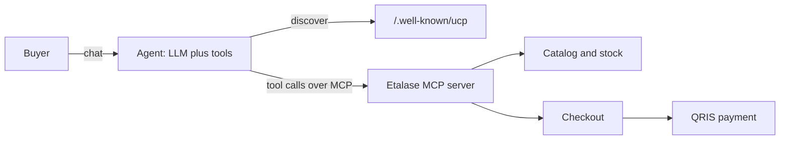

# Agentic commerce 101

Agentic commerce is shopping where an AI agent, not a person clicking, searches, compares and checks out; this page explains the building blocks from zero and shows exactly which ones Etalase uses.

::: tip What you will learn
- What an AI shopping agent is and why it needs structured catalogs
- The Model Context Protocol (MCP): hosts, clients, servers, tools and streamable HTTP
- Google's Universal Commerce Protocol (UCP), its `/.well-known/ucp` discovery, and how Etalase implements it as a business
- Where AP2, A2A and schema.org Product data fit
- Google ADK basics (`LlmAgent`, tools, `Runner`, sessions) through Etalase's two agents
:::

## What an AI shopping agent is

An **AI shopping agent** is a large language model (LLM) that can call tools on someone's behalf. The buyer says "find a black voal hijab under Rp100k and send it to Bandung", and the agent breaks that into steps: search, compare, get shipping prices, confirm with the buyer, check out, show how to pay, report the status.

The model only produces text. It acts by emitting **tool calls**, structured requests such as `search_products(query="black voal hijab", max_price_idr=100000)`, which a program runs and whose results go back to the model. The rest of this page is about standardising those tools and how agents find them.

Two consequences matter for Etalase. **Agents need structured data**: JSON with prices as numbers, variants and availability, which photos and chat messages are not ([The problem](/foundations/problem)). And **agents need explicit states**: an agent cannot sense that a seller sounds unsure, so Etalase says `availability: in_stock | confirm_with_seller` and adds a `next_step` hint to every checkout result.



## Structured catalogs

A **structured catalog** is product data in fixed fields software can read without guessing: title, description, images, price and currency, variants, weight, availability, shipping. Agents read it three ways:

| Channel | What it is | Etalase status |
|---|---|---|
| Tool calls (MCP, REST) | The agent asks live: search, product detail, checkout | <Badge type="tip" text="Built" /> |
| Embedded web data | schema.org JSON-LD that crawlers and feeds read | <Badge type="tip" text="Built" /> |
| Merchant feeds | Bulk product files (for example Google Merchant Center) | <Badge type="info" text="Roadmap" /> |

Etalase's catalog side exists to produce this data from photos, voice notes and chat; see [Catalog and stock](/architecture/catalog-and-stock).

## Model Context Protocol (MCP)

**MCP** is an open protocol, introduced by Anthropic in late 2024 and now supported widely, for connecting AI applications to tools and data. Think of it as "USB for agent tools": a tool provider writes one MCP server, and every MCP-capable agent can use it.

The vocabulary:

| Term | Meaning | In Etalase |
|---|---|---|
| **Host** | The AI application the user talks to | Gemini app, or the demo buyer agent |
| **Client** | The component inside the host that holds a connection to one server | ADK's `McpToolset` in `agents/buyer_agent.py` |
| **Server** | A program that exposes capabilities | `gateway/mcp_server.py`, mounted at `/mcp/` |
| **Tools** | Functions the model can call, each with a name, description and JSON Schema for its inputs | `search_products`, `get_product`, `get_shipping_options`, `create_checkout`, `get_checkout_status` |
| **Resources, prompts** | Other server primitives (read-only data, prompt templates) | Not used |

Messages are **JSON-RPC 2.0**. A client lists the server's tools (`tools/list`) and calls one (`tools/call`) with arguments; the server returns the result. MCP defines two standard transports: **stdio**, for a local server started as a subprocess, and **streamable HTTP**, for a remote server reached at one HTTP endpoint (requests are POSTed; the server answers with JSON or streams with server-sent events).

Etalase runs a remote server over streamable HTTP. From **`prototype/etalase/gateway/mcp_server.py`**:

```python
def build_mcp(ctx: "AppContext") -> FastMCP:
    mcp = FastMCP(
        "etalase",
        instructions=INSTRUCTIONS,
        stateless_http=True,
        json_response=True,
        streamable_http_path="/",
        # Cloud Run serves on its own hostname; restrict origins at the load balancer or with auth instead.
        transport_security=TransportSecuritySettings(enable_dns_rebinding_protection=False),
    )
    tools = ctx.gateway

    @mcp.tool()
    def search_products(query: str, max_price_idr: int | None = None, ship_to_country: str = "ID",
                        limit: int = 5) -> dict:
        """Search products from WhatsApp sellers. Query in English or Bahasa Indonesia, e.g. 'black voal hijab'."""
        return tools.search_products(query, max_price_idr, ship_to_country, limit)
    # ...
```

What to notice:

- **`FastMCP`** (from the official MCP Python SDK) turns a decorated Python function into an MCP tool. The type hints become the input JSON Schema and the docstring becomes the description the model reads. Docstrings here are prompt engineering: `create_checkout` says "Only call this after the buyer explicitly agreed to buy."
- **`stateless_http=True, json_response=True`**: each request stands alone and gets a plain JSON response, with no server-side session. That is what lets the endpoint scale across Cloud Run instances (`docs/03-architecture.md`, Deployment).
- **`INSTRUCTIONS`** tells any connecting agent the intended flow: `search_products -> get_shipping_options -> create_checkout -> show the QRIS code -> get_checkout_status`.
- The tools are thin wrappers. The real logic is in `GatewayTools` (**`prototype/etalase/gateway/tools.py`**), which returns plain dicts with a `next_step` hint and returns errors as `{"error": ...}` instead of raising, "which is what LLM agents handle best" (its docstring).

The same operations are mirrored as REST under `/agent/v1` in **`prototype/etalase/api/main.py`** (search, product, create checkout, checkout status), for clients that do not speak MCP. <Badge type="tip" text="Built" />

::: warning The MCP server is public and unauthenticated
Any agent can call it, which is the point. Protection comes from validation and limits in code (`validate_buyer`, max 10 units and 5 checkouts per buyer phone per hour) and a `content_note` telling agents that seller-written text is data, not instructions. See [Security model](/architecture/security).
:::

## Universal Commerce Protocol (UCP)

**UCP** is Google's open standard for agentic commerce, launched in January 2026 and co-developed with Shopify, Etsy, Wayfair, Target and Walmart ([Evidence](/business/evidence)). It powers checkout inside AI Mode in Search and the Gemini app, live in the US and started with select retailers in Australia.

The ideas you need, from the official spec (version 2026-04-08 at `ucp.dev`):

- **Roles.** The *platform* is the agent side (for example Gemini). The *business* is the merchant. *Payment credential providers* (for example Google Pay) process payments, and *payment handlers* are specifications for how an instrument is processed.
- **Discovery.** A business publishes a JSON profile at **`/.well-known/ucp`**. Its required `ucp` object holds a `version`, the `services` it offers (each with a transport: `rest`, `mcp`, `a2a` or `embedded`) and `payment_handlers`, plus optional `capabilities`. Signing keys sit alongside it.
- **Capabilities** have reverse-domain names, for example `dev.ucp.shopping.checkout`. Extensions build on them, for example `dev.ucp.shopping.fulfillment`, or `dev.ucp.shopping.ap2_mandate` for AP2.
- **Transports.** REST (described with OpenAPI), MCP (described with OpenRPC) and A2A (described with an Agent Card).

### Etalase as a UCP business

Etalase serves a valid UCP profile at `/.well-known/ucp` and implements the Checkout and Fulfillment capabilities over REST at `/ucp/v1`. From **`prototype/etalase/gateway/ucp.py`**:

```python
def ucp_profile(ctx):
    base = ctx.settings.public_base_url.rstrip("/")
    return {"ucp": {
        "version": "2026-04-08",
        "services": {"dev.ucp.shopping": [{"version": "2026-04-08", "transport": "rest",
                                           "endpoint": f"{base}/ucp/v1", ...}]},
        "capabilities": {
            "dev.ucp.shopping.checkout": [{"version": "2026-04-08", ...}],
            "dev.ucp.shopping.fulfillment": [{"version": "2026-04-08", ..., "extends": "dev.ucp.shopping.checkout"}],
        },
        "payment_handlers": {},   # QRIS is paid by the buyer on continue_url, not through an instrument handler
    }}
```

| Aspect | Official UCP | Etalase today |
|---|---|---|
| Location | `/.well-known/ucp` | Same <Badge type="tip" text="Built" /> |
| Profile shape | `ucp` object with `version`, `services`, `capabilities`, `payment_handlers` | Same; parsed in the tests with the official `BusinessSchema` <Badge type="tip" text="Built" /> |
| Checkout | `dev.ucp.shopping.checkout`: create, get, update, complete, cancel | Implemented over REST; QRIS ends in `requires_escalation` with a `continue_url` <Badge type="tip" text="Built" /> |
| Payments | Payment handlers, optional AP2 mandate extension | No handlers, no AP2 <Badge type="info" text="Roadmap" /> |
| Other capabilities | Cart, catalog, order, discount, buyer consent | Not implemented, not advertised |
| Signing keys, message signing | Optional | Not implemented |

The full story, with the sequence diagram and the conformance results, is on [UCP checkout](/architecture/ucp).

::: warning How to say it to a judge
"We implement UCP's checkout and fulfillment over REST and run Google's own conformance suite against it: it passes the applicable tests and every failure is listed with its reason. We don't claim certification, since there isn't one, and we haven't tried it with AI Mode or the Gemini app." Do not say "Etalase works with Gemini" or "UCP certified".
:::

## AP2: Agent Payments Protocol

**AP2** is Google's open protocol for payments made by agents. The core problem: when an agent pays, how does the merchant and the payment network know the human actually authorised *this* purchase? AP2's answer is **mandates**, cryptographically signed, verifiable records of what the user asked for and approved (for example an intent, then a specific cart), which travel with the payment. UCP supports AP2 through its `ap2_mandate` extension ([Evidence](/business/evidence)).

**Etalase and AP2:** <Badge type="info" text="Roadmap" />. Today the buyer pays a dynamic **QRIS** code shown by the agent, so the human approves the payment in their own banking or e-wallet app, and no agent-held credential is involved. "AP2 payment mandates" is listed as *Later* in `docs/02-product.md`.

## A2A: Agent2Agent

**A2A** is an open protocol, started by Google, for agents to talk to *other agents* as peers. Each agent advertises itself with an **Agent Card** (a JSON description of its skills and endpoint), and agents exchange tasks and messages. Where MCP is "agent uses a tool", A2A is "agent delegates to another agent". UCP lists A2A as one of its transports.

**Etalase and A2A:** not implemented and not on the roadmap. Etalase exposes deterministic *tools*, not a selling agent to negotiate with; stock and money decisions stay in code (ADR 0004).

## schema.org Product data

**schema.org** is a shared vocabulary for structured web data. A `Product` with an `Offer` (price, currency, availability) in JSON-LD is what search engines, crawlers and merchant feeds understand. Etalase publishes one `Product` per published variant at `/stores/{seller_id}/products.jsonld`. Trimmed from **`prototype/etalase/gateway/discovery.py`**:

```python
out.append({
    "@context": "https://schema.org", "@type": "Product",
    "sku": v.sku, "name": f"{p.title} {v.label}".strip(), "description": p.description,
    # ...
    "weight": {"@type": "QuantitativeValue", "value": v.weight_gram, "unitCode": "GRM"},
    "offers": {
        "@type": "Offer", "price": v.price, "priceCurrency": "IDR",
        "availability": ("https://schema.org/OutOfStock" if avail == 0 else
                         "https://schema.org/LimitedAvailability" if avail is None else
                         "https://schema.org/InStock"),
        "url": f"{base}/agent/v1/products/{p.id}",
        # ...
    },
})
```

Untracked stock is `LimitedAvailability`, because Etalase asks the seller before selling it, and the offer `url` points to the product in the agent REST API. <Badge type="tip" text="Built" /> as an endpoint. The docstring calls it "also the basis for a Merchant Center feed"; the feed itself is <Badge type="info" text="Roadmap" />.

## Google ADK basics

The **Agent Development Kit (ADK)** is Google's open-source framework for building agents, used here with Gemini. Four concepts cover everything Etalase does:

| Concept | What it is |
|---|---|
| `LlmAgent` | An agent: a `name`, a `model` (e.g. `gemini-3.8-flash`), an `instruction` (system prompt) and a list of `tools` |
| Tools | Plain Python functions (ADK reads the signature and docstring), or toolsets such as `McpToolset`, which loads every tool from an MCP server |
| `Runner` | Executes the agent loop: send the message to the model, run requested tools, feed results back, until a final answer. `run_async` yields **events**; `event.is_final_response()` marks the answer |
| Sessions | Conversation history plus a `state` dict, stored by a `SessionService`. `InMemorySessionService` is the simple, non-persistent one |

### The buyer agent: ADK as an MCP client

**`prototype/etalase/agents/buyer_agent.py`** is a demo stand-in for Gemini or AI Mode. It shops *only* through the public MCP server, exactly like a third-party agent:

```python
def build_buyer_agent(mcp_url: str, model: str) -> LlmAgent:
    return LlmAgent(
        name="buyer_assistant",
        model=model,
        instruction=INSTRUCTION,
        tools=[McpToolset(connection_params=StreamableHTTPConnectionParams(url=mcp_url))],
    )
```

`McpToolset` connects to `ETALASE_MCP_URL` (default `http://localhost:8080/mcp/`), lists the tools, and offers them to Gemini. The `chat` function creates an `InMemorySessionService`, a `Runner`, one session, and prints final responses. It needs Gemini credentials. <Badge type="warning" text="Mocked in demo" />: `scripts/demo.py` calls the same MCP tools directly with `mcp.call_tool(...)` instead of through Gemini.

### The seller agent: ADK with tenant-scoped tools

**`prototype/etalase/agents/seller_agent.py`** is the WhatsApp seller assistant: one `LlmAgent` with five function tools (`build_catalog`, `update_stock`, `update_price`, `submit_tracking`, `get_sales_summary`). The important trick is *where the seller id comes from*:

```python
def build_seller_agent(ctx: "AppContext") -> LlmAgent:
    def _seller(tool_context: ToolContext) -> str:
        return tool_context.state["seller_id"]

    def update_price(product_name: str, price_idr: int, tool_context: ToolContext) -> dict:
        """Change the price (IDR) of a product."""
        changed = ctx.catalog.update_price(_seller(tool_context), product_name, price_idr)
        # ...
```

`ToolContext` is injected by ADK and is not visible to the model, so the model can pass `product_name` and `price_idr` but **cannot choose which seller** it acts for. `SellerAgentRunner.respond` creates one session per seller with `state={"seller_id": seller_id}`, taken from the verified WhatsApp number. That is tenant isolation by construction (ADR 0004).

Status: <Badge type="warning" text="Mocked in demo" />. The agent is built and runs when `GOOGLE_API_KEY` or Vertex AI is set (`ctx.seller_agent` is created only if `gemini_enabled`); otherwise the inbox uses the offline intent parser in **`prototype/etalase/catalog/intents.py`**. Button taps never reach the model in either mode.

## How Etalase uses each piece

| Building block | Role in Etalase | Code | Status |
|---|---|---|---|
| MCP | Main agent interface: search, shipping, checkout, status | `gateway/mcp_server.py`, `gateway/tools.py` | <Badge type="tip" text="Built" /> |
| REST mirror | Same operations for non-MCP clients | `api/main.py` (`/agent/v1`) | <Badge type="tip" text="Built" /> |
| UCP | Profile at `/.well-known/ucp` and Checkout/Fulfillment over REST | `gateway/ucp.py` | <Badge type="tip" text="Built" /> (29 of 77 official tests pass; failures explained) |
| schema.org | JSON-LD per store | `gateway/discovery.py` | <Badge type="tip" text="Built" /> |
| ADK + Gemini | Seller agent; demo buyer agent | `agents/seller_agent.py`, `agents/buyer_agent.py` | <Badge type="warning" text="Mocked in demo" /> |
| Gemini structured output | Photos, voice and text to catalog JSON | `catalog/extractor.py` (`GeminiExtractor`) | <Badge type="warning" text="Mocked in demo" /> |
| AP2 | Agent payment mandates | none | <Badge type="info" text="Roadmap" /> |
| A2A | Agent-to-agent | none | Not planned |

## Pitfalls

- **Mixing up MCP and UCP.** MCP is a generic tool protocol. UCP is a commerce standard that can *use* MCP as one transport. Etalase serves both: its own MCP server, and UCP over REST (it does not use UCP's MCP binding).
- **"Gemini will find our sellers."** Only once UCP checkout reaches Indonesia and a platform chooses to call us; Etalase now speaks the protocol, but that is a distribution question. Today, the proof is any MCP client, shown with the ADK buyer agent.
- **Letting the model hold identifiers that matter.** Keep seller identity in session state, not tool arguments, for any new tool.

## Check yourself

1. What are the host, client and server in the demo buyer flow?

::: details Answer
The host is the ADK buyer agent application (Gemini plus `Runner`). The client is `McpToolset` with `StreamableHTTPConnectionParams`. The server is Etalase's `FastMCP` server mounted at `/mcp/`.
:::

2. Why does Etalase run its MCP server with `stateless_http=True`?

::: details Answer
So that every request is independent and needs no server-side MCP session. Any Cloud Run instance can serve any request, and the endpoint scales horizontally.
:::

3. Name two ways Etalase's `/.well-known/ucp` differs from the official UCP profile.

::: details Answer
Any two: no top-level `ucp` object with `version` and `payment_handlers`; capability names are not namespaced (`checkout.create` instead of `dev.ucp.shopping.checkout`); no signing keys; checkout runs through Etalase's own tools rather than UCP's checkout capability.
:::

4. How does the seller agent stop the model from changing another seller's stock?

::: details Answer
The seller id is read from `tool_context.state["seller_id"]`, set when the session is created from the verified WhatsApp number. It is never a tool parameter, so the model cannot supply or change it.
:::

## Next

See the whole product end to end in [The Etalase product](/foundations/product).
