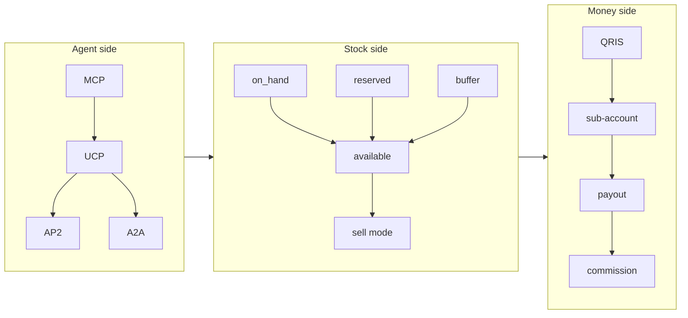

# Glossary

Every term you will meet in the Etalase docs, code and pitch, in alphabetical order, with a link to the page that explains it properly.

::: tip What you will learn
- The vocabulary of agentic commerce (MCP, UCP, AP2, A2A) and how Etalase uses each one
- The stock words (`on_hand`, `reserved`, `buffer`, `available`) and why they are separate numbers
- The payment, shipping and WhatsApp terms behind checkout and payouts
- The security and compliance words you will be asked about by judges
- Which terms describe built code and which describe the roadmap
:::

## How to use this page

Skim it once now, then come back whenever a page uses a word you cannot explain in one sentence. Each entry has a status where it matters:
<Badge type="tip" text="Built" /> means it runs in the prototype,
<Badge type="warning" text="Mocked in demo" /> means real code exists but the local demo uses a stand-in, and
<Badge type="info" text="Roadmap" /> means it is designed or planned, not built.

Many terms belong together. This map shows the clusters, so you can learn them as groups instead of one by one.

## 0–9

**24-hour window.** The customer-service window that opens when a user messages a WhatsApp business; inside it, free-form replies are allowed. [WhatsApp seller agent](/architecture/seller-agent)

## A

**A2A (Agent2Agent protocol).** An open protocol for AI agents to talk to other agents. UCP lists it as one of its supported transports; Etalase does not implement A2A. <Badge type="info" text="Roadmap" /> [Agentic commerce 101](/foundations/agentic-commerce)

**Adapter.** A small class that hides one external service behind a fixed interface (`PaymentProvider`, `ShippingProvider`, `Messenger`, `Store`), so the core never imports a provider directly. [Architecture overview](/architecture/overview)

**ADK (Agent Development Kit).** Google's Python framework for building LLM agents with tools and sessions. Etalase uses it for the WhatsApp seller agent (one `LlmAgent`, five tools) and the demo buyer agent (`McpToolset`). <Badge type="tip" text="Built" /> [WhatsApp seller agent](/architecture/seller-agent)

**Agent readiness score.** See *Readiness score*.

**Agentic commerce.** Shopping where an AI assistant searches, compares and checks out on the buyer's behalf by calling machine-readable APIs instead of clicking web pages. [Agentic commerce 101](/foundations/agentic-commerce)

**AP2 (Agent Payments Protocol).** A protocol for agents to make payments with verifiable user authorisation; UCP uses it as its payment layer. Etalase plans "AP2 payment mandates"; today buyers pay with QRIS. <Badge type="info" text="Roadmap" /> [Agentic commerce 101](/foundations/agentic-commerce)

**Available (stock).** What agents can buy right now: `max(0, on_hand - reserved - buffer)`, or `None` when the seller does not track stock. Computed in `Stock.available` in `prototype/etalase/models.py`. [Catalog and stock](/architecture/catalog-and-stock)

**AWB.** Air waybill, Indonesian couriers' common name for a tracking number. See *Waybill*.

## B

**Biteship.** An Indonesian shipping aggregator: one API for many couriers (JNE, J&T, SiCepat, AnterAja and others). `BiteshipShipping` fetches rates, books shipments and checks delivery. <Badge type="warning" text="Mocked in demo" /> [Turn on real services](/ship/real-services)

**Buffer.** Units deliberately kept back from agents (for walk-in sales, for example). The field exists on `Stock` but nothing sets it yet, so it is always 0. [Catalog and stock](/architecture/catalog-and-stock)

## C

**Cloud Run.** Google Cloud's service for running containers that scale with HTTP traffic. The prototype deploys there as one service in `asia-southeast2` (Jakarta). <Badge type="tip" text="Built" /> [Deploy to Cloud Run](/ship/deploy)

**Cloud Tasks, Cloud Storage, Cloud KMS.** Planned replacements for in-process pieces: one task per order for reservation expiry, a bucket for media, and encryption keys for stored OAuth tokens. <Badge type="info" text="Roadmap" /> [Architecture overview](/architecture/overview)

**Commission.** Etalase's fee: 4% of the order subtotal by default (`COMMISSION_RATE`), taken only when an order is delivered, quoted excluding VAT. [Business model and costs](/business/business-model)

**Confirm-first.** See *Sell mode*.

**Connector API.** A REST API (`/connector/v1/*`, OpenAPI spec at `/openapi.json`) that lets OMSs, e-commerce plugins and website builders push products and stock and receive signed `order.paid` webhooks. <Badge type="tip" text="Built" /> [Integrations](/architecture/integrations)

**Container (`container.py`).** The one place where settings, store, adapters and services are created and wired into an `AppContext`. Swapping an implementation means changing this file only. [Architecture overview](/architecture/overview)

**Country pack.** A `CountryPack` entry in `prototype/etalase/config.py` naming a market's currency, locale, payment provider, shipping provider and tax profile. Only `"ID"` exists. [Architecture overview](/architecture/overview)

## D

**Deterministic handler.** Code (not the model) that handles button taps such as Publish, Accept and Out of stock, because these decisions must be exact. [WhatsApp seller agent](/architecture/seller-agent)

**DEV_TOKEN.** Secret for the `/dev/*` simulation endpoints, sent as the `X-Dev-Token` header. Optional on localhost; required (16+ characters) on a public URL. [Security model](/architecture/security)

**Domain separation.** Mixing a purpose into a signature so one secret can sign several kinds of values safely. `OtpAuth._sig` signs session tokens with `session` and OAuth state with `state`, so one can never pass as the other. [Security model](/architecture/security)

**Draft, needs_review, published.** Product statuses. New products start as `draft` (publishable) or `needs_review` (missing title or price); only `published` products are visible to agents. [Catalog and stock](/architecture/catalog-and-stock)

## E

**ETALASE_ENV.** `dev` (default) enables the `/dev/*` simulation endpoints; `prod` hides them and refuses to start with mock payment, shipping or messaging. [Security model](/architecture/security)

**Event bus.** `EventBus` in `prototype/etalase/events.py`: services publish topics such as `order.paid`, and subscribers (WhatsApp notifications, Connector webhooks) react. In-process today; Pub/Sub is the production plan. [Architecture overview](/architecture/overview)

**Expiry.** Unpaid checkouts release their stock after 15 minutes (60 for a seller confirmation). A background loop runs `expire_due()` every 60 seconds; `POST /tasks/expire` does the same on demand. [Checkout and orders](/architecture/checkout-and-orders)

## F

**Firestore.** Google Cloud's document database. `FirestoreStore` implements the store interface with it. <Badge type="warning" text="Mocked in demo" /> (the demo and tests use `MemoryStore`). [Data model and store](/architecture/data-model)

**Firestore transaction.** A read-modify-write that Firestore retries and commits atomically. `FirestoreStore` wraps every stock change and order transition in one, so two buyers cannot take the last unit. [Data model and store](/architecture/data-model)

## G

**Gemini structured output.** Asking Gemini for JSON that must match a schema (`response_mime_type="application/json"`, `response_schema=ExtractedCatalog`), so extraction returns valid products instead of free text. <Badge type="tip" text="Built" /> (runs only with a key or Vertex AI). [Catalog and stock](/architecture/catalog-and-stock)

**Google Sheets sync.** Planned import of a seller's spreadsheet with OAuth, Google Picker and the `drive.file` scope. <Badge type="info" text="Roadmap" /> [Integrations](/architecture/integrations)

## H

**HMAC.** A hash keyed with a secret, proving a message came from someone who knows the secret. Used for WhatsApp webhook signatures, Connector webhook signatures, dashboard session tokens and the Instagram OAuth state. [Security model](/architecture/security)

## I

**Idempotency.** Doing the same thing twice has the same effect as doing it once. Payment webhooks, stock commits and releases, and duplicate WhatsApp deliveries are all idempotent. [Checkout and orders](/architecture/checkout-and-orders)

**Instagram import.** Optional catalog source: product posts (photo plus caption) become drafts. Instagram Login is wired; the demo uses sample posts. <Badge type="warning" text="Mocked in demo" /> [Integrations](/architecture/integrations)

**Instant mode.** See *Sell mode*.

## K

**KYC (Know Your Customer).** Identity and bank verification. Done by the payment provider; Etalase stores only `kyc_status` and the sub-account id, and only `verified` sellers can take orders. [Checkout and orders](/architecture/checkout-and-orders)

## M

**`ManualActionRequired`.** Raised by the Xendit adapter for refunds and payouts it cannot automate yet. It (or any other provider error) makes the order `refund_pending` or `pending_manual` and publishes an `ops.manual_action` event, which `container.py` logs as `MANUAL ACTION REQUIRED` at ERROR level. [Checkout and orders](/architecture/checkout-and-orders)

**MCP (Model Context Protocol).** An open protocol that lets AI agents discover and call tools on a server. Etalase serves five tools at `/mcp/` over streamable HTTP. <Badge type="tip" text="Built" /> [Agent gateway](/architecture/agent-gateway)

**MDR (merchant discount rate).** The fee a merchant pays on a QRIS payment, set by Bank Indonesia. [Business model and costs](/business/business-model)

**MemoryStore.** The in-memory store used by the demo and tests. One lock gives it the same "no oversell" guarantee Firestore gets from transactions; data is lost on restart. [Data model and store](/architecture/data-model)

**Merchant Center feed.** A Google product feed built from the schema.org data, so products can surface in Google surfaces. <Badge type="info" text="Roadmap" /> [Agent gateway](/architecture/agent-gateway)

## N

**`next_step`.** A plain-English hint in every checkout response telling the agent what to do next ("Show the QRIS code to the buyer..."). Agents handle hints better than status codes. [Agent gateway](/architecture/agent-gateway)

## O

**Offline rules.** `HeuristicExtractor` and the intent parser in `catalog/intents.py`: regex-based stand-ins for Gemini that read messages like "Voal hijab, black 5, price 85k" or "navy sold out" without any API key. <Badge type="tip" text="Built" /> [Catalog and stock](/architecture/catalog-and-stock)

**OMS (order management system).** Software that syncs stock and orders across a seller's channels (Jubelio, Ginee). OMS adapters are planned; the Connector API works today. <Badge type="info" text="Roadmap" /> [Integrations](/architecture/integrations)

**`on_hand`.** Units the seller physically has. `None` means "not tracked", which forces confirm-first mode. [Catalog and stock](/architecture/catalog-and-stock)

**OTP (one-time password).** The 6-digit dashboard sign-in code sent to the seller's WhatsApp: valid 5 minutes, 5 tries, 60-second resend cooldown. [Security model](/architecture/security)

**Outbox.** Where `ConsoleMessenger` stores "sent" WhatsApp messages when no WhatsApp keys are set; read it with `GET /dev/outbox`. [Hands-on walkthrough](/run/hands-on)

**Oversell.** Selling more units than exist. Reservations inside one lock or transaction prevent it; the demo has 50 agents race for 1 unit and exactly one wins. [Catalog and stock](/architecture/catalog-and-stock)

## P

**Payout.** Money released from the seller's sub-account to the seller: subtotal minus commission (shipping goes to the courier). Released only after the courier confirms delivery. <Badge type="warning" text="Mocked in demo" /> [Checkout and orders](/architecture/checkout-and-orders)

**PDP Law.** Indonesia's Personal Data Protection Law (UU 27/2022). It shapes what Etalase stores about buyers and sellers. [Security model](/architecture/security)

**PPh 22 (marketplace collection).** Income tax that appointed marketplaces must collect from sellers (PMK 37/2025); collection is postponed. A country pack's `tax_profile` is where it would apply. [Business model and costs](/business/business-model)

**PPh final.** Indonesia's final income tax for small businesses: 0.5% of turnover up to Rp4.8 billion a year (PP 55/2022), paid by the seller, not Etalase. [Business model and costs](/business/business-model)

**PPN.** Indonesian VAT. It applies to Etalase's commission once Etalase is VAT-registered; the ID pack's tax profile is `id-ppn`. [Business model and costs](/business/business-model)

**Prompt injection.** Text that tries to give instructions to an AI model. Product titles are seller-written, so agent responses carry a `content_note` saying to treat them as data, not instructions. [Security model](/architecture/security)

**Pub/Sub.** Google Cloud's messaging service, the production target for the event bus. <Badge type="info" text="Roadmap" /> [Architecture overview](/architecture/overview)

## Q

**QRIS.** Indonesia's national QR payment standard; any banking or e-wallet app can pay it. Etalase creates a dynamic QRIS per checkout through Xendit. <Badge type="warning" text="Mocked in demo" /> [Checkout and orders](/architecture/checkout-and-orders)

## R

**Readiness score.** 0–100 points for how complete a product is for agents (title, description, price, weight, photo, stock, category). Publishing needs at least a title and a price. [Catalog and stock](/architecture/catalog-and-stock)

**Reservation.** A hold on units for one order until `expires_at`. Statuses: `held`, then `committed` (paid) or `released` (expired or rejected); a refund moves `committed` to `restocked`. [Catalog and stock](/architecture/catalog-and-stock)

**`reserved`.** Units currently held by unpaid checkouts; they are not available to other buyers. [Catalog and stock](/architecture/catalog-and-stock)

**Retry-safe callback.** A function passed to `store.update_order` that can run more than once without leaving traces, because Firestore retries a transaction function on conflict. Every callback in `checkout/service.py` clears its outer flag dict (`won.clear()`, `outcome.clear()`) on its first line. [Checkout and orders](/architecture/checkout-and-orders)

## S

**schema.org JSON-LD.** Standard product markup served at `/stores/{seller_id}/products.jsonld`, the basis for a future Merchant Center feed. [Agent gateway](/architecture/agent-gateway)

**Secret Manager.** Google Cloud's store for secrets; the deploy script keeps `SESSION_SECRET`, `DEV_TOKEN` and `WEBHOOK_TOKEN` there. [Deploy to Cloud Run](/ship/deploy)

**Sell mode.** `instant` (buyer pays now) or `confirm_first` (the seller confirms stock before a QRIS code exists). For stock Etalase owns, confirm-first applies when it is untracked, last confirmed over 3 days ago, or down to 2 units or fewer; synced OMS or store stock is always instant. [Catalog and stock](/architecture/catalog-and-stock)

**SESSION_SECRET.** Key for signing dashboard session tokens and hashing OTP codes. The default `dev-only-change-me` is refused on a public URL and in prod. [Security model](/architecture/security)

**SKU and variant.** A variant is one buyable option of a product (for example the black one) with its own price, weight and stock; its SKU is a short code such as `VOAHIJ-BLAC`. [Data model and store](/architecture/data-model)

**Stock owner.** Which system owns a seller's stock: `internal` (Etalase, via chat), `oms` or `store` (synced through a connection). Chat stock edits are refused for non-internal sellers. [Catalog and stock](/architecture/catalog-and-stock)

**Streamable HTTP.** The MCP transport Etalase uses: JSON-RPC over plain HTTP POST, stateless, with JSON responses, so it scales on Cloud Run. [Agent gateway](/architecture/agent-gateway)

**Sub-account (xenPlatform).** A Xendit sub-account per seller; payments land there (header `for-user-id`) and Etalase only decides when they are released. Automated settlement is not built yet. <Badge type="warning" text="Mocked in demo" /> [Checkout and orders](/architecture/checkout-and-orders)

## T

**Template vs free-form message.** WhatsApp messages that start a conversation outside the 24-hour window must use a Meta-approved template; replies inside the window can be free-form. The prototype sends only free-form text and buttons. <Badge type="info" text="Roadmap" /> [WhatsApp seller agent](/architecture/seller-agent)

**Tenant isolation.** One seller can never read or change another seller's data. Services check `seller_id` ownership, and the seller agent gets the seller id from session state, never from the model. [Security model](/architecture/security)

## U

**UCP (Universal Commerce Protocol).** Google's protocol, launched January 2026, that lets shoppers buy inside AI Mode and the Gemini app; merchants publish a profile at `/.well-known/ucp`. Etalase implements it as a business (profile, Checkout and Fulfillment over REST). [UCP checkout](/architecture/ucp)

## V

**Vertex AI.** Google Cloud's AI platform. With `GOOGLE_GENAI_USE_VERTEXAI=true` and a project, Gemini calls go through Vertex AI instead of an API key. [Turn on real services](/ship/real-services)

## W

**Waybill.** The courier's tracking number. The seller replies "tracking JNE123456" (or "resi", "awb"); it must match `[A-Z0-9-]{6,40}`. [Checkout and orders](/architecture/checkout-and-orders)

**Webhook.** An HTTP call a provider makes to Etalase when something happens (a message, a payment, a delivery). Each is authenticated: Meta's signature, Xendit's callback token, or `WEBHOOK_TOKEN`. [Security model](/architecture/security)

**WEBHOOK_TOKEN.** Shared secret for webhooks that have no provider signature (shipping, mock payment, console WhatsApp, `/tasks/expire`), passed as `?token=` or `X-Etalase-Webhook-Token`. [Security model](/architecture/security)

**WhatsApp Cloud API.** Meta's hosted WhatsApp Business API. `WhatsAppCloudMessenger` sends text and buttons and downloads media; inbound messages arrive at `/webhooks/whatsapp`. <Badge type="warning" text="Mocked in demo" /> [WhatsApp seller agent](/architecture/seller-agent)

## X

**Xendit.** The Indonesian payment provider behind `XenditPayment` (dynamic QRIS, callback-token webhooks, xenPlatform sub-accounts). Refunds and settlement raise `ManualActionRequired` for now. <Badge type="warning" text="Mocked in demo" /> [Checkout and orders](/architecture/checkout-and-orders)

::: warning Words that sound built but are not
AP2, A2A, Pub/Sub, Cloud Tasks, Cloud Storage, KMS, Google Sheets sync, OMS adapters, the WooCommerce plugin and WhatsApp templates are all roadmap. If a judge asks, say so plainly and point to what runs today.
:::

## Check yourself

1. A variant has `on_hand = 5`, `reserved = 3`, `buffer = 0`. What is `available`, and which sell mode will an agent see?
2. What is the difference between MCP and UCP in one sentence each?
3. Why can a webhook alone never release a payout?
4. A seller connected through the Connector API sends "black 3" on WhatsApp. What happens?
5. Which taxes are the seller's problem and which one is Etalase's?

::: details Answer 1
`available = max(0, 5 - 3 - 0) = 2`. Two or fewer units triggers `confirm_first`, so the agent sees `confirm_with_seller` (assuming the stock is tracked internally and was confirmed in the last 3 days).
:::

::: details Answer 2
MCP is the generic protocol an agent uses to call tools on a server. UCP is Google's commerce protocol that describes a merchant (profile at `/.well-known/ucp`) and can use MCP, REST or A2A as transports.
:::

::: details Answer 3
Money moves on delivery, so a forged webhook would be expensive. `shipment_update` asks the courier directly (`confirm_delivered`) before marking the order delivered and calling `release_payout`.
:::

::: details Answer 4
Nothing changes. Creating a connection sets the seller's stock owner to `store` (or `oms`), and `update_stock` refuses chat edits: "Stock for this seller is owned by the connected store; update it there."
:::

::: details Answer 5
PPh final (income tax on turnover) and VAT on goods are the seller's. PPN on the commission is Etalase's, once it is VAT-registered. PPh 22 collection applies only to appointed marketplaces and is postponed.
:::

## Next

Now get it running on your machine: [Run the demo locally](/run/run-locally).
