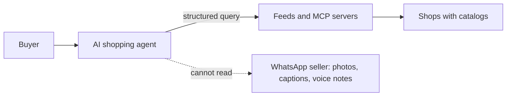

# The problem

AI agents are becoming a way to shop, and the sellers who make up most of Indonesian online commerce, who sell through WhatsApp chats, cannot be seen by them.

::: tip What you will learn
- Who Etalase's sellers are and how social and chat commerce works in Southeast Asia, Indonesia first
- Why these sellers are invisible to AI shopping agents, in concrete technical terms
- Why marketplaces are not the answer for them
- Why the timing is now, and what is still uncertain
- Which numbers you can quote, and where each one comes from
:::

::: warning Numbers on this page
Every statistic below links to [Evidence and sources](/business/evidence), which has the source, the exact quote, the date and a "nuance" line for each number. Do not quote a number in the pitch that is not on that page.
:::

## Who the sellers are

Picture **Rina** (the persona in `docs/02-product.md`). She runs a hijab shop from her phone. New stock arrives, she photographs it, posts it to her WhatsApp Status or Instagram, and buyers message her: "Is the navy still available? How much to Bandung?" She replies, sends her bank details or a QRIS code, checks the transfer, packs the parcel and sends a tracking number. Her "catalog" is her phone's photo gallery plus what she remembers.

Rina is not unusual. In Indonesia, Etalase's first market, **95% of e-commerce businesses use instant messaging apps** such as WhatsApp to sell, 33% social media, only **18% marketplaces** and about 2% their own website ([Evidence](/business/evidence)). These are BPS (Statistics Indonesia) figures for 2023 (40,011 businesses). Businesses can use several channels, so the shares add up to more than 100%: the correct reading is "95% *use* chat", not "95% sell *only* through chat". The survey counts any business that took orders over the internet, so a food stall taking orders on WhatsApp is included. The number shows that chat is the default order inbox. It does **not** show that 95% of sellers have no store system, and nobody has measured how many product sellers are chat-first. That gap is why the seller interviews matter.

Across the region, chat is a normal way to buy:

- In a 2019 Facebook × BCG study, close to half of Southeast Asian respondents had bought or sold through social media or messaging apps; over 40% in Thailand and 36% in Vietnam had made a conversational-commerce purchase, Indonesia 29%, against 5% in the US ([Evidence](/business/evidence)). This is old data and the only cross-country comparison found, so for Indonesia prefer the BPS figure.
- Each market has its own chat app: WhatsApp in Indonesia and Malaysia, LINE in Thailand, Zalo in Vietnam, Messenger in the Philippines (`docs/01-problem-and-market.md`). This is why Etalase keeps messaging behind an adapter (`Messenger` in **`prototype/etalase/adapters/messaging.py`**).
- Southeast Asia's e-commerce GMV is projected at about **US$185 billion for 2025**, video commerce is about a quarter of GMV, and consumer interest in AI topics is about **3× the global average** ([Evidence](/business/evidence)).

::: warning Do not invent a chat-commerce GMV
No source measures the GMV of chat commerce specifically. The evidence page says so explicitly. If asked "how big is your segment?", answer with the BPS share of businesses and the regional e-commerce GMV, and say that no one measures the chat-only slice.
:::

## Why they are invisible to AI shopping agents

An AI shopping agent does not browse a shop the way a person does. It does not scroll an Instagram feed, zoom into a photo or ask "is the navy one still there?" in a chat. It calls tools or reads feeds that return **structured catalog data**: title, description, price, currency, variants, availability, shipping. If that data does not exist, the shop does not exist for the agent.

Here is the gap in concrete terms. What Rina has:

```text
[photo of three folded hijabs]
"Voal hijab, black 5, navy 3, mocca 10, price 85k"
```

What an agent needs (a trimmed excerpt of what Etalase's `search_products` tool actually returns, built by `CatalogService.agent_view` in **`prototype/etalase/catalog/service.py`**):

```json
{
  "product_id": "prd_5b2a2e2072",
  "title": "Voal Hijab",
  "currency": "IDR",
  "ships_to": ["ID"],
  "seller": {"name": "Toko Rina", "city": "Jakarta"},
  "variants": [
    {"sku": "...", "options": {"color": "Black"}, "price": 85000,
     "availability": "in_stock", "sell_mode": "instant", "weight_gram": 150}
  ]
}
```

Four things are missing from the chat version, and each one blocks an agent:

| Missing | Why the agent needs it |
|---|---|
| Fields | "85k" is not a price until something knows it means IDR 85,000; "mocca 10" is a colour variant with ten units |
| Live availability | Agents should not offer what is sold out. Chat sellers rarely track stock exactly |
| Shipping data | Courier rates need a weight and an origin postal code |
| A checkout | The agent needs a way to reserve, pay and track, not "DM to order" |

The merchant-readiness numbers confirm the gap: only **11% of small and mid-size merchants** qualify as agent-ready, against 19% of large merchants, and only **15% of merchants** overall have structured product data for agent access ([Evidence](/business/evidence)). That survey is global and covers merchants who mostly *have* a store system. Sellers like Rina have none, so they are very likely below the SMB average. That last point is a reasonable inference, not a measured number; say it that way.



## Why marketplaces are not enough

The obvious objection is "Rina can just list on Shopee or Tokopedia, and the marketplace will bring her to AI agents." Three reasons why that does not solve the problem:

1. **Most chat sellers are not on a marketplace.** Only 18% of Indonesian e-commerce businesses use marketplaces ([Evidence](/business/evidence)). The other sellers have chosen chat for a reason: direct relationships, no platform rules, no listing work.
2. **Marketplace AI keeps the seller inside the marketplace.** Shopee's app in ChatGPT (eight markets including Indonesia, June 2026) does discovery in ChatGPT and continues the purchase on Shopee; Shopee is also building an agentic shopping prototype with Google ([Evidence](/business/evidence)). That is the right move for Shopee, and it means the seller reaches AI agents only on Shopee's terms.
3. **Fees keep rising.** After the 2026 revision, Shopee Indonesia's admin fee for fashion is 10% for non-Mall sellers, and TikTok Shop's non-mall commission is mostly around 9–10% ([Evidence](/business/evidence)). Etalase's prototype commission is 4% of the subtotal, charged only on delivered orders (`COMMISSION_RATE` / `commission_rate` in **`prototype/etalase/config.py`**).

What about Meta? WhatsApp's catalog feature is for human buyers inside WhatsApp. Agents need structured, stock-aware data and a payment flow on local rails (QRIS) and local couriers, which is outside Meta's business. In the Etalase framing, Etalase is a *customer* of WhatsApp, not a competitor (`docs/15-evidence.md`, likely judge question 1).

And the existing agentic-commerce tools (Shopify's Agentic Storefronts, Stripe's Agentic Commerce Suite, startups like Era and ShopAgentic) are built for brands and retailers that already have structured catalogs and card or wallet checkout. Stripe in Indonesia is invite-only and supports only virtual-account bank transfers, no QRIS ([Evidence](/business/evidence)). None of them builds a catalog from WhatsApp photos.

## Why now

AI platforms started to put shopping inside the assistant in 2026, but checkout is still narrow and mostly outside Indonesia:

- Google launched the **Universal Commerce Protocol (UCP)** in January 2026. Agent checkout through UCP went live in the **US** in February 2026 and started with select retailers in **Australia** in June 2026, the first Asia-Pacific market (Google's own pages still call checkout US-only). Google is running a limited test with Flipkart in India. One trade report (InfoQ, January 2026) says UCP will expand to Indonesia, but that is the reporter's narration, not a Google quote, and Google's own pages never name Indonesia; no date is known ([Evidence](/business/evidence)). Google's payment handler for UCP is Google Pay (cards), not QRIS.
- **OpenAI scaled back ChatGPT Instant Checkout in March 2026** and refocused on discovery. In Indonesia, AI *discovery* is live (Google AI Mode in Indonesian, Google AI shopping since March 2026, Shopee inside ChatGPT, which hands the shopper to Shopee to pay), but we found no agent checkout and no report of an agent-initiated purchase.
- Alibaba said its Qwen AI app handled more than **120 million consumer orders in six days** (6–11 February 2026) during a subsidised Lunar New Year campaign ([Evidence](/business/evidence)). It was subsidised, so use it to show that consumers will order through an AI app when it is easy, not as a market-size figure.
- Morgan Stanley projects that agentic shoppers could represent **US$190–385 billion of US e-commerce spending by 2030**, 10% to 20% of the market ([Evidence](/business/evidence)). This is a US-only scenario range. Use it for direction, not for Southeast Asian size. Surveys point the other way on near-term behaviour: people accept AI for searching and comparing but not for deciding and paying (Gartner: willingness to hand over purchase decisions "topped out at 11%" in the US).

The window matters because catalogs take time. When UCP checkout reaches Indonesia, the sellers who already have structured, stock-aware catalogs will be the ones agents can sell. Building that catalog from photos and chats is the hard part, and it is what Etalase does first.

::: warning Be honest about timing
Agent checkout is **not live in Indonesia** yet, and no measured agent purchase exists there. The docs list this as a risk (`docs/01-problem-and-market.md`, "Risks we are tracking"). The mitigation has two parts. First, Etalase exposes an **MCP server** that an agent can use if its owner connects it to our URL (there is no automatic discovery); the repository includes a demo Gemini buyer agent that shops only through it. Second, the catalog plus a QRIS store link is useful to the seller and to ordinary shoppers even before agents arrive. The seller side and the store link are the product today; the agent door is an option.
:::

## The problem in one paragraph

Use this paragraph in the pitch:

> AI shopping is arriving, but agents can only buy from shops with structured catalogs. In Indonesia, 95% of e-commerce businesses use chat apps to sell and only 18% use marketplaces. Their catalog lives in photos, captions and voice notes, which no agent can read. Marketplaces bring their own listings to AI, but only inside their own fees. Etalase turns what these sellers already have into a catalog and a store link that anyone can pay by QRIS, and that an AI agent can search and reserve from when its owner connects it, and keeps the seller working in WhatsApp.

Every number in it is on the [Evidence](/business/evidence) page.

## Pitfalls

- **Overclaiming the 95%.** It is "95% of e-commerce businesses use instant messaging as one of their channels", from a 2023 BPS survey. It is not "95% of Indonesians buy on WhatsApp".
- **Quoting "half of Indonesians".** The 2019 regional study (funded by Facebook) puts Indonesia at 29%. Use BPS for Indonesia, or drop the study.
- **"95% of sellers have no store system".** BPS does not say that; its definition of e-commerce business is wide.
- **"Google named Indonesia a UCP market."** One trade report said so; Google's pages do not.
- **"AI assistants are buying for people".** In Indonesia only discovery is live, and OpenAI scaled back its own checkout.
- **"UCP is live in India."** It is a limited test, and TechCrunch notes it may not use Google-hosted UCP checkout.
- **Old, unsupported numbers.** An earlier draft of `docs/01` claimed "80% of online merchants sell through social commerce" and "only a few percent of transactions involve agents". Both were removed because no study backs them (see "Claims to fix" in `docs/15-evidence.md`). If you see them in an old slide, delete them.

## Check yourself

1. A judge says: "95% of Indonesians shop on WhatsApp, really?" How do you correct the claim without sounding defensive?

::: details Answer
"The figure is from BPS's E-Commerce Statistics 2023: 95% of Indonesian e-commerce *businesses* sell through instant-messaging apps. Businesses use several channels, so it is about how sellers sell, not how every consumer buys. Only 18% of those businesses use marketplaces." The source and quote are on the [Evidence](/business/evidence) page.
:::

2. Name three things an AI agent needs that a WhatsApp chat catalog does not provide.

::: details Answer
Any three of: structured fields (price as a number in IDR, variants), live availability, a shipping weight and origin for courier rates, and a programmatic checkout (reserve, pay, track).
:::

3. Why doesn't listing on Shopee solve the problem for chat sellers?

::: details Answer
Most chat sellers are not on a marketplace (18% use one). Marketplace AI integrations lead buyers back to the marketplace's own checkout and fees (10% for fashion on Shopee Indonesia for non-Mall sellers). The seller gets no channel of their own.
:::

4. Is agent commerce live in Indonesia? What do you say?

::: details Answer
No. AI discovery is live in Indonesia, but we found no agent checkout and no measured agent purchase. UCP checkout is live in the US, has started with select retailers in Australia, is in limited test in India, and one trade report (not Google) says Indonesia is next, with no date; Google's handler takes cards, not QRIS. Etalase's MCP server works with an agent whose owner connects it, and the catalog with QRIS checkout is useful without agents.
:::

## Next

Learn the protocols that make agent shopping work in [Agentic commerce 101](/foundations/agentic-commerce).
