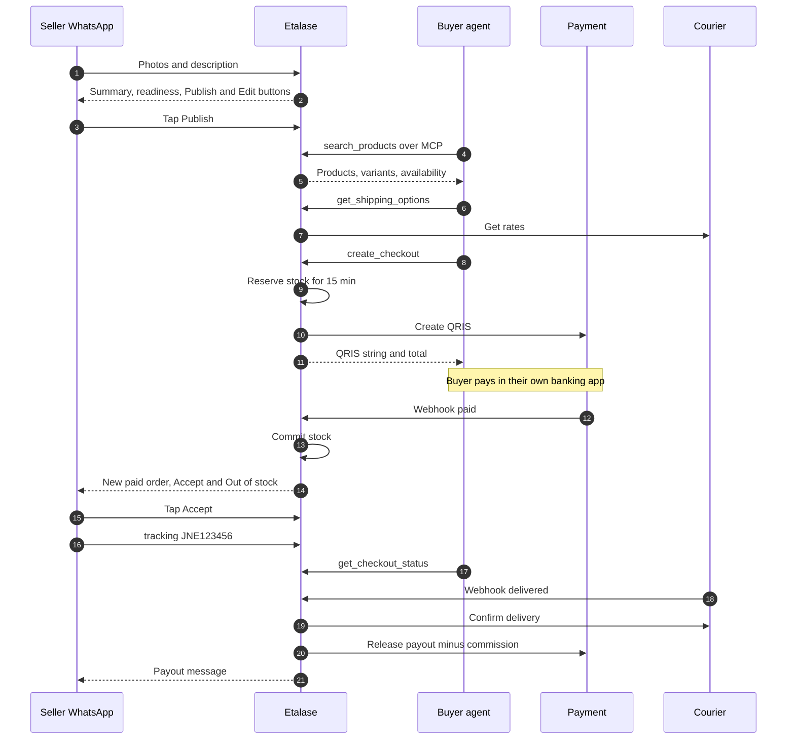
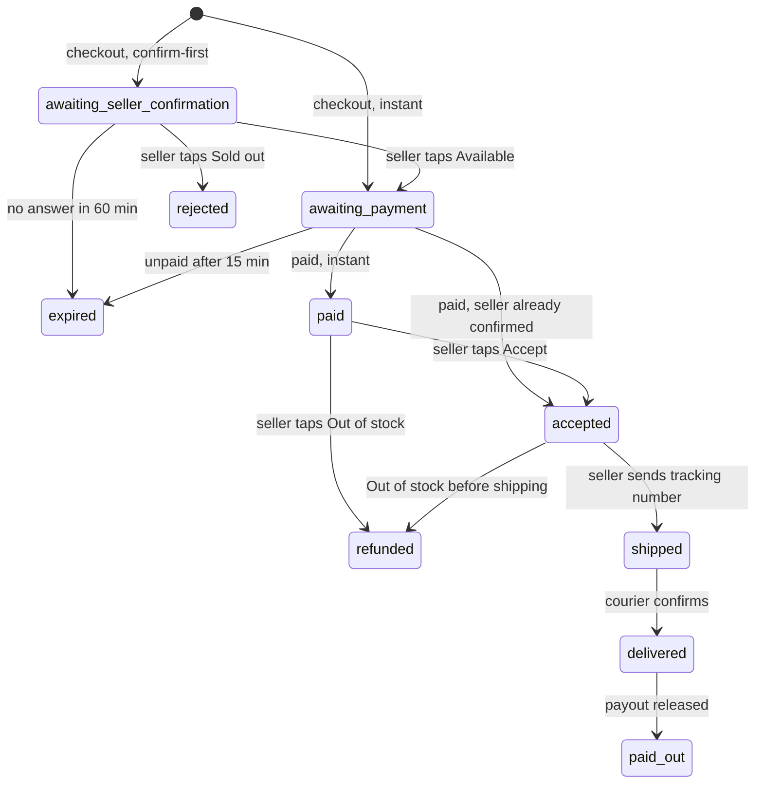

# The Etalase product

This page walks through Etalase end to end, from the seller's first WhatsApp photo to the payout after delivery, and marks honestly which parts are built, mocked in the demo, or still on the roadmap.

::: tip What you will learn
- The seller journey: WhatsApp photos, voice and text become drafts, a readiness score, then Publish; optional Instagram import; dashboard sign-in by one-time code
- The buyer-agent journey: search, shipping, checkout, QRIS, status
- Instant versus confirm-first selling, and the order lifecycle
- How payouts and the commission work, and why Etalase does not receive buyer payments in its own account
- Exactly what is Built, Mocked in demo and Roadmap
:::

## Who uses it

The personas in `docs/02-product.md`: **Rina**, a WhatsApp seller (uses WhatsApp, optionally the dashboard); **Dewi**, a buyer (uses her AI agent and her own banking app for QRIS); the **buyer's AI agent** (MCP, REST, `/.well-known/ucp`); and **builders or OMS partners** (the Connector API). Two product rules shape everything else: **zero new apps for sellers** (WhatsApp is the interface, the dashboard is optional), and **buttons for decisions, chat for data** (Publish, Accept and Out of stock are buttons; stock and prices can be typed).

## The whole flow in one diagram



This is the **instant** path. The confirm-first path adds a stock check before the QRIS is created (see below).

## Seller journey

### 1. Registration

A seller is identified by their WhatsApp number. KYC and bank details live at the payment provider, not in Etalase. Sellers can build a catalog before KYC, but `create_checkout` refuses orders until `seller.kyc_status == "verified"` (**`prototype/etalase/checkout/service.py`**).

In the prototype, `POST /dev/sellers` creates a verified seller with a mock sub-account <Badge type="warning" text="Mocked in demo" />. Self-service sign-up and KYC are <Badge type="info" text="Roadmap" />.

### 2. Photos, voice and text become drafts

Everything a seller sends lands in `SellerInbox.handle` (**`prototype/etalase/seller/inbox.py`**):

- **Photos, voice notes and files** are downloaded right away (WhatsApp media URLs expire) and held as "pending media". Photos sent within 15 minutes are grouped with the **next** description, because sellers usually send pictures first and explain after.
- **A caption or the next text message** triggers catalog building: `CatalogService.ingest` runs the extractor on the text plus the pending photos and voice notes.
- **A CSV file** is parsed as a spreadsheet (Indonesian or English headers).

There are two extractors behind one interface (**`prototype/etalase/catalog/extractor.py`**):

| Extractor | When | Handles |
|---|---|---|
| `GeminiExtractor` | `GOOGLE_API_KEY` or Vertex AI set | Photos + voice + text in one multimodal call with `response_schema=ExtractedCatalog`, so output is valid JSON. The prompt says "Use only facts the seller gave or that are visible in the photos." |
| `HeuristicExtractor` | Offline (demo, tests) | Text like `Voal hijab, black 5, navy 3, mocca 10, price 85k` and CSV. Cannot read voice notes or photos |

The output is normalised (colour words such as *hitam* become `Black`, SKUs, category, default weight per category) and saved as **draft** products, not visible to agents. Status: Gemini <Badge type="warning" text="Mocked in demo" />, offline path <Badge type="tip" text="Built" />.

### 3. Readiness score

Each draft gets an **agent-readiness score** from 0 to 100 (**`prototype/etalase/catalog/readiness.py`**): title 15, description of 30+ characters 15, price on every variant 20, weight 10, photo 15, stock tracked 15, category 10. The seller sees it in the WhatsApp summary:

```text
I found 1 product(s):
• Voal Hijab: Black (5), Navy (3), Mocca (10) · Rp85.000 ±150 g
  Readiness 100/100
Publish to AI shopping agents?
[Publish]  [Edit]
```

That is real output from `python scripts/demo.py`. A product **can be published once it has a title and a price** (`PUBLISH_MINIMUM`). Otherwise it is saved as `needs_review`. The score tells the seller what would make agents more likely to pick it. <Badge type="tip" text="Built" />

### 4. Publish

Tapping **Publish** is a button reply, handled in code, never by the model. `CatalogService.publish(seller_id)` publishes every publishable draft of that seller and emits `catalog.published`. From then on the products appear in `search_products`. **Edit** replies with a hint ("Send the correction, e.g. 'voal hijab price 90k'").

After publishing, the seller keeps the catalog current by chat: `navy sold out`, `navy 2 left`, `restock mocca 20`, `voal hijab price 90k` (or `navy habis` and so on). With Gemini these go to the ADK seller agent; offline, to the intent parser.

### 5. Optional: Instagram import

A seller with an Instagram professional account can connect it (`/connect/instagram`, Instagram Login). Etalase reads recent posts, skips videos and posts already imported, and runs each caption plus images through the same extractor. Non-product posts ("Giveaway this weekend") produce nothing and are counted as skipped. Drafts arrive in WhatsApp with Publish and Edit buttons.

The import logic and sample posts are <Badge type="tip" text="Built" />. The live Graph API path is wired but needs `INSTAGRAM_APP_ID` and `INSTAGRAM_APP_SECRET` and Meta App Review for public use, so it is <Badge type="warning" text="Mocked in demo" /> (`POST /dev/instagram/import` uses `samples/instagram_posts.json`). Code: **`prototype/etalase/adapters/instagram.py`**, `CatalogService.import_instagram`.

### 6. Dashboard sign-in by WhatsApp one-time code

The optional dashboard at `/` shows products (with readiness bars) and orders. Sign-in uses a **6-digit code sent from Etalase's own WhatsApp Business number**; the seller's WhatsApp account is never connected (**`prototype/etalase/auth.py`**):

1. `POST /auth/otp` always answers `{"sent": true}`, whether or not the number exists, so numbers cannot be enumerated.
2. The code is valid 5 minutes, with at most 5 wrong guesses, a resend cooldown and hourly caps.
3. `POST /auth/verify` returns a signed session token, valid 7 days.

<Badge type="tip" text="Built" />. In production the code goes out as an approved *authentication* template.

## Buyer-agent journey

The buyer never registers. Dewi talks to her agent; the agent calls Etalase's MCP tools.

| Step | Tool | What happens |
|---|---|---|
| 1. Search | `search_products(query, max_price_idr, ship_to_country, limit)` | Matches words against title, category, description and attributes; understands colour words in both languages; filters by price and country. Only published variants that are in stock or confirm-first are returned |
| 2. Detail (optional) | `get_product(product_id)` | One product with variants and availability |
| 3. Shipping | `get_shipping_options(product_id, variant_id, quantity, postal_code)` | Courier rates from the seller's origin postal code, cheapest first |
| 4. Checkout | `create_checkout(...)` with buyer name, phone, address, city, postal code | Validates the buyer, picks the cheapest courier (or the named one), reserves stock, and returns either a QRIS string or a pending state |
| 5. Pay | none | The agent shows the QRIS; the buyer pays in their own app; the provider sends a webhook |
| 6. Status | `get_checkout_status(checkout_id)` | Status, payment, tracking number and a `next_step` sentence for the agent |

From the demo: 2 × Voal Hijab Black at Rp85.000 plus JNE REG Rp12.000 gives a total of **Rp182.000**. Guard rails in `create_checkout`: 1 to 10 units, a verified seller, domestic delivery only (ADR 0001), validated buyer fields, and at most 5 checkouts per buyer phone per hour.

## Instant versus confirm-first

Chat sellers often do not track stock exactly. Rather than selling something that is gone and refunding later, Etalase decides a **sell mode** per variant every time an agent asks (`CatalogService.sell_mode`):

```python
def sell_mode(self, product: Product, variant: Variant, seller: Seller) -> SellMode:
    if seller.stock_owner != StockOwner.INTERNAL:  # OMS / store stock is synced, not typed by hand
        return SellMode.INSTANT
    s = variant.stock
    if s.on_hand is None:
        return SellMode.CONFIRM_FIRST
    if s.last_confirmed_at is None or now() - s.last_confirmed_at > timedelta(days=self.settings.confirm_if_stale_days):
        return SellMode.CONFIRM_FIRST
    if (s.available or 0) <= self.settings.confirm_if_available_lte:
        return SellMode.CONFIRM_FIRST
    return SellMode.INSTANT
```

So: stock not tracked, stock not confirmed for over 3 days, or 2 or fewer units available means **confirm-first**. Agents see it as `availability: "confirm_with_seller"`.

| | Instant | Confirm-first |
|---|---|---|
| At checkout | Stock reserved 15 min, QRIS created at once | Stock held up to 60 min, no QRIS yet |
| Seller sees | "New paid order" with **Accept** / **Out of stock**, after payment | "Quick stock check... Is it still available?" with **Available** / **Sold out**, before payment |
| If gone | Seller taps Out of stock after payment: refund | Seller taps Sold out: order rejected, nothing charged |
| After payment | `paid`, waits for Accept | Goes straight to `accepted` |

On **Available**, Etalase creates the QRIS and extends the hold by 15 minutes; the agent sees it on its next `get_checkout_status`. <Badge type="tip" text="Built" />

## Order lifecycle

Order statuses live in `OrderStatus` (**`prototype/etalase/models.py`**):



Details worth knowing, all in `CheckoutService`:

- **Idempotent webhooks.** A duplicate payment webhook changes nothing. A payment arriving after expiry is marked `paid_late` and refunded.
- **Expiry** runs every minute in the prototype; one Cloud Task per order is <Badge type="info" text="Roadmap" />.
- **Tenant isolation.** A seller can only confirm, accept, reject or ship their own orders (`_seller_order`).
- **Out of stock** sets that variant's stock to 0, so agents stop offering it (only when Etalase owns the stock; a connected OMS or store sends its own count).

## Payouts and commission

Etalase does **not receive buyer payments in its own bank account** (ADR 0003). The buyer's payment goes to the seller's sub-account at a licensed payment provider (Xendit's xenPlatform in Indonesia). Etalase tells the provider when to release money and how to split it. Two things are not settled: whether Xendit can enforce the hold (no page we read documents it), and whether instructing the release counts as a regulated payment activity. Do not say "Etalase never holds funds" as a legal conclusion.

The payout happens only after delivery, and a webhook alone is not trusted. `shipment_update` calls `shipping.confirm_delivered(order)`, which asks the courier directly, before moving to `delivered`. Then `release_payout`:

```python
rate = seller.commission_rate if seller.commission_rate is not None else self.settings.commission_rate
commission = round(order.subtotal * rate)
seller_amount = order.subtotal - commission  # the shipping fee goes to the courier
```

With the default 4%: subtotal Rp170.000, commission Rp6.800, payout **Rp163.200**, announced to the seller in WhatsApp. A claim step ensures only one caller can release money for an order. Refunds happen *before* release, and payout bank details can never be changed by chat.

::: warning What actually moves money today
With `MockPayment` the release is simulated. `XenditPayment.release_to_seller` and `refund` raise `ManualActionRequired`: the order stays `delivered` with payout `pending_manual`, an `ops.manual_action` event is published (and logged as `MANUAL ACTION REQUIRED` at ERROR level), and operations finish it by hand. Any other provider error takes the same path, so money is never silently lost track of. Live xenPlatform settlement is roadmap.
:::

## Built, mocked or roadmap

| Area | Status | Notes |
|---|---|---|
| WhatsApp inbox, buttons, media grouping, bilingual messages | <Badge type="tip" text="Built" /> | Console outbox offline; `SELLER_LOCALE=id` for Bahasa Indonesia |
| WhatsApp Cloud API sending and webhooks | <Badge type="warning" text="Mocked in demo" /> | `WhatsAppCloudMessenger`, signature check with `WHATSAPP_APP_SECRET` |
| Offline extraction, readiness score, publish | <Badge type="tip" text="Built" /> | |
| Gemini extraction and ADK seller agent | <Badge type="warning" text="Mocked in demo" /> | Runs with a key or Vertex AI |
| Instagram import | <Badge type="tip" text="Built" /> / <Badge type="warning" text="Mocked in demo" /> | Sample posts offline; Graph API needs app credentials |
| MCP server, REST mirror, UCP profile and Checkout (REST), schema.org | <Badge type="tip" text="Built" /> | UCP: 29 of 77 official conformance tests pass, the 22 failures are explained ([UCP checkout](/architecture/ucp)); no AP2; untried with Google's surfaces |
| Reservations, confirm-first, expiry, idempotent webhooks | <Badge type="tip" text="Built" /> | Oversell race tested |
| QRIS via Xendit | <Badge type="warning" text="Mocked in demo" /> | Creation and webhook written; refunds and settlement manual |
| Courier rates and booking via Biteship | <Badge type="warning" text="Mocked in demo" /> | `MockShipping` offline |
| Payouts | <Badge type="warning" text="Mocked in demo" /> | Simulated; live xenPlatform settlement is roadmap |
| Dashboard with WhatsApp one-time code | <Badge type="tip" text="Built" /> | Read-only views of products and orders |
| Connector API for OMSs and builders | <Badge type="tip" text="Built" /> | Signed order webhooks; products pushed this way publish directly when publishable |
| Firestore store | <Badge type="warning" text="Mocked in demo" /> | `FirestoreStore` exists; demo uses `MemoryStore` |
| Self-service sign-up and KYC | <Badge type="info" text="Roadmap" /> | Dev endpoint in the prototype |
| Google Sheets sync, OMS adapters, WooCommerce plugin | <Badge type="info" text="Roadmap" /> | |
| Pub/Sub, Cloud Tasks, Cloud Storage, KMS | <Badge type="info" text="Roadmap" /> | In-process equivalents today |
| AP2, e-wallets, virtual accounts, cross-border | <Badge type="info" text="Roadmap" /> | |

## Pitfalls

- **Offline catalog messages need a price.** Without Gemini, the intent parser only treats a message as a new product if it contains a price (`85k`, `Rp85.000`, `harga 85rb`). Without one, "Voal hijab, black 5, navy 3" gets the help text, and "Voal hijab black 5" is read as a stock update (Black → 5 on products whose title matches "Voal hijab").
- **Name the product when a colour is shared.** Offline, `navy 2 left` works when only one product has Navy. If several do, Etalase replies "Which product? Navy is in: ..." and changes nothing; `pashmina navy 2 left` names it. The Gemini agent passes `product_name` for the same reason.
- **Publish publishes everything publishable.** The button publishes all of the seller's publishable drafts, not only the latest summary.
- **Voice notes need Gemini.** Offline, the seller is asked to type the details instead.
- **Check modes before recording.** `GET /healthz` shows whether `ai`, `payment`, `shipping`, `messaging` and `store` are real or offline.

## Check yourself

1. A variant has `on_hand = 10`, last confirmed yesterday, 9 already reserved. What does an agent see, and what happens at checkout?

::: details Answer
Available is 10 − 9 = 1, which is 2 or fewer, so the sell mode is confirm-first and availability is `confirm_with_seller`. `create_checkout` reserves the unit for up to 60 minutes, returns `awaiting_seller_confirmation` without a QRIS, and the seller gets the Available / Sold out buttons.
:::

2. An order's subtotal is Rp250.000 and shipping Rp15.000. What is the seller's payout at the default rate, and when is it released?

::: details Answer
Commission is 4% of the subtotal, Rp10.000, so the payout is Rp240.000. The shipping fee goes to the courier. It is released only after the courier webhook says delivered **and** `confirm_delivered` confirms it with the courier.
:::

3. Why does a confirm-first order skip the Accept button after payment?

::: details Answer
The seller already confirmed stock by tapping Available, so `payment_succeeded` moves the order straight to `accepted` (`seller_confirmed` is true) and the seller gets "Payment received, ship to ..." instead.
:::

4. How does a seller sign in to the dashboard, and why can't someone check whether a number is registered?

::: details Answer
They enter their number, receive a 6-digit code from Etalase's WhatsApp number, and exchange it at `POST /auth/verify` for a signed token. `POST /auth/otp` returns the same `{"sent": true}` whether or not the number exists, and the limits are applied silently.
:::

## Next

Pin down the vocabulary in the [Glossary](/foundations/glossary).
