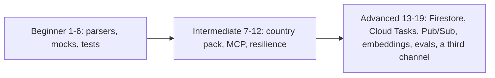

# Exercises

Nineteen graded exercises, from beginner to advanced, that make you read recent fixes, change the Etalase code, add tests and wire Google Cloud services.

::: tip What you will learn
- How to extend the offline parsers, the shipping mock and the readiness score without breaking the 627 existing tests
- How to add a country pack, an MCP tool and a chat intent end to end
- How to read a bug fix and its regression test, and why transaction retries need retry-safe code
- How to test the Firestore store against the emulator
- How to replace in-process pieces with Cloud Tasks, Pub/Sub and Vertex AI embeddings
- How to measure Gemini extraction quality with an eval instead of guessing
:::

## How to use this page

Each exercise has a **goal**, the **files to touch**, **hints**, **acceptance criteria** and a hidden **solution sketch**. Try it before you open the sketch. The sketches are outlines, not finished code: they show the shape of a good answer and the traps.

Work on a branch, and keep the baseline green:

```bash
cd prototype
pip install -r requirements-dev.txt
pytest -q                     # 627 passed before you start
python scripts/demo.py        # the ten-step story must still run
```



| Level | You should already know | Pages to reread |
|---|---|---|
| Beginner | Python, pytest, the demo story | [Hands-on walkthrough](/run/hands-on), [Catalog and stock](/architecture/catalog-and-stock) |
| Intermediate | How checkout, the inbox and the gateway connect | [Checkout and orders](/architecture/checkout-and-orders), [Agent gateway](/architecture/agent-gateway), [Seller agent](/architecture/seller-agent) |
| Advanced | Transactions, idempotency, Google Cloud IAM | [Data model and store](/architecture/data-model), [Deploy](/ship/deploy), [Real services](/ship/real-services) |

Useful test helpers live in `prototype/tests/conftest.py`: the `ctx`, `seller` and `product` fixtures, `make_seller`, `make_product`, `variant(product, "Black")` and the `BUYER` address in Bandung. `conftest.py` also clears provider and token variables from the environment and runs the tests from `tests/`, so your own `.env` never leaks into a test run. `prototype/tests/test_regressions.py` holds the tests for bugs fixed after the first review, and its `RetryingStore` is a useful helper for race tests.

Four exercises (6, 11, 12 and 14) start from a bug that is **already fixed**. They ask you to read the fix, explain it, and then extend it; that is how you learn a codebase you did not write line by line.

## Beginner

### 1. Teach the parser a new colour

**Goal.** Sellers write `tosca` (a blue-green). Make `"tosca habis"` set the Teal variant to 0, and make `"Hijab voal, tosca 4, harga 85rb"` create a Teal variant.

**Files.** `prototype/etalase/catalog/normalize.py` (`COLOR_MAP`), `prototype/tests/test_parsing.py`.

**Hints.**
- Every colour path goes through `canonical_color`, so one dictionary entry is enough.
- `_VARIANT_RE` in `extractor.py` matches one word followed by a number. Multi-word colours like "abu muda" will not work without changing the regex; note that as a limitation rather than fixing it here.

**Acceptance.** `intents.parse("tosca habis")` returns `set_stock`, `Teal`, `0`; the extractor test for the new message passes; all old tests pass.

::: details Solution sketch
```python
# normalize.py, inside COLOR_MAP
"tosca": "Teal", "teal": "Teal",
```

```python
# test_parsing.py
def test_tosca_is_teal():
    assert (intents.parse("tosca habis").kind, intents.parse("tosca habis").color) == ("set_stock", "Teal")
    cat = HeuristicExtractor().extract(["Hijab voal, tosca 4, harga 85rb"])
    assert {v.color: v.stock for v in cat.products[0].variants} == {"Teal": 4}
```
Search also benefits automatically: `CatalogService.search` treats any word found in `COLOR_MAP` as a colour filter.
:::

### 2. Add a courier to `MockShipping`

**Goal.** Offer AnterAja REG in the mock, and let an agent pick it with `courier="anteraja"`.

**Files.** `prototype/etalase/adapters/shipping.py` (`MockShipping.get_rates`), a new test in `prototype/tests/test_checkout.py`.

**Hints.**
- `create_checkout` keeps the cheapest rate unless a courier is given. It lowercases the courier, and an unknown name raises `CheckoutError` listing the available couriers (for example `courier pigeon is not available; options: jne, jnt, sicepat`), so your new courier will appear in that list too.
- If you make AnterAja the cheapest, the demo story changes (the wireframe shows JNE REG Rp12,000 and a total of Rp182,000). Price it above JNE to keep the story.

**Acceptance.** `get_shipping_options` returns four options sorted by price; `create_checkout(..., courier="anteraja")` stores an AnterAja rate; `test_unknown_courier_is_an_error_not_a_silent_fallback` still passes; `python scripts/demo.py` still prints JNE as the cheapest.

::: details Solution sketch
```python
# shipping.py, in MockShipping.get_rates
ShippingRate(courier="anteraja", service="REG", price=14000 * kg, etd="2-4 days"),
```

```python
def test_buyer_can_pick_a_courier(ctx, seller, product):
    black = variant(product, "Black")
    opts = ctx.gateway.get_shipping_options(product.id, black.id, 1, "40135")["options"]
    assert len(opts) == 4 and opts[0]["courier"] == "jne"
    order = ctx.checkout.create_checkout(product.id, black.id, 1, BUYER, courier="AnterAja")
    assert order.shipping_rate.courier == "anteraja" and order.shipping_fee == 14000
```
Also add `"anteraja"` to the `couriers` default of `BiteshipShipping` if you want the real adapter to ask for it (it already does: the default is `"jne,sicepat,jnt,anteraja"`).
:::

### 3. Add a chat intent: "my products"

**Goal.** Without Gemini, a seller who types `my products` or `produk apa saja` gets a list of their products with stock per variant.

**Files.** `prototype/etalase/catalog/intents.py`, `prototype/etalase/seller/inbox.py` (`handle_intent`), `prototype/etalase/seller/i18n.py`, a test.

**Hints.**
- `parse` checks patterns in order. Put your check before the `parse_price` fallback, or a message with a price in it could be read as a catalog.
- Reuse the variant formatting from `summarize` in `inbox.py` (`Black (5)`, `?` for untracked stock).
- With Gemini configured, free text goes to the ADK agent instead, so for parity you would also add a `list_products` tool in `agents/seller_agent.py`. Do that as a stretch goal.

**Acceptance.** `ctx.inbox.handle_intent(seller.id, "my products")` sends one message that contains `Voal Hijab` and `Black (5)`; both English and Indonesian messages exist in `MESSAGES`.

::: details Solution sketch
```python
# intents.py, in parse(), before the parse_price check
if any(k in low for k in ("my products", "produk apa", "daftar produk")):
    return Intent("list_products")
```

```python
# inbox.py, in handle_intent
elif it.kind == "list_products":
    products = ctx.store.list_products(seller_id=seller_id)
    lines = [ctx.t("product_list_head", n=len(products))]
    for p in products:
        variants = ", ".join(f"{v.label} ({v.stock.on_hand if v.stock.on_hand is not None else '?'})"
                             for v in p.variants)
        lines.append(f"• {p.title} [{p.status.value}]: {variants}")
    ctx.messenger.send_text(seller.whatsapp, "\n".join(lines))
```
Add `"product_list_head": {"en": "Your {n} product(s):", "id": "Produkmu ({n}):"}` to `i18n.py`, and mention the command in the `help` message.
:::

### 4. Add a readiness check

**Goal.** Reward products that have at least one attribute (for example material) with 5 points, and keep the total at 100.

**Files.** `prototype/etalase/catalog/readiness.py` (`CHECKS`), `docs/04-catalog-and-stock.md` (the points table), a test.

**Hints.**
- Today the checks add up to exactly 100 (15 + 15 + 20 + 10 + 15 + 15 + 10). Take 5 points from somewhere and justify it in the docs.
- Don't touch `PUBLISH_MINIMUM`; the new check should improve the score, not block publishing.
- Instagram imports store the post link as the attribute `instagram_post`. Should that count? Probably not.

**Acceptance.** A test asserts the points still sum to 100; a product without attributes lists `attributes` in `readiness_missing`; publishing rules are unchanged.

::: details Solution sketch
```python
CHECKS = [
    (15, "title", lambda p: len(p.title.strip()) >= 2),
    (10, "description", lambda p: len(p.description) >= 30),
    # ... price, weight, photo, stock, category unchanged ...
    (5, "attributes", lambda p: any(k != "instagram_post" for k in p.attributes)),
]
```

```python
def test_readiness_points_sum_to_100():
    assert sum(points for points, _, _ in readiness.CHECKS) == 100
```
Update the table in `docs/04-catalog-and-stock.md` in the same commit so docs and code agree.
:::

### 5. Test a late payment that needs a manual refund

**Goal.** `test_late_payment_after_expiry_is_refunded` covers the mock refund. Cover the Xendit case too: the refund raises `ManualActionRequired`.

**Files.** `prototype/tests/test_security.py` (new test only).

**Hints.**
- `CheckoutService._refund` catches **any** exception from `payment.refund` (`ManualActionRequired` or a provider error), sets `payment.status = "refund_pending"` and publishes `ops.manual_action`. Only unexpected errors are logged with a traceback.
- `container.py` subscribes a handler to `ops.manual_action` that logs `MANUAL ACTION REQUIRED` at ERROR level. Use pytest's `caplog` fixture if you want to assert on it.
- Stretch: write a second test where `refund` raises a plain `RuntimeError` (a provider outage) and check that the result is the same.
- `ctx.events.published` is a list of `(topic, payload)` tuples you can assert on.
- Check that a second, duplicate late webhook changes nothing.

**Acceptance.** The test passes and asserts the order stays `expired`, the payment is `refund_pending`, the event was published once, and stock is back to 5.

::: details Solution sketch
```python
def test_late_payment_with_manual_refund(ctx, seller, product, monkeypatch):
    black = variant(product, "Black")
    order = ctx.checkout.create_checkout(product.id, black.id, 1, BUYER)
    ctx.checkout.expire_due(now() + timedelta(minutes=16))

    def manual(o):
        raise ManualActionRequired("not automated")
    monkeypatch.setattr(ctx.payment, "refund", manual)

    late = ctx.checkout.payment_succeeded(order.payment.reference)
    assert late.status == OrderStatus.EXPIRED and late.payment.status == "refund_pending"
    again = ctx.checkout.payment_succeeded(order.payment.reference)  # duplicate webhook
    assert again.payment.status == "refund_pending"
    events = [e for e in ctx.events.published if e[0] == "ops.manual_action"]
    assert events == [("ops.manual_action", {"order_id": order.id, "action": "refund"})]
    assert ctx.store.get_product(product.id).variant(black.id).stock.available == 5
```
The duplicate is harmless because the `pay` callback only acts on `payment.status == "pending"`.
:::

### 6. Read the late-confirmation fix

**Goal.** A confirm-first order can expire, or be answered, before the seller taps **Available**. The first version of the inbox still replied "Great, the buyer has been sent the payment code." That bug is fixed. Read the fix, explain why it is correct, and add the tests that are still missing.

**Files.** `prototype/etalase/seller/inbox.py` (`handle_button`), `prototype/etalase/seller/i18n.py` (`order_closed`, `confirmed`), `prototype/tests/test_regressions.py` (`test_late_available_tap_does_not_claim_payment_was_sent`).

The fix in **`prototype/etalase/seller/inbox.py`**:

```python
            elif action == "confirm":
                order = ctx.checkout.seller_confirms_stock(seller_id, order_id, available=True)
                if order.status == OrderStatus.AWAITING_PAYMENT and order.seller_confirmed:
                    ctx.messenger.send_text(seller.whatsapp, ctx.t("confirmed"))
                else:  # expired or already answered: nothing was sent to the buyer
                    ctx.messenger.send_text(seller.whatsapp, ctx.t("order_closed", status=order.status.value))
```

and the message in **`prototype/etalase/seller/i18n.py`**:

```python
    "order_closed": {"en": "This order is already {status}, so nothing was sent to the buyer.",
                     "id": "Pesanan ini sudah {status}, jadi tidak ada yang dikirim ke pembeli."},
```

**Explain in your own words.**
- Why does the inbox look at the **returned** order instead of trusting that the tap worked? (Hint: `seller_confirms_stock` returns the order unchanged when its status is no longer `awaiting_seller_confirmation`.)
- Why does a double tap on **Available** still get the happy `confirmed` message, and why is that correct?
- What does the seller see after tapping **Sold out** and then **Available** on the same order?

**Then write two tests** in `test_regressions.py`: a double tap gets `confirmed` twice and creates only one payment; **Available** after **Sold out** replies with "already rejected".

**Acceptance.** Both new tests pass, and you can answer the three questions without looking at the code.

::: details Solution sketch
- The model of truth is the order, not the button. Expiry runs in a background loop, so by the time the tap arrives the order may already be `expired`. Only the returned status says what happened.
- After the first tap the order is `awaiting_payment` with `seller_confirmed=True`. The second call returns early without creating a payment, and the condition is still true, so the seller is told (again, truthfully) that the buyer has the QRIS code.
- After **Sold out** the order is `rejected`, so **Available** replies "This order is already rejected, so nothing was sent to the buyer."

```python
def test_double_tap_on_available(ctx, seller):
    product = make_product(ctx, seller, "Voal hijab, black 1, price 85k")  # 1 left -> confirm first
    order = ctx.checkout.create_checkout(product.id, variant(product, "Black").id, 1, BUYER)
    ctx.inbox.handle_button(seller.id, f"confirm:{order.id}")
    first = ctx.store.get_order(order.id).payment.reference
    ctx.inbox.handle_button(seller.id, f"confirm:{order.id}")
    assert "QRIS payment code" in ctx.messenger.outbox[-1].text
    assert ctx.store.get_order(order.id).payment.reference == first
```
Stretch: `seller_confirms_stock` still creates the payment **before** it knows it won the race against expiry, so a lost race leaves an unused QR code at the provider. Write it down in your PR; [Known gaps](/master/known-gaps) lists it as "orphan QR codes".
:::

## Intermediate

### 7. Add a country pack for Malaysia

**Goal.** A Malaysian seller can sell to Malaysian buyers in MYR, and an Indonesian buyer cannot buy from a Malaysian seller (ADR 0001, domestic delivery only).

**Files.** `prototype/etalase/config.py`, `prototype/etalase/checkout/service.py`, `prototype/etalase/catalog/service.py`, `prototype/etalase/gateway/tools.py`, `prototype/etalase/gateway/discovery.py`, `prototype/etalase/gateway/mcp_server.py`, tests.

**Hints.**
- Today only `CountryPack.currency` is read (in `create_checkout`). `payment_provider`, `shipping_provider`, `tax_profile` and `locale` are not used anywhere yet; the container picks adapters by which credentials exist.
- Domestic delivery is enforced indirectly: products get `ships_to=["ID"]` by default and the buyer's country must be in it. `seller.country` is never read. Make it explicit.
- Hard-coded `"IDR"` / `"ID"`: `agent_view` in `catalog/service.py`, `get_shipping_options` in `gateway/tools.py`, `discovery.py` (markets, `priceCurrency`, `addressCountry`), the MCP `INSTRUCTIONS`, and `POSTAL_RE` in checkout (Malaysian postcodes are also 5 digits).

**Acceptance.** Tests show: MY seller plus MY buyer gives an order with `currency == "MYR"`; ID buyer plus MY seller raises `CheckoutError` with "domestic"; `agent_view` shows `MYR` for the MY product; all old tests pass.

::: details Solution sketch
```python
# config.py
"MY": CountryPack("MY", "MYR", "ms-MY", payment_provider="xendit", shipping_provider="tbd", tax_profile="my-sst"),
```

```python
# checkout/service.py, in create_checkout, after loading the seller
if buyer.country != seller.country:
    raise CheckoutError(f"shipping to {buyer.country} is not available (domestic delivery only)")

POSTAL_RE = {"ID": re.compile(r"^[0-9]{5}$"), "MY": re.compile(r"^[0-9]{5}$")}
```

```python
# catalog/service.py
# in ingest: Product(..., ships_to=[seller.country]) after loading the seller
# in agent_view: "currency": COUNTRY_PACKS[seller.country].currency
```
Discovery should list one market per pack. Leave the MCP parameter name `max_price_idr` alone for compatibility, or add a `max_price` alias and document it. Picking the payment adapter per country (a dict of providers keyed by `payment_provider`) is the natural next step.
:::

### 8. Add an MCP tool: `cancel_checkout`

**Goal.** A buyer changes their mind. The agent calls `cancel_checkout(checkout_id, buyer_phone)`, the hold is released at once instead of after 15 minutes.

**Files.** `prototype/etalase/models.py` (`OrderStatus.CANCELLED`), `prototype/etalase/checkout/service.py`, `prototype/etalase/gateway/tools.py` (`NEXT_STEP`, a method), `prototype/etalase/gateway/mcp_server.py`, `prototype/etalase/api/main.py` (REST mirror), `prototype/etalase/gateway/discovery.py` (capabilities), `prototype/tests/test_api.py`.

**Hints.**
- `test_mcp_exposes_the_agent_tools` asserts the **exact** set of tool names. Update it on purpose.
- Use `store.update_order` with a callback, like every other transition, so cancel and payment can't both win.
- Trap: if the buyer already scanned the QR, the payment webhook can arrive after the cancel. Today `payment_succeeded` only refunds late payments for `EXPIRED` orders, so a cancelled order's money would be stuck. Extend that branch.
- Anyone who knows a checkout id could cancel it. Require the buyer phone to match.

**Acceptance.** Cancel releases stock; a cancel after payment returns an error; a payment after cancel is refunded; the MCP tool list test includes `cancel_checkout`.

::: details Solution sketch
```python
# checkout/service.py
def cancel(self, order_id: str, buyer_phone: str) -> Order:
    order = self.store.get_order(order_id)
    digits = lambda s: s.lstrip("+").replace(" ", "").replace("-", "")
    if order is None or digits(order.buyer.phone) != digits(buyer_phone):
        raise CheckoutError("checkout not found")
    won = {}

    def cancel(o: Order) -> bool:
        won.clear()
        if o.status not in (OrderStatus.AWAITING_PAYMENT, OrderStatus.AWAITING_SELLER_CONFIRMATION):
            return False
        o.status = OrderStatus.CANCELLED
        o.log("cancelled by buyer")
        won["yes"] = True
        return True
    updated = self.store.update_order(order_id, cancel)
    if not won:
        raise CheckoutError(f"checkout is {updated.status.value} and can no longer be cancelled")
    self.store.release(order_id)
    self.events.publish("order.cancelled", {"order_id": order_id})
    return updated
```
In `payment_succeeded`, treat `CANCELLED` like `EXPIRED` in the late-payment branch. In `expire_due`, add `CANCELLED` to the statuses that trigger the clean-up `release`. Add a `NEXT_STEP` entry so agents get a hint.
:::

### 9. Rate-limit the MCP endpoint per IP

**Goal.** *(Done in the repository for the tools: `gateway/mcp_server.py` limits each tool per client address through the request on FastMCP's `Context`, and `tests/test_gatekeeper.py` covers it. The coarse middleware variant below is still a good exercise, because it also protects `initialize` and `tools/list`.)* REST checkouts were limited to 20 per IP per hour, but `/mcp/` had no per-IP limit. A script that rotates fake phone numbers could hold a seller's whole stock for 15 minutes at a time. Add a limit.

**Files.** `prototype/etalase/api/main.py` (the `guard` middleware), a test in `prototype/tests/test_api.py`.

**Hints.**
- `rate_limit` raises `HTTPException`, which a middleware does not turn into a response. In a middleware, return a `JSONResponse(..., status_code=429)` yourself.
- A coarse limit on all `POST` requests under `/mcp` is easy and safe. A finer limit only on `create_checkout` needs the HTTP request inside the tool; check what the `Context` object of your installed MCP SDK version exposes before relying on it.
- Use `client_ip(request)`, which takes the last `X-Forwarded-For` entry (the one Google's front end adds).

**Acceptance.** After N allowed MCP posts from one IP, the next returns 429; other paths are unaffected; the existing MCP tests still pass.

::: details Solution sketch
```python
MCP_POSTS_PER_MINUTE = 120

@app.middleware("http")
async def guard(request: Request, call_next):
    # ... existing body-size check ...
    if request.url.path.startswith("/mcp") and request.method == "POST":
        if not limits.allow(f"mcp:{client_ip(request)}", MCP_POSTS_PER_MINUTE, 60):
            return JSONResponse({"detail": "too many requests, slow down"}, status_code=429)
    response = await call_next(request)
    # ... headers ...
```
Remember this limiter is in memory per instance; see [Known gaps](/master/known-gaps).
:::

### 10. Fall back to offline rules when Gemini fails

**Goal.** If Gemini times out or returns an error, the seller should still get a draft (from the offline parser) instead of silence. **Partly done in the repository:** `FallbackExtractor` is now wired in `container.py` and the client retries 429/5xx with backoff; the seller agent answers "please try again in a minute" when it fails. What is left for you is the acceptance below (telling the seller that photos and voice notes were not read) and a request timeout.

**Files.** `prototype/etalase/catalog/extractor.py`, `prototype/etalase/container.py`, `prototype/etalase/seller/inbox.py` (`handle_text`), tests.

**Hints.**
- Write a `FallbackExtractor(primary, fallback)` that implements the same `CatalogExtractor` protocol.
- The seller agent is deliberately *not* replayed through `handle_intent` on failure: the agent may already have changed stock before it failed, and replaying a restock would apply it twice. Think about why before you change that.
- Set a request timeout on the Gemini client (google-genai accepts HTTP options; check the unit in its docs).
- Test with a fake primary that raises; no network needed.

**Acceptance.** With a failing primary, `ctx.catalog.ingest` still returns drafts for `"Voal hijab, black 5, price 85k"`, and a question tells the seller that photos and voice notes were not read.

::: details Solution sketch
```python
class FallbackExtractor:
    def __init__(self, primary: CatalogExtractor, fallback: CatalogExtractor) -> None:
        self.primary, self.fallback = primary, fallback

    def extract(self, texts, image_paths=None, audio_paths=None) -> ExtractedCatalog:
        try:
            return self.primary.extract(texts, image_paths, audio_paths)
        except Exception:
            log.exception("Gemini extraction failed; using offline rules")
            catalog = self.fallback.extract(texts, image_paths, audio_paths)
            if image_paths or audio_paths:
                catalog.questions.append("I couldn't read your photos or voice note right now. Please check the details.")
            return catalog
```

```python
# container.py
extractor = FallbackExtractor(GeminiExtractor(...), HeuristicExtractor()) if s.gemini_enabled else HeuristicExtractor()
```
Test: `ctx.catalog.extractor = FallbackExtractor(Boom(), HeuristicExtractor())` where `Boom.extract` raises.
:::

### 11. Make the media-type mapping testable

**Goal.** WhatsApp voice notes are usually labelled `audio/ogg; codecs=opus`. The first version of `download_media` looked up the full string, so voice notes were saved without an extension and CSV files never reached the inbox's `.csv` branch. That is fixed, but the mapping is buried inside a method that makes two HTTP calls, so no test covers it. Pull it out and test it.

**Files.** `prototype/etalase/adapters/messaging.py`, a test in `prototype/tests/test_security.py` or a new file.

The current code in **`prototype/etalase/adapters/messaging.py`** (`WhatsAppCloudMessenger.download_media`):

```python
        mime = info.get("mime_type", "").split(";")[0].strip().lower()  # e.g. "audio/ogg; codecs=opus"
        ext = {"image/jpeg": ".jpg", "image/png": ".png", "image/webp": ".webp", "audio/ogg": ".ogg",
               "audio/mpeg": ".mp3", "audio/mp4": ".m4a", "audio/aac": ".aac", "audio/amr": ".amr",
               "text/csv": ".csv", "text/comma-separated-values": ".csv"}.get(mime, "")
```

**Hints.**
- Explain first why the `split(";")` matters: what would `.get("audio/ogg; codecs=opus")` return without it?
- Move the dictionary to a module constant and the lookup to a pure function, so the test needs no HTTP.
- Decide what the inbox should do with a PDF (`application/pdf`): ignore it, or reply that only photos, voice notes and CSV files are read today.
- Verify the exact MIME strings against Meta's media docs before relying on them.

**Acceptance.** `extension_for("audio/ogg; codecs=opus") == ".ogg"`, `extension_for("TEXT/CSV") == ".csv"`, unknown types return `""`; `download_media` uses the function; all 322 existing tests still pass.

::: details Solution sketch
```python
MEDIA_EXT = {"image/jpeg": ".jpg", "image/png": ".png", "image/webp": ".webp", "audio/ogg": ".ogg",
             "audio/mpeg": ".mp3", "audio/mp4": ".m4a", "audio/aac": ".aac", "audio/amr": ".amr",
             "text/csv": ".csv", "text/comma-separated-values": ".csv"}

def extension_for(mime: str) -> str:
    return MEDIA_EXT.get(mime.split(";")[0].strip().lower(), "")
```
In `download_media`: `ext = extension_for(info.get("mime_type", ""))`. Without the split, the lookup misses, the file has no extension, and both the `.csv` check in `inbox.py` and any extension-based MIME guess later fail. Note `/media/<name>` only serves `.jpg`, `.jpeg`, `.png` and `.webp`, which is what you want for product images.
:::

### 12. Read the which-product fix, then fix restock

**Goal.** Without Gemini, `navy sold out` used to set **every** Navy variant in the shop to 0. That is fixed: stock intents now carry a product `hint`, and a vague message asks "Which product?". Read the fix, then fix one case it does not cover yet: `restock pashmina navy 20`.

**Files.** `prototype/etalase/catalog/intents.py` (`_hint`, `_ADD`), `prototype/etalase/seller/inbox.py` (`handle_intent`), `prototype/tests/test_regressions.py` (`test_vague_stock_message_asks_which_product`).

The fix in **`prototype/etalase/seller/inbox.py`**:

```python
            elif it.kind in ("set_stock", "add_stock"):
                matches = ctx.catalog.find_variants(seller_id, it.color, it.hint)
                titles = sorted({p.title for p, _ in matches})
                if not it.hint and len(titles) > 1:  # never change several products from one vague message
                    ctx.messenger.send_text(seller.whatsapp, ctx.t("which_product", color=it.color,
                                                                   titles=", ".join(titles)))
                    return
```

and in **`prototype/etalase/catalog/intents.py`**:

```python
def _hint(prefix: str) -> str | None:
    """Product words before the colour, e.g. 'voal hijab' in 'voal hijab black 2 left'."""
    words = [w for w in re.split(r"\s+", prefix.strip()) if w and w.lower() not in ("stok", "stock", "yang", "the")]
    return " ".join(words) or None
```

**The remaining bug.** `_ADD` expects exactly one word between `restock` and the number. So `restock pashmina navy 20` does not match it, falls through to `_SET`, and becomes `set_stock` Navy = 20 with hint `restock pashmina`. The seller asked to **add** 20 and Etalase **sets** stock to 20. Try it:

```python
from etalase.catalog import intents
intents.parse("restock pashmina navy 20")
# Intent(kind='set_stock', color='Navy', qty=20, price=None, waybill=None, hint='restock pashmina')
```

**Hints.**
- Let `_ADD` accept optional product words before the colour, and pass them through `_hint`.
- Keep `restock navy 20` working (no hint; with Navy in two products it should ask "Which product?").
- Also add `restock` and `tambah` to the words `_hint` drops, in case another path picks them up.

**Acceptance.** `intents.parse("restock pashmina navy 20")` returns `add_stock`, Navy, 20, hint `pashmina`; a test with two products that both have Navy shows the pashmina stock increased by 20 and the other unchanged; `test_vague_stock_message_asks_which_product` still passes.

::: details Solution sketch
```python
_ADD = re.compile(r"\b(restock|tambah)\s+((?:[a-zA-Z-]+\s+)*?)([a-zA-Z-]+)\s+(\d+)\b", re.I)

# in parse()
if m := _ADD.search(t):
    color = canonical_color(m.group(3))
    if color:
        return Intent("add_stock", color=color, qty=int(m.group(4)), hint=_hint(m.group(2)))
```
Why "Which product?" only fires without a hint: with a hint, `find_variants` has already filtered by product title, so the seller named the product. With no hint and one product, there is nothing to ask. Note that a hint that matches two products (`hijab` for "Voal hijab" and "Square hijab") still changes both; decide whether to ask in that case too.
:::

## Advanced

### 13. Run the store contract against the Firestore emulator

**Goal.** `FirestoreStore` is not covered by automated tests (`docs/12` says the race against the emulator is next). Run the stock tests against both stores.

**Files.** `prototype/tests/conftest.py`, `prototype/tests/test_stock.py`, `prototype/requirements-dev.txt` (nothing new: `google-cloud-firestore` is already in `requirements.txt`), a CI job.

**Hints.**
- Start the emulator as the module docstring says: `gcloud emulators firestore start --host-port=localhost:8681`, then `export FIRESTORE_EMULATOR_HOST=localhost:8681`.
- Isolate tests with a fresh project id per test (the emulator keeps data per project), so you don't need to clean up.
- Skip the Firestore variant when `FIRESTORE_EMULATOR_HOST` is unset, so `pytest -q` stays offline.
- Under heavy contention, Firestore transactions are retried a limited number of times and can then fail with an error that is **not** `OutOfStock`. Your race test must allow that, but must still prove that no more than one reservation won. Then decide how `create_checkout` should report such an error to an agent (today only `OutOfStock` is caught).
- `held_reservations_expiring_before` needs a composite index on `(status, expires_ts)` in real Firestore; the emulator does not enforce indexes, so add the index definition to your deploy notes.

**Acceptance.** `pytest -q` passes offline (Firestore cases skipped); with the emulator, the race, idempotency and tenant-isolation tests pass on `FirestoreStore` too.

::: details Solution sketch
```python
# conftest.py
import uuid

@pytest.fixture(params=["memory", "firestore"])
def ctx(request):
    if request.param == "firestore" and not os.getenv("FIRESTORE_EMULATOR_HOST"):
        pytest.skip("Firestore emulator not running")
    return build_context(Settings(etalase_env="dev", store_backend=request.param,
                                  google_cloud_project=f"test-{uuid.uuid4().hex[:8]}", _env_file=None))
```

```python
# test_stock.py, race test body
def attempt(i):
    try:
        ctx.store.reserve(f"ord_{i}", product.id, black.id, 1, now() + timedelta(minutes=15))
        wins.append(i)
    except OutOfStock:
        errors.append(i)
    except Exception as e:  # contention gave up after retries
        aborted.append(e)
...
assert len(wins) == 1   # with fewer threads (e.g. 20) to keep emulator runs fast
assert ctx.store.get_product(product.id).variant(black.id).stock.available == 0
```
Parametrising `ctx` runs every test that uses it on both stores; start with `test_stock.py` only if the full suite is slow.
:::

### 14. Read the retry-safe callback fix

**Goal.** Firestore runs a transaction function again when it conflicts. The callbacks in `checkout/service.py` used to write to an outer dict (`won`, `outcome`, `delivered`) without resetting it. In the payment-versus-expiry race, the first attempt could see `awaiting_payment` and set `outcome["paid"]`, the retry could see `expired` and set `outcome["late"]`, and `payment_succeeded` would then publish `order.paid` for an expired order and **never refund the buyer**. That is fixed. Read the fix and the regression test, then extend the test to the callbacks it does not cover yet.

**Files.** `prototype/etalase/checkout/service.py`, `prototype/tests/test_regressions.py`.

The fix, in **`prototype/etalase/checkout/service.py`** (`payment_succeeded`):

```python
        outcome = {}

        def pay(o: Order) -> bool:
            outcome.clear()  # Firestore may run a transaction callback more than once
            if o.status == OrderStatus.AWAITING_PAYMENT:
                # ...
                outcome["paid"] = True
                return True
            if o.status == OrderStatus.EXPIRED and o.payment and o.payment.status == "pending":
                # ...
                outcome["late"] = True
                return True
            return False  # duplicate webhook
```

The same `won.clear()` or `delivered.clear()` line opens `confirm`, `accept`, the `reject` in `seller_rejects_paid`, `update` in `shipment_update`, and `expire`. The test double, in **`prototype/tests/test_regressions.py`**:

```python
class RetryingStore:
    """Wraps MemoryStore and runs every update_order callback twice, like a Firestore transaction retry."""

    def __init__(self, inner, stale=None):
        self._inner = inner
        self._stale = stale or {}  # order_id -> an older copy the first attempt reads

    def __getattr__(self, name):
        return getattr(self._inner, name)

    def update_order(self, order_id, change):
        snapshot = self._stale.pop(order_id, None) or self._inner.get_order(order_id)
        if snapshot is not None:
            change(snapshot.model_copy(deep=True))  # first attempt, discarded as if it conflicted
        return self._inner.update_order(order_id, change)
```

**Explain in your own words.**
- Why is the first `change(...)` call's result thrown away, and why does it still matter?
- `test_late_payment_is_refunded_even_with_retries` passes a stale copy taken **before** expiry. Which branch of `pay` runs on each attempt?
- Why is clearing the dict enough, and what is the alternative fix (hint: compare the order's status before and after)?

**Then extend the tests.** Today only `pay` is tested with `RetryingStore`. Add retry tests for `confirm` (seller taps Available while the first attempt sees the order still awaiting confirmation and the retry sees it expired) and for `expire`.

**Acceptance.** Your new tests fail if you delete the matching `.clear()` line, and pass with it.

::: details Solution sketch
- The thrown-away attempt changes nothing in the store, but it **does** run the callback's side effects on the outer dict. That is exactly the leak.
- First attempt (stale, `awaiting_payment`): sets `outcome["paid"]`. Retry (real, `expired`): `outcome.clear()` wipes it, then sets `outcome["late"]`. So the code refunds and does not publish `order.paid`.
- Only the last attempt's effects should count, and the last attempt is the one that commits. Clearing at the top makes the dict reflect only that attempt. The alternative is to drop the dict and decide from the returned order (for example `updated.status == OrderStatus.EXPIRED and updated.payment.status == "paid_late"`).

```python
class ExpiresDuringConfirm(RetryingStore):
    def update_order(self, order_id, change):
        change(self._inner.get_order(order_id).model_copy(deep=True))  # first attempt: awaiting confirmation

        def expire(o):
            o.status = OrderStatus.EXPIRED
            return True
        self._inner.update_order(order_id, expire)  # the expiry job commits in between
        return self._inner.update_order(order_id, change)  # the retry sees expired


def test_confirm_retry_after_expiry(ctx, seller):
    product = make_product(ctx, seller, "Voal hijab, black 1, price 85k")  # 1 left -> confirm first
    order = ctx.checkout.create_checkout(product.id, variant(product, "Black").id, 1, BUYER)
    ctx.checkout.store = ExpiresDuringConfirm(ctx.store)
    result = ctx.checkout.seller_confirms_stock(seller.id, order.id, available=True)
    assert result.status == OrderStatus.EXPIRED
    assert not [t for t, p in ctx.events.published if t == "order.awaiting_payment" and p["order_id"] == order.id]
```
Why a new double instead of a stale copy: `seller_confirms_stock` reads the order with `get_order` **before** it calls `update_order`. If the store is already expired, it returns early and `confirm` never runs. The expiry has to land between the read and the commit, which is exactly the race.
:::

### 15. Wire reservation expiry to Cloud Tasks

**Goal.** Replace the 60-second loop in the app lifespan with one Cloud Task per order that fires at `expires_at`, as `docs/04` describes. Today the deploy script keeps the loop alive with `--no-cpu-throttling` (CPU stays allocated between requests) and `--max-instances 1`; that works for the demo, but with several instances every instance would run the same loop, and an instance that is replaced loses its timer.

**Files.** a new `prototype/etalase/adapters/scheduler.py`, `prototype/etalase/checkout/service.py`, `prototype/etalase/container.py`, `prototype/etalase/api/main.py`, `prototype/requirements.txt` (`google-cloud-tasks`), `prototype/scripts/deploy_cloud_run.sh`.

**Hints.**
- Put a `Scheduler` protocol behind an adapter: an in-process default that does nothing (the loop stays as a safety net) and a Cloud Tasks one.
- Schedule at checkout (instant: 15 min; confirm-first: 60 min) and **again** when the seller confirms, because `seller_confirms_stock` moves the deadline. The old task will fire early and must be a no-op: the `expire` callback already skips orders whose `expires_at` is later than now.
- Name tasks deterministically (order id plus timestamp) so a retried checkout does not create duplicates.
- Protect the new endpoint. The existing `/tasks/expire` uses `WEBHOOK_TOKEN`; Cloud Tasks can also send an OIDC token from a service account, which is stronger.
- Create the queue once: `gcloud tasks queues create etalase-expiry --location=asia-southeast2`.

**Acceptance.** Unit tests with a fake scheduler show one task per checkout and one more after a confirm; `POST /tasks/expire/{order_id}` expires a due order and ignores one that was extended or paid.

::: details Solution sketch
```python
from google.cloud import tasks_v2
from google.protobuf import timestamp_pb2

class CloudTasksScheduler:
    def __init__(self, project, location, queue, base_url, service_account):
        self.client = tasks_v2.CloudTasksClient()
        self.parent = self.client.queue_path(project, location, queue)
        self.base_url, self.sa = base_url.rstrip("/"), service_account

    def expire_at(self, order_id: str, when) -> None:
        ts = timestamp_pb2.Timestamp()
        ts.FromDatetime(when)
        self.client.create_task(parent=self.parent, task={
            "name": f"{self.parent}/tasks/{order_id}-{int(when.timestamp())}",
            "schedule_time": ts,
            "http_request": {
                "http_method": tasks_v2.HttpMethod.POST,
                "url": f"{self.base_url}/tasks/expire/{order_id}",
                "oidc_token": {"service_account_email": self.sa, "audience": self.base_url},
            },
        })
```
In `CheckoutService`, factor the `expire` callback out of `expire_due` into `expire_order(order_id, when)` and call it from both the loop and the new endpoint. Give the service account `roles/cloudtasks.enqueuer`, and the invoker identity permission to call the service.
:::

### 16. Add embedding search with Vertex AI

**Goal.** `CatalogService.search` matches keywords. `_tokens` folds a simple English plural (`hijabs` also yields `hijab`), but `kerudung` (another word for a head scarf) never matches `hijab`, and neither does `jilbab`. Add semantic search with embeddings, and keep keyword search as the offline fallback.

**Files.** a new `prototype/etalase/catalog/embeddings.py`, `prototype/etalase/catalog/service.py`, `prototype/etalase/models.py` (a vector field or a separate collection), `prototype/etalase/container.py`, tests.

**Hints.**
- Embed a short text per product when it is published (title, category, description, colours), not on every search.
- Choose a model that handles Indonesian and English well, and check the current Vertex AI model list; with google-genai, embeddings come from `client.models.embed_content`.
- Keep all existing filters after ranking: published only, `ships_to`, `max_price`, colour, and hiding sold-out variants. `agent_view` already does most of that.
- Mix scores: keyword hits are precise, embeddings recall more. A simple weighted sum is fine to start.
- For scale, Firestore supports vector fields with nearest-neighbour queries; a linear scan is fine for the pilot.
- Never let embeddings return a product the keyword path would hide for business reasons.

**Acceptance.** With a fake embedder in tests, `search_products("kerudung hitam")` returns the black voal hijab; without Gemini, behaviour is unchanged; the `gateway` tests still pass.

::: details Solution sketch
```python
class GeminiEmbedder:
    def __init__(self, client, model: str):
        self.client, self.model = client, model

    def embed(self, texts: list[str]) -> list[list[float]]:
        resp = self.client.models.embed_content(model=self.model, contents=texts)
        return [e.values for e in resp.embeddings]

def cosine(a, b):
    dot = sum(x * y for x, y in zip(a, b))
    na = sum(x * x for x in a) ** 0.5
    nb = sum(y * y for y in b) ** 0.5
    return dot / (na * nb) if na and nb else 0.0
```
In `search`: compute `q = embedder.embed([query])[0]`; for each published product, `score = 1.0 * hits + 2.0 * cosine(q, product_vector)`; drop products under a threshold; then build `agent_view` with the same colour and price filters. Store vectors at `publish` time and refresh them in `update_price` and connector upserts.
:::

### 17. Build the Gemini extraction eval

**Goal.** Turn the deck's "TBD" for catalog extraction accuracy into a number: 50 labelled products, at least 90% of fields correct (`docs/12-benchmark-plan.md`), plus build time per product.

**Files.** a new `eval/catalog/` folder (cases), a new `prototype/scripts/eval_catalog.py`, a results file for the deck.

**Hints.**
- One folder per case: photos, an optional voice note, `message.txt` and `expected.json` in the `ExtractedCatalog` shape. Mix Indonesian and English, typos and slang (`85rb`, `dongker`).
- Score field by field: title (normalised fuzzy match), price (exact), colours (set match), stock per colour (exact), weight (within a tolerance, since it is an estimate), and "asked a question when the price was missing".
- Match predicted products to expected ones by title similarity before scoring.
- Run `HeuristicExtractor` on text-only cases as a baseline; it shows what Gemini adds.
- Time each call to report build time; run on Vertex AI in your deployment region.
- Never put real buyer or seller personal data in the eval set.

**Acceptance.** `python scripts/eval_catalog.py --extractor gemini` prints per-field and overall accuracy and the p50 and p95 time, and writes a JSON file you can quote on the benchmark slide.

::: details Solution sketch
```python
import difflib, json, time
from pathlib import Path

def similar(a: str, b: str) -> float:
    return difflib.SequenceMatcher(None, a.lower(), b.lower()).ratio()

def score_case(pred, exp) -> dict:
    fields = {}
    for e in exp.products:
        p = max(pred.products, key=lambda x: similar(x.title, e.title), default=None)
        fields.setdefault("title", []).append(bool(p) and similar(p.title, e.title) >= 0.8)
        fields.setdefault("price", []).append(bool(p) and p.price == e.price)
        fields.setdefault("colours", []).append(bool(p) and {v.color for v in p.variants} == {v.color for v in e.variants})
        # ... stock per colour, weight within 30% ...
    return fields

for case in sorted(Path("eval/catalog").iterdir()):
    started = time.perf_counter()
    pred = extractor.extract([(case / "message.txt").read_text()], images(case), audio(case))
    elapsed = time.perf_counter() - started
    # ... accumulate score_case(pred, ExtractedCatalog.model_validate_json((case / "expected.json").read_text()))
```
Report the method next to the number. "92% of fields on 50 products, Gemini 2.5 Flash, asia-southeast1" is a claim a judge can trust.
:::

### 18. Make events durable with Pub/Sub

**Goal.** `EventBus` calls handlers in-process and swallows their errors, so a failed WhatsApp send loses the "New paid order" alert, and a crash between a status change and `publish` loses the event. Move to Pub/Sub, as `events.py` and the architecture plan intend.

**Files.** `prototype/etalase/events.py`, `prototype/etalase/container.py`, `prototype/etalase/api/main.py` (a push endpoint), `prototype/etalase/seller/notifications.py`, `prototype/etalase/connector/service.py`.

**Hints.**
- Keep the `publish(topic, payload)` interface; add a `PubSubEventBus` that publishes to one Pub/Sub topic per event name (or one topic with an attribute) and a push subscription that calls back into the app.
- Pub/Sub delivers at least once. Every handler must be idempotent: include an event id in the payload and remember handled ids, or make the handler check order state first.
- To avoid losing events on a crash, write the event into the order document in the same `update_order` transaction (an outbox), and let a relay publish it.
- Connector webhooks need retries and a dead-letter topic (ADR 0006 says so).
- `EventBus.published` keeps every event in memory forever; that is useful for tests and the demo, but it should not exist in production.

**Acceptance.** In tests, an in-memory fake of the Pub/Sub bus delivers an event twice and the seller gets one message; a failing handler is retried, not dropped.

::: details Solution sketch
```python
class PubSubEventBus(EventBus):
    def __init__(self, project: str):
        super().__init__()
        from google.cloud import pubsub_v1
        self.publisher = pubsub_v1.PublisherClient()
        self.project = project

    def publish(self, topic, payload):
        payload = {"event_id": new_id("evt"), **payload}
        path = self.publisher.topic_path(self.project, "etalase-" + topic.replace(".", "-"))
        self.publisher.publish(path, json.dumps(payload).encode()).result(timeout=10)

# main.py: POST /events/push (OIDC-protected) decodes the Pub/Sub envelope and calls the local handlers;
# a handler error returns 500 so Pub/Sub retries.
```
Start with `order.paid` (seller alert and connector webhook), because a lost one costs a sale.
:::

### 19. Add a third channel behind the router

**Goal.** `ChannelRouter` knows two channels by hard-coded checks. Let it route any number of prefixes, so a third channel (say `line:<user id>`) is one adapter and one entry, with no change to services.

**Files.** `prototype/etalase/adapters/messaging.py` (`ChannelRouter`), a new test in `prototype/tests/test_telegram.py` (it already tests the router), and, if you want sellers to choose it, `CHANNELS` in `prototype/etalase/seller/channels.py` and `Seller.address` in `prototype/etalase/models.py`.

**Hints.**
- Read `ChannelRouter._for` first: it picks Telegram when the address starts with `tg:` and the default messenger otherwise. Keep that behaviour exactly; the existing tests depend on it.
- The `Messenger` interface is four methods (`send_text`, `send_buttons`, `send_notification`, `download_media`). A recording fake with those four methods is all the test needs; no HTTP.
- Media ids carry the same prefix as addresses (`tg:<file id>`), which is why `download_media` routes on the media id.
- Do not build the real LINE adapter. The point is that the core never has to change.

**Acceptance.** A message to `line:U123` reaches the new fake and nothing else; WhatsApp numbers still reach the default messenger; `tg:555` still reaches Telegram; the 627 tests still pass.

::: details Solution sketch
```python
class ChannelRouter:
    def __init__(self, default, telegram, extra: dict[str, Messenger] | None = None):
        self.default, self.telegram = default, telegram
        self.extra = extra or {}                      # {"line:": LineMessenger(...)}

    def _for(self, address: str) -> Messenger:
        if address.startswith(TELEGRAM_PREFIX):
            return self.telegram
        for prefix, messenger in self.extra.items():
            if address.startswith(prefix):
                return messenger
        return self.default
```

```python
class Recorder:
    def __init__(self): self.sent = []
    def send_text(self, to, text): self.sent.append((to, text))
    def send_buttons(self, to, text, buttons): self.sent.append((to, text, buttons))
    def send_notification(self, to, text, buttons=None, template=None): self.sent.append((to, text, buttons))
    def download_media(self, media_id, dest_dir): return ""


def test_a_third_channel_is_picked_by_its_prefix():
    default, tg, line = ConsoleMessenger(), Recorder(), Recorder()
    router = ChannelRouter(default, tg, {"line:": line})
    router.send_text("line:U123", "hi")
    router.send_text("6281234567890", "hello")
    assert line.sent == [("line:U123", "hi")] and tg.sent == []
    assert [m.to for m in default.outbox] == ["6281234567890"]
```
Choosing the channel in the dashboard also needs `CHANNELS`, a `Seller` field for the chat id, the `address` property, and a way to link the chat; that is the rest of what `seller/channels.py` does for Telegram.
:::

## Pitfalls

- **Changing behaviour the pitch depends on.** The demo story (JNE Rp12,000, total Rp182,000, payout Rp163,200) appears in the deck wireframes. Run `python scripts/demo.py` after every exercise.
- **Testing only the happy path.** Every money or stock change in Etalase has a race partner (payment vs expiry, confirm vs expiry, cancel vs payment). Write the race test first.
- **Forgetting the docs.** If you change a rule (readiness points, limits), update the matching `docs/` page in the same commit.
- **Mocking away the thing you test.** For Firestore, Cloud Tasks and Pub/Sub, a fake proves your logic; only the emulator or a real project proves the integration. Do both.

## Check yourself

**1. Why must the `cancel_checkout` exercise also change `payment_succeeded`?**

::: details Answer
A buyer may scan the QR code just before cancelling, so the payment webhook can arrive after the order is `cancelled`. `payment_succeeded` only refunds late payments for `expired` orders; without the change, the money would be stuck with no refund and no stock.
:::

**2. Why does the Firestore race test have to accept errors other than `OutOfStock`?**

::: details Answer
Under heavy contention, Firestore transactions are retried a limited number of times and can then give up with a contention error. That is safe (nothing was reserved), but it is not `OutOfStock`. The test must still prove that at most one reservation won and that available stock is 0.
:::

**3. Which existing test will fail when you add an MCP tool, and why is that good?**

::: details Answer
`test_mcp_exposes_the_agent_tools` in `prototype/tests/test_api.py`, because it asserts the exact set of tool names. That makes every change to the public agent surface deliberate.
:::

**4. In the Cloud Tasks exercise, why is an early task firing harmless?**

::: details Answer
The `expire` callback skips orders whose `expires_at` is later than the run time (it was extended when the seller confirmed) and orders that are no longer awaiting payment or confirmation. Expiry is a conditional, atomic update, so an early or duplicate task is a no-op.
:::

## Next

Now see what is still missing and in which order to fix it: [Known gaps and open problems](/master/known-gaps).
