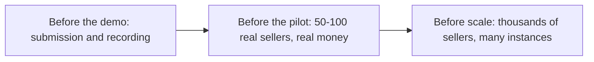

# Known gaps and open problems

An honest, prioritised list of what Etalase does not do yet, what is mocked, which bugs we know about, and which product questions are still open.

::: tip What you will learn
- Exactly which parts are mocked in the demo, and what each one needs to go live
- What to fix before the demo, before a pilot with real sellers, and before scale
- Which bugs were found by reading the code, which ones are already fixed, and why the tests did not catch them at first
- The product and business questions that code cannot answer
:::

## Why a gap list makes you stronger

A prototype built in a few weeks always has gaps. What matters to judges, partners and future you is whether you **know** them and have a plan. The docs already keep a short list in `docs/09-security-privacy-compliance.md` ("Known gaps before a pilot"); this page expands it with what the code shows, and sorts everything by **when** it must be fixed:

- **Before the demo** means it could embarrass you on video or in front of judges.
- **Before the pilot** means it could lose real money, real orders or real personal data.
- **Before scale** means it works for 100 sellers but not for 10,000.

When someone asks "what's missing?", answer from this page. It is the honest companion to the [Pitch and Q&A playbook](/business/pitch-and-qa).

## What is mocked today

These parts have real code paths, but the demo runs a stand-in. Each switches on independently with credentials (see [Turn on real services](/ship/real-services)).

| Part | Demo uses | Real adapter | What is still missing to go live |
|---|---|---|---|
| Catalog extraction <Badge type="warning" text="Mocked in demo" /> | `HeuristicExtractor` (text and CSV rules) | `GeminiExtractor` with Vertex AI or an API key | No accuracy eval yet; no timeout or fallback if Gemini fails |
| Seller chat <Badge type="warning" text="Mocked in demo" /> | Offline intent parser | ADK `LlmAgent` with five tools | Sessions in memory (`InMemorySessionService`); errors leave the seller with no reply |
| Messaging <Badge type="warning" text="Mocked in demo" /> | `ConsoleMessenger` (outbox list) | `WhatsAppCloudMessenger` | Approved templates; per-message cost control; media types tested only against the mapping, not the live API |
| Payments <Badge type="warning" text="Mocked in demo" /> | `MockPayment` (fake QRIS, instant refunds and releases) | `XenditPayment` (dynamic QRIS, callback token) | Refunds and xenPlatform settlement raise `ManualActionRequired` (an operator finishes them); field names to verify |
| Shipping <Badge type="warning" text="Mocked in demo" /> | `MockShipping` (three couriers, `confirm_delivered` always true) | `BiteshipShipping` | Field names, tracking endpoint and booking payload to verify against the live API |
| Database <Badge type="warning" text="Mocked in demo" /> | `MemoryStore` (one lock) | `FirestoreStore` (transactions) | Never run against the emulator in tests; see the Firestore section below |
| KYC <Badge type="warning" text="Mocked in demo" /> | `/dev/sellers` creates sellers with `kyc_status="verified"`; `payout_account_id` is `"mock-sub-account"` only with the mock payment adapter (`None` with real Xendit test keys) | None yet | A registration flow and sub-account creation at the provider |
| Instagram import <Badge type="warning" text="Mocked in demo" /> | `SampleInstagramSource` (three sample posts) | `InstagramGraphSource` with Instagram Login | Long-lived token exchange, token encryption, Meta App Review |
| Events, expiry, media, secrets for tokens <Badge type="info" text="Roadmap" /> | In-process `EventBus`, a 60-second loop, a local `./media` folder, a plain `access_token` field | Pub/Sub, Cloud Tasks, Cloud Storage, Cloud KMS | All four |

## Before the demo

These are ordered by risk to the submission. Registration closes on 11 October, and teams must have 2 to 4 members (`docs/14-hackathon-alignment.md`).

| # | Gap | Why it matters | Fix |
|---|---|---|---|
| D1 | Placeholders: team in `README.md` and slide 1, screenshots on slide 10, links on slide 13 | Judges see these first | Fill them in; the deck must link the public repo, the video and the Cloud Run URL |
| D2 | Benchmark slide has five "TBD" rows (extraction accuracy, build time, tool latency, alert speed, intent accuracy) | Technical Merit is 40%; numbers beat promises | Run what you can (see [Exercise 17](/master/exercises#_17-build-the-gemini-extraction-eval)); otherwise keep "TBD" and say why. Never fill in a guess |
| D3 | Real WhatsApp voice notes and CSV files: the fixed MIME mapping in `download_media` has no unit test and has never run against the live Cloud API | The voice-note scene is the heart of the video | Record a test voice note and send a CSV through the real Cloud API before filming |
| D4 | WhatsApp 24-hour window: the prototype sends only free-form messages, and messages that start a conversation need approved templates | The "New paid order" alert can fail on camera | Send a message from the seller's phone to the Etalase number just before recording, and register that phone as a test recipient |
| D5 | The demo buyer agent must point to the deployed MCP URL | Otherwise it shops on localhost | `ETALASE_MCP_URL=<cloud run url>/mcp/` (checklist in `docs/13-demo-script.md`) |
| D6 | Evidence: the exact BPS table number is still open in `docs/15-evidence.md` | The 95% number is your headline | Download the BPS PDF and note the table |

Three demo risks from the first review are already fixed in the code: the deploy script now wires the optional WhatsApp, Xendit, Biteship and Instagram secrets when they exist, WhatsApp MIME types such as `audio/ogg; codecs=opus` are parsed correctly, and the service is deployed with `--no-cpu-throttling` so the expiry loop keeps running between requests (see [Deploy to Cloud Run](/ship/deploy)).

## Before the pilot

A pilot means real sellers, real buyers and real money. Each group below is a blocker for that.

### State that lives in one process

The deploy script pins `--max-instances 1` for a reason. These objects live in memory and are lost on restart or split across instances:

| Object | File | Effect with more than one instance |
|---|---|---|
| `RateLimiter` (checkout, OTP and REST limits) | `prototype/etalase/security.py` | Each instance counts separately, so limits multiply; keys are never removed, so memory grows |
| OTP codes (`OtpAuth._codes`) | `prototype/etalase/auth.py` | A code requested on one instance fails on another |
| WhatsApp de-duplication (last 5,000 ids) and pending photos (15-minute window) | `prototype/etalase/seller/inbox.py` | Retries are processed twice; photos sent to one instance are lost when the description lands on another |
| ADK sessions | `prototype/etalase/agents/seller_agent.py` | The agent forgets the conversation |
| `EventBus.published`, `ConnectorService.delivered`, `MockPayment` lists | `events.py`, `connector/service.py`, `adapters/payment.py` | Grow forever; useful for tests, not for production |

Fix: move counters, codes, seen ids and pending media to Firestore or Memorystore, use a persistent ADK session service, and drop the in-memory lists outside dev. Also note that dashboard session tokens are signed and last 7 days, with no server-side revocation; logout only clears the browser's `sessionStorage`.

### Firestore is not proven yet

`FirestoreStore` exists and uses transactions, but the automated tests use `MemoryStore` only (its own docstring says so, and `docs/12` lists the emulator race as next).

- **Retry-safe callbacks: fixed, but only proven with a fake.** Firestore re-runs a transaction function on conflict. The callbacks in `checkout/service.py` used to write to outer dicts (`won`, `outcome`, `delivered`) without resetting them, so a retried `pay` callback could leave both `"paid"` and `"late"` set and publish `order.paid` for an expired order. Every callback now starts with `won.clear()`, `outcome.clear()` or `delivered.clear()`, and `tests/test_regressions.py` simulates a retry with a `RetryingStore`. That proves the logic; only the emulator proves it against real Firestore. See [Exercise 14](/master/exercises#_14-read-the-retry-safe-callback-fix).
- **Contention errors.** Under heavy load a transaction can give up with an error that is not `OutOfStock`; `create_checkout` only catches `OutOfStock`, so the agent would get a server error instead of "try again".
- **Indexes.** `held_reservations_expiring_before` needs a composite index on `(status, expires_ts)`.
- **Smaller issues.** `extend` updates reservations outside a transaction; `_apply` reads product documents after buffering writes, which is fine for today's one-item orders but should be restructured before multi-item carts.

Fix: [Exercise 13](/master/exercises#_13-run-the-store-contract-against-the-firestore-emulator), then make `firestore` the default backend.

### Money and operations

- **Refunds and payouts are manual with Xendit.** `refund` and `release_to_seller` raise `ManualActionRequired`. `_refund` and `release_payout` treat **any** exception from the provider the same way: the order becomes `refund_pending` or `pending_manual`, and an `ops.manual_action` event is published. The topic is in `events.TOPICS`, and `container.py` subscribes a handler that logs `MANUAL ACTION REQUIRED` at ERROR level, so it shows up in Cloud Logging. That is a log line, not a page: before real money flows, add a log-based alert or a Pub/Sub alert that wakes an operator, and an ops queue to track each case until it is done.
- **A crash mid-payout** leaves `payout.status = "releasing"` forever, because the claim and the provider call are separate steps. Add a reconciliation job that checks the provider.
- **Orphan QR codes.** `seller_confirms_stock` creates the payment before it knows it won the race against expiry; a lost race leaves an unused QR at the provider.
- **No cancel, return or dispute flow.** Buyers cannot cancel a checkout (it just expires), the `returned` shipping status has no money flow, and there is no dispute policy. Write the policy before writing the code.
- **Licensing.** "Etalase never holds funds" (ADR 0003) is a design that must be confirmed with the provider and a lawyer.

### Seller onboarding and KYC

There is no registration flow. An unknown number is told to sign up at the dashboard URL, but dashboard sign-in only works for sellers who already exist. Today sellers are created only through `/dev/sellers`, already marked as verified with a mock sub-account. The pilot needs registration, sub-account creation and KYC at the payment provider, and `create_checkout` already refuses sellers whose `kyc_status` is not `verified`.

### Messaging

- Approved WhatsApp templates: *utility* for order alerts outside the 24-hour window, *authentication* for sign-in codes. The code sends free-form text everywhere today.
- Event handlers swallow errors (`EventBus.publish` logs and continues), so a failed WhatsApp send silently loses an alert. Pub/Sub retries fix that ([Exercise 18](/master/exercises#_18-make-events-durable-with-pub-sub)).
- Pricing for service messages is unclear (Meta says free; BSP rate cards list charges from October 2026). Confirm with the BSP ([Evidence](/business/evidence)).

### Security hardening

- **MCP abuse.** `/mcp/` has no authentication and no per-IP limit (REST checkouts have 20 per IP per hour). Limits are per buyer phone (5 per hour) and 10 units per checkout, so a script that rotates fake phone numbers could keep a seller's stock on hold. DNS-rebinding protection is turned off in `build_mcp`, with a comment to restrict at the load balancer or with auth. See [Exercise 9](/master/exercises#_9-rate-limit-the-mcp-endpoint-per-ip).
- **Instagram tokens** are stored in `Connection.access_token` as plain text, and the short-lived token from `exchange_code` is stored without exchanging it for a long-lived one. Encrypt with Cloud KMS and exchange first.
- **Media.** Cloud Storage with signed URLs and malware scanning instead of a local folder (on Cloud Run the local folder disappears on restart).
- **Connector webhooks** check the target address and then post, so DNS could change in between; acceptable for a pilot, worth pinning the resolved IP later.

### AI quality

- No extraction eval and no intent eval yet: the 90% and 95% targets in `docs/12-benchmark-plan.md` are unmeasured.
- No Gemini timeout or fallback; a failing call means no reply to the seller ([Exercise 10](/master/exercises#_10-fall-back-to-offline-rules-when-gemini-fails)).
- Prompt-injection defences (the `content_note`, session-scoped tenant id, no money or order actions for the model) are mitigations without a red-team test.

### Bugs and mismatches found by reading the code

| Where | What happens | Fix |
|---|---|---|
| `catalog/intents.py`, restock with a product name | `restock pashmina navy 20` does not match `_ADD` (it expects one word after `restock`), so `_SET` reads it as `set_stock` Navy = 20 with hint `restock pashmina`: the stock is **set** to 20 instead of increased by 20 | [Exercise 12](/master/exercises#_12-read-the-which-product-fix-then-fix-restock) |
| `config.py` and checkout | `CountryPack.payment_provider`, `shipping_provider`, `tax_profile` and `locale` are not read anywhere; adapters are chosen by which credentials exist. Domestic delivery (ADR 0001) is enforced through the default `ships_to=["ID"]`, not by comparing with `seller.country` | [Exercise 7](/master/exercises#_7-add-a-country-pack-for-malaysia) |
| `docs/01` risks | Says the product is useful today as "a catalog and checkout link built from photos", but there is no buyer-facing checkout page; checkout exists only through MCP and REST | Build a simple store and checkout page, or reword the doc |
| `docs/02`, `docs/04` | Mention Excel input; the code parses CSV text only | Add `.xlsx` parsing or say "CSV" |
| `docs/05` state diagram | Shows only `Paid → Refunded`; the code also allows `Accepted → Refunded` (`seller_rejects_paid`) | Update the diagram |

### Fixed after the first code review

These were found while writing this guide and are now fixed in the code. Each is worth reading, because each shows a class of bug you will meet again. Most have a test in `prototype/tests/test_regressions.py`.

| Was | Now | Where to read the fix |
|---|---|---|
| Transaction retries could leave both `paid` and `late` set | Every `update_order` callback clears its outer flag dict first | `checkout/service.py`; `test_payment_callbacks_survive_transaction_retries`, `test_late_payment_is_refunded_even_with_retries` |
| An unknown `courier` silently fell back to the cheapest rate | `CheckoutError` lists the available couriers | `create_checkout`; `test_unknown_courier_is_an_error_not_a_silent_fallback` |
| Rejecting an order set stock to 0 even when an OMS or store owned it | Stock is zeroed only when `seller.stock_owner == INTERNAL` (ADR 0002) | `seller_confirms_stock`, `seller_rejects_paid`; `test_rejection_does_not_touch_stock_owned_by_an_oms` |
| Only `ManualActionRequired` led to a manual refund or payout; nobody listened to `ops.manual_action` | Any provider exception does; the topic is in `TOPICS` and logged at ERROR | `_refund`, `release_payout`, `container.py` |
| A late courier event could move a delivered shipment back to `in_transit` | Status never moves backwards after `delivered` or `returned` | `shipment_update`; `test_shipment_status_never_goes_backwards` |
| `navy sold out` set Navy to 0 on **every** product | Stock intents carry a product `hint`; without one, a colour in several products gets "Which product?" | `intents.py`, `inbox.py`; `test_vague_stock_message_asks_which_product` |
| A late tap on **Available** still said "the buyer has been sent the payment code" | The reply is `order_closed` ("This order is already expired ...") | `inbox.py`; `test_late_available_tap_does_not_claim_payment_was_sent` |
| A three-letter title such as "Tas" could not be published | Title check is `len(title.strip()) >= 2` | `readiness.py`; `test_short_titles_can_be_published_and_plural_search_works` |
| A signed OAuth state could pass as a session token; non-ASCII tokens caused a 500 | Signatures include a purpose; compares use bytes | `auth.py`, `security.py`, `api/main.py`; `test_session_tokens_and_oauth_state_are_not_interchangeable` |
| Schema.org offers linked to a store page that did not exist | Offer `url` is `{base}/agent/v1/products/{product_id}`; untracked stock is `LimitedAvailability` | `gateway/discovery.py` |
| REST had no shipping-options endpoint | `GET /agent/v1/products/{product_id}/shipping-options` mirrors the MCP tool | `api/main.py` |
| Inline comments in `.env.example` became values; tests could read a developer's `.env` | Comments on their own lines; `conftest.py` clears env vars and runs from `tests/` | `.env.example`, `tests/conftest.py` |

## Before scale

| Area | Today | Why it breaks | Direction |
|---|---|---|---|
| Search | `CatalogService.search` loads every published product of every seller, calls `get_seller` per product, and matches keywords (a simple plural fold makes `hijabs` find `hijab`, but `kerudung` never matches `hijab`) | Slow and misses synonyms | Embeddings ([Exercise 16](/master/exercises#_16-add-embedding-search-with-vertex-ai)), then Firestore vector queries or a search service |
| Courier webhook lookup | `_order_by_waybill` collects the unique sellers from all products and scans each seller's orders | Still a full scan of every order on every courier event | Query orders by `shipment.waybill` with a single-field index |
| Hot documents | A product and all its variants' stock live in one document; every reservation rewrites it | Many checkouts on one popular product contend in Firestore | Stock per variant in its own document, or sharded counters |
| Carts | `Order.items` is a list, but `create_checkout` builds exactly one item | Buyers want several items per order | Multi-item checkout; fix `_apply` read order first |
| Service shape | One Cloud Run service does everything | Webhooks, MCP traffic and workers scale differently | Split gateway, seller inbox and workers (`docs/03`, "Scale" row) |
| Countries | `IDR` and `ID` hard-coded in the agent view, discovery and MCP instructions | Every new market touches the core | Read from `COUNTRY_PACKS`; per-country deployments where data residency requires |
| AI cost | Every free-text message can call the model | Cost grows with chat volume | Flash-Lite routing, batch pricing for imports, context caching, a free allowance per seller (`docs/10`); none implemented yet |
| Observability | Logs only (including the `MANUAL ACTION REQUIRED` ERROR line) | You can't prove the p95 latency or alert-speed targets | Cloud Monitoring metrics and alerts, starting with a log-based alert on `ops.manual_action` |
| Integrations | Connector API only | Large partners want pull adapters | Google Sheets (designed), OMS adapters, WooCommerce plugin, marketplace stock sync, Merchant Center feed, AP2 <Badge type="info" text="Roadmap" /> |

## Open product questions

Code cannot answer these; a pilot can. Most come from `docs/10-business-model.md` ("Assumptions to validate first") and `docs/11-roadmap.md`.

1. **Will sellers pay 3–5% per delivered order?** The whole model rests on it.
2. **How many sellers track stock at all?** If few do, confirm-first fires on most orders, and buyers wait for the seller before they can pay. How long will buyers and their agents wait (the window is 60 minutes)?
3. **When does UCP checkout reach Indonesia, and how will agents find Etalase?** Publishing `/.well-known/ucp` does not make any assistant call us. Distribution to agents (Merchant Center feed, agent directories, partnerships) is unsolved.
4. **Will the payment provider support sub-accounts and delayed release for this use case?** If not, the payout design changes (`docs/11`, "What could change the order").
5. **Who pays the gateway's fixed fee?** Passing IDR 4,000 to the buyer may hurt conversion; absorbing it removes the margin at list price.
6. **What is the buyer experience after payment?** Buyers do not register, and Etalase never messages them; shipping updates and refunds reach them only if their agent polls `get_checkout_status`.
7. **Returns and disputes.** Who pays return shipping, and when is the seller's payout final?
8. **Which channel next: WooCommerce or a local website builder?** `docs/08` calls WooCommerce-first an assumption to test in seller interviews.
9. **Will marketplaces allow stock sync from a third party that also sells to agents?** Partner terms are unconfirmed.
10. **How does a buyer's agent judge a small seller's trustworthiness?** There are no ratings or seller signals in the agent view yet.

## Pitfalls

- **Hiding gaps from judges.** They will find the mocks in the repo in minutes. Say it first.
- **Fixing scale problems before pilot problems.** Embedding search is fun; a lost "New paid order" alert loses a real sale. Follow the order on this page.
- **Fixing a bug without a test.** Several bugs above survived because `MemoryStore` and the mocks are kinder than the real services. The fixes in `tests/test_regressions.py` each come with a test that pins down the behaviour the old code got wrong; keep doing that, and check that a new test fails before you fix the code.
- **Letting docs drift.** Three mismatches above are docs that promise more than the code. Update both in the same commit.

## Check yourself

**1. Why does the deploy script set `--max-instances 1`, and what must change before lifting it?**

::: details Answer
Rate limits, OTP codes, WhatsApp de-duplication, pending photos and ADK sessions live in memory, and the demo uses `MemoryStore`. With several instances, limits would multiply, codes would fail across instances and data would split. Move that state to Firestore or Memorystore and switch to `STORE_BACKEND=firestore` first.
:::

**2. Why did the original tests miss the retry-unsafe callback bug, and how does the new test catch it?**

::: details Answer
`MemoryStore.update_order` runs each callback exactly once under a lock, while Firestore may run a transaction function several times on conflict, and the callbacks kept state in outer dicts that were never reset. `tests/test_regressions.py` wraps the store in a `RetryingStore` that runs every callback once on a (possibly stale) copy and throws the result away, then runs it for real, which is what a retried transaction does. The fix is `won.clear()` / `outcome.clear()` / `delivered.clear()` at the top of each callback. The emulator under contention is still the final proof.
:::

**3. A Xendit refund raises `ManualActionRequired`. What happens, and what is missing?**

::: details Answer
`_refund` sets `payment.status = "refund_pending"`, logs a note on the order and publishes `ops.manual_action`. The handler in `container.py` logs `MANUAL ACTION REQUIRED: refund for order ...` at ERROR level. Any other provider exception takes the same path. What is missing is a real page (a log-based alert or Pub/Sub alert) and an ops queue, so a human is woken up and the case is tracked until the buyer has their money.
:::

**4. Name two things to check on the real WhatsApp Cloud API before recording the video.**

::: details Answer
Any two of: the 24-hour window is open (send a message from the seller's phone first) and the phone is a registered test recipient; a real voice note arrives and is saved as `.ogg` (the MIME mapping handles `audio/ogg; codecs=opus`, but only a live test proves it); the optional secrets `etalase-whatsapp-token`, `etalase-whatsapp-app-secret` and `etalase-whatsapp-verify-token` exist so the deploy script wires them; the webhook signature works with `WHATSAPP_APP_SECRET`.
:::

**5. Why is "how will agents find Etalase?" an open product question rather than a code task?**

::: details Answer
The code already publishes an MCP server and a UCP-style profile. Whether assistants call them depends on distribution: Merchant Center feeds, directories, partnerships and when UCP checkout reaches Indonesia. That is a go-to-market problem to test in the pilot.
:::

## Next

Test everything you learned: [Final quiz](/master/quiz).
