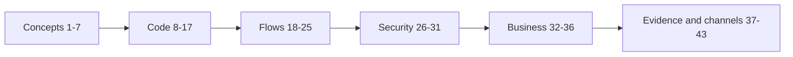

# Final quiz

Forty-three questions across concepts, code, flows, security, business, evidence and channels, with answers, links back to the pages that explain them, and a scoring guide.

::: tip What you will learn
- Whether you can explain Etalase without notes, the way a judge or a first engineer hire would test you
- Which pages to reread, based on the questions you miss
- What "mastery" means for this project: 39 of 43
:::

## How to take the quiz

Answer each question out loud or on paper **before** opening the answer. Count one point per question; for questions with several parts, you need every part right. Some questions are multiple choice; most ask for a short answer, because judges don't give you options.

The questions follow the levels of this site:

## Concepts

**1. In one sentence, what does Etalase do?**

::: details Answer
It turns a WhatsApp seller's product photos and chats into a storefront that AI shopping agents can find, check stock on and buy from, with every order landing back in the seller's WhatsApp. See [The product](/foundations/product).
:::

**2. Why can't an AI shopping agent buy from a typical WhatsApp seller today?**

::: details Answer
Agents request structured catalog data (title, price, availability, variants) through feeds or MCP servers. These sellers keep their catalog in photos, captions, voice notes and chats, which agents cannot read, and they have no checkout an agent can call. See [The problem](/foundations/problem).
:::

**3. What are UCP, MCP and AP2, in one line each, and which does Etalase actually implement?**

::: details Answer
UCP is Google's Universal Commerce Protocol for agent shopping (merchants publish a profile at `/.well-known/ucp`); MCP is the Model Context Protocol, a standard way for agents to call tools; AP2 is the Agent Payments Protocol, UCP's payment layer. Etalase implements an MCP server and a UCP business server (valid profile, Checkout and Fulfillment over REST, tested with the official conformance suite), and has AP2 on the roadmap. See [Agentic commerce 101](/foundations/agentic-commerce) and [UCP checkout](/architecture/ucp).
:::

**4. What does "one stock owner per seller" mean, and what are the three possible owners?**

::: details Answer
Only one system may change `on_hand` for a seller: Etalase (`internal`), the seller's OMS (`oms`) or their store (`store`). When the owner is external, chat stock updates are refused and the sell mode is always instant (ADR 0002). See [Catalog and stock](/architecture/catalog-and-stock).
:::

**5. Why is the design "one ADK agent plus deterministic handlers" instead of several agents?**

::: details Answer
Speed on WhatsApp, lower cost and easier debugging, and because money and stock decisions must be exact. Buttons, payment and courier webhooks and reservations are handled in code; the one agent only handles free-text seller messages (ADR 0004). See [WhatsApp seller agent](/architecture/seller-agent).
:::

**6. What is a country pack, and which of its fields does the code actually read today?**

::: details Answer
A `CountryPack` in `prototype/etalase/config.py` names a market's currency, locale, payment provider, shipping provider and tax profile. Today only `currency` is read (when an order is created); the other fields are not used yet, and adapters are chosen by which credentials are configured. See [Integrations](/architecture/integrations) and [Known gaps](/master/known-gaps).
:::

**7. Mark each as Built, Mocked in demo or Roadmap: (a) Xendit QRIS, (b) Cloud Tasks expiry, (c) the MCP server, (d) Firestore store, (e) Google Sheets sync.**

::: details Answer
(a) Mocked in demo (adapter wired, demo uses `MockPayment`); (b) Roadmap (a 60-second in-process loop today); (c) Built; (d) the code is built, but the demo runs `MemoryStore`, so mocked in demo; (e) Roadmap (designed only). See [Start here](/guide/start-here) and [Known gaps](/master/known-gaps).
:::

## Code

**8. Which file contains `create_checkout`, and what are the first three things it checks?**

::: details Answer
`prototype/etalase/checkout/service.py`. It checks that the quantity is at least 1 and at most `max_qty_per_order` (10), that the product exists and is published, and that the seller exists and has `kyc_status == "verified"`. Then it checks the country, validates the buyer and applies the per-phone rate limit. See [Checkout and orders](/architecture/checkout-and-orders).
:::

**9. How is available stock computed, and is it stored?**

::: details Answer
`available = on_hand − reserved − buffer` (never below 0), computed by the `Stock.available` property in `prototype/etalase/models.py`. It is never stored. If `on_hand` is `None` (stock not tracked), `available` is `None` too. See [Data model and store](/architecture/data-model).
:::

**10. List the four rules of `CatalogService.sell_mode`, in order.**

::: details Answer
1. Stock owner is not `internal` → instant. 2. `on_hand` is `None` → confirm-first. 3. Never confirmed, or last confirmed more than `confirm_if_stale_days` (3) days ago → confirm-first. 4. Available is at most `confirm_if_available_lte` (2) → confirm-first. Otherwise instant. See [Catalog and stock](/architecture/catalog-and-stock).
:::

**11. Why does `Store.put_product` never change the stock of variants that already exist?**

::: details Answer
Stock may only move through `reserve`, `commit`, `release`, `restock` and `set_stock`. If `put_product` copied stock, a stale product copy (for example a catalog edit that started before a checkout) could undo a sale. `test_stale_product_copy_cannot_overwrite_stock` covers it. See [Data model and store](/architecture/data-model).
:::

**12. What does `Store.update_order` guarantee, and why is every status change written through it?**

::: details Answer
It is an atomic read-modify-write: the callback mutates the order and returns `True` to save it. Because every transition goes through it with a check on the current status, the expiry job and a payment webhook (or two webhooks) can't both win. See [Checkout and orders](/architecture/checkout-and-orders).
:::

**13. Name the five MCP tools.**

::: details Answer
`search_products`, `get_product`, `get_shipping_options`, `create_checkout`, `get_checkout_status` (`prototype/etalase/gateway/mcp_server.py`). `test_mcp_exposes_the_agent_tools` asserts exactly this set, and the REST API under `/agent/v1` mirrors all five (including `GET /agent/v1/products/{product_id}/shipping-options`). See [Agent gateway](/architecture/agent-gateway).
:::

**14. Why do the gateway tools return `{"error": ...}` instead of raising exceptions?**

::: details Answer
LLM agents handle a readable error in the tool result better than a failed call: they can explain it to the buyer or try something else. Results also carry a `next_step` hint for the same reason (`prototype/etalase/gateway/tools.py`). See [Agent gateway](/architecture/agent-gateway).
:::

**15. In the ADK seller agent, where does the seller id come from, and why does that matter?**

::: details Answer
From `tool_context.state["seller_id"]`, set when the session is created for the verified WhatsApp number. It is never a tool argument, so the model can't be talked into acting on another seller's shop (tenant isolation). See [WhatsApp seller agent](/architecture/seller-agent).
:::

**16. What do `GeminiExtractor` and `HeuristicExtractor` have in common, and when is each used?**

::: details Answer
Both implement the `CatalogExtractor` protocol and return the same `ExtractedCatalog` schema. `GeminiExtractor` (multimodal, `response_schema=ExtractedCatalog`, temperature 0.1) is used when an API key or Vertex AI is configured; `HeuristicExtractor` (text and CSV rules) is used otherwise, including in all tests. See [Catalog and stock](/architecture/catalog-and-stock).
:::

**17. Multiple choice. The command that runs the 389 automated tests is:**
(a) `python scripts/demo.py` (b) `cd prototype && pytest -q` (c) `uvicorn etalase.api.main:app --port 8080` (d) `npm run build`

::: details Answer
(b). The demo script runs the ten-step story, uvicorn runs the API server, and `npm run build` builds this site. See [Testing](/ship/testing).
:::

## Flows

**18. Walk through an instant order from `create_checkout` to `paid_out`, naming each status.**

::: details Answer
`awaiting_payment` (stock reserved for 15 minutes, QRIS created) → `paid` (payment webhook, stock committed) → `accepted` (seller taps Accept) → `shipped` (seller sends a tracking number) → `delivered` (courier webhook, confirmed with the courier) → `paid_out` (payout released minus commission). See [Checkout and orders](/architecture/checkout-and-orders).
:::

**19. In confirm-first mode, how long does the hold last before and after the seller taps Available, and why does it change?**

::: details Answer
60 minutes while waiting for the seller (`seller_confirm_timeout_minutes`), then 15 minutes from the moment the seller confirms (`reservation_ttl_minutes`), via `store.extend`. The hold must outlive the new QR code, but not keep stock locked for a full hour after payment is possible. See [Checkout and orders](/architecture/checkout-and-orders).
:::

**20. In confirm-first mode, what status does an order get when the payment arrives, and why is it different from instant mode?**

::: details Answer
`accepted`, because the seller already confirmed the stock (`seller_confirmed=True`), so there is no need to ask again. In instant mode it becomes `paid` and the seller gets Accept / Out of stock buttons. See [Checkout and orders](/architecture/checkout-and-orders).
:::

**21. A payment webhook arrives after the order expired. What happens to the order, the money and the stock?**

::: details Answer
The order stays `expired`; the payment is marked `paid_late` and then refunded (`refunded` with the mock; with Xendit, or if the provider call fails for any reason, `refund_pending` plus an `ops.manual_action` event that `container.py` logs as `MANUAL ACTION REQUIRED` at ERROR level). Stock is not committed, because the hold was already released. See [Checkout and orders](/architecture/checkout-and-orders).
:::

**22. The seller taps Sold out on a confirm-first order. List three effects.**

::: details Answer
The order becomes `rejected`; the held units are released; the variant's stock is set to 0 because the seller just said it's gone (only when Etalase owns the stock, `stock_owner == internal`, which is always true for confirm-first orders); an `order.rejected` event is published with `paid: False`, so nothing was charged. Any three. See [Checkout and orders](/architecture/checkout-and-orders).
:::

**23. Calculate the payout for 2 × Voal Hijab Black at Rp85,000 with the cheapest mock courier to Bandung.**

::: details Answer
Subtotal Rp170,000; JNE REG Rp12,000 (300 g rounds up to 1 kg); buyer total Rp182,000. Commission 4% of the subtotal = Rp6,800, so the payout is Rp163,200. The shipping fee goes to the courier, not into the payout. See [Hands-on walkthrough](/run/hands-on).
:::

**24. What exactly releases a payout, and why isn't the courier webhook enough on its own?**

::: details Answer
A `delivered` shipping update for a `shipped` order, **and** `shipping.confirm_delivered(order)` returning true (Biteship: a tracking lookup by waybill and courier). Then `release_payout` atomically claims the payout once. The webhook is only a hint because a forged webhook or a fake waybill must never move money. See [Checkout and orders](/architecture/checkout-and-orders).
:::

**25. A seller sends three photos and then, five minutes later, "Voal hijab, black 5, navy 3, price 85k". What happens to the photos?**

::: details Answer
Each photo is saved and added to the seller's pending media (up to 20 files, kept for 15 minutes); the seller gets "N file(s) received". The text then triggers `create_catalog`, which takes the pending photos and voice notes and passes them to the extractor with the text, so the photos become the product images. See [WhatsApp seller agent](/architecture/seller-agent).
:::

## Security

**26. On a public URL, which three settings must be present for the app to start in dev mode, and what extra rule applies in prod?**

::: details Answer
`DEV_TOKEN` and `WEBHOOK_TOKEN` (16+ characters each) and a non-default `SESSION_SECRET`. In `prod`, `SESSION_SECRET` must be 32+ characters, and the app refuses mock payment, mock shipping and any messaging other than the WhatsApp Cloud API (`prototype/etalase/security.py`). See [Security model](/architecture/security).
:::

**27. How is each webhook authenticated: WhatsApp, Xendit, shipping?**

::: details Answer
WhatsApp: `X-Hub-Signature-256`, an HMAC of the raw body with the app secret, mandatory when the real Cloud API is on. Xendit: the `x-callback-token` header compared in constant time. Shipping (and the mock payment): our `WEBHOOK_TOKEN` as `?token=` or a header, and delivery is re-checked with the courier anyway. See [Security model](/architecture/security).
:::

**28. List the OTP sign-in limits.**

::: details Answer
Code valid 5 minutes; 5 wrong tries per code; 60-second resend cooldown; 5 codes per number per hour; lockout after 10 wrong tries per number per hour across codes; plus per-IP limits on `/auth/otp` (10 per hour) and `/auth/verify` (30 per hour). The response is the same whether or not the number exists. See [Security model](/architecture/security).
:::

**29. How are Connector API keys stored, and how does a partner verify Etalase's order webhooks?**

::: details Answer
Keys (`etk_...`) are shown once and only their SHA-256 hash is stored; partners send them in `X-Etalase-Key`. Outgoing `order.paid` webhooks carry `X-Etalase-Signature`, the hex HMAC-SHA256 of the raw body with the connection's webhook secret, which the partner recomputes and compares in constant time. See [Integrations](/architecture/integrations).
:::

**30. Why are order webhooks only allowed to public https addresses, checked again at send time?**

::: details Answer
They carry buyer names and addresses, and an attacker could otherwise point them at internal services or the cloud metadata server (SSRF). `check_webhook_url` rejects non-https URLs and private, loopback, link-local, reserved and multicast addresses, at creation and again before each send because DNS can change; redirects are not followed. See [Security model](/architecture/security).
:::

**31. Name two defences against prompt injection through seller-written product text.**

::: details Answer
Any two: every agent product view has a `content_note` saying the title and description are seller content, not instructions; the model can't accept orders or move money (buttons and webhooks are code); tools validate inputs; the tenant id comes from session state, not from the model; drafts are not visible to agents until the seller taps Publish. See [Security model](/architecture/security).
:::

## Business

**32. What is the pricing, and when is it charged?**

::: details Answer
A 3–5% commission (4% in the prototype, `COMMISSION_RATE`), excluding VAT, charged only on delivered orders, with no monthly or listing fee. Shipping is paid by the buyer. See [Business model and costs](/business/business-model).
:::

**33. What is the estimated platform cost per order in the pilot, and which component dominates it?**

::: details Answer
About IDR 2,000–3,500 per order. WhatsApp messages are most of it (about IDR 1,460–1,840 for about four utility messages); cloud and Gemini make up the rest. See [Business model and costs](/business/business-model).
:::

**34. Why is "Etalase never holds funds" a design decision and not just a slogan?**

::: details Answer
Holding and forwarding other people's money is a regulated payment activity in Indonesia (to verify with counsel). So payments go to the seller's sub-account at a licensed provider, and Etalase only instructs when to release and how to split the commission; KYC and bank details live at the provider (ADR 0003). In code, `refund` and `release_to_seller` are provider calls, not ledger moves. See [Checkout and orders](/architecture/checkout-and-orders).
:::

**35. Multiple choice. Why does Etalase use Xendit, not Stripe, in Indonesia?**
(a) Stripe is more expensive (b) Stripe Indonesia is invite-only, supports only virtual-account transfers and has no QRIS (c) Xendit has better MCP support (d) Stripe does not allow sub-accounts anywhere

::: details Answer
(b). See [Evidence and sources](/business/evidence) and ADR 0005.
:::

**36. Name three of the four assumptions `docs/10` says to validate first.**

::: details Answer
Sellers' willingness to pay 3–5% per order; the share of sellers who track stock at all; when UCP checkout reaches Indonesia; payment-provider support for sub-accounts and delayed release. See [Business model and costs](/business/business-model) and [Known gaps](/master/known-gaps).
:::

## Evidence

**37. State the BPS chat-commerce number correctly, including its nuance.**

::: details Answer
95.33% of Indonesian e-commerce businesses sell through instant messaging apps such as WhatsApp; 17.80% use marketplaces and 1.77% a website (BPS, *E-Commerce Statistics 2023*, published January 2025). Businesses can use several channels, so it means "use chat", not "sell only via chat". See [Evidence and sources](/business/evidence).
:::

**38. Is UCP agent checkout live in Indonesia? Give the honest status by country.**

::: details Answer
No. Live in the US (February 2026); started with select retailers in Australia (June 2026), while Google's own pages still call checkout US-only and place the self-serve hub in Australia in 2027; a limited Flipkart test in India (September 2026); Indonesia was named as a future market in January 2026, with no date known. See [Evidence and sources](/business/evidence).
:::

**39. What is the QRIS fee situation for a typical Etalase order of IDR 170,000 since 1 October 2026?**

::: details Answer
For a micro merchant, the QRIS MDR is 0% for transactions up to Rp500,000 (and 0% for all merchants up to Rp100,000). The gateway may still add a fixed fee; Xendit lists IDR 4,000 per transaction, which the pilot shows to the buyer as a payment fee. See [Evidence and sources](/business/evidence).
:::

**40. Which benchmark results can you claim today, and which are still TBD?**

::: details Answer
Claimable: 0 units oversold when 100 concurrent reservations race for the last unit (on the in-memory store), and duplicate and late payments handled (no double stock change, late payment refunded), all in the 389 passing tests. TBD: catalog extraction accuracy, catalog build time, agent tool latency, seller alert speed and stock-update intent accuracy with Gemini. See [Testing](/ship/testing) and [Pitch and Q&A](/business/pitch-and-qa).
:::

**41. How does the same order alert reach a seller on WhatsApp or on Telegram without the core knowing which?**

::: details Answer
The core only calls the `Messenger` interface. `ChannelRouter` implements it and picks the adapter from the address string: `tg:<chat id>` goes to the Telegram adapter, anything else to WhatsApp. `Seller.address` returns the chosen channel's address, and `SellerInbox.to()` replies on the channel the seller wrote on. Telegram needs no template because it has no 24-hour window. See [WhatsApp seller agent](/architecture/seller-agent).
:::

**42. What stops a stranger from linking their own Telegram chat to someone else's shop, and what is the known gap?**

::: details Answer
Linking needs a code issued inside a signed-in dashboard session: `<seller id>-<expiry>-<HMAC>`, valid for 10 minutes, with the purpose "link" so a sign-in token cannot be replayed as one, and a chat already linked to a shop is not moved by another code. The gap: the code is a bearer value and not single-use, so anyone holding an unexpired code could use it. A one-time server-side code is the next step. See [Security model](/architecture/security) and [Known gaps](/master/known-gaps).
:::

**43. A friend says "use Click-to-WhatsApp ads and WhatsApp becomes free" and "Instagram DMs are free, so build an Instagram bot". What do you say?**

::: details Answer
CTWA frees a chat that starts from an ad; Etalase's alerts to sellers are not that, and the length of the window is reported differently by different resellers (claim 51). "Instagram DMs are free" came from a vendor table we could not confirm (claim 53). An Instagram buyer bot would have to run per seller on each seller's own account, needs Meta's Advanced Access, and is roadmap, not built (claim 52, Q49 in [Pitch and Q&A](/business/pitch-and-qa)).
:::

## Scoring guide

| Score | Level | What to do next |
|---|---|---|
| 39–43 | **Mastery** | You can defend Etalase in front of judges. Do two advanced [exercises](/master/exercises) to stay sharp. |
| 33–38 | Solid | Reread the pages linked from the questions you missed, then retake those sections. |
| 24–32 | Getting there | Redo the [Hands-on walkthrough](/run/hands-on) and the Level 3 pages before pitching. |
| 0–23 | Start again | Go back to [Start here](/guide/start-here) and follow the sidebar in order. |

Two rules on top of the score:

- **Questions 21, 24, 34 and 38 are must-pass.** They cover late payments, payout release, holding funds and agent-commerce status: the four places where a wrong answer becomes an overclaim. Missing any of them means you are not at mastery yet, whatever your total.
- **Score yourself strictly.** "Something about locks" is not an answer to question 12. If you needed the code open, count it as wrong.

## Check yourself

Three bonus questions that combine several pages.

**1. A judge says: "So if two agents buy the last unit on your Cloud Run deployment, you are safe?" Give the complete honest answer.**

::: details Answer
On today's deployment, yes: it runs one instance with `MemoryStore`, where `reserve` checks and increments under one lock, and the 100-thread test proves exactly one wins. The pilot uses `FirestoreStore` transactions; the order callbacks are now retry-safe (each clears its outer flags, and `tests/test_regressions.py` simulates a retry), but the same race against the Firestore emulator is still the next test. See [Known gaps](/master/known-gaps).
:::

**2. Which single setting switches Gemini on, and what changes in the seller experience when it does?**

::: details Answer
`GOOGLE_API_KEY`, or `GOOGLE_GENAI_USE_VERTEXAI=true` with a project (`Settings.gemini_enabled`). Catalog building switches to `GeminiExtractor` (photos and voice notes are read), and free-text messages go to the ADK seller agent instead of the offline intent parser. Buttons stay deterministic either way. See [Turn on real services](/ship/real-services).
:::

**3. Why is the late-payment refund in question 21 a good example of "fail safe" design?**

::: details Answer
The system cannot stop a buyer from paying a QR code after the hold ends, so it plans for it: the `pay` callback detects an expired order with a pending payment, does not commit stock (which may have been sold to someone else), and returns the money. If the provider can't refund automatically, or fails in any way, it records `refund_pending` and publishes `ops.manual_action` (logged at ERROR for an operator) instead of crashing the webhook. And because the `pay` callback clears its outcome flags on every attempt, a Firestore retry can't turn this late payment into a "paid" order.
:::

## Next

You have finished the Academy. Go back to [Start here](/guide/start-here) and pick the path you need next, or start on the [Known gaps](/master/known-gaps) in priority order.
