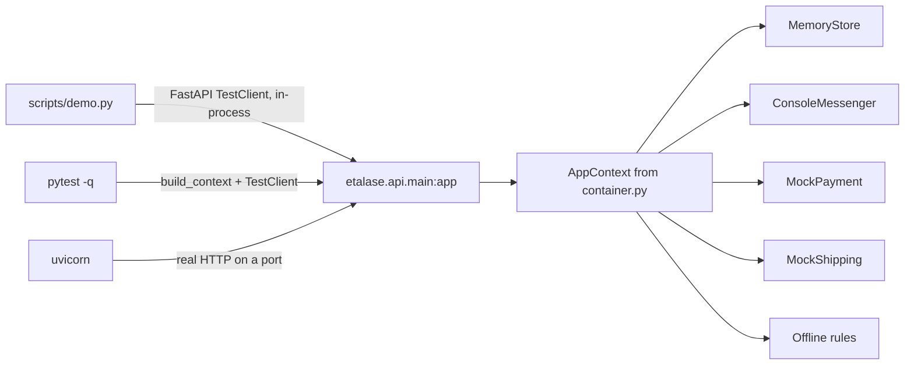

# Run the demo locally

Go from a fresh clone to a running Etalase server, the ten-step demo and a green test suite, with no accounts or API keys.

::: tip What you will learn
- How to set up Python, a virtual environment and the dependencies
- The three ways to run Etalase locally: the demo script, the tests and the HTTP server
- What the "modes" in `/healthz` mean and which environment variable flips each one
- How `DEV_TOKEN` and `WEBHOOK_TOKEN` behave on localhost versus a public URL
- How to fix the problems people actually hit (wrong folder, busy port, stray settings in your shell or `.env`, the `mcp<2` pin)
:::

## Why it runs with zero credentials

Etalase talks to five outside services: Gemini, WhatsApp, Xendit, Biteship and Firestore. Each one sits behind an adapter, and every adapter has an offline twin. When a key is missing, `build_context()` in `prototype/etalase/container.py` quietly picks the twin:

| Part | Real implementation | Offline twin (default) |
|---|---|---|
| AI | `GeminiExtractor` + ADK seller agent | `HeuristicExtractor` + regex intent parser ("offline rules") |
| Messaging | `WhatsAppCloudMessenger` | `ConsoleMessenger` (an in-memory outbox) |
| Payment | `XenditPayment` | `MockPayment` (fake QRIS strings) |
| Shipping | `BiteshipShipping` | `MockShipping` (three fixed couriers) |
| Store | `FirestoreStore` | `MemoryStore` (lost on restart) |

So the whole flow, from seller onboarding to payout, runs on your laptop. This is a deliberate design choice (`docs/adr/0005-adapters-and-country-packs.md`): it keeps the tests fast and the demo reliable.

There are three ways to run it, and they use the app differently:



The demo script and the tests never open a port. Only `uvicorn` gives you a server you can hit with `curl` or a browser.

## Prerequisites

| Need | Version | Why |
|---|---|---|
| Python | 3.11 or newer (`requires-python = ">=3.11"` in `prototype/pyproject.toml`) | The Docker image uses 3.12; 3.13 also works |
| pip and `venv` | ships with Python | Isolated install |
| curl | any | For the [hands-on walkthrough](/run/hands-on) |
| Internet, once | | The first install downloads FastAPI, MCP, Google ADK, google-genai and the Firestore client; it can take several minutes |

Check your Python first:

```bash
python3 --version     # must print 3.11 or higher
```

## Step 1: create a virtual environment and install

All commands run from the `prototype/` folder. That matters: the code imports the `etalase` package from the current directory, and settings read `.env` from the current directory.

```bash
cd prototype
python3 -m venv .venv
source .venv/bin/activate          # Windows PowerShell: .venv\Scripts\Activate.ps1
pip install -r requirements-dev.txt
```

`requirements-dev.txt` pulls in `requirements.txt` plus `pytest` and `pillow`. The `.venv/` folder is already in `.gitignore`.

One line in **`prototype/requirements.txt`** deserves attention:

```text
# ADK's MCP toolset currently targets the 1.x MCP SDK
mcp[cli]>=1.30,<2
```

Keep that pin. Both the MCP server (`mcp.server.fastmcp.FastMCP`) and the ADK buyer agent (`McpToolset`) are written against MCP SDK 1.x.

## Step 2: run the demo

```bash
python scripts/demo.py
```

The script imports the FastAPI `app` and drives it through `TestClient`, playing seller, buyer agent, payment provider and courier in turn. You should see ten numbered steps. Trimmed real output:

```text
Modes: {'store': 'memory', 'messaging': 'console', 'telegram': 'off', 'payment': 'mock', 'shipping': 'mock', 'ai': 'offline rules'}

==============================================================================
2. The seller sends a product photo, then a description, on WhatsApp
==============================================================================
  [seller → WhatsApp] Voal hijab, black 5, navy 3, mocca 10, price 85k
  [WhatsApp → seller]
   I found 1 product(s):
   • Voal Hijab: Black (5), Navy (3), Mocca (10) · Rp85.000 ±150 g
     Readiness 100/100
   Publish to AI shopping agents?
   [Publish]  [Edit]
...
  [agent → MCP] create_checkout(product_id='prd_c76945b93a', variant_id='var_4a333346eb', quantity=2)
  → checkout ord_c6478022b2 · awaiting_payment · total Rp182.000
...
6. The courier says delivered → the payout waits out the return window, then it is released
  [WhatsApp → seller]
   Parcel delivered ✅ Rp163.200 is on its way to your account (commission Rp6.800).
...
8. Oversell race: 50 agents try to buy the last unit at the same time
  → successful checkouts: 1 of 50 (expected 1), refused as out of stock: 49. Oversold units: 0
...
  Events published: 25 · WhatsApp messages sent: 23
```

IDs (`sel_…`, `prd_…`, `ord_…`) are random, so yours will differ. The numbers should not: Rp182.000 total (2 × Rp85.000 + Rp12.000 JNE), Rp6.800 commission (4% of Rp170.000) and exactly one winner in the race.

## Step 3: run the tests

```bash
pytest -q
```

```text
........................................................................ [ 18%]
........................................................................ [ 37%]
........................................................................ [ 55%]
........................................................................ [ 74%]
........................................................................ [ 92%]
.............................                                            [100%]
729 passed in 15.6s
```

`tests/conftest.py` removes the provider keys (`GOOGLE_API_KEY`, `WHATSAPP_*`, `XENDIT_*`, `BITESHIP_API_KEY`, `INSTAGRAM_*`, `TELEGRAM_*`), the tokens and URLs (`DEV_TOKEN`, `WEBHOOK_TOKEN`, `SESSION_SECRET`, `PUBLIC_BASE_URL`, `STORE_BASE_DOMAIN`) and a few others from the environment, then changes into `tests/`, so no `prototype/.env` is read either. The tests always run offline, whatever is in your shell or `.env`. [Testing](/ship/testing) walks through what they cover.

## Step 4: start the server

```bash
uvicorn etalase.api.main:app --reload --port 8080
```

```text
INFO:     Application startup complete.
INFO:     Uvicorn running on http://127.0.0.1:8080 (Press CTRL+C to quit)
```

`--reload` restarts the server when you edit code. Remember that a restart also wipes `MemoryStore`, so every seller and order you created disappears.

| URL | What |
|---|---|
| `http://localhost:8080/` | Seller dashboard (WhatsApp OTP sign-in) |
| `/docs` | Interactive OpenAPI docs |
| `/healthz` | Liveness plus the mode of each part |
| `/mcp/` | MCP server for agents (note the trailing slash) |
| `/.well-known/ucp` | UCP discovery profile (spec 2026-04-08) |
| `/ucp/v1/checkout-sessions` | UCP Checkout over REST; see [UCP checkout](/architecture/ucp) |
| `/checkout/{id}` | Hosted QRIS payment page (the UCP `continue_url`) |
| `/agent/v1/*` | REST versions of the agent tools |
| `/connector/v1/*` | Connector API |
| `/dev/*` | Simulation endpoints (only when `ETALASE_ENV=dev`) |

Check it:

```bash
curl -s localhost:8080/healthz
```

```json
{"ok":true,"modes":{"store":"memory","messaging":"console","payment":"mock","shipping":"mock","ai":"offline rules"}}
```

## Environment variables and modes

Settings come from `Settings` in **`prototype/etalase/config.py`** (pydantic-settings). Each field reads the environment variable with the same name in upper case, then a `.env` file in the current directory. You can always override on the command line:

```bash
RESERVATION_TTL_MINUTES=1 uvicorn etalase.api.main:app --port 8080
```

That example is handy for testing expiry: an unpaid checkout turns `expired` within about two minutes (one-minute hold plus the 60-second expiry loop), and paying it afterwards marks the payment `refunded`.

Each `/healthz` mode is decided in `build_context()`:

| Mode key | Value you see | Switches to the real thing when |
|---|---|---|
| `store` | `memory` | `STORE_BACKEND=firestore` (with Google Cloud credentials, or the emulator via `FIRESTORE_EMULATOR_HOST`) |
| `messaging` | `console` | `WHATSAPP_TOKEN` and `WHATSAPP_PHONE_NUMBER_ID` are both set |
| `payment` | `mock` | `XENDIT_SECRET_KEY` is set (needs `XENDIT_CALLBACK_TOKEN` too) |
| `telegram` | `off` | `TELEGRAM_BOT_TOKEN` is set (then `bot`; needs `TELEGRAM_WEBHOOK_SECRET` too) |
| `shipping` | `mock` | `BITESHIP_API_KEY` is set |
| `ai` | `offline rules` | `GOOGLE_API_KEY` is set, or `GOOGLE_GENAI_USE_VERTEXAI=true` |

Other variables you will meet:

| Variable | Default | Effect |
|---|---|---|
| `ETALASE_ENV` | `dev` | `dev` enables `/dev/*`; `prod` hides them and refuses mocks |
| `PUBLIC_BASE_URL` | `http://localhost:8080` | Used in links and image URLs, and decides "local or public" for the security checks |
| `SESSION_SECRET` | `dev-only-change-me` | Signs dashboard tokens |
| `DEV_TOKEN`, `WEBHOOK_TOKEN` | unset | See the next section |
| `SELLER_LOCALE` | `en` | `id` sends seller messages in Bahasa Indonesia |
| `GEMINI_MODEL` | `gemini-3.8-flash` | Model for extraction and the seller agent |
| `ETALASE_MEDIA_DIR` | `./media` | Where downloaded WhatsApp media is saved |
| `COMMISSION_RATE`, `RESERVATION_TTL_MINUTES`, `MAX_QTY_PER_ORDER`, `MAX_CHECKOUTS_PER_BUYER_PER_HOUR` | `0.04`, `15`, `10`, `5` | Business rules |
| `SELLER_AI_CALLS_PER_HOUR` | `60` | Gemini calls one seller can trigger per hour (free-text turns and catalog builds) |
| `TELEGRAM_BOT_TOKEN`, `TELEGRAM_WEBHOOK_SECRET`, `TELEGRAM_BOT_USERNAME` | unset | The optional Telegram seller channel; the secret is 16 or more characters from `A-Z a-z 0-9 _ -`. Setup in `SETUP.md` section 3b |
| `STORE_BASE_DOMAIN` | unset | A bare host such as `example.com`. When set, sellers can claim `shop.example.com`; path links keep working |

Turning on each real service is covered in [Turn on real services](/ship/real-services).

## DEV_TOKEN and WEBHOOK_TOKEN: local versus public

Two secrets protect the parts of the API that have no other authentication. Their rules live in **`prototype/etalase/security.py`**:

```python
def require_dev(request: Request, s: Settings) -> None:
    if not s.is_dev:
        raise HTTPException(404)
    if s.dev_token and not _eq(request.headers.get("x-dev-token"), s.dev_token):
        raise HTTPException(401, "X-Dev-Token required")


def require_webhook_token(request: Request, s: Settings) -> None:
    """For webhooks without provider signatures. Open only on a local dev run with no token set."""
    if not s.webhook_token:
        if s.is_dev and s.is_local:
            return
        raise HTTPException(503, "WEBHOOK_TOKEN not configured")
    # ...
```

What that means in practice (the first four rows were checked against a running server; the last follows from the code, because prod cannot start with mocks):

| Situation | `/dev/*` | Mock payment, shipping, console WhatsApp webhooks, `/tasks/expire` |
|---|---|---|
| Localhost, no tokens set | Open | Open |
| Localhost, `DEV_TOKEN` set | `401 {"detail":"X-Dev-Token required"}` without the header | — |
| Localhost, `WEBHOOK_TOKEN` set | — | `401 {"detail":"invalid webhook token"}` without `?token=` or `X-Etalase-Webhook-Token` |
| Public `PUBLIC_BASE_URL`, tokens missing or short | Server refuses to start | Server refuses to start |
| `ETALASE_ENV=prod` | `404` | Needs `WEBHOOK_TOKEN` |

Starting with a public URL and no secrets fails fast:

```bash
PUBLIC_BASE_URL=https://etalase-demo.example.com uvicorn etalase.api.main:app --port 8091
```

```text
etalase.security.InsecureConfig: Refusing to start:
- DEV_TOKEN (16+ chars) is required when dev endpoints are reachable from the internet
- WEBHOOK_TOKEN (16+ chars) is required on a non-local deployment
- SESSION_SECRET must be set on a non-local deployment
```

And `ETALASE_ENV=prod` with the mocks:

```text
- SESSION_SECRET (32+ chars) is required in prod
- WEBHOOK_TOKEN (16+ chars) is required in prod
- prod cannot run with the mock payment adapter
- prod cannot run with the mock shipping adapter
- prod needs the WhatsApp Cloud API (WHATSAPP_TOKEN, WHATSAPP_PHONE_NUMBER_ID)
```

::: warning "Local" means PUBLIC_BASE_URL, not the bind address
`Settings.is_local` looks only at the host in `PUBLIC_BASE_URL` (`localhost`, `127.0.0.1`, `testserver`, `0.0.0.0`). If you run `uvicorn --host 0.0.0.0` on a shared network, or expose the port through a tunnel, but leave `PUBLIC_BASE_URL` at its default, the startup checks do not fire and `/dev/*` is wide open. Whenever the server is reachable by anyone else, set `PUBLIC_BASE_URL` to the real URL so the checks apply.
:::

## Troubleshooting

| Symptom | Cause | Fix |
|---|---|---|
| `ModuleNotFoundError: No module named 'etalase'` | You ran `uvicorn` from the repo root | `cd prototype` first |
| `[Errno 98] error while attempting to bind on address ('127.0.0.1', 8080): address already in use` | Another process (often an old uvicorn) holds the port | Stop it, or use `--port 8081` and adjust your URLs |
| `python3 --version` prints 3.10 or older | Below `requires-python = ">=3.11"`; untested and unsupported | Install Python 3.11+ and recreate `.venv` |
| Errors from `mcp` or `google.adk` after you upgraded packages; `pip show mcp` says 2.x | The `<2` pin was bypassed (for example by `pip install -U mcp`) | `pip install 'mcp[cli]>=1.30,<2'`, or rerun `pip install -r requirements-dev.txt` |
| `/dev/*` returns 401 locally; the demo or your curl calls fail | `DEV_TOKEN` is set, in your shell or in `.env` | Unset it or send `-H "X-Dev-Token: ..."` |
| `/dev/*` returns 401 even though you left `DEV_TOKEN` empty in `.env` | A comment on the same line as an **empty** value (`DEV_TOKEN=   # header for /dev`) is read as the value itself, so the token becomes `# header for /dev` | Put comments on their own lines, as `prototype/.env.example` now does (older copies had this problem) |
| `/healthz` shows `"ai": "gemini (...)"` when you wanted offline | `GOOGLE_API_KEY` or `GOOGLE_GENAI_USE_VERTEXAI` is set in your shell or `.env` | `unset GOOGLE_API_KEY GOOGLE_GENAI_USE_VERTEXAI` and restart |
| `InsecureConfig: Refusing to start` | Public `PUBLIC_BASE_URL` or `ETALASE_ENV=prod` without secrets | Read the listed problems; set the tokens (16+ chars) and `SESSION_SECRET` |
| `POST /mcp` returns `307 Temporary Redirect` | The MCP app is mounted at `/mcp/` | Use the trailing slash |
| MCP returns `Not Acceptable: Client must accept application/json` | Missing `Accept` header | Send `accept: application/json, text/event-stream` |
| `{"error":"too many checkouts for this phone number; try again later"}` | Max 5 checkouts per buyer phone per hour | Use another `buyer_phone` or restart the server |
| A second OTP never arrives | 60-second resend cooldown (the API still says `{"sent":true}`) | Wait a minute |
| Checkout status is `expired` | Unpaid for 15 minutes | Create a new checkout; pay sooner |
| Everything you created is gone | `MemoryStore` resets on restart (and on every `--reload`) | Expected; rerun your setup commands |

## Check yourself

1. Which file decides whether payments are mocked, and what makes it switch to Xendit?
2. You start the server on localhost with `DEV_TOKEN=abc…` set. What happens to `curl -X POST localhost:8080/dev/sellers …` without a header?
3. Why does `pytest -q` stay offline even when `GOOGLE_API_KEY` is exported in your shell, while `python scripts/demo.py` does not?
4. You run on a cloud VM with `--host 0.0.0.0` and the default `PUBLIC_BASE_URL`. Is `/dev/*` protected?

::: details Answer 1
`build_context()` in `prototype/etalase/container.py`. It uses `XenditPayment` when `XENDIT_SECRET_KEY` is set (whose constructor refuses to start without `XENDIT_CALLBACK_TOKEN`); otherwise `MockPayment`.
:::

::: details Answer 2
`401 {"detail":"X-Dev-Token required"}`. Once `DEV_TOKEN` is set, `require_dev` demands a matching `X-Dev-Token` header even on localhost.
:::

::: details Answer 3
`tests/conftest.py` pops the provider, token and URL variables from `os.environ`, changes into `tests/` (so no `prototype/.env` is found) and builds `Settings(_env_file=None)`. The demo script only sets `ETALASE_ENV=dev` and otherwise uses your environment, so a Gemini key switches it to Gemini mode.
:::

::: details Answer 4
No. `is_local` checks the host in `PUBLIC_BASE_URL`, which still says `localhost`, so the startup checks pass and no token is required. Set `PUBLIC_BASE_URL` to the VM's URL and the server will refuse to start until `DEV_TOKEN`, `WEBHOOK_TOKEN` and `SESSION_SECRET` are set.
:::

## Next

Drive the running server by hand, one request at a time: [Hands-on walkthrough](/run/hands-on).
