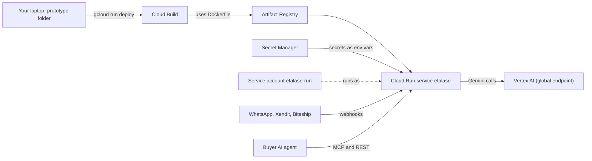
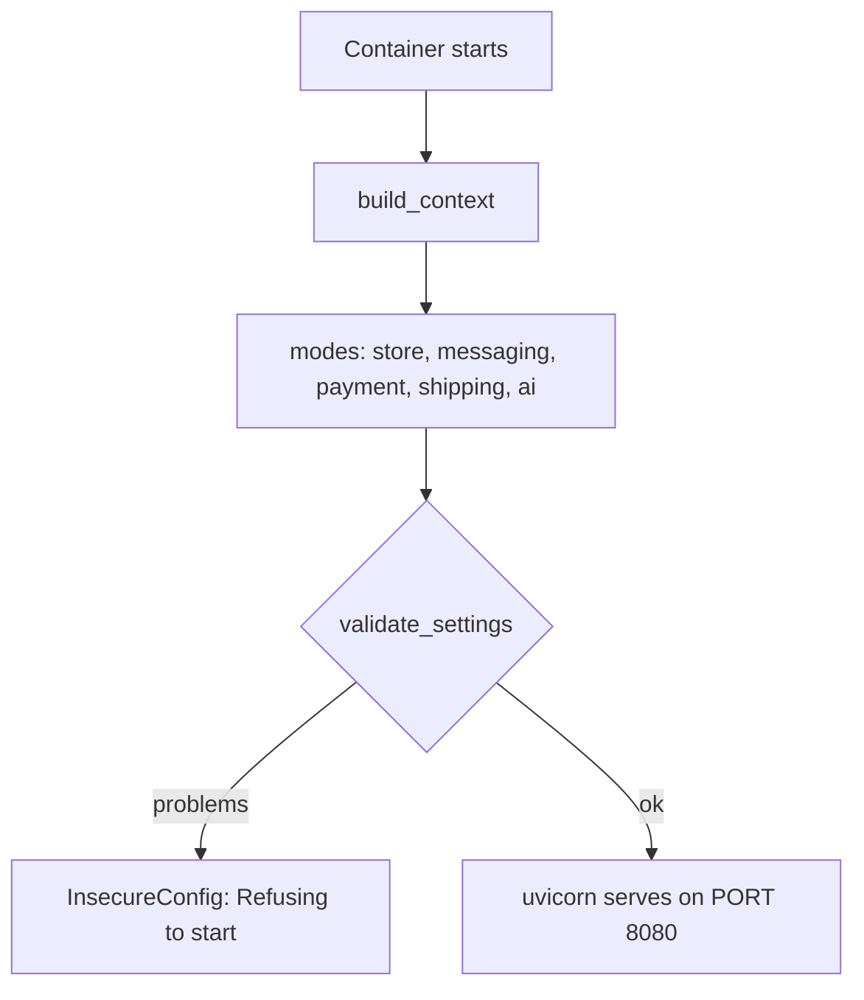

# Deploy to Cloud Run

This page takes you from an empty Google Cloud project to a public Etalase URL, explaining every line of `prototype/scripts/deploy_cloud_run.sh` and the things it does not do for you.

::: tip What you will learn
- Which Google Cloud services a deploy touches (Cloud Run, Cloud Build, Artifact Registry, Secret Manager, Vertex AI) and why
- The exact one-time setup: APIs, the service account the script creates, optional Firestore
- What the deploy script does, line by line, and how the startup checks in `etalase/security.py` refuse an insecure configuration
- How to register webhook URLs, run smoke tests, read logs, estimate costs and clean up
- What the script still leaves to you, and what can bite you on demo day
:::

## Concepts: what "deploy" means here

Etalase is one Python process: a FastAPI app started by uvicorn (see **`prototype/Dockerfile`**). Deploying means turning the `prototype/` folder into a container image and running it somewhere with a public HTTPS address, so WhatsApp, Xendit, Biteship and AI agents can reach it.

| Service | What it does for Etalase |
|---|---|
| **Cloud Run** | Runs the container, gives it an HTTPS URL, scales instances. Etalase's API, MCP server, webhooks and dashboard all live in this one service. |
| **Cloud Build** | Builds the image from source when you pass `--source .` to `gcloud run deploy`. Because `prototype/Dockerfile` exists, it builds with that Dockerfile (not buildpacks). |
| **Artifact Registry** | Stores the built image. A source deploy creates a repository called `cloud-run-source-deploy` in the region if it does not exist. |
| **Secret Manager** | Holds `SESSION_SECRET`, `DEV_TOKEN`, `WEBHOOK_TOKEN`, `OPERATOR_TOKEN` and, if you create them, the WhatsApp, Xendit, Biteship and Instagram secrets. Cloud Run injects them as environment variables. |
| **IAM** | The script creates a dedicated service account, `etalase-run`, that the service runs as, with only the roles it needs. |
| **Vertex AI** | Runs Gemini. The script sets `GOOGLE_GENAI_USE_VERTEXAI=true`, so the deployed build uses Gemini, not the offline parsers. |
| **Firestore** | Optional. The script deploys with `STORE_BACKEND=memory` unless you set `STORE_BACKEND=firestore` in your shell; Firestore is for the pilot. |

<Badge type="tip" text="Built" /> The deploy script, Dockerfile and startup checks are in the repo. <Badge type="info" text="Roadmap" /> Pub/Sub, Cloud Tasks, Cloud Storage and KMS are not used by the deploy.

## The big picture



## Step 0: tools, project and billing

You need the `gcloud` CLI, Python 3 on your laptop (the script uses `python3` to generate secrets) and a billing account.

```bash
gcloud auth login
gcloud projects create etalase-demo-12345          # project IDs are globally unique; pick your own
gcloud billing accounts list
gcloud billing projects link etalase-demo-12345 --billing-account=XXXXXX-XXXXXX-XXXXXX
gcloud config set project etalase-demo-12345
export PROJECT_ID=etalase-demo-12345
```

Setting the default project is still handy for your own commands; the script itself passes `--project` everywhere, including in the helper commands it prints at the end.

## Step 1: enable the APIs

This is the one-time setup copied from the comment at the top of the script:

```bash
gcloud services enable run.googleapis.com cloudbuild.googleapis.com artifactregistry.googleapis.com \
    secretmanager.googleapis.com firestore.googleapis.com aiplatform.googleapis.com --project "$PROJECT_ID"
```

`firestore.googleapis.com` is only needed if you will switch to Firestore later; enabling it costs nothing.

## Step 2: the service account and IAM

The script now handles the runtime identity itself. It creates a dedicated service account and grants it four roles, nothing more:

**`prototype/scripts/deploy_cloud_run.sh`**

```bash
SA_NAME="etalase-run"
SA="${SA_NAME}@${PROJECT_ID}.iam.gserviceaccount.com"
# ...
if ! gcloud iam service-accounts describe "$SA" --project "$PROJECT_ID" >/dev/null 2>&1; then
  gcloud iam service-accounts create "$SA_NAME" --project "$PROJECT_ID" --display-name "Etalase Cloud Run"
fi
for role in roles/aiplatform.user roles/datastore.user roles/secretmanager.secretAccessor roles/logging.logWriter; do
  gcloud projects add-iam-policy-binding "$PROJECT_ID" --member "serviceAccount:${SA}" --role "$role" \
    --condition=None --quiet >/dev/null
done
```

| Role | Why Etalase needs it |
|---|---|
| `roles/aiplatform.user` | Call Gemini on Vertex AI |
| `roles/datastore.user` | Read and write Firestore (only used with `STORE_BACKEND=firestore`) |
| `roles/secretmanager.secretAccessor` | Read the secrets Cloud Run injects |
| `roles/logging.logWriter` | Write logs, including the `MANUAL ACTION REQUIRED` line |

This is the principle of **least privilege**: if the service were ever compromised, the attacker gets these four roles, not the broad Editor role the Compute Engine default service account often has. The service then deploys with `--service-account "$SA"`.

::: warning What you still need yourself
- **Your own user** must be allowed to create service accounts, grant roles and deploy, and to "act as" `etalase-run` (`roles/iam.serviceAccountUser`). A project Owner has all of this.
- **The build.** `--source .` still builds with Cloud Build, which uses its own build identity (by default the Compute Engine default service account). If the build fails with a permission error, Google's "deploy from source" page asks for **Cloud Run Builder** (`roles/run.builder`) on that account. Verify the current role names there, because Google has changed the default build identity before.
- The role bindings are **project-wide**, so `secretAccessor` can read every secret in the project. For the pilot, grant it per secret with `gcloud secrets add-iam-policy-binding` instead.
:::

## Step 3 (optional): Firestore

The script's comment includes `gcloud firestore databases create --location=asia-southeast2`. You only need this when you switch to Firestore (`STORE_BACKEND=firestore PROJECT_ID=... ./scripts/deploy_cloud_run.sh`, see [Turn on real services](/ship/real-services#firestore)). By default the deploy runs on `MemoryStore`.

## Step 4: run the script

```bash
cd prototype
PROJECT_ID=$PROJECT_ID ./scripts/deploy_cloud_run.sh
```

The first source deploy may ask to create the `cloud-run-source-deploy` repository; answer yes. Optional variables the script reads from your shell: `REGION`, `SERVICE`, `ETALASE_ENV`, `STORE_BACKEND`, `GOOGLE_CLOUD_LOCATION`, `GEMINI_MODEL`, `SELLER_LOCALE`, and the non-secret ids `WHATSAPP_PHONE_NUMBER_ID` and `INSTAGRAM_APP_ID`.

Re-running the script is safe: it reuses the service account and secrets and **updates** variables instead of replacing them.

## What the script does, step by step

```bash
set -euo pipefail

PROJECT_ID="${PROJECT_ID:?set PROJECT_ID}"
REGION="${REGION:-asia-southeast2}"
SERVICE="${SERVICE:-etalase}"
ENV_MODE="${ETALASE_ENV:-dev}"   # "dev" for the hackathon demo (mock payment/shipping + /dev endpoints behind DEV_TOKEN)
SA_NAME="etalase-run"
SA="${SA_NAME}@${PROJECT_ID}.iam.gserviceaccount.com"

cd "$(dirname "$0")/.."
```

- `set -euo pipefail`: stop at the first failing command, unset variable or failing pipe stage.
- `PROJECT_ID` is mandatory; the others have defaults. Region defaults to Jakarta, service name to `etalase`, mode to `dev`.
- `cd "$(dirname "$0")/.."` moves into `prototype/`, so `--source .` uploads the prototype folder whatever directory you ran from.

### Secrets

```bash
ensure_secret() {  # create a random secret once; never print it
  if ! gcloud secrets describe "$1" --project "$PROJECT_ID" >/dev/null 2>&1; then
    python3 -c "import secrets; print(secrets.token_urlsafe(32), end='')" |
      gcloud secrets create "$1" --project "$PROJECT_ID" --replication-policy=automatic --data-file=-
  fi
}
ensure_secret etalase-session-secret
ensure_secret etalase-dev-token
ensure_secret etalase-webhook-token
SECRETS="SESSION_SECRET=etalase-session-secret:latest,DEV_TOKEN=etalase-dev-token:latest,WEBHOOK_TOKEN=etalase-webhook-token:latest,OPERATOR_TOKEN=etalase-operator-token:latest"
```

- Creates each secret **only if it does not exist**, so re-running the script never rotates them.
- The value is 32 random bytes in URL-safe base64 (43 characters), piped straight into Secret Manager (`--data-file=-`), never echoed. That length passes the checks in `security.py` (16+ characters for tokens, 32+ for `SESSION_SECRET` in prod).

Then the optional provider secrets. You create them by hand (the script never invents provider keys); the script wires each one **only if it exists**:

```bash
# ENV_VAR=secret-name pairs, wired only if the secret exists
OPTIONAL_SECRETS=(
  "WHATSAPP_TOKEN=etalase-whatsapp-token"
  "WHATSAPP_APP_SECRET=etalase-whatsapp-app-secret"
  "WHATSAPP_VERIFY_TOKEN=etalase-whatsapp-verify-token"
  "XENDIT_SECRET_KEY=etalase-xendit-key"
  "XENDIT_CALLBACK_TOKEN=etalase-xendit-callback"
  "BITESHIP_API_KEY=etalase-biteship-key"
  "INSTAGRAM_APP_SECRET=etalase-instagram-app-secret"
)
for pair in "${OPTIONAL_SECRETS[@]}"; do
  if gcloud secrets describe "${pair#*=}" --project "$PROJECT_ID" >/dev/null 2>&1; then
    SECRETS="${SECRETS},${pair}:latest"
    echo "wiring optional secret ${pair#*=}"
  fi
done
```

To add one, create it and re-run the script:

```bash
printf '%s' "$TOKEN" | gcloud secrets create etalase-whatsapp-token --data-file=-
WHATSAPP_PHONE_NUMBER_ID=1234567890 PROJECT_ID=$PROJECT_ID ./scripts/deploy_cloud_run.sh
```

::: warning Create provider secrets in matching groups
`validate_settings` refuses to start when `WHATSAPP_TOKEN` is set without `WHATSAPP_APP_SECRET`, when `WHATSAPP_VERIFY_TOKEN` is still the default `etalase-dev-verify`, or when `XENDIT_SECRET_KEY` is set without `XENDIT_CALLBACK_TOKEN`. So create all three WhatsApp secrets together, and both Xendit secrets together, before re-running.
:::

### Environment

```bash
# Cloud Run URLs are deterministic: https://SERVICE-PROJECT_NUMBER.REGION.run.app
PROJECT_NUMBER="$(gcloud projects describe "$PROJECT_ID" --format 'value(projectNumber)')"
URL="https://${SERVICE}-${PROJECT_NUMBER}.${REGION}.run.app"

ENV_VARS="ETALASE_ENV=${ENV_MODE},PUBLIC_BASE_URL=${URL},STORE_BACKEND=${STORE_BACKEND:-memory}"
ENV_VARS="${ENV_VARS},GOOGLE_GENAI_USE_VERTEXAI=true,GOOGLE_CLOUD_PROJECT=${PROJECT_ID},GOOGLE_CLOUD_LOCATION=${GOOGLE_CLOUD_LOCATION:-global}"
ENV_VARS="${ENV_VARS},GEMINI_MODEL=${GEMINI_MODEL:-gemini-3.8-flash},SELLER_LOCALE=${SELLER_LOCALE:-en}"
[[ -n "${WHATSAPP_PHONE_NUMBER_ID:-}" ]] && ENV_VARS="${ENV_VARS},WHATSAPP_PHONE_NUMBER_ID=${WHATSAPP_PHONE_NUMBER_ID}"
[[ -n "${INSTAGRAM_APP_ID:-}" ]] && ENV_VARS="${ENV_VARS},INSTAGRAM_APP_ID=${INSTAGRAM_APP_ID}"
```

The key idea: a Cloud Run service URL has the form `https://SERVICE-PROJECT_NUMBER.REGION.run.app`, so the script can compute it **before** the first deploy and set `PUBLIC_BASE_URL` on the very first revision. The app uses `PUBLIC_BASE_URL` for discovery URLs, image URLs, the sign-up link it sends unknown numbers, the Instagram OAuth redirect and, crucially, `Settings.is_local` (next section).

### Deploy

```bash
# --no-cpu-throttling keeps CPU for the in-process reservation-expiry loop between requests.
# --max-instances 1 because the demo uses the in-memory store (state lives in one instance).
gcloud run deploy "$SERVICE" \
  --project "$PROJECT_ID" \
  --region "$REGION" \
  --source . \
  --service-account "$SA" \
  --allow-unauthenticated \
  --min-instances 1 \
  --max-instances 1 \
  --no-cpu-throttling \
  --update-env-vars "$ENV_VARS" \
  --update-secrets "$SECRETS"
```

| Flag | Why |
|---|---|
| `--source .` | Build with Cloud Build using `prototype/Dockerfile`. `prototype/.gcloudignore` keeps `.env`, virtualenvs, `media/`, `tests/`, caches and `.git` out of the upload. |
| `--service-account "$SA"` | Run as `etalase-run`, with the four roles above. |
| `--allow-unauthenticated` | Public URL. Agents and webhooks must reach it; protection comes from the app (tokens, signatures), not Cloud Run IAM. |
| `--min-instances 1 --max-instances 1` | Exactly one instance. `MemoryStore`, rate limits, OTP counters and ADK sessions live in process memory, so a second instance would see different data. Min 1 avoids cold starts during the demo. |
| `--no-cpu-throttling` | "CPU always allocated". By default Cloud Run gives an instance CPU only while it handles requests, which would stall the 60-second expiry loop in `api/main.py` when nobody is calling. With this flag, holds expire on time even when the demo is idle. |
| `--update-env-vars`, `--update-secrets` | Add or change only the listed variables and secrets, keeping everything else on the service. |
| `STORE_BACKEND=memory` (default) | Data is lost on every restart or redeploy. Fine for a demo, not for a pilot. |
| `GOOGLE_GENAI_USE_VERTEXAI=true` + project + `global` | Gemini on Vertex AI (global endpoint), authenticated as the service account. No API key needed. |

::: tip Why `--update-*` instead of `--set-*`
An earlier version used `--set-env-vars` and `--set-secrets`, which remove all existing variables and secrets first. Anything you had added by hand (a WhatsApp token, a phone number id) silently disappeared on the next deploy. `--update-*` merges instead. The flip side: removing a variable now needs `--remove-env-vars` or `--remove-secrets`.
:::

### After the deploy

```bash
ACTUAL="$(gcloud run services describe "$SERVICE" --project "$PROJECT_ID" --region "$REGION" --format 'value(status.url)')"
if [[ "$ACTUAL" != "$URL" ]]; then  # older projects may get the legacy URL format
  gcloud run services update "$SERVICE" --project "$PROJECT_ID" --region "$REGION" \
    --update-env-vars "PUBLIC_BASE_URL=${ACTUAL}"
  URL="$ACTUAL"
fi
```

Some services get the older URL format with a random hash instead of the project number. If the real URL differs from the computed one, the script fixes `PUBLIC_BASE_URL` in a second revision. Finally it prints the health, MCP, WhatsApp, payment, shipping and expiry URLs, plus the commands to read the dev and webhook tokens.

## Dev vs prod, and the startup checks

`build_context()` in **`prototype/etalase/container.py`** ends with `validate_settings(s, ctx.modes)`. If it raises `InsecureConfig`, the module import fails, the container never listens on its port and Cloud Run marks the revision as failed. The rules, from **`prototype/etalase/security.py`**:

```python
    remote = not s.is_local
    if s.is_dev and remote:
        if not s.dev_token or len(s.dev_token) < MIN_SECRET_LEN:
            problems.append("DEV_TOKEN (16+ chars) is required when dev endpoints are reachable from the internet")
        # ... WEBHOOK_TOKEN (16+), SESSION_SECRET not the default
    if not s.is_dev:
        # ... SESSION_SECRET 32+, WEBHOOK_TOKEN 16+
        for part in ("payment", "shipping"):
            if modes.get(part) == "mock":
                problems.append(f"prod cannot run with the mock {part} adapter")
        if modes.get("messaging") != "whatsapp":
            problems.append("prod needs the WhatsApp Cloud API (WHATSAPP_TOKEN, WHATSAPP_PHONE_NUMBER_ID)")
```

| Mode | Requires | `/dev/*` |
|---|---|---|
| `dev` on a public URL (the script's default) | `DEV_TOKEN` and `WEBHOOK_TOKEN` of 16+ chars, a non-default `SESSION_SECRET` | Enabled, but every call needs the `X-Dev-Token` header |
| `prod` | `SESSION_SECRET` 32+, `WEBHOOK_TOKEN` 16+, real Xendit, real Biteship, real WhatsApp | Return 404 |
| Any mode | `WHATSAPP_APP_SECRET` and a non-default `WHATSAPP_VERIFY_TOKEN` if `WHATSAPP_TOKEN` is set; `XENDIT_CALLBACK_TOKEN` if `XENDIT_SECRET_KEY` is set | |

`is_local` is true when the host in `PUBLIC_BASE_URL` is `localhost`, `127.0.0.1`, `testserver` or `0.0.0.0`. Two consequences:

1. Because the script sets `PUBLIC_BASE_URL` to the real service URL on the **first** revision, the public-URL checks apply from the first moment the service is reachable. (An earlier version set it only in a second revision, so the first one briefly ran as if it were local.)
2. **`ETALASE_ENV=prod ./scripts/deploy_cloud_run.sh` fails unless every provider is real**: the WhatsApp, Xendit and Biteship secrets must exist so the script wires them, and you must pass `WHATSAPP_PHONE_NUMBER_ID`. Otherwise `prod` refuses the mock adapters. And in `prod` the `/dev` routes are gone, so there is no way to create sellers yet. Keep `dev` for the hackathon.

With the mock payment adapter, `POST /dev/sellers` gives the seller `payout_account_id="mock-sub-account"`. With real Xendit test keys it leaves it `None`, so payments go to the platform account in test mode rather than a fake sub-account id the provider would reject.



## Region choice

- **Cloud Run in `asia-southeast2` (Jakarta):** closest to Indonesian sellers, buyers and providers, and keeps the order data in Indonesia.
- **Gemini location:** the first sandbox deploy used `asia-southeast1` (Singapore), and `gemini-3.8-flash` returned 404 there for our project (18 Oct 2026). The catalog builder then silently fell back to the offline rules while the `/demo` label still said `gemini`; the log line was "Gemini extraction failed". Setting `GOOGLE_CLOUD_LOCATION=global` fixed it, and it is now the default. The global endpoint does not fix where a request is processed, so re-check the data-location implications in `docs/09` before real seller data. Model availability per region changes: test with `curl` against the model's `:generateContent` URL before relying on a region.
- Prices differ by endpoint for some models; the [business model page](/business/business-model) uses list prices.

## Register webhook URLs

| Provider | URL to register | Authenticated by |
|---|---|---|
| WhatsApp (Meta) | `https://YOUR-URL/webhooks/whatsapp` plus the verify token stored in `etalase-whatsapp-verify-token` | Meta's `X-Hub-Signature-256` HMAC with `WHATSAPP_APP_SECRET` |
| Xendit | `https://YOUR-URL/webhooks/payment` (no token) | `x-callback-token` header = `XENDIT_CALLBACK_TOKEN` |
| Biteship | `https://YOUR-URL/webhooks/shipping?token=WEBHOOK_TOKEN` | Our `WEBHOOK_TOKEN` (`?token=` or `X-Etalase-Webhook-Token` header) |
| Expiry job (optional) | `POST https://YOUR-URL/tasks/expire?token=WEBHOOK_TOKEN` | Our `WEBHOOK_TOKEN` |
| Operator console (disputes) | `GET /tasks/disputes`, `POST /tasks/resolve-dispute`, header `X-Etalase-Operator-Token` | Our `OPERATOR_TOKEN`; never in a URL, because `WEBHOOK_TOKEN` is and URLs reach access logs |

The script prints exactly these URLs at the end. With `--no-cpu-throttling` the in-process loop already runs every 60 seconds, so a Cloud Scheduler job on `/tasks/expire` is a belt-and-braces option, not a requirement. Read the token with:

```bash
gcloud secrets versions access latest --secret etalase-webhook-token --project "$PROJECT_ID"
```

## Smoke tests

```bash
URL="$(gcloud run services describe etalase --region asia-southeast2 --format 'value(status.url)')"
DEV="$(gcloud secrets versions access latest --secret etalase-dev-token)"
HOOK="$(gcloud secrets versions access latest --secret etalase-webhook-token)"

curl -s "$URL/healthz"                       # {"ok":true,"modes":{...,"ai":"gemini (gemini-3.8-flash)"}}
curl -s "$URL/.well-known/ucp" | head -c 300

# Security checks: these must fail
curl -s -o /dev/null -w '%{http_code}\n' -X POST "$URL/dev/sellers"   # 401 X-Dev-Token required
curl -s -o /dev/null -w '%{http_code}\n' -X POST "$URL/tasks/expire"  # 401 invalid webhook token

# Happy path
curl -s -X POST "$URL/tasks/expire?token=$HOOK"                       # {"expired":[]}
curl -s -X POST "$URL/dev/sellers" -H "X-Dev-Token: $DEV" -H 'content-type: application/json' \
  -d '{"name":"Toko Rina","whatsapp":"6281234567890","city":"Jakarta","postal_code":"12950"}'
curl -s -X POST "$URL/dev/whatsapp" -H "X-Dev-Token: $DEV" -H 'content-type: application/json' \
  -d '{"sender":"6281234567890","text":"Voal hijab, black 5, navy 3, mocca 10, price 85k"}'
```

The `/dev/whatsapp` call is the first one that reaches Gemini. A 500 here usually means the service account lacks `roles/aiplatform.user` or the model is not available in the location; check the logs. Then run the buyer agent against the deployed MCP server: `export ETALASE_MCP_URL=$URL/mcp/` and follow [Run it locally](/run/run-locally).

## Logs

```bash
gcloud run services logs read etalase --region asia-southeast2 --limit 100
gcloud run services logs read etalase --region asia-southeast2 --log-filter='severity>=ERROR'
```

What to look for: `Etalase modes: {...}` at startup (logged by `container.py`), `Refusing to start:` with the list of problems, `create_payment failed`, `WhatsApp send failed`, `delivery for ... not confirmed by the courier`, and **`MANUAL ACTION REQUIRED: refund for order ...`** (or `payout`), the ERROR line that `container.py` logs for every `ops.manual_action` event. For the pilot, turn that last one into a log-based alert so a person is paged.

## Costs

The script's choices drive the bill:

- `--min-instances 1` keeps one instance alive around the clock, and `--no-cpu-throttling` means its CPU is allocated (and billed) the whole time, not only during requests. Check the Cloud Run pricing page for `asia-southeast2`, and delete the service when the demo is over.
- Each deploy runs a Cloud Build and stores a new image in Artifact Registry; old images accumulate.
- Secret Manager charges per secret version and per access; small at this scale.
- Gemini is billed per token on Vertex AI.

`docs/10-business-model.md` estimates US$10–30 a month for Cloud Run, Firestore, Storage and Pub/Sub in the pilot, "mostly within free tiers". That estimate does not say whether it includes an always-on instance with CPU always allocated, so verify it with the Google Cloud Pricing Calculator before quoting it. See [Business model and costs](/business/business-model).

## Cleanup

```bash
gcloud run services delete etalase --region asia-southeast2
gcloud artifacts repositories delete cloud-run-source-deploy --location asia-southeast2
for s in etalase-session-secret etalase-dev-token etalase-webhook-token; do gcloud secrets delete "$s"; done
gcloud iam service-accounts delete "etalase-run@${PROJECT_ID}.iam.gserviceaccount.com"
# or remove everything at once:
gcloud projects delete "$PROJECT_ID"
```

Also delete any optional `etalase-*` provider secrets you created. Cloud Build keeps uploaded source archives in a Cloud Storage bucket; delete it from the console if you keep the project.

## What the script still leaves to you

| Gap | What to do |
|---|---|
| Create the provider secrets | By hand, with the names in `OPTIONAL_SECRETS`; the script then wires them. |
| Create the Firestore database | `gcloud firestore databases create --location=asia-southeast2`, then deploy with `STORE_BACKEND=firestore` and add the composite index on reservations (see [Turn on real services](/ship/real-services#firestore)). |
| Register webhook URLs at Meta, Xendit and Biteship | Use the URLs the script prints. |
| Cloud Build permissions | See the warning in Step 2. |
| Per-secret IAM | The bindings are project-wide; tighten for the pilot. |
| Support `prod` | Needs every provider secret, `WHATSAPP_PHONE_NUMBER_ID`, and, for sign-up, `SIGNUP_ENABLED` plus an `OPERATOR_TOKEN` and someone to verify each new shop by hand (the provider's own check is not built). |
| Scale beyond one instance | Move in-memory state out first (see [Known gaps](/master/known-gaps)), then lift `--max-instances` and move expiry to Cloud Tasks. |

## Pitfalls

- **Data disappears on redeploy.** `MemoryStore` plus one instance: every deploy starts empty. Re-seed with `/dev/sellers` before a demo.
- **`--update-*` keeps old values.** A variable you no longer want stays on the service until you remove it with `--remove-env-vars`. Check with `gcloud run services describe etalase --region asia-southeast2`.
- **Sign-up in prod waits for a person.** With `SIGNUP_ENABLED=true` a stranger can build a shop in chat, but it stays invisible until an operator calls `POST /tasks/verify-seller`. With it off, sellers are created only through `POST /dev/sellers`, which exists only in `dev`.
- **`/dev/outbox` is empty when real WhatsApp is on**, because only the console messenger keeps an outbox.
- **A half-configured provider stops the service.** Wiring `etalase-whatsapp-token` without the app secret and verify token makes the next revision refuse to start. Cloud Run keeps serving the previous revision, but your change did not go live; check the logs for `Refusing to start:`.

## Check yourself

1. Why does the script pin `--max-instances 1`, and what must change before you raise it?
::: details Answer
`MemoryStore`, rate limits, OTP counters and ADK sessions are in process memory. Two instances would disagree about stock and sign-in state. Move to `STORE_BACKEND=firestore` and move counters to Firestore or Memorystore (`docs/09`, known gaps) first.
:::

2. How does the script know the service URL before the service exists, and why does that matter for security?
::: details Answer
Cloud Run URLs are deterministic: `https://SERVICE-PROJECT_NUMBER.REGION.run.app`. The script reads the project number and builds the URL, so `PUBLIC_BASE_URL` is correct on the first revision. Since `is_local` is computed from it, the public-URL checks (`DEV_TOKEN`, `WEBHOOK_TOKEN`, `SESSION_SECRET`) apply from the very first revision. If the real URL turns out different (legacy format), the script updates it.
:::

3. Why does the deploy use `--no-cpu-throttling`?
::: details Answer
Reservation expiry runs as a background loop inside the app every 60 seconds. With Cloud Run's default, an instance gets CPU only while it handles a request, so the loop could stall and holds would not expire on time. CPU always allocated keeps it running, at the cost of paying for CPU all the time.
:::

4. Which webhook URL gets `?token=` and which does not?
::: details Answer
Biteship (`/webhooks/shipping`) and `/tasks/expire` need `?token=WEBHOOK_TOKEN`, because those callers cannot sign. WhatsApp is verified by Meta's HMAC signature and Xendit by its callback token header, so their URLs have no token.
:::

5. You created `etalase-whatsapp-token` and re-ran the script, and the new revision refuses to start. Why, and what do you do?
::: details Answer
`validate_settings` requires `WHATSAPP_APP_SECRET` and a non-default `WHATSAPP_VERIFY_TOKEN` whenever `WHATSAPP_TOKEN` is set. Create `etalase-whatsapp-app-secret` and `etalase-whatsapp-verify-token` too, pass `WHATSAPP_PHONE_NUMBER_ID`, and re-run. Because the script uses `--update-*`, nothing else you configured is lost.
:::

## Next

[Turn on real services](/ship/real-services)
