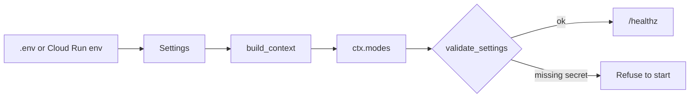
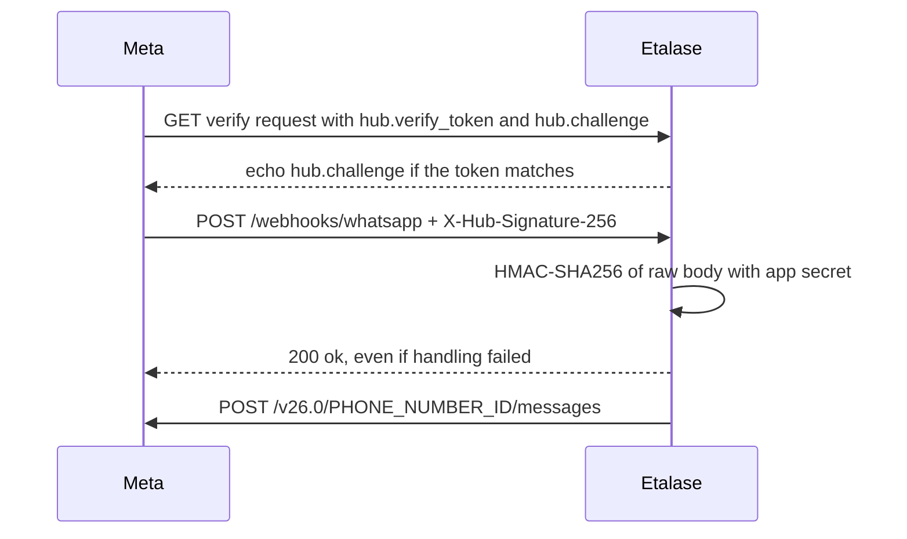

# Turn on real services

Every external service in Etalase sits behind an adapter that falls back to an offline or mock version, so you can switch them on one at a time and watch `/healthz` change.

::: tip What you will learn
- How `container.py` picks each adapter from environment variables, and how `/healthz` reports the result
- How to switch on Gemini (API key or Vertex AI), WhatsApp Cloud API, Xendit QRIS in test mode, Biteship, Instagram Login and Firestore
- What each provider must be configured with (tokens, webhooks, templates, sub-accounts) and how to test it
- The gotchas found in the adapters, including what `ManualActionRequired` means
:::

::: warning Provider details change
The adapters say so themselves: "verify endpoint names, the api-version header and webhook payloads against the current Xendit docs", "Check field names against the API docs" (Biteship), "verify before going live" (Instagram). Steps on this page that describe a provider's dashboard are marked **(verify against the provider docs)**. The code excerpts are exact.
:::

## Concepts: one switch per service

Nothing is configured in code. **`prototype/etalase/container.py`** reads `Settings` (from environment variables or `.env`) and picks an implementation:

```python
    if s.whatsapp_token and s.whatsapp_phone_number_id:
        messenger: Messenger = WhatsAppCloudMessenger(s.whatsapp_token, s.whatsapp_phone_number_id, s.whatsapp_api_version)
    else:
        # ...
        messenger = ConsoleMessenger(echo=echo_messages, media_roots=[samples])
    payment: PaymentProvider = XenditPayment(s.xendit_secret_key, s.xendit_callback_token) if s.xendit_secret_key else MockPayment()
    shipping: ShippingProvider = BiteshipShipping(s.biteship_api_key) if s.biteship_api_key else MockShipping()
    if s.gemini_enabled:
        extractor = GeminiExtractor(s.gemini_model, s.google_genai_use_vertexai, s.google_cloud_project,
                                    s.google_cloud_location, s.google_api_key)
    else:
        extractor = HeuristicExtractor()
```

It then records the result in `ctx.modes`, which `GET /healthz` returns, and runs the startup checks from `security.py`:

```json
{"ok": true, "modes": {"store": "memory", "messaging": "console", "payment": "mock",
                       "shipping": "mock", "ai": "offline rules"}}
```

| Service | Status | Env vars | `/healthz` key: off → on |
|---|---|---|---|
| Gemini | <Badge type="tip" text="Built" /> needs a key or Vertex AI | `GOOGLE_API_KEY` (or `GEMINI_API_KEY`) or `GOOGLE_GENAI_USE_VERTEXAI` (or `GOOGLE_GENAI_USE_ENTERPRISE`) + `GOOGLE_CLOUD_PROJECT` + `GOOGLE_CLOUD_LOCATION`, `GEMINI_MODEL` | `ai`: `offline rules` → `gemini (gemini-3.8-flash)` |
| WhatsApp Cloud API | <Badge type="tip" text="Built" /> <Badge type="warning" text="Mocked in demo" /> | `WHATSAPP_TOKEN`, `WHATSAPP_PHONE_NUMBER_ID`, `WHATSAPP_VERIFY_TOKEN`, `WHATSAPP_APP_SECRET` | `messaging`: `console` → `whatsapp` |
| Xendit QRIS | <Badge type="tip" text="Built" /> <Badge type="warning" text="Mocked in demo" /> | `XENDIT_SECRET_KEY`, `XENDIT_CALLBACK_TOKEN` | `payment`: `mock` → `xendit` |
| Biteship | <Badge type="tip" text="Built" /> <Badge type="warning" text="Mocked in demo" /> | `BITESHIP_API_KEY` | `shipping`: `mock` → `biteship` |
| Instagram Login | <Badge type="tip" text="Built" /> <Badge type="warning" text="Mocked in demo" /> | `INSTAGRAM_APP_ID`, `INSTAGRAM_APP_SECRET` | not reported; `/connect/instagram` returns 501 when off |
| Firestore | <Badge type="tip" text="Built" /> <Badge type="warning" text="Mocked in demo" /> | `STORE_BACKEND=firestore`, `GOOGLE_CLOUD_PROJECT` | `store`: `memory` → `firestore` |
| Cloud Tasks, KMS for tokens | <Badge type="info" text="Roadmap" /> | | |

Order of switching that keeps the demo working: Gemini, then Firestore on the emulator, then Biteship rates, then Xendit, then WhatsApp last, because WhatsApp changes how you interact with the whole system.



## Gemini

Two ways to authenticate, both handled by `GeminiExtractor` in **`prototype/etalase/catalog/extractor.py`**:

```python
        if use_vertex:
            self.client = genai.Client(vertexai=True, project=project, location=location)
        else:
            self.client = genai.Client(api_key=api_key)
```

| | API key | Vertex AI |
|---|---|---|
| Set | `GOOGLE_API_KEY=...` | `GOOGLE_GENAI_USE_VERTEXAI=true`, `GOOGLE_CLOUD_PROJECT`, `GOOGLE_CLOUD_LOCATION` (default `global`) |
| Credentials | The key | Application Default Credentials: `gcloud auth application-default login` locally, the service account on Cloud Run (needs `roles/aiplatform.user`) |
| Best for | A quick local try | Cloud Run (what the deploy script uses), data-location control, Google Cloud billing |

`gemini_enabled` is true if either is set. Then two things change: catalog extraction uses Gemini, and `build_context` creates the ADK `SellerAgentRunner`, so free-text seller messages go to the agent (`seller/inbox.py`, `if self.ctx.seller_agent is not None`). Buttons still never touch the model.

**Test:**

```bash
export GOOGLE_API_KEY=...        # or the three Vertex variables
uvicorn etalase.api.main:app --port 8080
curl -s localhost:8080/healthz   # "ai": "gemini (gemini-3.8-flash)"
curl -X POST localhost:8080/dev/sellers -H 'content-type: application/json' \
  -d '{"name":"Toko Rina","whatsapp":"6281234567890","city":"Jakarta","postal_code":"12950"}'
curl -X POST localhost:8080/dev/whatsapp -H 'content-type: application/json' \
  -d '{"sender":"6281234567890","text":"Voal hijab, black 5, navy 3, mocca 10, price 85k"}'
```

**Gotchas**

- **Export, do not only write `.env`.** `Settings` reads `.env`, but pydantic-settings does not copy those values into the process environment. The ADK agent builds its own Gemini client from the model name (`LlmAgent(model=ctx.settings.gemini_model, ...)`), and that client reads credentials from real environment variables. Use `export` (or `set -a; source .env; set +a`).
- **No automatic fallback.** If Gemini fails (quota, permission, wrong region), the request fails; the extractor does not fall back to the offline parser.
- **Region.** Jakarta is not a Gemini location; the deploy uses Singapore. If the model is not available there, try `GOOGLE_CLOUD_LOCATION=global` (verify against the Vertex AI locations page).
- **Tests stay offline.** `tests/conftest.py` removes `GOOGLE_API_KEY`, `GOOGLE_GENAI_USE_VERTEXAI` and the provider keys, so `pytest -q` never calls a real service.

## WhatsApp Cloud API

**Code:** `WhatsAppCloudMessenger` and `parse_whatsapp_webhook` in **`prototype/etalase/adapters/messaging.py`**; webhook routes in **`prototype/etalase/api/main.py`**.

**Provider setup (verify against the provider docs):**

1. Create an app in Meta for Developers and add the WhatsApp product. Meta gives you a test business phone number, its **Phone number ID** and a temporary access token.
2. For anything longer than a quick test, create a long-lived token (Meta's docs describe a system user in Business Manager) with WhatsApp messaging permission.
3. Copy the **App secret** from the app's basic settings. Etalase uses it to check `X-Hub-Signature-256`.
4. Choose your own **verify token**, any random string. It must not be the default `etalase-dev-verify`; the app refuses to start with it when `WHATSAPP_TOKEN` is set.
5. In the WhatsApp webhook configuration, set the callback URL to `https://YOUR-URL/webhooks/whatsapp`, enter the verify token and subscribe to the `messages` field.
6. Add your own phone as an allowed test recipient.

**What happens on the wire:**



The handler always returns 200 after a valid signature ("acknowledge anyway, or Meta retries the same message for days"), and the inbox drops duplicates by message id.

**Env vars:** `WHATSAPP_TOKEN`, `WHATSAPP_PHONE_NUMBER_ID`, `WHATSAPP_VERIFY_TOKEN`, `WHATSAPP_APP_SECRET`; optional `WHATSAPP_API_VERSION` (default `v26.0`). On Cloud Run, create the three secrets under the names the deploy script looks for, then re-run it with the phone number id; the script wires every optional secret that exists:

```bash
printf '%s' "$WA_TOKEN"   | gcloud secrets create etalase-whatsapp-token --data-file=-
printf '%s' "$WA_SECRET"  | gcloud secrets create etalase-whatsapp-app-secret --data-file=-
printf '%s' "$WA_VERIFY"  | gcloud secrets create etalase-whatsapp-verify-token --data-file=-
WHATSAPP_PHONE_NUMBER_ID=123456789 PROJECT_ID=$PROJECT_ID ./scripts/deploy_cloud_run.sh
```

Create all three before re-running: `validate_settings` refuses to start with a token but no app secret, or with the default verify token. Because the script uses `--update-env-vars` and `--update-secrets`, re-running it never drops settings you added earlier (see [Deploy to Cloud Run](/ship/deploy)).

**Test:** create the seller with `/dev/sellers` using your real number (digits only, no `+`), then send the hijab text from your phone. `/healthz` shows `"messaging": "whatsapp"`.

**Gotchas**

- **Media types.** Voice notes arrive as `audio/ogg; codecs=opus`; `download_media` strips the parameters and maps JPEG, PNG, WebP, OGG, MP3, M4A, AAC, AMR and CSV to file extensions. This has not been run against the live API yet, so send one voice note and one CSV through the real number before the demo. Gemini does not accept AMR, so an AMR voice note is skipped and the seller is asked to describe the product in text.
- **Templates.** <Badge type="tip" text="Built" /> Free-form text and reply buttons only work inside the 24-hour customer service window. Outside it Meta answers error 131047, and the adapter then re-sends the same alert as an approved template. You have to create the six templates once (`python -m etalase.adapters.whatsapp_templates` prints them; see [WhatsApp templates](/ship/whatsapp-templates)); until they are approved, an alert to a seller who has not messaged the business number in the last 24 hours is logged as failed. Sign-in codes are not templated: the seller must message the number first (the dashboard says so).
- **Pricing.** Meta charges per message; utility templates inside an open service window are free. See [Evidence: WhatsApp prices](/business/evidence#costs-and-prices).
- **`/dev/whatsapp` and `/dev/outbox` return empty lists** once WhatsApp is on: only the console messenger keeps an outbox. Dashboard codes now arrive on the phone.
- **API version.** `v26.0` is the default (the latest when this was checked, 2026-10-15). Meta retires old Graph API versions on a schedule; set `WHATSAPP_API_VERSION` to move.
- **Media URLs are short-lived.** `download_media` resolves and downloads in one go, as Meta requires.

## Xendit QRIS (test mode)

**Code:** `XenditPayment` in **`prototype/etalase/adapters/payment.py`**.

```python
        headers = dict(self.headers)
        if seller_account_id:  # xenPlatform: the payment lands in the seller's sub-account
            headers["for-user-id"] = seller_account_id
        body = {"reference_id": order.id, "type": "DYNAMIC", "currency": order.currency, "amount": order.total}
        if order.expires_at:  # the QR must die with the reservation
            body["expires_at"] = order.expires_at.isoformat()
        resp = httpx.post(f"{self.BASE}/qr_codes", headers=headers, timeout=15, json=body)
```

**Concepts.** **QRIS** is Indonesia's national QR payment standard: any banking or e-wallet app can pay a QRIS code. A **dynamic** QR encodes one amount for one order. **xenPlatform** is Xendit's product for platforms: each seller gets a **sub-account**, and the `for-user-id` header makes the payment land in that sub-account, so buyer payments never land in an Etalase account (`docs/adr/0003-never-hold-funds.md`; whether Xendit can enforce the payout hold is unconfirmed; see [Checkout and orders](/architecture/checkout-and-orders)).

**Provider setup (verify against the provider docs):**

1. Create a Xendit account and stay in **test mode**. Create a secret API key with permission for QR codes.
2. In the callback (webhook) settings, copy the **verification token**. This is `XENDIT_CALLBACK_TOKEN`; Xendit sends it in the `x-callback-token` header.
3. Set the QR code payment callback URL to `https://YOUR-URL/webhooks/payment` (no `?token=`).
4. For sub-accounts, xenPlatform must be enabled on the account; create a test sub-account and note its id.

**Env vars:** `XENDIT_SECRET_KEY`, `XENDIT_CALLBACK_TOKEN`. The constructor raises if the callback token is missing, and `validate_settings` refuses to start without it. On Cloud Run, store them as the secrets `etalase-xendit-key` and `etalase-xendit-callback` (create both) and re-run the deploy script.

**Webhook parsing:** the token is compared in constant time, then `data.reference_id` (our order id) with status `SUCCEEDED`, `COMPLETED` or `PAID` becomes `"paid"`.

**What is `ManualActionRequired`?** Two steps are deliberately not automated:

```python
    def refund(self, order: Order) -> None:
        raise ManualActionRequired("Xendit QR refunds are not automated yet (see docs/05); refund from the dashboard.")

    def release_to_seller(self, order, seller_account_id, amount, commission) -> str:
        raise ManualActionRequired("xenPlatform settlement is not automated yet (see docs/05); release from the dashboard.")
```

`CheckoutService` catches it, and in fact catches **any** exception from `refund` or `release_to_seller` (a timeout or a changed field name must not lose track of money either): a refund becomes `payment.status = "refund_pending"`, a payout becomes `payout.status = "pending_manual"` with the order left `DELIVERED`, and both publish an `ops.manual_action` event. `container.py` logs every such event as `MANUAL ACTION REQUIRED: refund for order ...` at ERROR level, so it appears in Cloud Logging. The webhook still succeeds; a human finishes the money step in the Xendit dashboard. This is honest: the code refuses to pretend money moved. For the pilot, turn the ERROR line into an alert that pages someone.

**Test:** with keys set, `/healthz` shows `"payment": "xendit"` and a checkout returns a real `qr_string`. Xendit's test mode offers a way to simulate a QR payment (verify the current method in its docs); in `dev` you can also call `/dev/pay/{order_id}`, which skips Xendit.

**Gotchas**

- **Dev sellers and sub-accounts.** `POST /dev/sellers` sets `payout_account_id="mock-sub-account"` only when the payment adapter is the mock. With real Xendit keys it leaves it `None`, and `XenditPayment.create_payment` sends the `for-user-id` header only when an account id is set, so test QR codes are created on the platform account. Testing the real sub-account flow (xenPlatform) still needs a way to give a seller a real test sub-account id.
- **The Xendit QR id is not stored.** `PaymentInfo.reference` is our order id, so a simulation call that needs Xendit's own QR id has to look it up in the dashboard.
- **Fees.** Xendit's price list shows QRIS 0.70% above IDR 100,000 plus a processing fee of IDR 4,000; Bank Indonesia's MDR is 0% for micro merchants up to Rp500,000. See [Evidence](/business/evidence#costs-and-prices).
- **Check `expires_at` format and allowed range** against Xendit's QR docs; Python's `isoformat()` emits `+00:00`.

## Biteship

**Code:** `BiteshipShipping` in **`prototype/etalase/adapters/shipping.py`**. Three calls: `POST /v1/rates/couriers` (rates), `POST /v1/orders` (booking), `GET /v1/trackings/{waybill}/couriers/{courier}` (delivery check before payout).

**Provider setup (verify against the provider docs):** create a Biteship account, generate a test API key, and register the webhook `https://YOUR-URL/webhooks/shipping?token=WEBHOOK_TOKEN` in the dashboard.

**Env var:** `BITESHIP_API_KEY`, sent as the `authorization` header (on Cloud Run: the secret `etalase-biteship-key`, wired by the deploy script). `/healthz` shows `"shipping": "biteship"`.

**Test rates first:** they are cheap ([Evidence](/business/evidence#costs-and-prices) lists Biteship's "Rp5,- per 1 API request") and have no side effects. Ask the agent API for rates to a real postal code and compare with Biteship's dashboard.

**Gotchas**

- **Postal codes must be digits.** `get_rates` returns an empty list if either code is not numeric, and checkout then fails for lack of rates.
- **Booking sends `"weight": 0` for every item** and `delivery_type: "now"`. Rates use the product weight, but bookings do not; check whether Biteship accepts or re-prices this before booking real parcels.
- **Matching webhooks.** `parse_webhook` uses `courier_waybill_id` or `order_id`. We send our id as `reference_id` and store only the waybill returned at booking, so if Biteship has no waybill yet at booking time and its webhook `order_id` is Biteship's own id, the update will not find the order.
- **`/dev/deliver` cannot finish the flow.** It calls `shipment_update(..., "delivered")`, which asks Biteship's tracking endpoint first; a test waybill will not report `delivered`, so the payout is never released. That is the security design working (`docs/09`).
- `_order_by_waybill` scans every seller's orders (once per seller): fine in memory, expensive on Firestore, where it should become a query on `shipment.waybill`.
- **Late courier events are ignored.** Once a shipment is `delivered` or `returned`, later events such as `in_transit` no longer change it.

## Instagram Login

**Code:** **`prototype/etalase/adapters/instagram.py`** and the `/connect/instagram` routes. Scope: `instagram_business_basic`.

**Provider setup (verify against the provider docs):** in a Meta app, add Instagram API with Instagram Login; use an Instagram professional (Business or Creator) account added as a tester while the app is in development mode; register the redirect URI exactly as `PUBLIC_BASE_URL + "/connect/instagram/callback"`. Public launch needs Meta App Review (`docs/08`).

**Env vars:** `INSTAGRAM_APP_ID`, `INSTAGRAM_APP_SECRET` (on Cloud Run: pass `INSTAGRAM_APP_ID=...` to the deploy script and store the secret as `etalase-instagram-app-secret`).

**Test:** sign in to the dashboard, call `GET /connect/instagram` with the `Authorization: Bearer` session token, open the returned `authorize_url`, approve. The callback verifies the signed `state` (10 minutes; signed with the purpose `state`, so it can never be used as a session token), exchanges the code, imports recent image posts and sends the summary to the seller's WhatsApp. Offline, `POST /dev/instagram/import?seller_id=...` uses `samples/instagram_posts.json`.

**Gotchas:** the token from `exchange_code` is short-lived and is stored as-is; the long-lived exchange and KMS encryption are not built (`docs/09` known gaps). Videos are skipped and carousels keep up to four images.

## Firestore

**Code:** **`prototype/etalase/store/firestore.py`**. Stock changes run in Firestore transactions.

**Emulator first**, exactly as the module docstring says:

```bash
gcloud emulators firestore start --host-port=localhost:8681
# second terminal
export FIRESTORE_EMULATOR_HOST=localhost:8681 STORE_BACKEND=firestore GOOGLE_CLOUD_PROJECT=demo-etalase
uvicorn etalase.api.main:app --port 8080
curl -s localhost:8080/healthz      # "store": "firestore"
```

Then run the curl steps from [Hands-on walkthrough](/run/hands-on). The automated tests use `MemoryStore`, which implements the same contract; the Firestore store is "exercised manually against the emulator".

**Index.** `held_reservations_expiring_before` combines an equality filter and a range filter and carries the comment "needs a composite index on (status, expires_ts)". The repo has no index file. In a real database:

```bash
gcloud firestore indexes composite create --collection-group=reservations \
  --field-config=field-path=status,order=ascending \
  --field-config=field-path=expires_ts,order=ascending
```

Without it, the query fails in production while working on the emulator, so expired holds would never be released.

**Production:** create the database (`gcloud firestore databases create --location=asia-southeast2`) and deploy with `STORE_BACKEND=firestore PROJECT_ID=$PROJECT_ID ./scripts/deploy_cloud_run.sh`. The script's `etalase-run` service account already has `roles/datastore.user`. Pass `STORE_BACKEND=firestore` on every re-run, because the script sets `STORE_BACKEND=${STORE_BACKEND:-memory}` each time.

## Pitfalls across all services

- Each real key adds a startup rule: WhatsApp needs the app secret and a non-default verify token; Xendit needs the callback token. A missing one stops the service at boot, which is the point.
- Never paste keys into `.env.example`, chat logs or the deck. On Cloud Run, keep them in Secret Manager.
- Switch one service at a time and check `/healthz` after each.

## Check yourself

1. You set `GOOGLE_API_KEY` in `.env` only. Catalog extraction works, but the seller agent fails to authenticate. Why?
::: details Answer
`Settings` reads `.env` and passes the key to `GeminiExtractor` explicitly. The ADK agent creates its own client from environment variables, and pydantic-settings does not export `.env` values to the process environment.
:::

2. A Xendit refund raises `ManualActionRequired`. What does the order look like afterwards?
::: details Answer
`payment.status` is `refund_pending`, the order log says "manual refund required", an `ops.manual_action` event is published and logged as `MANUAL ACTION REQUIRED` at ERROR level, and the webhook still returns success. Someone refunds from the Xendit dashboard.
:::

3. Why does `/webhooks/shipping` need `?token=` while `/webhooks/payment` does not when Xendit is on?
::: details Answer
Xendit authenticates its callbacks with `x-callback-token`. Biteship callbacks have no signature that Etalase verifies, so Etalase requires its own `WEBHOOK_TOKEN`, and still re-checks delivery with the courier before paying out.
:::

4. Which Firestore query needs a composite index, and what breaks if it is missing?
::: details Answer
Reservations filtered by `status == "held"` and `expires_ts <= now`. Without the index the expiry query fails, so unpaid holds are never released and stock stays locked.
:::

5. Why does a real order alert fail for a seller who last messaged three days ago?
::: details Answer
Outside the 24-hour customer service window WhatsApp only delivers approved templates. The adapter now re-sends such an alert as a template after Meta answers error 131047, but only if you created and got the six templates approved ([WhatsApp templates](/ship/whatsapp-templates)). Sign-in codes are not templated yet.
:::

## Next

[Business model and costs](/business/business-model)
