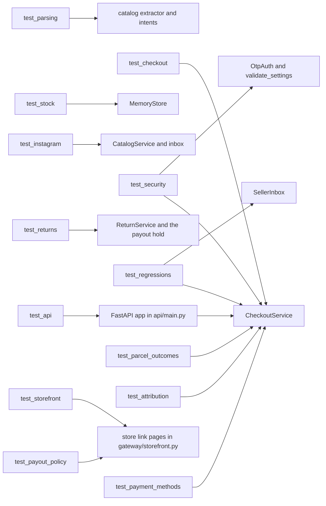

# Testing

How Etalase's 735 automated tests are organised, what each file proves, how to run and extend them, and what still has to be measured before a pilot.

::: tip What you will learn
- The layout of `prototype/tests/`, the fixtures in `conftest.py` and the regression tests for fixed bugs
- How the 100-thread oversell race works and what it does and does not prove
- How to run one file, one test or a keyword subset
- How to add a test, with two worked examples for controls that are not covered yet
- What is not tested (Firestore emulator, live providers, Gemini evals) and the benchmark plan in `docs/12-benchmark-plan.md`
:::

## Why these tests matter

Etalase holds stock for strangers' AI agents and decides when money moves. The dangerous bugs are not crashes but **wrong outcomes**: the last unit sold twice, a payout released on a forged webhook, an order expired after it was paid. Most tests therefore set up a race or an attack and assert on the **state** afterwards (stock counts, order status, refunds, messages sent).

All tests run offline in about ten seconds. ADR 0005 (`docs/adr/0005-adapters-and-country-packs.md`) puts every external service behind a small interface with a mock, so the suite never needs a Gemini key, WhatsApp, Xendit or Biteship.

```bash
cd prototype
pip install -r requirements-dev.txt
pytest -q          # 735 passed
```

## How the suite is organised

| File | Tests | Covers |
|---|---|---|
| `tests/test_parsing.py` | 24 | Price parsing (`85rb`, `Rp85.000`, `price 85k`, `1,2jt`), Gemini colours normalised to the parser's ("Hitam" is "Black"), the offline extractor in English and Indonesian, CSV import, stock and price intents, stable SKUs |
| `tests/test_checkout.py` | 14 | Instant order end to end (paid, accepted, shipped, delivered, paid out), confirm-first, seller sold out, refund after payment, expiry, domestic-only, KYC gate, tenant isolation, gateway errors as data, multi-item carts (all-or-nothing stock, one shop per cart, clear validation messages) |
| `tests/test_stock.py` | 6 | The 100-way oversell race, idempotent commit, release and restock, cross-seller `set_stock`, sell-mode rules, chat stock blocked for OMS sellers |
| `tests/test_instagram.py` | 4 | Posts to drafts, non-product posts skipped, idempotent re-import, imported products searchable, minimal OAuth scope |
| `tests/test_security.py` | 24 | Startup checks, OTP abuse, signed state, payment races, payout safety, input limits, media paths, webhook dedupe, SSRF, stale writes |
| `tests/test_api.py` | 12 | The HTTP layer through FastAPI's `TestClient`: discovery, WhatsApp webhook, Connector key, MCP tool list, OpenAPI, `/dev` protection, webhook tokens, Meta signature, CSP and media route, oversized input |
| `tests/test_regressions.py` | 9 | Bugs found while writing this guide, each with the test that failed before the fix: transaction retries, purpose-bound signatures, "Which product?", late Available taps, OMS-owned stock, short titles and plural search, shipment status never going backwards, unknown couriers |
| `tests/test_ucp.py` | 30 | Etalase as a real UCP business server: the profile validates against the official `ucp-sdk` schema, a full checkout (create, update, complete, cancel) with every response validated by the SDK's `Checkout` model, idempotency, closed sessions, protocol errors, escaping, sold-out and confirm-first orders, and the buyer-consent extension (kept, replaced, withdrawn, unknown keys dropped) |
| `tests/test_doctor.py` | 15 | The setup doctor: each service reports skip, ok or fail with a fix hint, with the network mocked; no key value is ever printed |
| `tests/test_evals.py` | 17 | The extraction eval's scoring (title tokens, effective prices, invented price/stock/product counters, question behaviour), so the number on the slide is trustworthy |
| `tests/test_scripts.py` | 7 | `scripts/env_to_cloud.py` and the deploy script's dry run: secrets travel on stdin only, unchanged secrets get no new version, nothing leaks into output |
| `tests/test_biteship.py` | 24 | Biteship contract with a fake HTTP layer: rate request and response, order booking body (postal code, item weights, `reference_id`), error bodies, `order.status` webhook parsing by Biteship id / tracking id / waybill, status map, delivery re-check by tracking id |
| `tests/test_xendit.py` | 9 | Xendit QRIS contract: request headers and body, UTC expiry format, QR id kept, `qr.payment` webhook parsing and ignored events, the Rp10.000.000 cap, error logging |
| `tests/test_whatsapp.py` | 12 | WhatsApp Cloud API contract: send bodies (`+` prefix, button limits), template payloads, free-form then template on error 131047, failed-status parsing, and a check that the template list matches what notifications send |
| `tests/test_gatekeeper.py` | 9 | The checks before anything costly: MCP tools rate-limited per client address and sharing buckets with REST, errors returned as tool results, per-seller Gemini budget for chat turns and catalog builds, offline mode never limited |
| `tests/test_returns.py` | 72 | The payout hold and returns: the hold and its shorter version for proven sellers, delivery starting the window, a return blocking the payout, the checkout id alone being useless, change of mind only if the seller opted in, the window fixed at checkout, approve then item received refunds once, silence approving, lapse, escalation to an operator, a refund that cannot be sent never being lost, courier returns checked with the courier, the policy in every product result and in JSON-LD, one broken order never stopping the others, every WhatsApp template matching what the app sends |
| `tests/test_parcel_outcomes.py` | 12 | What happens to the money when a parcel does not simply arrive: `returning` moves nothing and the pages say so, a return to sender refunds in full and restocks once, a lost parcel (Biteship `disposed`) refunds without restocking and never pays the seller, both need the courier's own record to agree, a failed booking only alerts an operator, and the six-hourly recheck catches a lost webhook, asks once per interval and survives a courier outage |
| `tests/test_attribution.py` | 36 | Where an order came from: referers and tagged links become a known label or `other` and never a URL (look-alike hosts, crafted tags, a forged cookie), our own pages are not a new source, the web label survives from landing page to order, REST, MCP and UCP orders carry their own channel, and the operator report counts started, paid and expired-unpaid per door |
| `tests/test_payout_policy.py` | 7 | The published payout policy states the rule with the numbers the code runs on, never says "rekber" or "escrow", is honest that settlement is manual until it is automated, offers an appeal only when `SUPPORT_CONTACT` is set (escaped), computes the longest wait, and is linked from the order page, the return policy and the dashboard |
| `tests/test_payment_methods.py` | 7 | The QRIS-only decision: COD gets a readable refusal and creates nothing, agents and the buy page are told first, MCP and REST refuse it, and the report gives the unpaid share without dividing by zero |
| `tests/test_storefront.py` | 26 | The public store link: catalog and agent pointers, one script pinned by hash in the CSP, the font route, labelled swatches and no filler text, pending buttons and live polling, escaping and JSON-LD safety, buying, bad input, cross-site posts refused, the referrer policy a real browser needs, the return form |
| `tests/test_gemini.py` | 35 | Gemini contract with a recorded client: model and key aliases, retry options, audio and image MIME types, size budget, temperature rule for Gemini 3, response parsing and errors, offline fallback, seller-agent failure replies, API-key and Vertex modes building the right backend |
| `tests/test_telegram.py` | 28 | Telegram as a second seller channel: update parsing (text, buttons, photos, voice, files, private chats only), Bot API calls and errors that never contain the token, router choice by address, link codes (valid, expired, forged, moved), alerts and button taps over Telegram, replies on the channel the seller wrote on, sign-in code on the chosen channel, the webhook secret, startup checks |
| `tests/test_review_fixes.py` | 50 | Regression tests for an independent security review: bot token absent from logs, single-use link codes and relink alerts, an atomic shop address and its cooldown, a tracking number owned by one order, stock errors that cannot lose an alert or a refund, WhatsApp fallback for a blocked Telegram chat, Host header spellings, the operator token, the client address behind a proxy, chunked uploads, malformed webhook bodies, links in buyer text |
| `tests/test_subdomains.py` | 32 | Per-shop addresses: slug rules and reserved names, claiming and changing, `Host` to shop mapping, unclaimed host is 404, other paths pass through, canonical links, each shop a separate origin for the form check, startup checks for `STORE_BASE_DOMAIN`, the doctor's DNS check |
| `tests/test_shop_profiles.py` | 18 | A shop address is its own UCP business: each shop's profile validates against `BusinessSchema` and points at its own address, UCP sessions belong to the shop they started on, REST and MCP tools see only that shop (the MCP test calls the tool the way FastMCP does for a request on a shop host), another shop's pages 404, a pending shop is invisible and its address is a holding page, a multi-item cart is checked item by item (no other shop's item, none from a shop that is not open) |
| `tests/test_cart_channels.py` | 10 | A cart (several products of one shop) through REST and MCP: one order with several lines, all-or-nothing stock, the shop rules line by line, the cart shipping quote, the MCP schema, and a two-item order through payment, the seller's message, shipping, return window and payout, and through expiry |
| `tests/test_store_cart.py` | 22 | The store-page cart: add, update, remove, a tampered or stale cookie, another shop's variant ignored, a shop that is not open, a two-item checkout that makes one order and clears the cart, out-of-stock messages, forms with JavaScript off |
| `tests/test_stock_check_wait.py` | 9 | A seller who does not answer a stock check: one reminder at 15 minutes (reusing the stock-check template), a notice when it runs out, none for a cancelled or non-stock-check checkout, the agent sees the deadline and then the reason, the store page says the seller did not answer |
| `tests/test_ucp_shopper.py` | 9 | The simulated AI shopping surface (`scripts/ucp_shopper.py`): the UCP journey step by step (discovery, session with two products, courier options, `requires_escalation` and `continue_url`, payment, `completed` with the order), one shop only, a variant that needs the seller's answer is not picked, a payment that never comes is a failure when one was expected, the banner says it is not Google AI Mode |
| `tests/test_env_to_cloud.py` | 4 | `scripts/env_to_cloud.py`: plain settings reach gcloud intact, including a value that contains the usual separator (an e-mail address in `SUPPORT_CONTACT`) |
| `tests/test_ucp_shop_carts.py` | 2 | A UCP cart on a shop's own address: another shop's line is unavailable, on create and on update |
| `tests/test_ucp_order.py` | 45 | The UCP Order capability: the order entity and who may read it, events and adjustments, signed webhooks checked by an independent RFC 9421 verifier (ES256 and Ed25519), retry, give-up and ordering rules, SSRF pinning, the platform allow-list, startup checks, and the sandbox test mode (mock card, simulate-shipping, `PUT /orders`) |
| `tests/test_demo_sandbox.py` | 39 | The judge sandbox (`DEMO_MODE`): it refuses to run with anything real behind it (real keys, prod, sign-up on), seeds a shop that works without setup, simulation steps touch only the demo seller, a visitor cannot empty the shop, what visitors publish disappears, the console is locked down and rate limited, and the deploy script keeps real keys out of it |
| `tests/test_signup.py` | 46 | Sign-up in chat: the whole conversation, address offered then claimed, two shops racing for one name, lookalike and link/phone names refused, the pickup address parsed from one message, pending shop invisible and verified by an operator, the 72-hour hold, limits per hour and per number, off by default, prod needs an operator token |

The parametrised tests in `test_parsing.py` count once per case, which is why 8 functions make 23 tests.



Most tests call services directly (unit and integration level). Only `test_api.py` goes through HTTP.

## End to end over real HTTP: `scripts/e2e_http.py`

The pytest suite uses FastAPI's in-process `TestClient`. `make e2e` goes further: it starts the real app with `uvicorn` on a free port, in a clean environment with no `.env`, and plays the whole story over sockets: the seller builds a catalog on WhatsApp, an agent finds it over REST, buys it over UCP (profile, create, update, courier choice, complete, hosted QRIS page), the payment webhook fires, the seller accepts and ships on WhatsApp, the courier webhook delivers, the payout is released, and a second agent sees the shop over MCP with the real client library. A further step links the seller's Telegram chat with a dashboard code, handles an order with Telegram buttons while nothing goes to WhatsApp, and switches back (46 checks in all). It fails on the first wrong step and runs in CI. It uses the mock adapters, so it proves our own wiring, not Meta, Xendit, Biteship or Gemini.

## A real browser: `scripts/browser_check.py`

`make browser` drives the buyer pages and the seller dashboard in headless Chromium through Playwright. It is optional (the machine needs Playwright and a browser) and is not part of CI. It exists because some bugs only appear in a real browser: it found a Referrer-Policy that made Chromium send `Origin: null` on the buy form, so our own same-origin check refused every real purchase, and a chip attribute name that collided with a built-in. TestClient and httpx cannot reproduce either. The dashboard's Content-Security-Policy forbids string evaluation, so the checks wait on selectors rather than on script strings.

## Fixtures: `conftest.py`

**`prototype/tests/conftest.py`**

```python
sys.path.insert(0, str(Path(__file__).resolve().parents[1]))
os.environ.setdefault("ETALASE_ENV", "dev")
# Tests must not depend on the developer's shell or .env file.
for var in ("GOOGLE_API_KEY", "GOOGLE_GENAI_USE_VERTEXAI", "WHATSAPP_TOKEN", "WHATSAPP_PHONE_NUMBER_ID",
            "WHATSAPP_APP_SECRET", "WHATSAPP_VERIFY_TOKEN", "XENDIT_SECRET_KEY", "XENDIT_CALLBACK_TOKEN",
            "BITESHIP_API_KEY", "INSTAGRAM_APP_ID", "INSTAGRAM_APP_SECRET", "DEV_TOKEN", "WEBHOOK_TOKEN",
            "PUBLIC_BASE_URL", "SESSION_SECRET", "STORE_BACKEND", "SELLER_LOCALE"):
    os.environ.pop(var, None)
os.chdir(Path(__file__).resolve().parents[1] / "tests")  # no prototype/.env is picked up from here

# ...
BUYER = Address(name="Dewi", phone="6285700001111", line1="Jl. Dago 10", city="Bandung", postal_code="40135")


@pytest.fixture
def ctx():
    return build_context(Settings(etalase_env="dev", _env_file=None))
# ...
@pytest.fixture
def seller(ctx):
    return make_seller(ctx)


@pytest.fixture
def product(ctx, seller):
    return make_product(ctx, seller)
```

What each piece gives you:

- **Provider keys, tokens and URLs are removed** from the environment, so every test runs on mocks and the offline parser even on a developer machine with real keys or a `WEBHOOK_TOKEN` exported.
- **The working directory becomes `prototype/tests/`.** `Settings` reads `.env` relative to the current directory, so your `prototype/.env` is never picked up, not even by the app module that `test_api.py` imports.
- **`ctx`** is a fresh `AppContext` per test (new `MemoryStore`, console outbox, mock payment and shipping). `_env_file=None` stops it reading a local `.env`. Nothing leaks between tests.
- **`seller`** is "Toko Rina" on `6281234567890`, KYC verified, shipping from Jakarta 12950.
- **`product`** is the published voal hijab with Black 5, Navy 3, Mocca 10 at Rp85,000, built through the real `catalog.ingest` path.
- Helpers: `make_seller(ctx, name=..., wa=...)` for a second tenant, `variant(product, "Black")` to pick a variant, `BUYER` for a valid Bandung address.

Because the messenger is a `ConsoleMessenger`, tests can read `ctx.messenger.outbox` to assert what the seller was told, and `ctx.payment.refunds` / `ctx.payment.releases` to assert money movements.

::: warning `test_api.py` is different
It imports `app` and `ctx` from `etalase.api.main`, which builds its context at import time from `get_settings()`. Thanks to `conftest.py` (which pytest loads first), that context no longer sees your `.env` or the variables listed above. It still reads anything **not** in the list, for example `ETALASE_ENV=prod` (only defaulted, never removed) or `COMMISSION_RATE`. The module also shares one `TestClient` (the MCP session manager can only start once per process), so state accumulates across its 12 tests. If an API test fails only on your machine, run it in a clean shell before debugging.
:::

## Regression tests: how a bug becomes a test

`tests/test_regressions.py` collects the bugs found while this guide was written. Each test pins down behaviour the old code got wrong, so the bug cannot quietly return. The most instructive one simulates a Firestore transaction retry without Firestore:

**`prototype/tests/test_regressions.py`**

```python
class RetryingStore:
    """Wraps MemoryStore and runs every update_order callback twice, like a Firestore transaction retry."""

    def __init__(self, inner, stale=None):
        self._inner = inner
        self._stale = stale or {}  # order_id -> an older copy the first attempt reads

    def __getattr__(self, name):
        return getattr(self._inner, name)

    def update_order(self, order_id, change):
        snapshot = self._stale.pop(order_id, None) or self._inner.get_order(order_id)
        if snapshot is not None:
            change(snapshot.model_copy(deep=True))  # first attempt, discarded as if it conflicted
        return self._inner.update_order(order_id, change)


def test_late_payment_is_refunded_even_with_retries(ctx, seller):
    product = make_product(ctx, seller)
    order = ctx.checkout.create_checkout(product.id, variant(product, "Mocca").id, 1, BUYER)
    before_expiry = ctx.store.get_order(order.id)
    ctx.checkout.expire_due(order.expires_at)
    # First attempt reads the order while it was still awaiting payment, the retry sees it expired.
    ctx.checkout.store = RetryingStore(ctx.store, {order.id: before_expiry})
    late = ctx.checkout.payment_succeeded(order.payment.reference)
    assert late.status == OrderStatus.EXPIRED
    assert late.payment.status == "refunded"
    assert not [t for t, p in ctx.events.published if t == "order.paid" and p["order_id"] == order.id]
```

`MemoryStore` runs each callback once under a lock, so before this test nothing exercised the "callback runs twice" path. The wrapper runs the callback once on a stale copy (whose result is thrown away, like an aborted transaction) and once for real. Before the fix, the stale attempt left `outcome["paid"]` behind and the order was treated as paid. The fix is one line per callback (`outcome.clear()` and friends); see [Checkout and orders](/architecture/checkout-and-orders).

Note the trick of swapping `ctx.checkout.store` after setup: only the checkout service sees the retrying store, so the test isolates exactly the code under suspicion.

## The 100-way oversell race

**`prototype/tests/test_stock.py`**

```python
def test_last_unit_cannot_be_sold_twice_under_concurrency(ctx, seller, product):
    black = variant(product, "Black")
    ctx.store.set_stock(seller.id, product.id, black.id, 1, "test")
    wins, errors = [], []

    def attempt(i):
        try:
            ctx.store.reserve(f"ord_{i}", product.id, black.id, 1, now() + timedelta(minutes=15))
            wins.append(i)
        except OutOfStock:
            errors.append(i)

    threads = [threading.Thread(target=attempt, args=(i,)) for i in range(100)]
    for t in threads:
        t.start()
    for t in threads:
        t.join()
    assert len(wins) == 1
    assert len(errors) == 99
    assert ctx.store.get_product(product.id).variant(black.id).stock.available == 0
```

The stock is set to exactly 1, then 100 threads try to reserve it. Without protection, several threads could read `available == 1` before any of them writes `reserved += 1`, the classic *check-then-act* race. `MemoryStore.reserve` does the check and the write inside one `threading.RLock`, so they happen as a single step. The Firestore store gets the same guarantee from a database transaction.

What it proves: the **reservation contract** holds under concurrency on the in-memory store. What it does not prove: the same for `FirestoreStore`, whose transactions are only exercised by hand against the emulator (see its module docstring). The demo's step 8 repeats the race at a higher level, 50 agent checkouts through `ctx.gateway.create_checkout` from 50 different buyer phones.

## Security tests

`test_security.py` and the second half of `test_api.py` are the evidence behind [Security model](/architecture/security), which maps every control to its test. Patterns worth copying:

- **Monkeypatch a limit down** instead of looping thousands of times: `test_otp_lockout_across_codes` sets `RESEND_COOLDOWN = 0` and raises `MAX_CODES_PER_HOUR` so it can hit the failure lockout quickly.
- **Monkeypatch a provider to fail**: `test_failed_payment_creation_releases_stock` makes `create_payment` raise and checks that stock comes back; `test_unconfirmed_delivery_does_not_release_money` makes `confirm_delivered` return `False`.
- **Move the clock by argument**: `expire_due(now() + timedelta(minutes=16))` simulates expiry without sleeping.
- **Flip settings on the shared app**: `monkeypatch.setattr(ctx.settings, "dev_token", "d" * 24)`; monkeypatch undoes it after the test.

## Running subsets

```bash
cd prototype
pytest -q tests/test_security.py                       # one file (24 tests)
pytest -q tests/test_stock.py::test_last_unit_cannot_be_sold_twice_under_concurrency
pytest -q -k otp                                       # names containing "otp" (4 tests)
pytest -q -k "webhook and not whatsapp"                # boolean keyword expressions
pytest -x --lf                                         # rerun last failures, stop at the first
pytest -v tests/test_checkout.py                       # one line per test
pytest --collect-only -q                               # list every test id
pytest -q --durations=5                                # slowest tests
```

`pyproject.toml` sets `testpaths = ["tests"]` and silences deprecation and user warnings from dependencies.

## How to add a test

1. Pick the file by subject (security control to `test_security.py`, HTTP behaviour to `test_api.py`, and so on).
2. Ask for fixtures as arguments: `ctx`, `seller`, `product`.
3. Act through the **service**, not the store, unless you are testing the store contract.
4. Assert on resulting state: order status, stock numbers, `ctx.messenger.outbox`, `ctx.payment.refunds`, `ctx.events.published`.
5. Name the test as a sentence of the guarantee: `test_late_payment_after_expiry_is_refunded`.

**Example 1: the Xendit callback token.** It is enforced in `XenditPayment.parse_webhook` but not tested. No network is needed, because `parse_webhook` only reads headers and body (`pytest` is already imported in `test_security.py`):

```python
from etalase.adapters.payment import XenditPayment


def test_xendit_webhook_needs_the_callback_token():
    xendit = XenditPayment("xnd_development_dummy", "cb-token")
    event = {"data": {"reference_id": "ord_1", "status": "SUCCEEDED"}}
    with pytest.raises(PermissionError):
        xendit.parse_webhook({"x-callback-token": "wrong"}, event)
    assert xendit.parse_webhook({"x-callback-token": "cb-token"}, event) == ("ord_1", "paid")
```

**Example 2: the seller agent's tenant scope, without Gemini.** `build_seller_agent` only constructs the `LlmAgent`; no model is called until a `Runner` runs. The tools are plain Python functions in `agent.tools`, and any object with a `state` dict can stand in for ADK's `ToolContext`:

```python
from types import SimpleNamespace

from .conftest import make_seller, variant


def test_agent_tools_are_scoped_to_the_session_seller(ctx, seller, product):
    from etalase.agents.seller_agent import build_seller_agent
    other = make_seller(ctx, name="Other", wa="6289999999999")
    tools = {t.__name__: t for t in build_seller_agent(ctx).tools}
    as_other = SimpleNamespace(state={"seller_id": other.id})
    assert "error" in tools["update_stock"]("black", 0, "set", as_other)
    assert ctx.store.get_product(product.id).variant(variant(product, "Black").id).stock.on_hand == 5
```

Both examples pass against the current code when added to `prototype/tests/`.

## What is not tested yet, and how to add it

| Gap | Why it matters | Status |
|---|---|---|
| Firestore store | Production path; transactions replace the lock | <Badge type="info" text="Roadmap" /> |
| Live providers (Xendit, Biteship, WhatsApp, Instagram) | Payloads and endpoints are written from docs and marked "verify" | <Badge type="info" text="Roadmap" /> |
| Gemini extraction and the ADK agent | Accuracy and latency are the product's core claims | <Badge type="info" text="Roadmap" /> |

**Firestore emulator.** Parametrise the `ctx` fixture over both stores so every existing test, including the race, runs against Firestore when an emulator is up:

```python
@pytest.fixture(params=["memory", "firestore"])
def ctx(request):
    if request.param == "firestore" and not os.getenv("FIRESTORE_EMULATOR_HOST"):
        pytest.skip("start the emulator: gcloud emulators firestore start --host-port=localhost:8681")
    return build_context(Settings(etalase_env="dev", store_backend=request.param,
                                  google_cloud_project="demo-etalase", _env_file=None))
```

The emulator keeps data between tests, so clear it in the fixture (the emulator exposes a `DELETE .../emulator/v1/projects/<project>/databases/(default)/documents` endpoint) and add the composite index on reservations `(status, expires_ts)` that `docs/09` lists.

**Live providers.** Put them behind a marker and an environment check, run them by hand or nightly with test-mode keys, never in the default run: `@pytest.mark.skipif(not os.getenv("XENDIT_SECRET_KEY"), reason="needs Xendit test keys")`. Register the marker in `pyproject.toml` and select with `pytest -m live`.

**Gemini evals.** Accuracy is a score, not a pass/fail, so it lives in an evaluation script rather than pytest: `prototype/evals/` holds 43 labelled seller messages (`extraction_cases.jsonl`, Indonesian and English, including hard ones: sold-out lines, several products in one message, "1,2jt" prices, missing prices that must trigger a question) and `run_eval.py`, which scores a case only when every field is right, nothing is invented and the extractor asks when it should. `make eval-baseline` scores the offline rules (49% today, which is why Gemini is in the product); `make eval` adds Gemini when a key is set and writes `evals/results/latest.md`. The scoring itself is unit-tested in `tests/test_evals.py`. The first Gemini run (17 Oct 2026, `gemini-3.8-flash`, text only, one run) scored 36/43 (84%) against the 90% target. After a prompt fix made on those same messages it scored 42/43 (98%), which is not a held-out result; `docs/12` has both runs and what failed. Quote only numbers from a report in `evals/results/`. Photo sets (`eval/catalog/` in `docs/12`) and the 100-message intent set are still to do.

## The benchmark plan

From `docs/12-benchmark-plan.md`:

| Metric | How | Target | Status |
|---|---|---|---|
| Overselling under load | 100-thread race (`test_stock.py`); 50 agent checkouts (demo step 8) | 0 oversold | Passing on MemoryStore; Firestore emulator next |
| Duplicate and late payments | `test_checkout.py`, `test_security.py` | No double stock change; late payment refunded | Passing |
| Payment vs expiry race | `test_security.py` | Exactly one wins | Passing |
| Webhook and sign-in abuse | `test_security.py`, `test_api.py` | Rejected | Passing |
| Catalog extraction accuracy | 43 labelled messages (`make eval`); photo sets next | 90%+ fields correct | Offline rules 49%; Gemini 3.8 Flash 98% (42/43) after a prompt fix on the same messages, 84% before it; text only |
| Catalog build time | Photos and voice to published product | Under 15 s | To run |
| Agent tool latency | p95 of `search_products`, `create_checkout` on Cloud Run | Under 2 s | To run |
| Seller alert speed | Payment webhook to WhatsApp message | Under 5 s | To run |
| Stock-update understanding | 100 real messages, Indonesian and English | 95%+ | Offline parser unit-tested; Gemini to run |

Latency is to come from Cloud Run request logs in Cloud Monitoring, and results go on the deck's benchmark slide. Until then, quote only the passing rows to judges.

## Pitfalls

- Tests that pass on `MemoryStore` can hide Firestore issues such as missing indexes or transaction retries. `RetryingStore` covers the retry logic of the payment callback; indexes and real contention still need the emulator.
- A test that calls `ctx.store` directly skips the service rules (ownership, sell mode). Prefer the service unless you test the store.
- The mock adapters are deliberately permissive (`MockShipping.confirm_delivered` returns `True`), so monkeypatch them to test the unhappy path.
- `asyncio.run(ctx.inbox.handle(msg))` is how the sync tests drive the async inbox; do not call it inside an already running event loop.

## Check yourself

1. Why does a fresh `ctx` per test matter for the oversell race?

::: details Answer
Each test gets its own `MemoryStore`, so stock and reservations from other tests cannot change the count. The race starts from exactly one unit.
:::

2. What does the 100-thread test prove, and what does it not?

::: details Answer
It proves `MemoryStore.reserve` checks and reserves atomically under its lock, so 1 of 100 wins. It does not prove the Firestore store, which needs the same test against the emulator.
:::

3. How would you run only the OTP tests?

::: details Answer
`pytest -q -k otp` from `prototype/`.
:::

4. Why is Gemini extraction accuracy not a pytest test?

::: details Answer
It needs a live model, costs money and produces a percentage against a labelled set, not a yes/no. It belongs in an eval script run on Vertex AI, with results on the benchmark slide.
:::

5. Your shell exports `WEBHOOK_TOKEN` and you run `pytest -q`. Why do the API tests still pass?

::: details Answer
`conftest.py` removes `WEBHOOK_TOKEN` (and the other provider and token variables) from the environment and changes into `tests/` before any test module is imported, so the app context that `test_api.py` builds from `get_settings()` sees neither the variable nor `prototype/.env`. Variables outside that list, such as `ETALASE_ENV=prod`, can still leak in.
:::

6. How does `RetryingStore` simulate a Firestore retry without Firestore?

::: details Answer
It wraps `MemoryStore` and, in `update_order`, runs the callback first on a copy of the order (optionally a stale one) and throws the result away, then runs it for real. Any state the callback leaks outside the order, such as an outer flag dict, survives the first run, which is exactly the bug a real retry would expose.
:::

## Next

[Deploy to Cloud Run](/ship/deploy)
